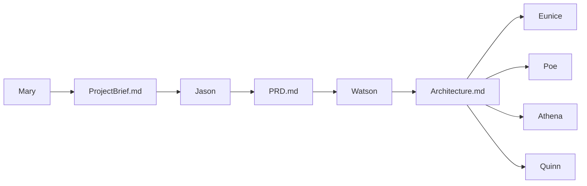

# AGENTS — My Golf Diary

**My Golf Diary** is a local-first **Flutter** app under [`golf_diary_app/`](golf_diary_app/). Planning and constraints live in **`docs/context/`** (three canonical files). Cohort personas under [`cohorts/`](cohorts/) are long-form prompts: **@** them in Cursor and follow their Pre-Work / Commands.

## Canonical docs

| Doc | Owner | Purpose |
| :--- | :--- | :--- |
| [docs/context/ProjectBrief.md](docs/context/ProjectBrief.md) | Mary | Problem, personas, scope, risks |
| [docs/context/PRD.md](docs/context/PRD.md) | Jason | Features, module prefixes, NFRs, journeys |
| [docs/context/Architecture.md](docs/context/Architecture.md) | Watson | Stack, folder map, data/sync, **constraints** (no separate CONSTRAINTS.md) |
| [docs/context/PH_Golf_Venues.md](docs/context/PH_Golf_Venues.md) | Reference | Philippines golf courses, hole-by-hole par (H1–H18), driving ranges & simulator shops |
| [docs/context/PH_Golf_Course_Hole_Coordinates.md](docs/context/PH_Golf_Course_Hole_Coordinates.md) | Reference | Surveyed Tee and Green/Pin GPS coordinates for Philippine golf holes |

## Roster

| Persona | Cohort file | Primary outputs / touches | When to @ |
| :--- | :--- | :--- | :--- |
| Mary (Analyst) | [cohorts/mary.agent.md](cohorts/mary.agent.md) | `docs/context/ProjectBrief.md`, validation | Brainstorming strategy, v1 scope, risks |
| Jason (PM) | [cohorts/jason.agent.md](cohorts/jason.agent.md) | `docs/context/PRD.md`, optional `docs/stories/` | Requirements, modules, user journeys |
| Watson (Architect) | [cohorts/watson.agent.md](cohorts/watson.agent.md) | `docs/context/Architecture.md`, diagrams | Stack, data model, constraints, technical feasibility |
| Eunice (UI/UX) | [cohorts/eunice.agent.md](cohorts/eunice.agent.md) | `docs/context/UI_UX_Design_Guide.md`, `docs/context/designs/` | Theme, wireframes, flows, Flutter `Key` maps |
| Poe (PO) | [cohorts/poe.agent.md](cohorts/poe.agent.md) | `docs/shards/`, `docs/context/BACKLOG.md` | Shard backlog, alignment PRD ↔ Architecture |
| Athena (Dev) | [cohorts/athena.agent.md](cohorts/athena.agent.md) | `golf_diary_app/` implementation, branches, optional `gh` | Implement shards / features, analyze & test |
| Quinn (QA) | [cohorts/quinn.agent.md](cohorts/quinn.agent.md) | Test plans, audits, `flutter test` guidance | Quality gate, widget/integration strategy |

## Publish skills

Project skills under [`.cursor/skills/`](.cursor/skills/) for shipping the Flutter app:

| Skill | Use when |
| :--- | :--- |
| [`publish-pwa-github-pages`](.cursor/skills/publish-pwa-github-pages/SKILL.md) | Deploy the web PWA to GitHub Pages (`gh-pages`) |
| [`publish-github-release-pwa-apk`](.cursor/skills/publish-github-release-pwa-apk/SKILL.md) | Cut a GitHub Release with the PWA zip and/or Android APK |

Invoke with `/publish-pwa-github-pages` or `/publish-github-release-pwa-apk`, or ask in plain language to publish Pages / a release.

## How to use in Cursor

1. **@** the cohort file for the role you need (e.g. `@cohorts/watson.agent.md`).
2. Read prerequisites from **`docs/context/`** in order: ProjectBrief → PRD → Architecture (Architecture § Constraints for stack rules).
3. Optional: copy a **handoff** prompt from the cohort’s YAML frontmatter into a new message when switching personas.
4. For shipping the PWA or APK, use the **Publish skills** above.

## Doc flow

Mary → ProjectBrief → Jason → PRD → Watson → Architecture → Eunice / Poe → Athena → Quinn.

Diagram (same idea):

