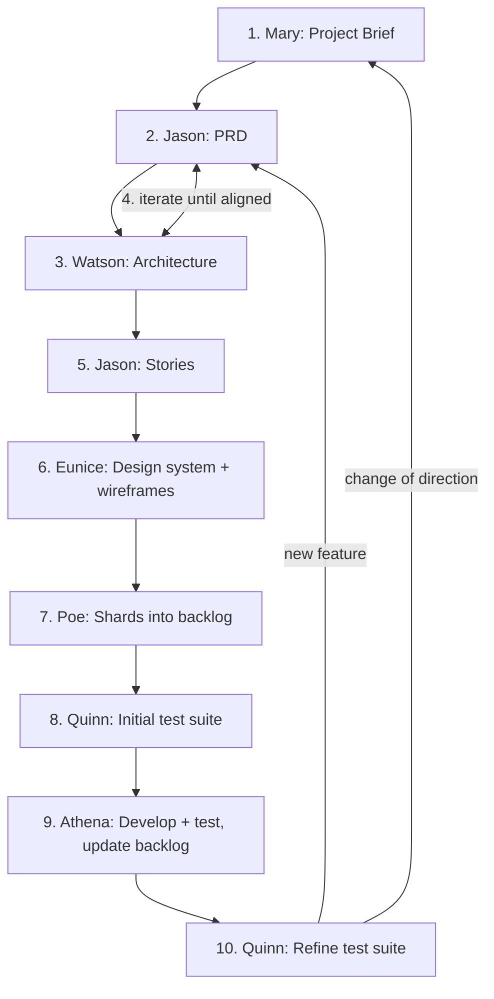

# CLAUDE.md — My Golf Diary

**My Golf Diary** is a local-first **Flutter** app under [`golf_diary_app/`](golf_diary_app/). Run `flutter pub get` and `flutter run` from that directory. Planning lives in [`docs/context/`](docs/context/); cohort personas live in [`cohorts/`](cohorts/).

This file is the single guide for agents (Claude, Cursor, or others). [`AGENTS.md`](AGENTS.md) points here.

---

## Canonical docs

| Doc | Owner | Purpose |
| :--- | :--- | :--- |
| [docs/context/ProjectBrief.md](docs/context/ProjectBrief.md) | Mary | Problem, personas, goals, scope, risks |
| [docs/context/PRD.md](docs/context/PRD.md) | Jason | Features, module prefixes, NFRs, journeys |
| `docs/stories/[PREFIX]/` (or stories inside PRD) | Jason | Development stories drawn from PRD features |
| [docs/context/Architecture.md](docs/context/Architecture.md) | Watson | Stack, folder map, data/sync, **§ Constraints & non-negotiables** (no separate `CONSTRAINTS.md`) |
| [docs/context/UI_UX_Design_Guide.md](docs/context/UI_UX_Design_Guide.md), [docs/context/designs/](docs/context/designs/) | Eunice | Design system (color, theme, UX principles) and wireframes with Flutter `Key` maps |
| [docs/shards/](docs/shards/), [docs/context/BACKLOG.md](docs/context/BACKLOG.md) | Poe | Task shards; backlog index and status |
| `golf_diary_app/test/`, `integration_test/` | Quinn | Test suite |
| `golf_diary_app/` | Athena | Implementation |
| [docs/context/Roadmap-V3.md](docs/context/Roadmap-V3.md) | Reference | V2 completion and V3 roadmap |

**Reference data:** [PH_Golf_Venues.md](docs/context/PH_Golf_Venues.md) (courses, pars, ranges, sim shops), [PH_Golf_Course_Hole_Coordinates.md](docs/context/PH_Golf_Course_Hole_Coordinates.md) (tee and green GPS), [Range_Drills.md](docs/context/Range_Drills.md) (seeded drills).

---

## Cohort roster

| Persona | Cohort file | Owns |
| :--- | :--- | :--- |
| Mary (Analyst) | [cohorts/mary.agent.md](cohorts/mary.agent.md) | Project Brief and overall goal |
| Jason (PM) | [cohorts/jason.agent.md](cohorts/jason.agent.md) | PRD and development stories |
| Watson (Architect) | [cohorts/watson.agent.md](cohorts/watson.agent.md) | Architecture and constraints |
| Eunice (UI/UX) | [cohorts/eunice.agent.md](cohorts/eunice.agent.md) | Design system and wireframes covering every story |
| Poe (PO) | [cohorts/poe.agent.md](cohorts/poe.agent.md) | Task shards and backlog |
| Quinn (QA) | [cohorts/quinn.agent.md](cohorts/quinn.agent.md) | Initial test suite, then refinement against real code |
| Athena (Dev) | [cohorts/athena.agent.md](cohorts/athena.agent.md) | Implementation, testing against the suite, backlog updates |

---

## Workflow

| Step | Persona | Input | Output |
| :--- | :--- | :--- | :--- |
| 1 | **Mary** | Discussion with the user | `ProjectBrief.md`: goal, audience, scope, risks |
| 2 | **Jason** | Project Brief | `PRD.md`: features, modules, journeys, NFRs |
| 3 | **Watson** | PRD + Brief | `Architecture.md` that delivers and supports the PRD |
| 4 | **Jason ↔ Watson** | PRD + Architecture | Both docs synced; no open conflicts. Repeat until aligned. |
| 5 | **Jason** | Aligned PRD + Architecture | Stories drawn from each feature and how it is intended to work, with acceptance criteria |
| 6 | **Eunice** | Stories + Architecture | (a) Design system: color scheme, theme, UI/UX principles. (b) Wireframes that cover **every story so far**, with `Key` maps. |
| 7 | **Poe** | Architecture + Stories + Wireframes | Shards under `docs/shards/[PREFIX]/`, indexed in `BACKLOG.md` |
| 8 | **Quinn** | Shards + Stories + Key maps | Initial test suite (`flutter test`; widget/unit; integration where valuable) |
| 9 | **Athena** (or any dev agent) | Shard + Architecture + Wireframes + test suite | Code in `golf_diary_app/`; passes the test suite, `flutter analyze` clean; **BACKLOG.md updated** when done |
| 10 | **Quinn** | Developed code | Refined and extended test suite based on the real implementation |

### Re-entry points

- **New feature:** start at **Jason** (step 2) and continue down the flow.
- **Change of direction:** start at **Mary** (step 1).
- **Implementation diverges from Architecture:** Athena raises it with **Watson**, who updates `Architecture.md`; Jason re-checks the PRD if scope changed.
- **Missing `Key`s for tests:** Quinn raises it with **Eunice**.

### Rules for every persona

1. Read prerequisites in order before working: ProjectBrief → PRD → Architecture (especially § Constraints), then the docs from earlier steps that feed your step.
2. Only edit the documents your persona owns. Flag gaps upstream instead of rewriting another persona's doc.
3. Keep traceability: Brief goal → PRD feature → story → wireframe `Key` → shard → test.
4. Use the handoff prompts in each cohort's YAML frontmatter when moving to the next step.

---

## How to use in Cursor or Claude

1. **@**-mention the cohort file for the step you are on (e.g. `@cohorts/watson.agent.md`).
2. Follow its Pre-work and Commands.
3. Copy the cohort's handoff prompt into a new turn and @ the next persona.

---

## Development rules

- **Stack constraints:** follow **§ Constraints & non-negotiables** in `Architecture.md`.
- **Verify:** `flutter analyze` and `flutter test` from `golf_diary_app/`. No Playwright; this is a Flutter app.
- **Knowledge graph:** a graphify graph lives in `graphify-out/`. Before exploring code, run `graphify query "<question>"`, `graphify path "<A>" "<B>"`, or `graphify explain "<concept>"`. After changing code, run `graphify update .`.

---

## Publish skills

| Skill | Use when |
| :--- | :--- |
| [`publish-pwa-github-pages`](.cursor/skills/publish-pwa-github-pages/SKILL.md) | Deploy the web PWA to GitHub Pages (`gh-pages`) |
| [`publish-github-release-pwa-apk`](.cursor/skills/publish-github-release-pwa-apk/SKILL.md) | Cut a GitHub Release with the PWA zip and/or Android APK |
