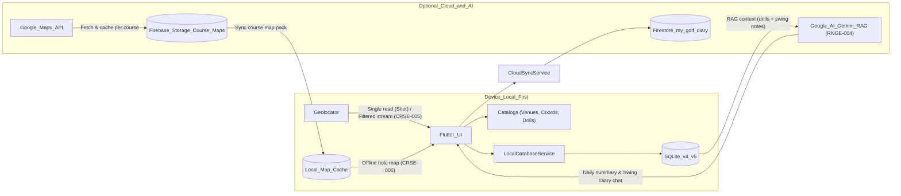
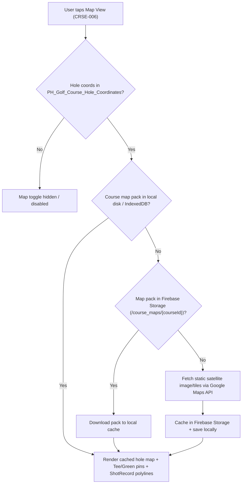
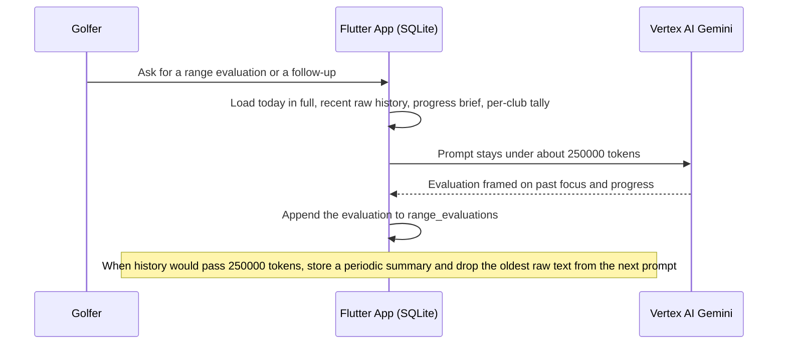

# Architecture — My Golf Diary

## Document Header

| Version | Status | Date | Owner |
| :--- | :--- | :--- | :--- |
| 1.4 | Active | 2026-11-09 | Watson (Architect cohort) |

**Inputs:** [`PRD.md`](./PRD.md) v1.3 · [`ProjectBrief.md`](./ProjectBrief.md) v1.0 · [`PH_Golf_Venues.md`](./PH_Golf_Venues.md) · [`PH_Golf_Course_Hole_Coordinates.md`](./PH_Golf_Course_Hole_Coordinates.md) · [`Range_Drills.md`](./Range_Drills.md).

---

## 1. System Overview

**My Golf Diary** is a **local-first** Flutter app under [`golf_diary_app/`](../../golf_diary_app/). The **system of record** is **SQLite** (`sqflite`). **On Course** uses **GPS** (`geolocator`): each **`ShotRecord`** stores ball position; segment distance is **Haversine** via `Geolocator.distanceBetween` (meters) converted to **yards** before save. When the selected course and hole have surveyed coordinates in [`PH_Golf_Course_Hole_Coordinates.md`](./PH_Golf_Course_Hole_Coordinates.md) and the HUD is in `Course` mode, a distance-filtered GPS stream computes live yards to the green (`CRSE-005`).

**Scoring** is **`round_scores`** (per hole), paired with **`golf_rounds`** metadata (DB v4). **Range** combines a seeded + user-editable **Practice Drills** catalog (`RNGE-003`, [`Range_Drills.md`](./Range_Drills.md)) with 10-ball block logging (`range_drills`). Optional **Firebase** syncs dirty rows with Firestore database **`my-golf-diary`** under **`users/{uid}/{table}/{docId}`**. Sync is pull-then-push, last-write-wins on `updatedAtMs`. Web SQLite (IndexedDB) uses the same path.

Future roadmap capabilities (`CRSE-006` cached hole map view and `RNGE-004` Vertex AI swing diary) layer onto this local-first core without breaking offline play.



---

## 2. Technology Stack

| Tool / library | Version / note | Purpose |
| :--- | :--- | :--- |
| Flutter / Dart | SDK `>=3.0.0 <4.0.0` | UI & logic |
| sqflite / sqflite_common_ffi / sqflite_common_ffi_web | `^2.3.0` / `^2.3.3` / `^1.0.0` | Local SQLite on mobile, desktop tests, and web PWA (IndexedDB) |
| path | `^1.9.0` | DB & local cache paths |
| geolocator | `^14.1.2` | Single-shot GPS capture, live distance-to-hole stream (`CRSE-005`), & `distanceBetween` |
| firebase_core | `^5.1.0` | Optional Firebase initialization |
| firebase_auth | `^7.0.1` | Anonymous Auth (`SyncIdentity`) |
| cloud_firestore | `^7.1.0` | Optional pull/push LWW sync on named DB `my-golf-diary` |
| provider | `^6.1.2` | State management where needed |
| google_fonts | `^9.0.0` | Playfair Display, Inter, Roboto Mono |
| *Planned (`CRSE-006`)* | `firebase_storage`, `google_maps_flutter` (or static tile renderer) | Course-level map caching in Firebase Storage & local offline map rendering |
| *Planned (`RNGE-004`)* | `firebase_ai` (`FirebaseAI.vertexAI()`) | Vertex AI Gemini for the swing diary. The project owner pays. No player API keys |

---

## 3. Repository & App Layout

```
golf_diary_app/lib/
├── main.dart                         # initializeFirebase, MaterialApp, HomeShell 4-tab nav
├── data/
│   ├── ph_golf_catalog.dart          # Course par cards, ranges, sims (from PH_Golf_Venues.md)
│   ├── ph_golf_hole_coords.dart      # Planned (CRSE-005/006): Tee & Green LatLon lookup
│   └── range_drills_catalog.dart     # Planned (RNGE-003): Seeded drills from Range_Drills.md
├── models/
│   ├── golf_models.dart              # Club, ShotRecord, RoundScore, RangeDrillLog (+ PracticeDrill)
│   └── round_summary.dart            # RoundSummary, RoundTotals
├── pwa/                              # Web build ID & service-worker update prompt
├── screens/                          # clubs, fairway_tracker, scorecard, scorecard_hole_editor, range_drill
├── services/
│   ├── local_database_service.dart   # SQLite v4 (v5 planned for practice_drills & AI diary)
│   ├── cloud_sync_service.dart       # Pull-then-push LWW Firestore sync
│   ├── diary_remote.dart             # Firestore adapter
│   ├── sync_identity.dart            # Firebase Anonymous Auth uid
│   └── sync_merge.dart               # LWW timestamp & tombstone merge helpers
├── widgets/
│   ├── venue_name_field.dart         # Shared course/range autocomplete
│   ├── range_session_log.dart        # Chronological range log & trend
│   ├── save_round_before_new_dialog.dart
│   └── sync_cloud_button.dart
└── theme/app_theme.dart

golf_diary_app/android/app/src/main/AndroidManifest.xml   # location permissions
golf_diary_app/ios/Runner/Info.plist                    # NSLocationWhenInUseUsageDescription
```

---

## 4. Module Breakdown (PRD prefixes)

| Prefix | UI & Widgets | Data & Persistence |
| :--- | :--- | :--- |
| `BAG` | `clubs_screen.dart` | `clubs` |
| `CRSE` | `fairway_tracker_screen.dart`, `venue_name_field.dart` | `shots`, `round_scores`, `golf_rounds`, `ph_golf_catalog.dart`, `ph_golf_hole_coords.dart` (`CRSE-005`), local map cache (`CRSE-006`) |
| `SCOR` | `scorecard_screen.dart`, `scorecard_hole_editor.dart`, `venue_name_field.dart` | `round_scores`, `golf_rounds`, `ph_golf_catalog.dart` |
| `RNGE` | `range_drill_screen.dart`, `range_session_log.dart`, drills sheet (`RNGE-003`), AI diary sheet (`RNGE-004`) | `range_drills` → updates `clubs`; `practice_drills` (`RNGE-003`); `swing_diary_messages` and `range_evaluations` (`RNGE-004`) |
| `SYNC` | `sync_cloud_button.dart` | `CloudSyncService` → Firestore (`my-golf-diary`) & Firebase Storage (`CRSE-006` map packs) |

---

## 5. Data Models & SQLite

**DB:** `golf_diary.db`, currently **version 4** (`LocalDatabaseService._initDB`), with **version 5** planned for `RNGE-003` custom/deleted practice drills (and later `CRSE-006` / `RNGE-004` tables).
- Version 2 added `clubs.brand`, `clubs.model`, and `range_drills.venue_name`.
- Version 3 added `updated_at_ms`, `deleted`, and `sync_state` for Firestore merge.
- Version 4 added `golf_rounds` to track round lifecycle (`started_at_ms`, `completed_at_ms`).
- **Planned Version 5 (`RNGE-003`):** adds `practice_drills` (seeded + user-created drills with tombstone support so users can delete seeded or custom drills) and optional `drill_id` reference on `range_drills`.

### Tables (current & planned)

- **`clubs`** — `id`, `name`, `category`, `brand`, `model`, `min_distance`, `max_distance`, `avg_distance` (yards), `swing_notes`, `is_synced`, `updated_at_ms`, `deleted`. Starter bag seeded on create.
- **`shots`** — `id`, `round_id`, `hole_number`, `stroke_number`, `club_id`, `lie_type`, `start_lat/lon`, `end_lat/lon` (set when next shot lands), `distance_yards`, `notes`, `timestamp`, `is_synced`, `updated_at_ms`, `deleted`.
- **`round_scores`** — `id`, `round_id`, `course_name`, `hole_number`, `par`, **`strokes`**, `penalties`, `mulligans`, `conceded`, **`final_score`**, `is_synced`, `updated_at_ms`, `deleted`.
- **`golf_rounds`** — `round_id`, `course_name`, `started_at_ms`, `completed_at_ms`, `is_synced`, `updated_at_ms`, `deleted`.
- **`range_drills`** — `id`, `club_id`, `shot_count`, `min_yards`, `max_yards`, `avg_yards`, `tempo_notes`, `venue_name`, `timestamp`, `is_synced`, `updated_at_ms`, `deleted`. *(Planned v5 column: `drill_id TEXT` nullable).*
- **`practice_drills` *(Planned v5 — `RNGE-003`)*** — `id TEXT PRIMARY KEY`, `title TEXT NOT NULL`, `category TEXT NOT NULL`, `short_description TEXT NOT NULL`, `steps_json TEXT NOT NULL` (JSON array of step strings), `recommended_clubs TEXT`, `is_custom INTEGER NOT NULL DEFAULT 0`, `is_synced INTEGER NOT NULL DEFAULT 0`, `updated_at_ms INTEGER NOT NULL DEFAULT 0`, `deleted INTEGER NOT NULL DEFAULT 0`.
  - *Seed & Delete Mechanics:* On DB upgrade/create, `practice_drills` seeds the 11 reference drills from [`Range_Drills.md`](./Range_Drills.md) using their stable IDs (`rng-drl-*`) with `ConflictAlgorithm.ignore`. When a user deletes any drill (seeded or custom), `deleted = 1` and `updated_at_ms = _nowMs()` are set. Queries filter `WHERE deleted = 0`, ensuring deleted seeded drills stay hidden across restarts and sync.

**Scoring helpers** (`golf_models.dart`): `computeFinalScore(strokes, penalties) = strokes + penalties` — **mulligans** stored but **not** in gross formula (display/practice).

### 5.1 Yards vs meters

- **Storage:** all distance columns are **yards**.
- **GPS math:** `distanceBetween` → meters → **`meters * 1.09361`** in `recordFairwayHit` and in `CRSE-005` live distance-to-hole.
- **v1:** no user-facing meters preference; adding one needs PRD + conversion layer.

### 5.2 Strokes vs shots (source of truth)

| Concept | Where | Meaning |
| :--- | :--- | :--- |
| **Shot** | `shots` | GPS-logged stroke on a hole (club, lie, positions). |
| **Strokes (scoring)** | `round_scores.strokes` | Used for **gross** with penalties. |

**Fairway path:** `recordFairwayHit` inserts a shot, then **`syncStrokeCountFromShots`** sets **`strokes = shots.length`** for that hole. So **recording a GPS shot overwrites** the hole’s stroke count with **shot count** (manual scorecard strokes can be replaced).

**Manual path:** `saveManualHoleScore` writes `strokes` directly; no auto-reconcile until another `syncStrokeCountFromShots` runs.

**HUD:** `strokes = holeScore?.strokes ?? shots.length`.

**Architectural stance:** `round_scores` is the **scorecard row**; `shots` is the **GPS audit**. Precedence for `strokes` after fairway capture is **syncStrokeCountFromShots** until product adds “manual lock” or merge rules.

### 5.3 RNGE → club (`saveRangeDrill`)

After inserting **`range_drills`**, updates **`clubs`** for `log.clubId`:

- **min:** if club min was 0 → use `log.minYards`; else `min(club.min, log.minYards)`
- **max:** `max(club.max, log.maxYards)`
- **avg:** if club avg was 0 → `log.avgYards`; else `(club.avg + log.avgYards) / 2` (pairwise blend—not a true running mean over all shots)
- **swing_notes:** replace with `log.tempoNotes` if non-empty
- mark `is_synced = 0`

Changing this math requires **Version History** + migration if schema changes.

### 5.4 Live GPS Distance to Hole (`CRSE-005`)

- **Coordinate Lookup (`ph_golf_hole_coords.dart`):** Encodes verified WGS84 6-decimal Tee and Green/Pin coordinates from [`PH_Golf_Course_Hole_Coordinates.md`](./PH_Golf_Course_Hole_Coordinates.md) keyed by canonical course name and `holeNumber` (1–18).
- **Gating Rule:** `hasHoleCoordinates(courseName, holeNumber)` is true **only** when On Course is in `Course` mode (`!_simulator`) and a verified `HoleCoordinates(teeLat, teeLon, greenLat, greenLon)` entry exists for that exact course and hole.
  - Full 18-hole mapped courses (16 layouts) enable the metric on holes 1–18.
  - Partial courses (e.g., Hallow Ridge H1–H4, H6–H9; Sherwood Hills mapped holes) enable the metric **only** on mapped holes and turn it off on unmapped holes.
  - Unmapped courses (centroid-only or custom names) keep the metric and stream completely off.
- **Stream Lifecycle & Battery:**
  - When gated **on**, `FairwayTrackerScreenState` subscribes to `Geolocator.getPositionStream(locationSettings: const LocationSettings(accuracy: LocationAccuracy.high, distanceFilter: 3))` (3-meter movement threshold) and performs an initial `getCurrentPosition` read so yardage appears immediately.
  - Remaining yardage is `((Geolocator.distanceBetween(pos.latitude, pos.longitude, greenLat, greenLon)) * 1.09361).round()`, rendered in `ValueKey('on-course-distance-to-hole')`.
  - The stream subscription is **cancelled immediately** on `dispose()`, when switching to `Simulator` mode, when changing to an unmapped course/hole, or when app lifecycle pauses.

### 5.5 On-Course Hole Map View & Cached Course Maps (`CRSE-006` — Future Architecture)



- **Eligibility:** Toggle (`ValueKey('on-course-map-toggle')`) is visible only when `hasHoleCoordinates(courseName, holeNumber)` is true.
- **Course Map Pack Format:** Each mapped course (`courseId`, e.g., `ph-crse-wack-wack-east`) has a pre-computed bounding box covering its holes (or per-hole bounding boxes derived from `teeLat/Lon` and `greenLat/Lon` padded by ~60 yards) plus zoom/projection metadata (`course_map_manifest.json` + high-DPI satellite WebP/PNG imagery).
- **Two-Tier Cache (Firebase Storage → Device):**
  1. **Cloud Cache (Firebase Storage):** Stored under `gs://<bucket>/course_maps/{courseId}/manifest.json` and `hole_{n}.webp` (or course-wide stitched tile pack). Populated once via a Cloud Function / admin script or first-client fetch using the Google Maps Static/Tile API so subsequent golfers download directly from Firebase Storage without hitting Google Maps API quotas.
  2. **Local Cache:** Stored on device under `<appDocDir>/course_maps/{courseId}/` (or Cache API / IndexedDB on web) and tracked in SQLite `course_map_cache(course_id, version, local_path, downloaded_at_ms)`.
- **Stroke Plotting Overlay:** Overlays a custom `CustomPainter` / marker layer transforming WGS84 `(lat, lon)` into the cached image's Mercator pixel coordinates:
  - Draws Tee box marker, Green/Pin flag, and a dashed centerline.
  - Plots each `ShotRecord` for the active hole (`start_lat/lon` → `end_lat/lon`) with club labels and yardage badges.
- **Offline Fallback:** If a golfer is on the course with no cellular data and the course pack was not pre-downloaded, the view still renders a clean 2D vector fairway schematic (scaled from Tee-to-Green coordinates and `ShotRecord` GPS points) without failing.

### 5.6 Vertex AI swing diary and range-evaluation log (`RNGE-004` — Future Architecture)

The diary comments on **today’s drills in the context of earlier practice**: what the player has been focusing on, and whether yardages and cues moved. The project owner pays Vertex AI on `novusinc-8df79` for this phase, aimed at **fewer than 1,000 people**. At about 1,000 people, stop and plan again (in-app charging or a tighter cap). Players do not paste their own Gemini keys.



**Who pays.** `FirebaseAI.vertexAI()` with App Check and the existing anonymous user. A Flash-class Gemini model. No `google_generative_ai` client and no API key in the binary. Vertex is billed only for tokens sent. The 250,000 figure is a ceiling, not the size of a new player’s prompt.

**What each call contains**, in order:

1. Fixed system role: comment from this golfer’s notes, in yards.
2. **Progress brief** — present only after a periodic summary exists. It states clubs and drills they returned to, cues they wrote, and how min / avg / max moved.
3. **Per-club tally** from SQLite, not from the model: session count, average this period versus the previous period, and the drill titles used most. Numbers stay exact after older notes are shortened.
4. **Recent history, still raw**, while the whole prompt is under the ceiling. This is how early accounts work: the real drill log is the history.
5. **Today, in full** — that day’s `range_drills`, drill steps, min / avg / max, and tempo notes. Today is never folded into the progress brief.
6. The latest chat turns only.

**250,000-token ceiling.** Count the prompt before the call. While it fits, send the raw history so the evaluation can see focus and progress directly. When the next call would pass about 250,000 tokens, compact the oldest material:

- Write a **periodic summary** row (the new progress brief) from SQLite plus the previous brief. Keep the comparison facts above.
- Leave a recent raw window (about a month of sessions, or the last several dozen logs) verbatim.
- Leave today in full.
- Later calls send the brief, the tally, the recent window, today, and the latest turns. Cost per message stays flat after the ceiling. It does not grow because the account is older.

**Readable log.** Every model evaluation and every periodic summary is stored for the player to read later. A navigation entry to that log is not part of this decision. The rows have to be enough to render it without calling Vertex again.

Planned SQLite table `range_evaluations`:

| Column | Purpose |
| :--- | :--- |
| `id` | Primary key |
| `kind` | `evaluation` or `periodic_summary` |
| `session_date` | `YYYY-MM-DD` the note is about |
| `content` | The text the player can read |
| `prompt_tokens` | Size of the prompt that produced it, when known |
| `covered_through_ms` | For a periodic summary, the newest drill timestamp folded into the brief |
| `referenced_drill_ids_json` | Drills cited |
| `referenced_club_ids_json` | Clubs cited |
| `timestamp` | When the row was written |
| `is_synced`, `updated_at_ms`, `deleted` | Same sync shape as other diary tables. Sync can wait |

`swing_diary_messages` still holds the chat turns (`user`, `model`). An `evaluation` row is the durable copy of a model reply the log shows. A `periodic_summary` row is the progress brief used in later prompts and shown in the same log, marked so a reader can tell a compaction note from a day’s evaluation.

Do not add an embedding index in this phase. A question about a specific older day loads that day’s `range_drills` by date and club and adds only those rows.

---

## 6. Sync & External Services

- **Init:** `initializeFirebase()` in `main.dart` / `cloud_sync_service.dart` uses [`firebase_options.dart`](../../golf_diary_app/lib/firebase_options.dart). Failure is soft; the app stays local-only.
- **Database:** named Firestore database `my-golf-diary` via `FirebaseFirestore.instanceFor(databaseId: ...)`. Do not write the `(default)` database.
- **Identity:** Firebase **Anonymous Auth**. `SyncIdentity.ensureSignedIn()` supplies `users/{uid}`. Enable Anonymous sign-in in the Firebase console before the first sync.
- **Client config:** `firebase_options.dart` holds the public web client config (API key is not a server secret). Re-run `flutterfire configure` when Android or iOS apps are registered.

**CloudSyncService.syncFull**

1. **Pull** every doc in `users/{uid}/{table}` for `clubs`, `shots`, `round_scores`, `range_drills`, `golf_rounds` (and `practice_drills` once DB v5 lands).
2. **Last-write-wins:** remote `updatedAtMs` newer than local `updated_at_ms` replaces the row (`is_synced = 1`). A remote `deleted: true` tombstone removes the local row (or marks seeded `practice_drills` hidden with `deleted = 1`). An equal or older remote leaves the local row.
3. **Push** rows with `is_synced = 0`. A failed write stays dirty. A pushed tombstone is then removed locally (except seeded `practice_drills` rows, which retain `deleted = 1` locally so the seed is not re-inserted on next launch); the cloud doc stays so other devices can see the delete.

Club delete is a tombstone (`deleted = 1`), not an immediate local `DELETE`, so the next sync can tell other devices.

### Firestore security rules

Rules live in [`firestore.rules`](../../firestore.rules) and [`firebase.json`](../../firebase.json) targets database `my-golf-diary`. Deploy them on that database, not `(default)`:

```bash
firebase deploy --only firestore:my-golf-diary
```

```
rules_version = '2';
service cloud.firestore {
  match /databases/{database}/documents {
    match /users/{userId}/{subcollection}/{docId} {
      allow read, write: if request.auth != null && request.auth.uid == userId;
    }
  }
}
```

**Do not** ship `allow read, write: if true` on user paths. Rows previously stored under `users/local_user` are not migrated.

---

## 7. Security & Privacy

- SQLite at rest = OS defaults; no app-level encryption in v1.
- `firebase_options.dart` is public client config. Do not commit server credentials, Google Maps private signing keys, or Google AI (Gemini) API keys in repository source.
- Sync exposes data to cloud—deploy the named-database rules and turn on Anonymous Auth before production use.
- **Firebase Storage (`CRSE-006`):** Shared course map packs under `/course_maps/{courseId}/**` allow authenticated read (`request.auth != null`) and restrict writes to authenticated cache builders / admin functions.
- **Vertex AI (`RNGE-004`):** `FirebaseAI.vertexAI()` on this Firebase project. The owner pays while the diary stays under about 1,000 people. Players do not supply Gemini keys. No model key in the client.

---

## 8. Performance, Platform & Testing

- **GPS:**
  - **Shot capture (`CRSE-002`):** single `getCurrentPosition` per “Record Shot”.
  - **Live distance to hole (`CRSE-005`):** distance-filtered position stream (`distanceFilter: 3` meters) active **only** while `FairwayTrackerScreen` is mounted, in `Course` mode, and on a hole with verified coordinates in [`PH_Golf_Course_Hole_Coordinates.md`](./PH_Golf_Course_Hole_Coordinates.md). Immediately cancelled when off-screen, in `Simulator` mode, or on an unmapped course/hole.
- **DB:** currently version 4 (`golf_rounds`), upgrading to version 5 when `practice_drills` (`RNGE-003`) is implemented.

**Android** — `AndroidManifest.xml`: `ACCESS_FINE_LOCATION`, `ACCESS_COARSE_LOCATION`.

**iOS** — `Info.plist`:

```xml
<key>NSLocationWhenInUseUsageDescription</key>
<string>Golf Diary uses your location to measure shot distances on the course.</string>
```

Background location **not** required for current flows.

**Testing:** `flutter test`; inject fakes/streams for DB and GPS where possible; verify `CRSE-005` visibility gating (shown on mapped hole in Course mode, hidden in Simulator mode or unmapped course) and `RNGE-003` drill seeding, custom creation, and deletion; `ValueKey` for interactive widgets (Eunice).

---

## 9. Constraints & non-negotiables

1. **Stack:** Flutter/Dart under `golf_diary_app/lib/`.
2. **Local-first:** works offline without Firebase or AI connectivity.
3. **Units:** Yards in persistence and HUD distance-to-hole (`meters * 1.09361`); document metric UX in PRD before changing.
4. **Live GPS Gating (`CRSE-005` & `CRSE-006`):** Never fabricate hole coordinates. Turn off the distance-to-hole readout and map toggle whenever a course or hole lacks verified Tee and Green coordinates or when `Simulator` mode is selected.
5. **Strokes vs shots:** any change to `syncStrokeCountFromShots` updates §5.2 + PRD.
6. **RNGE blend:** changes require Version History + migration if schema changes.
7. **Seeded vs Custom Drills (`RNGE-003`):** deleting a seeded drill must persist via tombstone/flag (`deleted = 1`) so it does not reappear on app restart.
8. **Firestore & Secrets:** no wide-open production rules on user data; no raw Google Maps or Gemini API keys committed to git. Swing-diary calls use Vertex AI billed to the project. Do not add a player-supplied API key.
9. **Diary prompt (`RNGE-004`):** send raw drill history while the prompt is under about 250,000 tokens. Past that, persist a periodic summary and keep today plus a recent raw window. Store every evaluation and periodic summary for a later read-only log.
10. **Theme/keys:** `app_theme.dart`; wireframe Keys per `cohorts/eunice.agent.md` (`on-course-distance-to-hole`, `on-course-map-toggle`, `range-header-drills-btn`).
11. **Dependencies:** justify in Version History when adding packages.

---

## Version History (architecture)

| Version | Date | Author | Summary |
| :--- | :--- | :--- | :--- |
| 0.1 | — | — | Stub |
| 1.0 | 2026-11-06 | Watson | Full tech spec: strokes vs shots, yards, RNGE→club, Firestore rules, iOS plist |
| 1.1 | 2026-11-07 | Watson | Named Firestore `my-golf-diary`, anonymous auth, pull-then-push LWW, tombstones |
| 1.2 | 2026-11-09 | Watson | Align with PRD v1.3: DB v4 (`golf_rounds`) + planned v5 (`practice_drills`), venue catalog, `CRSE-005` gated live GPS distance-to-hole stream, `CRSE-006` Google Maps → Firebase Storage → local offline map cache, `RNGE-003` seeded/custom drill persistence, and `RNGE-004` Google AI (Gemini) RAG Golf Swing Diary architecture |
| 1.3 | 2026-11-09 | Watson | RNGE-004 uses Vertex AI billed to the project under about 1,000 people. Prompts send raw drill history up to about 250,000 tokens, then a stored periodic summary plus a recent window, with today always in full. Evaluations and periodic summaries are kept in `range_evaluations` for a later reader log |
| 1.4 | 2026-11-09 | Watson | §1 names the swing diary as Vertex AI so it matches PRD 1.4. No change to the §5.6 design |
