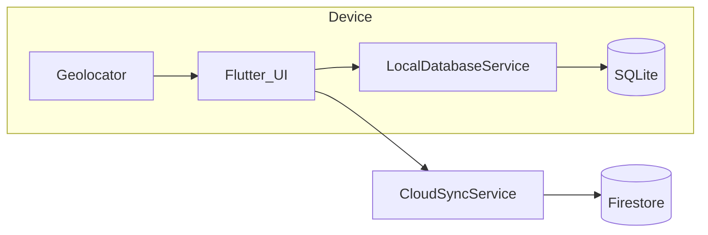

# Architecture — My Golf Diary

## Document Header

| Version | Status | Date | Owner |
| :--- | :--- | :--- | :--- |
| 1.0 | Active | 2026-11-06 | Watson (Architect cohort) |

**Inputs:** [`PRD.md`](./PRD.md) v1.0 · [`ProjectBrief.md`](./ProjectBrief.md) v1.0.

---

## 1. System Overview

**My Golf Diary** is a **local-first** Flutter app under [`golf_diary_app/`](../../golf_diary_app/). The **system of record** is **SQLite** (`sqflite`). **On Course** uses **GPS** (`geolocator`): each **`ShotRecord`** stores ball position; segment distance is **Haversine** via `Geolocator.distanceBetween` (meters) converted to **yards** before save.

**Scoring** is **`round_scores`** (per hole). Optional **Firebase** syncs dirty rows with Firestore database **`my-golf-diary`** under **`users/{uid}/{table}/{docId}`**. Sync is pull-then-push, last-write-wins on `updatedAtMs`. Web SQLite (IndexedDB) uses the same path.



---

## 2. Technology Stack

| Tool / library | Version / note | Purpose |
| :--- | :--- | :--- |
| Flutter / Dart | SDK `>=3.0.0 <4.0.0` | UI & logic |
| sqflite | ^2.3.0 | SQLite |
| path | ^1.9.0 | DB paths |
| geolocator | ^11.0.0 | GPS + distanceBetween |
| firebase_core | ^2.30.0 | Optional init |
| cloud_firestore | ^4.17.0 | Optional sync |
| provider | ^6.1.2 | State |

---

## 3. Repository & App Layout

```
golf_diary_app/lib/
├── main.dart                 # initializeFirebase, MaterialApp, tab shell
├── screens/                  # clubs, fairway_tracker, scorecard, range_drill, hole editor
├── services/
│   ├── local_database_service.dart
│   └── cloud_sync_service.dart
├── models/golf_models.dart   # Club, ShotRecord, RoundScore, RangeDrillLog
└── theme/app_theme.dart

golf_diary_app/android/app/src/main/AndroidManifest.xml   # location permissions
golf_diary_app/ios/Runner/Info.plist                    # NSLocationWhenInUseUsageDescription
```

---

## 4. Module Breakdown (PRD prefixes)

| Prefix | UI | Persistence |
| :--- | :--- | :--- |
| `BAG` | `clubs_screen.dart` | `clubs` |
| `CRSE` | `fairway_tracker_screen.dart` | `shots`, `round_scores` |
| `SCOR` | `scorecard_screen.dart`, `scorecard_hole_editor.dart` | `round_scores` |
| `RNGE` | `range_drill_screen.dart` | `range_drills` → updates `clubs` |
| `SYNC` | Fairway sync button | `CloudSyncService` → Firestore |

---

## 5. Data Models & SQLite

**DB:** `golf_diary.db`, **version 3** (`LocalDatabaseService._initDB`). Version 3 adds `updated_at_ms`, `deleted`, and `sync_state` for Firestore merge.

### Tables (summary)

- **`clubs`** — `id`, `name`, `category`, `min_distance`, `max_distance`, `avg_distance` (yards), `swing_notes`, `is_synced`. Starter bag seeded on create.
- **`shots`** — `round_id`, `hole_number`, `stroke_number`, `club_id`, `lie_type`, `start_lat/lon`, `end_lat/lon` (set when next shot lands), `distance_yards`, `notes`, `timestamp`, `is_synced`.
- **`round_scores`** — `round_id`, `course_name`, `hole_number`, `par`, **`strokes`**, `penalties`, `mulligans`, `conceded`, **`final_score`**, `is_synced`.
- **`range_drills`** — `club_id`, `shot_count`, `min_yards`, `max_yards`, `avg_yards`, `tempo_notes`, `timestamp`, `is_synced`.

**Scoring helpers** (`golf_models.dart`): `computeFinalScore(strokes, penalties) = strokes + penalties` — **mulligans** stored but **not** in gross formula (display/practice).

### 5.1 Yards vs meters

- **Storage:** all distance columns are **yards**.
- **GPS math:** `distanceBetween` → meters → **`meters * 1.09361`** in `recordFairwayHit`.
- **v1:** no user-facing meters preference; adding one needs PRD + conversion layer.

### 5.2 Strokes vs shots (source of truth)

| Concept | Where | Meaning |
| :--- | :--- | :--- |
| **Shot** | `shots` | GPS-logged stroke on a hole (club, lie, positions). |
| **Strokes (scoring)** | `round_scores.strokes` | Used for **gross** with penalties. |

**Fairway path:** `recordFairwayHit` inserts a shot, then **`syncStrokeCountFromShots`** sets **`strokes = shots.length`** for that hole. So **recording a GPS shot overwrites** the hole’s stroke count with **shot count** (manual scorecard strokes can be replaced).

**Manual path:** `saveManualHoleScore` writes `strokes` directly; no auto-reconcile until another `syncStrokeCountFromShots` runs.

**HUD:** `strokes = holeScore?.strokes ?? shots.length`.

**Architectural stance:** `round_scores` is the **scorecard row**; `shots` is the **GPS audit**. Precedence for `strokes` after fairway capture is **syncStrokeCountFromShots** until product adds “manual lock” or merge rules.

### 5.3 RNGE → club (`saveRangeDrill`)

After inserting **`range_drills`**, updates **`clubs`** for `log.clubId`:

- **min:** if club min was 0 → use `log.minYards`; else `min(club.min, log.minYards)`
- **max:** `max(club.max, log.maxYards)`
- **avg:** if club avg was 0 → `log.avgYards`; else `(club.avg + log.avgYards) / 2` (pairwise blend—not a true running mean over all shots)
- **swing_notes:** replace with `log.tempoNotes` if non-empty
- mark `is_synced = 0`

Changing this math requires **Version History** + migration if schema changes.

---

## 6. Sync & External Services

- **Init:** `initializeFirebase()` in `main.dart` / `cloud_sync_service.dart` uses [`firebase_options.dart`](../../golf_diary_app/lib/firebase_options.dart). Failure is soft; the app stays local-only.
- **Database:** named Firestore database `my-golf-diary` via `FirebaseFirestore.instanceFor(databaseId: ...)`. Do not write the `(default)` database.
- **Identity:** Firebase **Anonymous Auth**. `SyncIdentity.ensureSignedIn()` supplies `users/{uid}`. Enable Anonymous sign-in in the Firebase console before the first sync.
- **Client config:** `firebase_options.dart` holds the public web client config (API key is not a server secret). Re-run `flutterfire configure` when Android or iOS apps are registered.

**CloudSyncService.syncFull**

1. **Pull** every doc in `users/{uid}/{table}` for `clubs`, `shots`, `round_scores`, `range_drills`.
2. **Last-write-wins:** remote `updatedAtMs` newer than local `updated_at_ms` replaces the row (`is_synced = 1`). A remote `deleted: true` tombstone removes the local row. An equal or older remote leaves the local row.
3. **Push** rows with `is_synced = 0`. A failed write stays dirty. A pushed tombstone is then removed locally; the cloud doc stays so other devices can see the delete.

Club delete is a tombstone (`deleted = 1`), not an immediate local `DELETE`, so the next sync can tell other devices.

### Firestore security rules

Rules live in [`firestore.rules`](../../firestore.rules) and [`firebase.json`](../../firebase.json) targets database `my-golf-diary`. Deploy them on that database, not `(default)`:

```bash
firebase deploy --only firestore:my-golf-diary
```

```
rules_version = '2';
service cloud.firestore {
  match /databases/{database}/documents {
    match /users/{userId}/{subcollection}/{docId} {
      allow read, write: if request.auth != null && request.auth.uid == userId;
    }
  }
}
```

**Do not** ship `allow read, write: if true` on user paths. Rows previously stored under `users/local_user` are not migrated.

---

## 7. Security & Privacy

- SQLite at rest = OS defaults; no app-level encryption in v1.
- `firebase_options.dart` is public client config. Do not commit server credentials or service-account JSON.
- Sync exposes data to cloud—deploy the named-database rules and turn on Anonymous Auth before production use.

---

## 8. Performance, Platform & Testing

- **GPS:** one `getCurrentPosition` per “Record Shot”—no streaming loop.
- **DB:** version 3. `onUpgrade` adds v2 club brand/model and range venue, then v3 sync columns.

**Android** — `AndroidManifest.xml`: `ACCESS_FINE_LOCATION`, `ACCESS_COARSE_LOCATION`.

**iOS** — `Info.plist`:

```xml
<key>NSLocationWhenInUseUsageDescription</key>
<string>Golf Diary uses your location to measure shot distances on the course.</string>
```

Background location **not** required for current flows.

**Testing:** `flutter test`; inject fakes for DB/GPS where possible; `ValueKey` for interactive widgets (Eunice).

---

## 9. Constraints & non-negotiables

1. **Stack:** Flutter/Dart under `golf_diary_app/lib/`.
2. **Local-first:** works without Firebase.
3. **Units:** Yards in persistence; document metric UX in PRD before changing.
4. **Strokes vs shots:** any change to `syncStrokeCountFromShots` updates §5.2 + PRD.
5. **RNGE blend:** changes require Version History + migration if schema changes.
6. **Firestore:** no wide-open production rules on user data.
7. **Theme/keys:** `app_theme.dart`; wireframe Keys per `cohorts/eunice.agent.md`.
8. **Dependencies:** justify in Version History when adding packages.

---

## Version History (architecture)

| Version | Date | Author | Summary |
| :--- | :--- | :--- | :--- |
| 0.1 | — | — | Stub |
| 1.0 | 2026-11-06 | Watson | Full tech spec: strokes vs shots, yards, RNGE→club, Firestore rules, iOS plist |
| 1.1 | 2026-11-07 | Watson | Named Firestore `my-golf-diary`, anonymous auth, pull-then-push LWW, tombstones |
