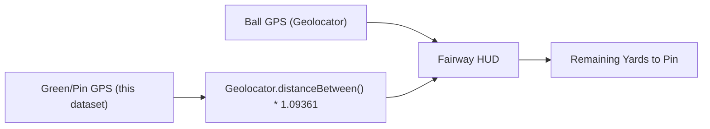

# Philippine Golf Courses — Hole-by-Hole GPS Coordinates

| Field | Value |
| :--- | :--- |
| **Product** | My Golf Diary |
| **Document** | Reference / Dataset — Philippine Golf Course Hole & Green Coordinates |
| **Source & License** | © OpenStreetMap contributors ([ODbL 1.0](https://opendatacommons.org/licenses/odbl/1-0/)) |
| **Companion Doc** | [`docs/context/PH_Golf_Venues.md`](./PH_Golf_Venues.md) |
| **Purpose** | High-precision Tee box and Green/Pin GPS coordinates for on-course HUD remaining distance calculations and hole mapping |
| **Status** | Active |

---

## 1. Overview & Data Architecture

This document compiles verified **Hole-by-Hole GPS Coordinates** (Tee box and Green/Pin `lat, lon`) for Philippine golf courses where detailed hole paths (`golf=hole`), greens (`golf=green`), or pins (`golf=pin`) have been surveyed in OpenStreetMap.

### Integration in My Golf Diary
- **On Course Fairway HUD (`fairway_tracker_screen.dart`)**: When a golfer is at their ball position, the app compares `currentLat, currentLon` against `green_lat, green_lon` using `Geolocator.distanceBetween` to display **yards to center of green / pin**.
- **Tee Box Verification**: When starting a hole, proximity to `tee_lat, tee_lon` confirms the active hole automatically.
- **Hole Par Pre-population**: Each hole entry binds the official par from [`PH_Golf_Venues.md`](./PH_Golf_Venues.md).



---

## 2. Fully Mapped 18-Hole Championship Courses

### Wack Wack Golf & Country Club — East Course
- **Course ID**: `ph-crse-wack-wack-east`
- **Location**: Mandaluyong, Metro Manila
- **Layout**: 18 holes mapped (Par 72)

| Hole | Par | Tee Latitude | Tee Longitude | Green/Pin Latitude | Green/Pin Longitude | Note |
| :---: | :---: | :---: | :---: | :---: | :---: | :--- |
| **Hole 1** | 4 | `14.589451` | `121.049660` | `14.588319` | `121.052971` | OSM mapped |
| **Hole 2** | 4 | `14.587979` | `121.053200` | `14.590107` | `121.055491` | OSM mapped |
| **Hole 3** | 4 | `14.590438` | `121.055823` | `14.592002` | `121.053279` | OSM mapped |
| **Hole 4** | 4 | `14.592370` | `121.053226` | `14.594811` | `121.054393` | OSM mapped |
| **Hole 5** | 5 | `14.595755` | `121.054417` | `14.598249` | `121.050448` | OSM mapped |
| **Hole 6** | 4 | `14.597715` | `121.050656` | `14.595273` | `121.053508` | OSM mapped |
| **Hole 7** | 4 | `14.595482` | `121.054504` | `14.593058` | `121.053177` | OSM mapped |
| **Hole 8** | 3 | `14.593337` | `121.052949` | `14.591811` | `121.052829` | OSM mapped |
| **Hole 9** | 4 | `14.591513` | `121.053207` | `14.589630` | `121.050164` | OSM mapped |
| **Hole 10** | 4 | `14.589831` | `121.049859` | `14.591936` | `121.052458` | OSM mapped |
| **Hole 11** | 4 | `14.592163` | `121.052269` | `14.594886` | `121.052198` | OSM mapped |
| **Hole 12** | 4 | `14.594715` | `121.053381` | `14.597290` | `121.050506` | OSM mapped |
| **Hole 13** | 5 | `14.597372` | `121.049641` | `14.593954` | `121.052223` | OSM mapped |
| **Hole 14** | 4 | `14.593160` | `121.052223` | `14.596098` | `121.049813` | OSM mapped |
| **Hole 15** | 4 | `14.596057` | `121.049324` | `14.593308` | `121.050721` | OSM mapped |
| **Hole 16** | 3 | `14.594012` | `121.050763` | `14.592782` | `121.051949` | OSM mapped |
| **Hole 17** | 4 | `14.591549` | `121.051392` | `14.594332` | `121.049323` | OSM mapped |
| **Hole 18** | 4 | `14.593452` | `121.049358` | `14.589872` | `121.049520` | OSM mapped |

### Wack Wack Golf & Country Club — West Course
- **Course ID**: `ph-crse-wack-wack-west`
- **Location**: Mandaluyong, Metro Manila
- **Layout**: 18 holes mapped (Par 72)

| Hole | Par | Tee Latitude | Tee Longitude | Green/Pin Latitude | Green/Pin Longitude | Note |
| :---: | :---: | :---: | :---: | :---: | :---: | :--- |
| **Hole 1** | 4 | `14.589329` | `121.048526` | `14.591966` | `121.046257` | OSM mapped |
| **Hole 2** | 4 | `14.592136` | `121.045749` | `14.594536` | `121.047650` | OSM mapped |
| **Hole 3** | 3 | `14.593579` | `121.047411` | `14.591852` | `121.047431` | OSM mapped |
| **Hole 4** | 5 | `14.591439` | `121.047881` | `14.595612` | `121.048412` | OSM mapped |
| **Hole 5** | 4 | `14.595598` | `121.047887` | `14.592935` | `121.045574` | OSM mapped |
| **Hole 6** | 4 | `14.593252` | `121.044801` | `14.595458` | `121.046673` | OSM mapped |
| **Hole 7** | 5 | `14.596274` | `121.046747` | `14.593462` | `121.044036` | OSM mapped |
| **Hole 8** | 3 | `14.593186` | `121.044803` | `14.592160` | `121.045349` | OSM mapped |
| **Hole 9** | 4 | `14.591912` | `121.045680` | `14.589659` | `121.048040` | OSM mapped |
| **Hole 10** | 5 | `14.588393` | `121.048242` | `14.591290` | `121.045947` | OSM mapped |
| **Hole 11** | 3 | `14.591657` | `121.045395` | `14.592907` | `121.044489` | OSM mapped |
| **Hole 12** | 4 | `14.593717` | `121.043637` | `14.595883` | `121.045825` | OSM mapped |
| **Hole 13** | 5 | `14.596213` | `121.046180` | `14.599057` | `121.049693` | OSM mapped |
| **Hole 14** | 3 | `14.598968` | `121.050114` | `14.597695` | `121.049885` | OSM mapped |
| **Hole 15** | 4 | `14.598055` | `121.049548` | `14.595731` | `121.046932` | OSM mapped |
| **Hole 16** | 4 | `14.595323` | `121.047047` | `14.597256` | `121.049233` | OSM mapped |
| **Hole 17** | 4 | `14.595924` | `121.048945` | `14.592628` | `121.048304` | OSM mapped |
| **Hole 18** | 4 | `14.592947` | `121.048704` | `14.589840` | `121.048784` | OSM mapped |

### Manila Golf and Country Club
- **Course ID**: `ph-crse-manila-golf`
- **Location**: Makati City, Metro Manila
- **Layout**: 18 holes mapped (Par 71)

| Hole | Par | Tee Latitude | Tee Longitude | Green/Pin Latitude | Green/Pin Longitude | Note |
| :---: | :---: | :---: | :---: | :---: | :---: | :--- |
| **Hole 1** | 4 | `14.549992` | `121.039469` | `14.547707` | `121.040977` | OSM mapped |
| **Hole 2** | 4 | `14.548020` | `121.041143` | `14.545337` | `121.043577` | OSM mapped |
| **Hole 3** | 3 | `14.545555` | `121.043974` | `14.546833` | `121.043242` | OSM mapped |
| **Hole 4** | 5 | `14.546021` | `121.043226` | `14.549241` | `121.040618` | OSM mapped |
| **Hole 5** | 4 | `14.549380` | `121.041291` | `14.547176` | `121.042976` | OSM mapped |
| **Hole 6** | 3 | `14.548350` | `121.042862` | `14.549389` | `121.042403` | OSM mapped |
| **Hole 7** | 5 | `14.549673` | `121.042969` | `14.545895` | `121.044390` | OSM mapped |
| **Hole 8** | 4 | `14.546015` | `121.044914` | `14.549269` | `121.043412` | OSM mapped |
| **Hole 9** | 4 | `14.550008` | `121.042864` | `14.550225` | `121.039801` | OSM mapped |
| **Hole 10** | 4 | `14.550584` | `121.039446` | `14.550435` | `121.042555` | OSM mapped |
| **Hole 11** | 3 | `14.550982` | `121.042744` | `14.549726` | `121.043340` | OSM mapped |
| **Hole 12** | 4 | `14.549214` | `121.043781` | `14.552180` | `121.042791` | OSM mapped |
| **Hole 13** | 4 | `14.552402` | `121.043130` | `14.554632` | `121.042065` | OSM mapped |
| **Hole 14** | 3 | `14.555004` | `121.042030` | `14.555541` | `121.040674` | OSM mapped |
| **Hole 15** | 5 | `14.555121` | `121.040774` | `14.551177` | `121.042243` | OSM mapped |
| **Hole 16** | 3 | `14.552434` | `121.041457` | `14.550898` | `121.041033` | OSM mapped |
| **Hole 17** | 4 | `14.550914` | `121.040368` | `14.554341` | `121.040794` | OSM mapped |
| **Hole 18** | 5 | `14.555013` | `121.040498` | `14.550912` | `121.039527` | OSM mapped |

### Villamor Golf Club
- **Course ID**: `ph-crse-villamor`
- **Location**: Pasay City, Metro Manila
- **Layout**: 18 holes mapped (Par 72)

| Hole | Par | Tee Latitude | Tee Longitude | Green/Pin Latitude | Green/Pin Longitude | Note |
| :---: | :---: | :---: | :---: | :---: | :---: | :--- |
| **Hole 1** | 4 | `14.525017` | `121.023699` | `14.527490` | `121.022171` | OSM mapped |
| **Hole 2** | 4 | `14.527685` | `121.021787` | `14.530034` | `121.018774` | OSM mapped |
| **Hole 3** | 3 | `14.529570` | `121.018477` | `14.526616` | `121.018922` | OSM mapped |
| **Hole 4** | 5 | `14.526093` | `121.019229` | `14.524673` | `121.019893` | OSM mapped |
| **Hole 5** | 4 | `14.524347` | `121.020471` | `14.523005` | `121.017501` | OSM mapped |
| **Hole 6** | 4 | `14.522291` | `121.018417` | `14.521355` | `121.020551` | OSM mapped |
| **Hole 7** | 3 | `14.521996` | `121.021346` | `14.523300` | `121.022482` | OSM mapped |
| **Hole 8** | 5 | `14.524171` | `121.021957` | `14.527820` | `121.019748` | OSM mapped |
| **Hole 9** | 4 | `14.527878` | `121.020350` | `14.524963` | `121.022204` | OSM mapped |
| **Hole 10** | 4 | `14.523174` | `121.022968` | `14.520601` | `121.020918` | OSM mapped |
| **Hole 11** | 5 | `14.520309` | `121.021347` | `14.522966` | `121.023533` | OSM mapped |
| **Hole 12** | 4 | `14.523568` | `121.022953` | `14.523307` | `121.024390` | OSM mapped |
| **Hole 13** | 3 | `14.523002` | `121.024406` | `14.519828` | `121.021558` | OSM mapped |
| **Hole 14** | 4 | `14.519883` | `121.021083` | `14.521902` | `121.018216` | OSM mapped |
| **Hole 15** | 4 | `14.522406` | `121.018359` | `14.523733` | `121.021023` | OSM mapped |
| **Hole 16** | 4 | `14.525000` | `121.020453` | `14.528263` | `121.018991` | OSM mapped |
| **Hole 17** | 3 | `14.529016` | `121.018889` | `14.528411` | `121.019883` | OSM mapped |
| **Hole 18** | 5 | `14.528501` | `121.020622` | `14.525142` | `121.022927` | OSM mapped |

### Club Intramuros Golf Course
- **Course ID**: `ph-crse-club-intramuros`
- **Location**: Intramuros, Manila
- **Layout**: 18 holes mapped (Par 66)

| Hole | Par | Tee Latitude | Tee Longitude | Green/Pin Latitude | Green/Pin Longitude | Note |
| :---: | :---: | :---: | :---: | :---: | :---: | :--- |
| **Hole 1** | 3 | `14.592702` | `120.970609` | `14.591769` | `120.971433` | OSM mapped |
| **Hole 2** | 4 | `14.591023` | `120.971949` | `14.589130` | `120.972553` | OSM mapped |
| **Hole 3** | 3 | `14.588962` | `120.972831` | `14.588527` | `120.973423` | OSM mapped |
| **Hole 4** | 4 | `14.588193` | `120.973617` | `14.585862` | `120.975078` | OSM mapped |
| **Hole 5** | 4 | `14.584471` | `120.975598` | `14.585260` | `120.977814` | OSM mapped |
| **Hole 6** | 3 | `14.585943` | `120.978608` | `14.585802` | `120.979506` | OSM mapped |
| **Hole 7** | 5 | `14.586474` | `120.979791` | `14.589606` | `120.980256` | OSM mapped |
| **Hole 8** | 4 | `14.590577` | `120.980170` | `14.592177` | `120.979238` | OSM mapped |
| **Hole 9** | 4 | `14.591872` | `120.978790` | `14.589901` | `120.979511` | OSM mapped |
| **Hole 10** | 3 | `14.589656` | `120.979970` | `14.588304` | `120.979973` | OSM mapped |
| **Hole 11** | 4 | `14.588140` | `120.979456` | `14.586140` | `120.979309` | OSM mapped |
| **Hole 12** | 3 | `14.586470` | `120.979163` | `14.586332` | `120.978189` | OSM mapped |
| **Hole 13** | 4 | `14.585101` | `120.978182` | `14.584041` | `120.976013` | OSM mapped |
| **Hole 14** | 4 | `14.584624` | `120.975257` | `14.586207` | `120.974516` | OSM mapped |
| **Hole 15** | 4 | `14.586002` | `120.974313` | `14.587666` | `120.973452` | OSM mapped |
| **Hole 16** | 3 | `14.588299` | `120.972880` | `14.588852` | `120.972692` | OSM mapped |
| **Hole 17** | 4 | `14.588911` | `120.972476` | `14.590838` | `120.971637` | OSM mapped |
| **Hole 18** | 3 | `14.591638` | `120.971302` | `14.592460` | `120.970233` | OSM mapped |

### Camp Aguinaldo Golf Club
- **Course ID**: `ph-crse-camp-aguinaldo`
- **Location**: Quezon City, Metro Manila
- **Layout**: 18 holes mapped (Par 68)

| Hole | Par | Tee Latitude | Tee Longitude | Green/Pin Latitude | Green/Pin Longitude | Note |
| :---: | :---: | :---: | :---: | :---: | :---: | :--- |
| **Hole 1** | 4 | `14.605935` | `121.058264` | `14.608474` | `121.058593` | OSM mapped |
| **Hole 2** | 3 | `14.607999` | `121.058176` | `14.606957` | `121.058046` | OSM mapped |
| **Hole 3** | 5 | `14.605461` | `121.058894` | `14.609464` | `121.059321` | OSM mapped |
| **Hole 4** | 5 | `14.609514` | `121.060374` | `14.605299` | `121.059312` | OSM mapped |
| **Hole 5** | 4 | `14.605415` | `121.059832` | `14.607966` | `121.061337` | OSM mapped |
| **Hole 6** | 4 | `14.608019` | `121.061666` | `14.605413` | `121.060107` | OSM mapped |
| **Hole 7** | 4 | `14.604745` | `121.059150` | `14.603724` | `121.060341` | OSM mapped |
| **Hole 8** | 3 | `14.603425` | `121.060551` | `14.602444` | `121.059752` | OSM mapped |
| **Hole 9** | 4 | `14.601694` | `121.059612` | `14.604623` | `121.058798` | OSM mapped |
| **Hole 10** | 5 | `14.605417` | `121.059053` | `14.609427` | `121.060045` | OSM mapped |
| **Hole 11** | 3 | `14.609277` | `121.060624` | `14.610494` | `121.060896` | OSM mapped |
| **Hole 12** | 3 | `14.610447` | `121.061109` | `14.609295` | `121.061147` | OSM mapped |
| **Hole 13** | 3 | `14.609303` | `121.061683` | `14.610950` | `121.061498` | OSM mapped |
| **Hole 14** | 4 | `14.611659` | `121.059877` | `14.611130` | `121.057358` | OSM mapped |
| **Hole 15** | 3 | `14.610546` | `121.056835` | `14.610943` | `121.058228` | OSM mapped |
| **Hole 16** | 3 | `14.609597` | `121.057878` | `14.609401` | `121.056513` | OSM mapped |
| **Hole 17** | 3 | `14.609966` | `121.056322` | `14.610067` | `121.057642` | OSM mapped |
| **Hole 18** | 5 | `14.609501` | `121.058949` | `14.605699` | `121.058596` | OSM mapped |

### Veterans Golf Club
- **Course ID**: `ph-crse-veterans`
- **Location**: Quezon City, Metro Manila
- **Layout**: 18 holes mapped (Par 70)

| Hole | Par | Tee Latitude | Tee Longitude | Green/Pin Latitude | Green/Pin Longitude | Note |
| :---: | :---: | :---: | :---: | :---: | :---: | :--- |
| **Hole 1** | 4 | `14.658285` | `121.037306` | `14.656049` | `121.036413` | OSM mapped |
| **Hole 2** | 3 | `14.655627` | `121.037483` | `14.655575` | `121.036257` | OSM mapped |
| **Hole 3** | 3 | `14.654666` | `121.035787` | `14.654615` | `121.036982` | OSM mapped |
| **Hole 4** | 4 | `14.654495` | `121.037284` | `14.654099` | `121.039298` | OSM mapped |
| **Hole 5** | 5 | `14.654015` | `121.039743` | `14.653176` | `121.042890` | OSM mapped |
| **Hole 6** | 4 | `14.653477` | `121.042982` | `14.655603` | `121.042561` | OSM mapped |
| **Hole 7** | 4 | `14.656317` | `121.041972` | `14.658232` | `121.041542` | OSM mapped |
| **Hole 8** | 3 | `14.658669` | `121.039649` | `14.658836` | `121.038494` | OSM mapped |
| **Hole 9** | 4 | `14.658942` | `121.038139` | `14.656990` | `121.038101` | OSM mapped |
| **Hole 10** | 4 | `14.658265` | `121.037509` | `14.656401` | `121.037247` | OSM mapped |
| **Hole 11** | 4 | `14.656987` | `121.038368` | `14.658362` | `121.039707` | OSM mapped |
| **Hole 12** | 4 | `14.658752` | `121.041141` | `14.658291` | `121.043827` | OSM mapped |
| **Hole 13** | 3 | `14.657805` | `121.043988` | `14.658007` | `121.042825` | OSM mapped |
| **Hole 14** | 3 | `14.657680` | `121.042596` | `14.656147` | `121.042296` | OSM mapped |
| **Hole 15** | 5 | `14.657085` | `121.043642` | `14.653715` | `121.043101` | OSM mapped |
| **Hole 16** | 4 | `14.653394` | `121.042961` | `14.654218` | `121.040151` | OSM mapped |
| **Hole 17** | 5 | `14.654404` | `121.039333` | `14.655125` | `121.035965` | OSM mapped |
| **Hole 18** | 4 | `14.656520` | `121.036427` | `14.658790` | `121.037078` | OSM mapped |

### Philippine Navy Golf Club
- **Course ID**: `ph-crse-phil-navy`
- **Location**: Taguig City, Metro Manila
- **Layout**: 18 holes mapped (Par 70)

| Hole | Par | Tee Latitude | Tee Longitude | Green/Pin Latitude | Green/Pin Longitude | Note |
| :---: | :---: | :---: | :---: | :---: | :---: | :--- |
| **Hole 1** | 5 | `14.521627` | `121.031898` | `14.523502` | `121.035058` | 471 yds |
| **Hole 2** | 4 | `14.523860` | `121.034803` | `14.522438` | `121.031632` | 447 yds |
| **Hole 3** | 3 | `14.523027` | `121.031571` | `14.524483` | `121.031114` | 190 yds |
| **Hole 4** | 4 | `14.524742` | `121.031055` | `14.525088` | `121.033363` | 324 yds |
| **Hole 5** | 3 | `14.525293` | `121.033463` | `14.524734` | `121.034152` | 109 yds |
| **Hole 6** | 4 | `14.524493` | `121.034247` | `14.523399` | `121.031732` | 343 yds |
| **Hole 7** | 4 | `14.523051` | `121.031827` | `14.523940` | `121.033970` | 327 yds |
| **Hole 8** | 3 | `14.524269` | `121.033932` | `14.524071` | `121.035239` | 162 yds |
| **Hole 9** | 5 | `14.523741` | `121.035041` | `14.521711` | `121.031392` | 511 yds |
| **Hole 10** | 3 | `14.521135` | `121.032280` | `14.521645` | `121.033391` | 160 yds |
| **Hole 11** | 4 | `14.521807` | `121.033589` | `14.523334` | `121.035656` | 295 yds |
| **Hole 12** | 3 | `14.524453` | `121.035313` | `14.525503` | `121.034693` | 160 yds |
| **Hole 13** | 5 | `14.526514` | `121.034521` | `14.523168` | `121.036448` | 455 yds |
| **Hole 14** | 5 | `14.523075` | `121.036861` | `14.526887` | `121.035222` | 510 yds |
| **Hole 15** | 5 | `14.526829` | `121.035647` | `14.523785` | `121.037649` | 442 yds |
| **Hole 16** | 3 | `14.523450` | `121.038044` | `14.523046` | `121.037275` | 115 yds |
| **Hole 17** | 3 | `14.522877` | `121.036977` | `14.522465` | `121.035405` | 180 yds |
| **Hole 18** | 4 | `14.522254` | `121.035893` | `14.521034` | `121.033077` | 380 yds |

### Manila Southwoods — Masters Course
- **Course ID**: `ph-crse-southwoods-masters`
- **Location**: Carmona, Cavite
- **Layout**: 18 holes mapped (Par 72)

| Hole | Par | Tee Latitude | Tee Longitude | Green/Pin Latitude | Green/Pin Longitude | Note |
| :---: | :---: | :---: | :---: | :---: | :---: | :--- |
| **Hole 1** | 4 | `14.321124` | `121.044827` | `14.317970` | `121.045816` | OSM mapped |
| **Hole 2** | 4 | `14.317582` | `121.047042` | `14.319629` | `121.049978` | OSM mapped |
| **Hole 3** | 3 | `14.320064` | `121.050311` | `14.321331` | `121.051232` | OSM mapped |
| **Hole 4** | 5 | `14.321914` | `121.051218` | `14.323548` | `121.055210` | OSM mapped |
| **Hole 5** | 3 | `14.324326` | `121.054919` | `14.325075` | `121.053504` | OSM mapped |
| **Hole 6** | 4 | `14.325401` | `121.053745` | `14.323551` | `121.056197` | OSM mapped |
| **Hole 7** | 4 | `14.322696` | `121.055983` | `14.321803` | `121.052423` | OSM mapped |
| **Hole 8** | 5 | `14.321814` | `121.051011` | `14.318875` | `121.047387` | OSM mapped |
| **Hole 9** | 4 | `14.318091` | `121.046479` | `14.321057` | `121.045387` | OSM mapped |
| **Hole 10** | 4 | `14.321896` | `121.045695` | `14.322772` | `121.049153` | OSM mapped |
| **Hole 11** | 4 | `14.323127` | `121.050186` | `14.326005` | `121.051883` | OSM mapped |
| **Hole 12** | 4 | `14.326465` | `121.051475` | `14.323519` | `121.049821` | OSM mapped |
| **Hole 13** | 3 | `14.323847` | `121.049508` | `14.325663` | `121.050284` | OSM mapped |
| **Hole 14** | 4 | `14.326615` | `121.051049` | `14.327284` | `121.047515` | OSM mapped |
| **Hole 15** | 5 | `14.327482` | `121.046560` | `14.323749` | `121.048464` | OSM mapped |
| **Hole 16** | 4 | `14.322726` | `121.047793` | `14.324259` | `121.044411` | OSM mapped |
| **Hole 17** | 3 | `14.324511` | `121.044048` | `14.324526` | `121.042518` | OSM mapped |
| **Hole 18** | 5 | `14.323896` | `121.041766` | `14.322350` | `121.045804` | OSM mapped |

### Manila Southwoods — Legends Course
- **Course ID**: `ph-crse-southwoods-legends`
- **Location**: Carmona, Cavite
- **Layout**: 18 holes mapped (Par 72)

| Hole | Par | Tee Latitude | Tee Longitude | Green/Pin Latitude | Green/Pin Longitude | Note |
| :---: | :---: | :---: | :---: | :---: | :---: | :--- |
| **Hole 1** | 4 | `14.320494` | `121.042954` | `14.317235` | `121.043673` | OSM mapped |
| **Hole 2** | 4 | `14.316576` | `121.044733` | `14.314824` | `121.042058` | OSM mapped |
| **Hole 3** | 3 | `14.315265` | `121.041680` | `14.313707` | `121.041474` | OSM mapped |
| **Hole 4** | 4 | `14.313575` | `121.040183` | `14.312906` | `121.036841` | OSM mapped |
| **Hole 5** | 4 | `14.312186` | `121.036651` | `14.312701` | `121.040173` | OSM mapped |
| **Hole 6** | 5 | `14.313770` | `121.040619` | `14.318556` | `121.040008` | OSM mapped |
| **Hole 7** | 3 | `14.319051` | `121.039894` | `14.320501` | `121.039489` | OSM mapped |
| **Hole 8** | 5 | `14.321353` | `121.040305` | `14.317302` | `121.042440` | OSM mapped |
| **Hole 9** | 4 | `14.317249` | `121.043111` | `14.320425` | `121.042512` | OSM mapped |
| **Hole 10** | 4 | `14.323034` | `121.043577` | `14.322808` | `121.040146` | OSM mapped |
| **Hole 11** | 4 | `14.322762` | `121.039050` | `14.320581` | `121.036806` | OSM mapped |
| **Hole 12** | 3 | `14.320242` | `121.036460` | `14.321957` | `121.036535` | OSM mapped |
| **Hole 13** | 4 | `14.321881` | `121.037099` | `14.324848` | `121.037388` | OSM mapped |
| **Hole 14** | 5 | `14.325235` | `121.036778` | `14.321051` | `121.035955` | OSM mapped |
| **Hole 15** | 4 | `14.321726` | `121.035239` | `14.318666` | `121.036564` | OSM mapped |
| **Hole 16** | 3 | `14.318473` | `121.036018` | `14.317279` | `121.037032` | OSM mapped |
| **Hole 17** | 5 | `14.317842` | `121.037345` | `14.322024` | `121.039038` | OSM mapped |
| **Hole 18** | 4 | `14.322486` | `121.039824` | `14.322703` | `121.043428` | OSM mapped |

### Valley Golf & Country Club — South Course
- **Course ID**: `ph-crse-valley-south`
- **Location**: Antipolo, Rizal
- **Layout**: 18 holes mapped (Par 72)

| Hole | Par | Tee Latitude | Tee Longitude | Green/Pin Latitude | Green/Pin Longitude | Note |
| :---: | :---: | :---: | :---: | :---: | :---: | :--- |
| **Hole 1** | 4 | `14.603769` | `121.140628` | `14.600457` | `121.139925` | OSM mapped |
| **Hole 2** | 4 | `14.600927` | `121.139575` | `14.597515` | `121.138912` | OSM mapped |
| **Hole 3** | 4 | `14.597403` | `121.139282` | `14.595485` | `121.137243` | OSM mapped |
| **Hole 4** | 3 | `14.595923` | `121.137277` | `14.597444` | `121.137913` | OSM mapped |
| **Hole 5** | 5 | `14.597385` | `121.137293` | `14.601656` | `121.137921` | OSM mapped |
| **Hole 6** | 4 | `14.601951` | `121.138591` | `14.598724` | `121.138094` | OSM mapped |
| **Hole 7** | 5 | `14.598519` | `121.138481` | `14.602114` | `121.139667` | OSM mapped |
| **Hole 8** | 3 | `14.602576` | `121.139636` | `14.602354` | `121.137785` | OSM mapped |
| **Hole 9** | 4 | `14.602720` | `121.137282` | `14.603635` | `121.140122` | OSM mapped |
| **Hole 10** | 4 | `14.603551` | `121.142022` | `14.601031` | `121.142560` | OSM mapped |
| **Hole 11** | 5 | `14.600322` | `121.143402` | `14.596967` | `121.145282` | OSM mapped |
| **Hole 12** | 3 | `14.596686` | `121.144719` | `14.597476` | `121.143321` | OSM mapped |
| **Hole 13** | 4 | `14.597981` | `121.143192` | `14.597999` | `121.139683` | OSM mapped |
| **Hole 14** | 4 | `14.598787` | `121.139756` | `14.601891` | `121.140945` | OSM mapped |
| **Hole 15** | 4 | `14.602077` | `121.141358` | `14.599057` | `121.140409` | OSM mapped |
| **Hole 16** | 4 | `14.598581` | `121.140229` | `14.598400` | `121.143448` | OSM mapped |
| **Hole 17** | 5 | `14.598184` | `121.144542` | `14.601371` | `121.141692` | OSM mapped |
| **Hole 18** | 3 | `14.601809` | `121.141584` | `14.603506` | `121.141323` | OSM mapped |

### Valley Golf & Country Club — North Course
- **Course ID**: `ph-crse-valley-north`
- **Location**: Antipolo, Rizal
- **Layout**: 18 holes mapped (Par 72)

| Hole | Par | Tee Latitude | Tee Longitude | Green/Pin Latitude | Green/Pin Longitude | Note |
| :---: | :---: | :---: | :---: | :---: | :---: | :--- |
| **Hole 1** | 4 | `14.605196` | `121.140502` | `14.607876` | `121.140312` | OSM mapped |
| **Hole 2** | 4 | `14.607261` | `121.140825` | `14.609660` | `121.139876` | OSM mapped |
| **Hole 3** | 3 | `14.609900` | `121.140058` | `14.610441` | `121.141431` | OSM mapped |
| **Hole 4** | 4 | `14.610560` | `121.141667` | `14.612614` | `121.143232` | OSM mapped |
| **Hole 5** | 5 | `14.612238` | `121.143620` | `14.608497` | `121.142529` | OSM mapped |
| **Hole 6** | 3 | `14.608068` | `121.142569` | `14.606949` | `121.142005` | OSM mapped |
| **Hole 7** | 5 | `14.607212` | `121.141387` | `14.610493` | `121.142164` | OSM mapped |
| **Hole 8** | 3 | `14.610209` | `121.141735` | `14.609345` | `121.140952` | OSM mapped |
| **Hole 9** | 5 | `14.609635` | `121.141546` | `14.605971` | `121.140886` | OSM mapped |
| **Hole 10** | 5 | `14.604231` | `121.140156` | `14.606397` | `121.137646` | OSM mapped |
| **Hole 11** | 3 | `14.606854` | `121.137729` | `14.607402` | `121.136635` | OSM mapped |
| **Hole 12** | 3 | `14.606773` | `121.137118` | `14.605643` | `121.136828` | OSM mapped |
| **Hole 13** | 5 | `14.605545` | `121.136612` | `14.603915` | `121.139532` | OSM mapped |
| **Hole 14** | 4 | `14.604398` | `121.140274` | `14.606092` | `121.138694` | OSM mapped |
| **Hole 15** | 3 | `14.606309` | `121.138759` | `14.607396` | `121.138692` | OSM mapped |
| **Hole 16** | 5 | `14.607399` | `121.138418` | `14.610626` | `121.138445` | OSM mapped |
| **Hole 17** | 4 | `14.610325` | `121.139073` | `14.607797` | `121.139323` | OSM mapped |
| **Hole 18** | 4 | `14.607595` | `121.139008` | `14.605241` | `121.140146` | OSM mapped |

### Eagle Ridge G&CC — Nick Faldo Course
- **Course ID**: `ph-crse-eagle-ridge-faldo`
- **Location**: General Trias, Cavite
- **Layout**: 18 holes mapped (Par 72)

| Hole | Par | Tee Latitude | Tee Longitude | Green/Pin Latitude | Green/Pin Longitude | Note |
| :---: | :---: | :---: | :---: | :---: | :---: | :--- |
| **Hole 1** | 4 | `14.249943` | `120.907105` | `14.247415` | `120.906187` | OSM mapped |
| **Hole 2** | 5 | `14.246585` | `120.905721` | `14.242764` | `120.906426` | OSM mapped |
| **Hole 3** | 3 | `14.242429` | `120.904472` | `14.242935` | `120.903611` | OSM mapped |
| **Hole 4** | 5 | `14.241483` | `120.903808` | `14.239070` | `120.905573` | OSM mapped |
| **Hole 5** | 4 | `14.237195` | `120.905900` | `14.234567` | `120.905961` | OSM mapped |
| **Hole 6** | 3 | `14.235391` | `120.907278` | `14.236685` | `120.907465` | OSM mapped |
| **Hole 7** | 4 | `14.238717` | `120.907075` | `14.241364` | `120.906743` | OSM mapped |
| **Hole 8** | 4 | `14.243202` | `120.906919` | `14.245830` | `120.906337` | OSM mapped |
| **Hole 9** | 4 | `14.246752` | `120.906811` | `14.249705` | `120.907524` | OSM mapped |
| **Hole 10** | 4 | `14.249778` | `120.906582` | `14.247169` | `120.905288` | OSM mapped |
| **Hole 11** | 3 | `14.249126` | `120.904773` | `14.249940` | `120.904700` | OSM mapped |
| **Hole 12** | 5 | `14.248212` | `120.903792` | `14.244600` | `120.903509` | OSM mapped |
| **Hole 13** | 4 | `14.243975` | `120.902557` | `14.246080` | `120.901072` | OSM mapped |
| **Hole 14** | 5 | `14.246493` | `120.900579` | `14.250380` | `120.898896` | OSM mapped |
| **Hole 15** | 4 | `14.252977` | `120.900216` | `14.255292` | `120.899869` | OSM mapped |
| **Hole 16** | 4 | `14.254288` | `120.900517` | `14.251271` | `120.901661` | OSM mapped |
| **Hole 17** | 3 | `14.250783` | `120.902129` | `14.250570` | `120.903298` | OSM mapped |
| **Hole 18** | 4 | `14.250657` | `120.904962` | `14.250803` | `120.906481` | OSM mapped |

### Eagle Ridge G&CC — Dye / East Course
- **Course ID**: `ph-crse-eagle-ridge-east`
- **Location**: General Trias, Cavite
- **Layout**: 18 holes mapped (Par 72)

| Hole | Par | Tee Latitude | Tee Longitude | Green/Pin Latitude | Green/Pin Longitude | Note |
| :---: | :---: | :---: | :---: | :---: | :---: | :--- |
| **Hole 1** | 4 | `14.242482` | `120.911324` | `14.241045` | `120.913647` | OSM mapped |
| **Hole 2** | 4 | `14.242713` | `120.913606` | `14.244829` | `120.913391` | OSM mapped |
| **Hole 3** | 3 | `14.244887` | `120.912596` | `14.244028` | `120.911353` | OSM mapped |
| **Hole 4** | 5 | `14.245459` | `120.910810` | `14.247479` | `120.908990` | OSM mapped |
| **Hole 5** | 4 | `14.248455` | `120.909803` | `14.248867` | `120.912154` | OSM mapped |
| **Hole 6** | 4 | `14.249910` | `120.912367` | `14.250412` | `120.908909` | OSM mapped |
| **Hole 7** | 4 | `14.250181` | `120.908330` | `14.248794` | `120.908188` | OSM mapped |
| **Hole 8** | 3 | `14.248525` | `120.908596` | `14.248093` | `120.908034` | OSM mapped |
| **Hole 9** | 5 | `14.246704` | `120.908428` | `14.243704` | `120.910431` | OSM mapped |
| **Hole 10** | 4 | `14.242566` | `120.909906` | `14.240069` | `120.910767` | OSM mapped |
| **Hole 11** | 5 | `14.238936` | `120.911167` | `14.235666` | `120.914147` | OSM mapped |
| **Hole 12** | 3 | `14.235279` | `120.913707` | `14.234800` | `120.912883` | OSM mapped |
| **Hole 13** | 4 | `14.234644` | `120.912035` | `14.232691` | `120.913061` | OSM mapped |
| **Hole 14** | 4 | `14.232117` | `120.912721` | `14.229361` | `120.914339` | OSM mapped |
| **Hole 15** | 4 | `14.231085` | `120.914292` | `14.234185` | `120.913537` | OSM mapped |
| **Hole 16** | 5 | `14.235426` | `120.913358` | `14.237923` | `120.910756` | OSM mapped |
| **Hole 17** | 3 | `14.238622` | `120.910590` | `14.239340` | `120.910254` | OSM mapped |
| **Hole 18** | 4 | `14.240851` | `120.909450` | `14.243463` | `120.909320` | OSM mapped |

### Ayala Greenfield Golf & Leisure Club
- **Course ID**: `ph-crse-ayala-greenfield`
- **Location**: Calamba, Laguna
- **Layout**: 18 holes mapped (Par 72)

| Hole | Par | Tee Latitude | Tee Longitude | Green/Pin Latitude | Green/Pin Longitude | Note |
| :---: | :---: | :---: | :---: | :---: | :---: | :--- |
| **Hole 1** | 4 | `14.151890` | `121.160531` | `14.149175` | `121.160247` | OSM mapped |
| **Hole 2** | 5 | `14.148779` | `121.160271` | `14.148267` | `121.156232` | OSM mapped |
| **Hole 3** | 3 | `14.149060` | `121.156142` | `14.149776` | `121.155205` | OSM mapped |
| **Hole 4** | 4 | `14.150034` | `121.154846` | `14.151164` | `121.152222` | OSM mapped |
| **Hole 5** | 4 | `14.151475` | `121.152352` | `14.150477` | `121.155513` | OSM mapped |
| **Hole 6** | 3 | `14.150298` | `121.156006` | `14.149479` | `121.156462` | OSM mapped |
| **Hole 7** | 4 | `14.149133` | `121.156897` | `14.149567` | `121.159359` | OSM mapped |
| **Hole 8** | 4 | `14.150025` | `121.159034` | `14.150529` | `121.156438` | OSM mapped |
| **Hole 9** | 5 | `14.150581` | `121.157319` | `14.152873` | `121.159807` | OSM mapped |
| **Hole 10** | 5 | `14.154316` | `121.160105` | `14.157689` | `121.158578` | OSM mapped |
| **Hole 11** | 3 | `14.157693` | `121.159704` | `14.156726` | `121.159920` | OSM mapped |
| **Hole 12** | 4 | `14.156712` | `121.160697` | `14.159029` | `121.158790` | OSM mapped |
| **Hole 13** | 5 | `14.158082` | `121.158104` | `14.155263` | `121.156285` | OSM mapped |
| **Hole 14** | 3 | `14.155420` | `121.155910` | `14.156719` | `121.155041` | OSM mapped |
| **Hole 15** | 4 | `14.156793` | `121.154562` | `14.153788` | `121.153193` | OSM mapped |
| **Hole 16** | 3 | `14.153357` | `121.153686` | `14.152246` | `121.153217` | OSM mapped |
| **Hole 17** | 5 | `14.151757` | `121.153056` | `14.150953` | `121.156738` | OSM mapped |
| **Hole 18** | 4 | `14.150987` | `121.157434` | `14.152922` | `121.159372` | OSM mapped |

### Cebu Country Club
- **Course ID**: `ph-crse-cebu-cc`
- **Location**: Banilad, Cebu City
- **Layout**: 18 holes mapped (Par 72)

| Hole | Par | Tee Latitude | Tee Longitude | Green/Pin Latitude | Green/Pin Longitude | Note |
| :---: | :---: | :---: | :---: | :---: | :---: | :--- |
| **Hole 1** | 4 | `10.330758` | `123.911750` | `10.331701` | `123.914716` | OSM mapped |
| **Hole 2** | 5 | `10.331886` | `123.914887` | `10.332271` | `123.919226` | OSM mapped |
| **Hole 3** | 3 | `10.331801` | `123.919748` | `10.330819` | `123.920914` | OSM mapped |
| **Hole 4** | 4 | `10.330291` | `123.920650` | `10.331746` | `123.917855` | OSM mapped |
| **Hole 5** | 3 | `10.331146` | `123.916076` | `10.330913` | `123.917553` | OSM mapped |
| **Hole 6** | 4 | `10.330335` | `123.917866` | `10.331440` | `123.915079` | OSM mapped |
| **Hole 7** | 5 | `10.330746` | `123.914528` | `10.327229` | `123.913352` | OSM mapped |
| **Hole 8** | 4 | `10.327359` | `123.913648` | `10.330787` | `123.915075` | OSM mapped |
| **Hole 9** | 4 | `10.331571` | `123.915003` | `10.330564` | `123.912004` | OSM mapped |
| **Hole 10** | 4 | `10.330836` | `123.911436` | `10.332804` | `123.913448` | OSM mapped |
| **Hole 11** | 5 | `10.332718` | `123.913854` | `10.332730` | `123.917956` | OSM mapped |
| **Hole 12** | 4 | `10.333070` | `123.916775` | `10.333848` | `123.919938` | OSM mapped |
| **Hole 13** | 3 | `10.334375` | `123.920345` | `10.333701` | `123.921820` | OSM mapped |
| **Hole 14** | 4 | `10.334057` | `123.922264` | `10.336074` | `123.920309` | OSM mapped |
| **Hole 15** | 3 | `10.335792` | `123.919752` | `10.334490` | `123.919145` | OSM mapped |
| **Hole 16** | 5 | `10.334328` | `123.919910` | `10.333540` | `123.915825` | OSM mapped |
| **Hole 17** | 4 | `10.333024` | `123.916424` | `10.333317` | `123.913470` | OSM mapped |
| **Hole 18** | 4 | `10.333472` | `123.913082` | `10.331264` | `123.911481` | OSM mapped |

## 3. Partially Mapped Courses

### Hallow Ridge Filipinas Golf
- **Course ID**: `ph-crse-hallow-ridge`
- **Location**: San Pedro, Laguna
- **Layout**: 9 holes mapped (Par 36)

| Hole | Par | Tee Latitude | Tee Longitude | Green/Pin Latitude | Green/Pin Longitude | Note |
| :---: | :---: | :---: | :---: | :---: | :---: | :--- |
| **Hole 1** | 4 | `14.355182` | `121.027621` | `14.352262` | `121.026818` | OSM mapped |
| **Hole 2** | 4 | `14.351404` | `121.026937` | `14.351965` | `121.023656` | OSM mapped |
| **Hole 3** | 3 | `14.352109` | `121.023010` | `14.352875` | `121.023981` | OSM mapped |
| **Hole 4** | 4 | `14.352554` | `121.022676` | `14.350496` | `121.019922` | OSM mapped |
| **Hole 5** | 3 | `14.350003` | `121.019002` | `14.350554` | `121.017600` | OSM mapped |
| **Hole 6** | 5 | `14.351009` | `121.018695` | `14.352842` | `121.022120` | OSM mapped |
| **Hole 7** | 4 | `14.353511` | `121.022673` | `14.355410` | `121.024776` | OSM mapped |
| **Hole 8** | 4 | `14.354961` | `121.024990` | `14.352198` | `121.024907` | OSM mapped |
| **Hole 9** | 5 | `14.351868` | `121.025532` | `14.355681` | `121.027299` | OSM mapped |

### Sherwood Hills Golf Club
- **Course ID**: `ph-crse-sherwood-hills`
- **Location**: Trece Martires, Cavite
- **Layout**: 13 holes mapped (Par 52)

| Hole | Par | Tee Latitude | Tee Longitude | Green/Pin Latitude | Green/Pin Longitude | Note |
| :---: | :---: | :---: | :---: | :---: | :---: | :--- |
| **Hole 1** | 4 | `14.249943` | `120.907105` | `14.247415` | `120.906187` | OSM mapped |
| **Hole 2** | 3 | `14.246585` | `120.905721` | `14.242764` | `120.906426` | OSM mapped |
| **Hole 8** | 5 | `14.243202` | `120.906919` | `14.245830` | `120.906337` | OSM mapped |
| **Hole 9** | 4 | `14.246752` | `120.906811` | `14.249705` | `120.907524` | OSM mapped |
| **Hole 10** | 4 | `14.249778` | `120.906582` | `14.247169` | `120.905288` | OSM mapped |
| **Hole 11** | 3 | `14.249126` | `120.904773` | `14.249940` | `120.904700` | OSM mapped |
| **Hole 12** | 5 | `14.248212` | `120.903792` | `14.244600` | `120.903509` | OSM mapped |
| **Hole 13** | 4 | `14.243975` | `120.902557` | `14.246080` | `120.901072` | OSM mapped |
| **Hole 14** | 4 | `14.246493` | `120.900579` | `14.250380` | `120.898896` | OSM mapped |
| **Hole 15** | 5 | `14.252977` | `120.900216` | `14.255292` | `120.899869` | OSM mapped |
| **Hole 16** | 3 | `14.254288` | `120.900517` | `14.251271` | `120.901661` | OSM mapped |
| **Hole 17** | 4 | `14.250783` | `120.902129` | `14.250570` | `120.903298` | OSM mapped |
| **Hole 18** | 4 | `14.250657` | `120.904962` | `14.250803` | `120.906481` | OSM mapped |

---

## 4. Courses Without Hole-Level OSM Mapping (Clubhouse Fallback)

The following courses from [`PH_Golf_Venues.md`](./PH_Golf_Venues.md) do not currently have per-hole pin/green ways mapped in OpenStreetMap. For these venues, the app utilizes the **Clubhouse / Course Centroid GPS** as a reference point until satellite hole survey data is contributed:

| Course Name | Region / Province | Holes | Par | Centroid Latitude | Centroid Longitude | Hole Coordinates Status |
| :--- | :--- | :---: | :---: | :---: | :---: | :--- |
| The Country Club (TCC) | Santa Rosa, Laguna | 18 | 72 | `14.2285` | `121.0882` | Pending OSM survey |
| Sta. Elena Golf & Country Estate | Santa Rosa, Laguna | 27 | 72 | `14.2398` | `121.0921` | Pending OSM survey |
| Canlubang Golf & Country Club (North & South) | Calamba, Laguna | 36 | 72 | `14.1980` | `121.0477` | Pending OSM survey |
| Tagaytay Highlands International Golf Club | Tagaytay City, Cavite | 18 | 72 | `14.1343` | `121.0367` | Pending OSM survey |
| Tagaytay Midlands Golf Club | Talisay, Batangas | 18 | 72 | `14.1250` | `121.0380` | Pending OSM survey |
| Splendido Taal Golf Club | Laurel, Batangas | 18 | 72 | `14.0627` | `120.8709` | Pending OSM survey |
| Mount Malarayat Golf & Country Club | Lipa City, Batangas | 27 | 72 | `13.9635` | `121.1936` | Pending OSM survey |
| Summit Point Golf & Residential Estates | Lipa City, Batangas | 18 | 72 | `14.0011` | `121.1909` | Pending OSM survey |
| Calatagan Golf Club | Calatagan, Batangas | 18 | 72 | `13.8585` | `120.6521` | Pending OSM survey |
| Forest Hills Golf & Country Club | Antipolo, Rizal | 36 | 72 | `14.6394` | `121.1973` | Pending OSM survey |
| Eastridge Golf Club | Binangonan, Rizal | 18 | 72 | `14.5265` | `121.1859` | Pending OSM survey |
| The Riviera Golf Club (Langer & Couples) | Silang, Cavite | 36 | 72 | `14.2351` | `120.9478` | Pending OSM survey |
| Southlinks Golf Club | Las Piñas / Alabang | 18 | 72 | `14.4180` | `121.0020` | Pending OSM survey |
| Mimosa Plus Golf Course | Clark Freeport, Pampanga | 36 | 72 | `15.1876` | `120.5186` | Pending OSM survey |
| Clark Sun Valley Golf & Country Club | Clark Freeport, Pampanga | 36 | 72 | `15.2020` | `120.5110` | Pending OSM survey |
| Pradera Verde Golf & Country Club | Lubao, Pampanga | 27 | 72 | `14.8881` | `120.4972` | Pending OSM survey |
| Luisita Golf & Country Club | Tarlac City, Tarlac | 18 | 72 | `15.4341` | `120.6201` | Pending OSM survey |
| Royal Northwoods Golf & Residential Estates | San Rafael, Bulacan | 18 | 72 | `14.9926` | `120.9627` | Pending OSM survey |
| Anvaya Cove Golf & Sports Club | Morong, Bataan | 18 | 72 | `14.7243` | `120.2673` | Pending OSM survey |
| Subic International Golf Club | Subic Bay Freeport, Zambales | 18 | 72 | `14.8135` | `120.3136` | Pending OSM survey |
| Camp John Hay Golf Club | Baguio City, Benguet | 18 | 69 | `16.4075` | `120.6130` | Pending OSM survey |
| Baguio Country Club | Baguio City, Benguet | 18 | 61 | `16.4082` | `120.6190` | Pending OSM survey |
| Alta Vista Golf & Country Club | Pardo Hills, Cebu City | 18 | 72 | `10.2836` | `123.8492` | Pending OSM survey |
| Mactan Island Golf Club | Lapu-Lapu City, Cebu | 18 | 69 | `10.3180` | `123.9580` | Pending OSM survey |
| Club Filipino Inc. de Cebu | Danao City, Cebu | 18 | 71 | `10.5120` | `124.0080` | Pending OSM survey |
| Fairways and Bluewater Resort | Boracay Island, Aklan | 18 | 72 | `11.9790` | `121.9212` | Pending OSM survey |
| Iloilo Golf & Country Club (Santa Barbara) | Santa Barbara, Iloilo | 18 | 70 | `10.8250` | `122.5350` | Pending OSM survey |
| Negros Occidental (Marapara) G&CC | Bacolod City, Negros Occ. | 18 | 70 | `10.7120` | `122.9650` | Pending OSM survey |
| Apo Golf & Country Club | Davao City, Davao del Sur | 18 | 72 | `7.0497` | `125.5292` | Pending OSM survey |
| Rancho Palos Verdes Golf & Country Club | Mandug, Davao City | 18 | 72 | `7.1420` | `125.5890` | Pending OSM survey |
| South Pacific Golf & Leisure Estates | Catalunan Pequeño, Davao | 18 | 72 | `7.0750` | `125.5120` | Pending OSM survey |
| Del Monte Golf Club | Manolo Fortich, Bukidnon | 18 | 72 | `8.3650` | `124.8450` | Pending OSM survey |
| Pueblo de Oro Golf & Country Club | Cagayan de Oro City | 18 | 72 | `8.4410` | `124.6180` | Pending OSM survey |

---

## 5. Summary & Usage Guide

1. **Coordinate Format**: All coordinates are expressed in decimal degrees (WGS84 datum) with 6 decimal places of precision (~0.1 meter resolution).
2. **Distance Calculation**: Distance in yards from current GPS location to pin:
   ```dart
   final meters = Geolocator.distanceBetween(userLat, userLon, greenLat, greenLon);
   final yardsToPin = meters * 1.09361;
   ```
3. **Contributing New Holes**: Missing courses can be mapped directly in OpenStreetMap using satellite imagery with standard `golf=hole`, `golf=tee`, and `golf=pin` tags to be automatically ingestible by this pipeline.
