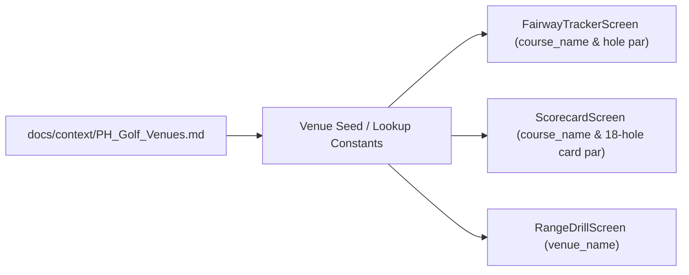

# Philippine Golf Courses, Driving Ranges, and Indoor Simulators Lookup Table

| Field | Value |
| :--- | :--- |
| **Product** | My Golf Diary |
| **Document** | Reference / Lookup Table — Philippine Golf Venues |
| **Purpose** | Authoritative lookup table for `course_name` on On Course & Scorecard, hole-by-hole par arrays (`H1`–`H18`), and `venue_name` on Range Drill |
| **Status** | Active |

---

## 1. Overview & Architectural Integration

This lookup table provides a curated, standardized directory of **Philippine Golf Courses**, **Driving Ranges**, and **Indoor Golf Simulator Shops**.



### Module Bindings (PRD prefixes)
- **`CRSE` (`fairway_tracker_screen.dart`)**: Course picker or auto-complete chip list matching `name`. When a recognized course is active, hole progression automatically presets `_par` to the hole's official par.
- **`SCOR` (`scorecard_screen.dart`, `scorecard_hole_editor.dart`)**: When starting a new round (`startNewRound`), par for holes 1–18 can default to the course's scorecard par rather than flat par 4.
- **`RNGE` (`range_drill_screen.dart`)**: Simulator bay and driving range picker for `venue_name`.

---

## 2. Master Golf Courses Directory

### 2.1 Metro Manila (NCR)

| ID | Course Name | City / Location | Holes | Par | Access | Notes |
| :--- | :--- | :--- | :---: | :---: | :--- | :--- |
| `ph-crse-alabang-cc` | Alabang Country Club | Ayala Alabang, Muntinlupa City | 18 | 72 | Private | Nelson & Wright design, rolling parkland |
| `ph-crse-camp-aguinaldo` | Camp Aguinaldo Golf Club | EDSA, Quezon City | 18 | 68 | Public / Military | Compact military layout, tight tree lines |
| `ph-crse-club-intramuros` | Club Intramuros Golf Course | Intramuros, Manila | 18 | 66 | Public | Historical Andy Dye layout along colonial stone walls; night golf |
| `ph-crse-manila-golf` | Manila Golf and Country Club | Forbes Park, Makati City | 18 | 71 | Private | Established 1901; premier championship parkland |
| `ph-crse-phil-army` | Philippine Army Golf Club (Kagitingan) | Bayani Rd, Fort Bonifacio, Taguig City | 9 | 33 | Public / Military | 9-hole executive military layout |
| `ph-crse-phil-navy` | Philippine Navy Golf Club | BNS, Fort Bonifacio, Taguig City | 18 | 70 | Public / Military | Ron Fream design; tight, water in play |
| `ph-crse-southlinks` | Southlinks Golf Club | Las Piñas / Alabang border | 18 | 72 | Public / Semi-Private | Ted Robinson design |
| `ph-crse-veterans` | Veterans Golf Club | Mindanao Ave / North Ave, Quezon City | 18 | 70 | Public | Public parkland layout with mature trees |
| `ph-crse-villamor` | Villamor Golf Club | Sales Rd, Pasay City (near NAIA) | 18 | 72 | Public / Military | Flat championship military course; historic Philippine Open venue |
| `ph-crse-wack-wack-east` | Wack Wack Golf & Country Club — East | Shaw Blvd, Mandaluyong City | 18 | 72 | Private | Historic World Cup / Philippine Open venue; legendary hole 16 |
| `ph-crse-wack-wack-west` | Wack Wack Golf & Country Club — West | Shaw Blvd, Mandaluyong City | 18 | 72 | Private | Members' championship layout |

### 2.2 Calabarzon (Rizal, Cavite, Laguna, Batangas)

| ID | Course Name | City / Province | Holes | Par | Access | Notes |
| :--- | :--- | :--- | :---: | :---: | :--- | :--- |
| `ph-crse-valley-south` | Valley Golf & Country Club — South | Antipolo, Rizal | 18 | 72 | Private | Rolling terrain, scenic mountain vistas |
| `ph-crse-valley-north` | Valley Golf & Country Club — North | Antipolo, Rizal | 18 | 72 | Private | Challenging executive hilly layout |
| `ph-crse-forest-hills-nicklaus` | Forest Hills Golf & Country Club — Nicklaus | Antipolo, Rizal | 18 | 71 | Private / Resort | Jack Nicklaus Jr. design; elevated mountain tees |
| `ph-crse-forest-hills-palmer` | Forest Hills Golf & Country Club — Palmer | Antipolo, Rizal | 18 | 72 | Private / Resort | Arnold Palmer design; undulating fairways |
| `ph-crse-eastridge` | Eastridge Golf Club | Binangonan, Rizal | 18 | 72 | Semi-Private | Scenic mountain ridge overlooking Laguna de Bay |
| `ph-crse-southwoods-masters` | Manila Southwoods — Masters Course | Carmona, Cavite | 18 | 72 | Private | Jack Nicklaus signature layout; major tournament venue |
| `ph-crse-southwoods-legends` | Manila Southwoods — Legends Course | Carmona, Cavite | 18 | 72 | Private | Jack Nicklaus design; rolling parkland with mounds |
| `ph-crse-orchard-palmer` | The Orchard — Palmer Course | Dasmariñas, Cavite | 18 | 72 | Private | Arnold Palmer layout; 1995 Johnnie Walker Classic venue |
| `ph-crse-orchard-player` | The Orchard — Player Course | Dasmariñas, Cavite | 18 | 72 | Private | Gary Player layout; strategic bunkering |
| `ph-crse-riviera-langer` | The Riviera Golf Club — Langer Course | Silang, Cavite | 18 | 71 | Private / Resort | Bernhard Langer design; deep ravines |
| `ph-crse-riviera-couples` | The Riviera Golf Club — Couples Course | Silang, Cavite | 18 | 72 | Private / Resort | Fred Couples design; scenic valley views |
| `ph-crse-sherwood-hills` | Sherwood Hills Golf Club | Trece Martires, Cavite | 18 | 72 | Private | Jack Nicklaus design; inland links style |
| `ph-crse-eagle-ridge-faldo` | Eagle Ridge G&CC — Nick Faldo Course | General Trias, Cavite | 18 | 72 | Semi-Private | Nick Faldo design; challenging greens |
| `ph-crse-eagle-ridge-norman` | Eagle Ridge G&CC — Greg Norman Course | General Trias, Cavite | 18 | 72 | Semi-Private | Greg Norman layout with deep sand traps |
| `ph-crse-eagle-ridge-dye` | Eagle Ridge G&CC — Pete Dye Course | General Trias, Cavite | 18 | 72 | Semi-Private | Strategic target-golf design |
| `ph-crse-eagle-ridge-aoki` | Eagle Ridge G&CC — Isao Aoki Course | General Trias, Cavite | 18 | 72 | Semi-Private | Wide fairways, resort-style |
| `ph-crse-south-forbes` | South Forbes Golf City | Silang, Cavite | 18 | 66 | Semi-Private | Executive hilly course |
| `ph-crse-tagaytay-highlands` | Tagaytay Highlands International Golf Club | Tagaytay City, Cavite | 18 | 72 | Private | Richard Bigler design; dramatic elevation changes, cable car |
| `ph-crse-tagaytay-midlands` | Tagaytay Midlands Golf Club | Talisay, Batangas / Tagaytay | 18 | 72 | Private | Overlooks Taal Lake and Volcano |
| `ph-crse-royale-tagaytay` | Royale Tagaytay Country Club | Alfonso, Cavite | 9 | 36 | Semi-Private | 9-hole executive resort layout |
| `ph-crse-splendido-taal` | Splendido Taal Golf Club | Laurel, Batangas | 18 | 72 | Semi-Private | Greg Norman design along Taal Ridge |
| `ph-crse-canyon-woods` | Canyon Woods Resort Club | Laurel, Batangas | 9 | 34 | Resort | Mountain resort 9-hole course |
| `ph-crse-the-country-club` | The Country Club (TCC) | Santa Rosa, Laguna | 18 | 72 | Exclusive Private | Tom Weiskopf design; flagship Philippine Open championship venue |
| `ph-crse-sta-elena` | Sta. Elena Golf & Country Estate | Santa Rosa, Laguna | 27 | 72 | Private | Robert Trent Jones Jr. 27-hole layout (Banahaw, Makiling, Sierra Madre) |
| `ph-crse-canlubang-north` | Canlubang Golf & Country Club — North | Calamba, Laguna | 18 | 72 | Private | Robert Trent Jones Jr. layout; long championship course |
| `ph-crse-canlubang-south` | Canlubang Golf & Country Club — South | Calamba, Laguna | 18 | 72 | Private | Robert Trent Jones Jr. layout; undulating scenic terrain |
| `ph-crse-ayala-greenfield` | Ayala Greenfield Golf & Leisure Club | Calamba, Laguna | 18 | 72 | Private | Robert Trent Jones Jr. mountain course with views of Laguna de Bay |
| `ph-crse-hallow-ridge` | Hallow Ridge Filipinas Golf (KC Filipinas) | San Pedro, Laguna | 18 | 72 | Public / Semi-Private | Seiichi Inoue design; classic tree-lined layout |
| `ph-crse-caliraya-springs` | Caliraya Springs Golf Club | Cavinti, Laguna | 18 | 72 | Resort / Semi-Private | Arnold Palmer / Graham Marsh design by Caliraya Lake |
| `ph-crse-mount-malarayat` | Mount Malarayat Golf & Country Club | Lipa City, Batangas | 27 | 72 | Semi-Private | J. Michael Poellot design; 27 holes (Makulot, Lobo, Malipunyo) |
| `ph-crse-summit-point` | Summit Point Golf & Residential Estates | Lipa City, Batangas | 18 | 72 | Semi-Private | Robert Trent Jones Jr. replica course of famous world holes |
| `ph-crse-fernando-air-base` | Fernando Air Base Golf Club | Lipa City, Batangas | 18 | 72 | Public / Military | Air Force base layout |
| `ph-crse-calatagan` | Calatagan Golf Club | Calatagan, Batangas | 18 | 72 | Semi-Private | Robert Trent Jones Jr. coastal championship layout |
| `ph-crse-punta-fuego` | Club Punta Fuego | Nasugbu, Batangas | 9 | 32 | Private / Resort | Seaside resort course |

### 2.3 Central & Northern Luzon and Bicol

| ID | Course Name | City / Province | Holes | Par | Access | Notes |
| :--- | :--- | :--- | :---: | :---: | :--- | :--- |
| `ph-crse-mimosa-mountainview` | Mimosa Plus Golf Course — Mountainview | Clark Freeport Zone, Pampanga | 18 | 72 | Public / Resort | Nelson & Haworth design |
| `ph-crse-mimosa-acacia` | Mimosa Plus Golf Course — Acacia Lakeview | Clark Freeport Zone, Pampanga | 18 | 72 | Public / Resort | Lake-lined scenic layout |
| `ph-crse-clark-sun-valley` | Clark Sun Valley Golf & Country Club | Clark Freeport Zone, Pampanga | 36 | 72 | Public / Resort | Clark Course & Sun Valley Course; mountain plateau |
| `ph-crse-fa-korea` | FA Korea Country Club | Clark Freeport Zone, Pampanga | 27 | 72 | Public / Resort | 27-hole Korean-managed complex |
| `ph-crse-pradera-verde` | Pradera Verde Golf & Country Club | Lubao, Pampanga | 27 | 72 | Public / Resort | Flat, immaculate championship turf |
| `ph-crse-beverly-place` | Beverly Place Golf Club | Mexico, Pampanga | 18 | 71 | Semi-Private | Gary Player layout |
| `ph-crse-air-force-city` | Air Force City Golf Club | Angeles City, Pampanga | 9 | 36 | Public / Military | Public military layout in Clark |
| `ph-crse-royal-garden` | Royal Garden Golf & Country Club | Angeles City, Pampanga | 18 | 72 | Semi-Private | Greco-Roman statues along fairways |
| `ph-crse-luisita` | Luisita Golf & Country Club | Tarlac City, Tarlac | 18 | 72 | Semi-Private | Robert Trent Jones Sr. masterpiece; water hazards on 17 holes |
| `ph-crse-royal-northwoods` | Royal Northwoods Golf & Residential Estates | San Rafael, Bulacan | 18 | 72 | Semi-Private | Graham Marsh design; undulating tiered greens |
| `ph-crse-lakewood` | Lakewood Golf & Country Club | Cabanatuan City, Nueva Ecija | 18 | 72 | Semi-Private | Central Luzon parkland layout |
| `ph-crse-anvaya-cove` | Anvaya Cove Golf & Sports Club | Morong, Bataan | 18 | 72 | Private / Member Resort | Kevin Ramsey design; seaside and mountain holes |
| `ph-crse-camaya-coast` | Camaya Coast (Tandatangan Golf Course) | Mariveles, Bataan | 9 | 36 | Resort | Coastal cliffs golf course |
| `ph-crse-subic-intl` | Subic International Golf Club | Subic Bay Freeport, Zambales | 18 | 72 | Semi-Private | Completely renovated championship forest course |
| `ph-crse-camp-john-hay` | Camp John Hay Golf Club | Baguio City, Benguet | 18 | 69 | Semi-Private / Resort | Jack Nicklaus design; bentgrass greens at 5,000 ft altitude |
| `ph-crse-baguio-cc` | Baguio Country Club | Baguio City, Benguet | 18 | 61 | Private | Historic short mountain layout with pine tree corridors |
| `ph-crse-pinewoods` | Pinewoods Golf & Country Club | Tuba / Baguio City, Benguet | 18 | 72 | Semi-Private | Gary Player mountain layout |
| `ph-crse-the-cliffs` | The Cliffs Golf & Beach Club | San Fernando, La Union | 9 | 36 | Resort | Poro Point seaside course |
| `ph-crse-paoay` | Paoay Golf Course (Fort Ilocandia) | Paoay, Ilocos Norte | 18 | 72 | Public / Resort | Lake Paoay lakeside course |
| `ph-crse-isabela` | Isabela Golf Club | Ilagan, Isabela | 9 | 36 | Semi-Private | Cagayan Valley course |
| `ph-crse-haciendas-de-naga` | Haciendas de Naga Golf Course | Naga City, Camarines Sur | 9 | 36 | Resort | Bicol golf resort |

### 2.4 Visayas

| ID | Course Name | City / Province | Holes | Par | Access | Notes |
| :--- | :--- | :--- | :---: | :---: | :--- | :--- |
| `ph-crse-cebu-cc` | Cebu Country Club | Banilad, Cebu City | 18 | 72 | Private | Historic 1928 parkland layout; Gary Player redesigned |
| `ph-crse-alta-vista` | Alta Vista Golf & Country Club | Pardo Hills, Cebu City | 18 | 72 | Semi-Private | Gary Player mountain layout overlooking Cebu Strait |
| `ph-crse-mactan-island` | Mactan Island Golf Club | Lapu-Lapu City, Cebu | 18 | 69 | Public / Military | Flat military air base layout |
| `ph-crse-club-filipino-cebu` | Club Filipino Inc. de Cebu | Danao City, Cebu | 18 | 71 | Semi-Private | Mountain terrain with scenic rolling hills |
| `ph-crse-liloan` | Liloan Golf & Leisure Estate | Liloan, Cebu | 18 | 72 | Semi-Private | Modern Northern Cebu layout |
| `ph-crse-queens-island` | Queens Island Golf and Resort | Medellin, Cebu | 18 | 72 | Resort | Full-service golf resort in North Cebu |
| `ph-crse-mercedes-plantation` | Mercedes Plantation Golf & Country Club | Medellin, Cebu | 18 | 72 | Semi-Private | Sugar plantation estate course |
| `ph-crse-cebu-intl` | Cebu International Golf and Resort | Badian, Cebu | 18 | 72 | Resort | Southwest Cebu coastal resort |
| `ph-crse-fairways-boracay` | Fairways and Bluewater Resort | Boracay Island, Aklan | 18 | 72 | Resort | Graham Marsh championship island layout |
| `ph-crse-iloilo-golf` | Iloilo Golf & Country Club (Santa Barbara) | Santa Barbara, Iloilo | 18 | 70 | Semi-Private | Built 1907; oldest golf course in the Philippines / SE Asia |
| `ph-crse-marapara` | Negros Occidental (Marapara) G&CC | Bacolod City, Negros Occ. | 18 | 70 | Semi-Private | Historic tournament parkland course |
| `ph-crse-bacolod-golf` | Bacolod Golf & Country Club (Binitinan) | Murcia, Negros Occidental | 18 | 70 | Semi-Private | Challenging tree-lined course in the foothills |
| `ph-crse-victorias` | Victorias Golf & Country Club | Victorias City, Negros Occ. | 18 | 72 | Semi-Private | Milling company estate layout |
| `ph-crse-negros-intl` | Negros International Golf & Country Club | Tanjay City, Negros Oriental | 18 | 72 | Semi-Private | Coastal Negros Oriental layout |
| `ph-crse-san-juanico` | San Juanico Golf and Country Club | Tacloban City, Leyte | 18 | 72 | Semi-Private | Located near San Juanico Bridge |

### 2.5 Mindanao

| ID | Course Name | City / Province | Holes | Par | Access | Notes |
| :--- | :--- | :--- | :---: | :---: | :--- | :--- |
| `ph-crse-apo-golf` | Apo Golf & Country Club | Bago Aplaya, Davao City | 18 | 72 | Semi-Private | Historic home of Philippine pros; foot of Mt. Apo |
| `ph-crse-palos-verdes` | Rancho Palos Verdes Golf & Country Club | Mandug, Davao City | 18 | 72 | Semi-Private | Andy Dye championship design along Davao River |
| `ph-crse-south-pacific-davao` | South Pacific Golf & Leisure Estates | Catalunan Pequeño, Davao City | 18 | 72 | Semi-Private | Arnold Palmer design; modern residential golf community |
| `ph-crse-lanang` | Lanang Country Club | Lanang, Davao City | 18 | 72 | Semi-Private | Established Davao community course |
| `ph-crse-del-monte` | Del Monte Golf Club | Manolo Fortich, Bukidnon | 18 | 72 | Semi-Private | Built 1928; high altitude pineapple plantation plateau |
| `ph-crse-pueblo-de-oro` | Pueblo de Oro Golf & Country Club | Cagayan de Oro City | 18 | 72 | Semi-Private | Robert Trent Jones Jr. championship plateau course |
| `ph-crse-camp-evangelista` | Camp Evangelista Golf Club | Cagayan de Oro City | 9 | 36 | Public / Military | Army 4th Infantry Division military course |
| `ph-crse-west-highlands` | West Highlands Golf Club | Butuan City, Agusan del Norte | 9 | 36 | Semi-Private | Modern mountain layout |
| `ph-crse-dole-kalsangi` | Dole Kalsangi Golf Club | Polomolok, South Cotabato | 9 | 36 | Private | Private club on Dole plantation slopes of Mt. Matutum |
| `ph-crse-sarangani` | Sarangani Golf & Country Club | General Santos City | 9 | 36 | Semi-Private | Southern Mindanao layout |
| `ph-crse-brittannika` | Brittannika Golf Club | Surigao del Sur | 9 | 36 | Semi-Private | Coastal Caraga layout |
| `ph-crse-dakak` | Dakak Golf Club | Dapitan City, Zamboanga del Norte | 9 | 36 | Resort | Coastal beach resort course |
| `ph-crse-zamboanga` | Zamboanga Golf Course & Beach Park | Upper Calarian, Zamboanga City | 18 | 72 | Public | Historic 1910 course overlooking Basilan Strait |
| `ph-crse-edwin-andrews` | Edwin Andrews Air Base Golf Course | Zamboanga City | 9 | 36 | Public / Military | Air Force military golf course |
| `ph-crse-iligan-golf` | Golf & Country Club of Iligan | Iligan City, Lanao del Norte | 9 | 36 | Semi-Private | Northern Mindanao course |
| `ph-crse-illana-bay` | Illana Bay Golf & Country Club | Pagadian City, Zamboanga del Sur | 9 | 36 | Semi-Private | Military / community layout |

---

## 3. Hole-by-Hole Par Table (`H1`–`H18`)

Standard official par per hole for auto-populating `RoundScore.par` during on-course tracking and scorecard creation.

| Course Name | H1 | H2 | H3 | H4 | H5 | H6 | H7 | H8 | H9 | Out | H10 | H11 | H12 | H13 | H14 | H15 | H16 | H17 | H18 | In | Tot |
| :--- | :---: | :---: | :---: | :---: | :---: | :---: | :---: | :---: | :---: | :---: | :---: | :---: | :---: | :---: | :---: | :---: | :---: | :---: | :---: | :---: | :---: |
| **Alabang Country Club** | 4 | 4 | 5 | 4 | 4 | 3 | 5 | 3 | 4 | **36** | 4 | 4 | 3 | 5 | 4 | 3 | 4 | 4 | 5 | **36** | **72** |
| **Camp Aguinaldo Golf Club** | 4 | 3 | 5 | 5 | 4 | 4 | 4 | 3 | 4 | **36** | 5 | 3 | 3 | 3 | 4 | 3 | 3 | 3 | 5 | **32** | **68** |
| **Club Intramuros Golf Course** | 3 | 4 | 3 | 4 | 4 | 3 | 5 | 4 | 4 | **34** | 3 | 4 | 3 | 4 | 4 | 4 | 3 | 4 | 3 | **32** | **66** |
| **Manila Golf & Country Club** | 4 | 4 | 3 | 5 | 4 | 3 | 5 | 4 | 4 | **36** | 4 | 3 | 4 | 4 | 3 | 5 | 3 | 4 | 5 | **35** | **71** |
| **Philippine Army (Kagitingan)** | 4 | 3 | 4 | 3 | 4 | 4 | 4 | 3 | 4 | **33** | — | — | — | — | — | — | — | — | — | — | **33** |
| **Philippine Navy Golf Club** | 5 | 4 | 3 | 4 | 3 | 4 | 4 | 3 | 5 | **35** | 3 | 4 | 3 | 5 | 5 | 5 | 3 | 3 | 4 | **35** | **70** |
| **Veterans Golf Club** | 4 | 3 | 3 | 4 | 5 | 4 | 4 | 3 | 4 | **34** | 4 | 4 | 4 | 3 | 3 | 5 | 4 | 5 | 4 | **36** | **70** |
| **Villamor Golf Club** | 4 | 4 | 3 | 5 | 4 | 4 | 3 | 5 | 4 | **36** | 4 | 5 | 4 | 3 | 4 | 4 | 4 | 3 | 5 | **36** | **72** |
| **Wack Wack G&CC — East Course** | 4 | 4 | 4 | 4 | 5 | 4 | 4 | 3 | 4 | **36** | 4 | 4 | 4 | 5 | 4 | 4 | 3 | 4 | 4 | **36** | **72** |
| **Wack Wack G&CC — West Course** | 4 | 4 | 3 | 5 | 4 | 4 | 5 | 3 | 4 | **36** | 5 | 3 | 4 | 5 | 3 | 4 | 4 | 4 | 4 | **36** | **72** |
| **Valley Golf — South Course** | 4 | 4 | 4 | 3 | 5 | 4 | 5 | 3 | 4 | **36** | 4 | 5 | 3 | 4 | 4 | 4 | 4 | 5 | 3 | **36** | **72** |
| **Valley Golf — North Executive** | 4 | 4 | 3 | 4 | 5 | 3 | 5 | 3 | 5 | **36** | 5 | 3 | 3 | 5 | 4 | 3 | 5 | 4 | 4 | **36** | **72** |
| **Forest Hills — Nicklaus Course** | 4 | 4 | 4 | 3 | 4 | 5 | 3 | 4 | 4 | **35** | 5 | 4 | 4 | 3 | 4 | 3 | 5 | 4 | 4 | **36** | **71** |
| **Forest Hills — Palmer Course** | 4 | 5 | 4 | 3 | 4 | 4 | 4 | 3 | 5 | **36** | 4 | 4 | 3 | 4 | 5 | 3 | 5 | 4 | 4 | **36** | **72** |
| **Eastridge Golf Club** | 4 | 5 | 3 | 4 | 4 | 5 | 4 | 3 | 4 | **36** | 4 | 4 | 3 | 5 | 4 | 4 | 3 | 4 | 5 | **36** | **72** |
| **Manila Southwoods — Masters** | 4 | 4 | 3 | 5 | 3 | 4 | 4 | 5 | 4 | **36** | 4 | 4 | 4 | 3 | 4 | 5 | 4 | 3 | 5 | **36** | **72** |
| **Manila Southwoods — Legends** | 4 | 4 | 3 | 4 | 4 | 5 | 3 | 5 | 4 | **36** | 4 | 4 | 3 | 4 | 5 | 4 | 3 | 5 | 4 | **36** | **72** |
| **The Orchard — Palmer Course** | 4 | 5 | 4 | 4 | 3 | 5 | 3 | 4 | 4 | **36** | 4 | 4 | 3 | 4 | 5 | 4 | 3 | 4 | 5 | **36** | **72** |
| **The Orchard — Player Course** | 4 | 4 | 3 | 5 | 3 | 4 | 4 | 4 | 5 | **36** | 4 | 3 | 5 | 4 | 3 | 4 | 4 | 4 | 5 | **36** | **72** |
| **The Riviera — Langer Course** | 4 | 4 | 4 | 3 | 5 | 4 | 4 | 3 | 4 | **35** | 5 | 4 | 3 | 4 | 4 | 4 | 5 | 3 | 4 | **36** | **71** |
| **The Riviera — Couples Course** | 4 | 5 | 4 | 4 | 4 | 3 | 5 | 3 | 4 | **36** | 4 | 5 | 4 | 4 | 3 | 4 | 5 | 3 | 4 | **36** | **72** |
| **Sherwood Hills Golf Club** | 4 | 3 | 4 | 5 | 4 | 3 | 4 | 5 | 4 | **36** | 4 | 3 | 5 | 4 | 4 | 5 | 3 | 4 | 4 | **36** | **72** |
| **Eagle Ridge — Nick Faldo** | 4 | 5 | 3 | 5 | 4 | 3 | 4 | 4 | 4 | **36** | 4 | 3 | 5 | 4 | 5 | 4 | 4 | 3 | 4 | **36** | **72** |
| **Eagle Ridge — Greg Norman** | 4 | 4 | 5 | 3 | 5 | 4 | 4 | 3 | 4 | **36** | 4 | 5 | 4 | 4 | 3 | 5 | 4 | 3 | 4 | **36** | **72** |
| **Tagaytay Highlands International** | 4 | 4 | 3 | 5 | 4 | 4 | 4 | 3 | 5 | **36** | 4 | 5 | 3 | 4 | 4 | 4 | 5 | 3 | 4 | **36** | **72** |
| **Tagaytay Midlands Golf Club** | 4 | 5 | 3 | 4 | 3 | 5 | 4 | 4 | 4 | **36** | 4 | 4 | 3 | 4 | 4 | 4 | 5 | 3 | 5 | **36** | **72** |
| **Splendido Taal Golf Club** | 5 | 5 | 3 | 4 | 4 | 4 | 4 | 3 | 4 | **36** | 4 | 5 | 4 | 4 | 4 | 3 | 4 | 3 | 5 | **36** | **72** |
| **The Country Club (TCC)** | 4 | 5 | 3 | 4 | 4 | 3 | 4 | 5 | 4 | **36** | 5 | 3 | 4 | 4 | 5 | 4 | 4 | 3 | 4 | **36** | **72** |
| **Canlubang — North Course** | 4 | 5 | 4 | 3 | 4 | 3 | 4 | 4 | 5 | **36** | 4 | 3 | 4 | 4 | 5 | 3 | 4 | 5 | 4 | **36** | **72** |
| **Canlubang — South Course** | 4 | 5 | 4 | 3 | 4 | 4 | 4 | 3 | 5 | **36** | 4 | 5 | 4 | 3 | 4 | 4 | 4 | 3 | 5 | **36** | **72** |
| **Ayala Greenfield Golf Club** | 4 | 5 | 3 | 4 | 4 | 3 | 4 | 4 | 5 | **36** | 5 | 3 | 4 | 5 | 3 | 4 | 3 | 5 | 4 | **36** | **72** |
| **Hallow Ridge Filipinas Golf** | 4 | 4 | 3 | 4 | 3 | 5 | 4 | 4 | 5 | **36** | 4 | 4 | 3 | 5 | 4 | 3 | 4 | 4 | 5 | **36** | **72** |
| **Mount Malarayat (Makulot/Lobo)** | 4 | 4 | 4 | 3 | 5 | 4 | 5 | 3 | 4 | **36** | 4 | 4 | 4 | 3 | 5 | 4 | 5 | 3 | 4 | **36** | **72** |
| **Summit Point Golf & Estates** | 4 | 3 | 5 | 4 | 5 | 3 | 4 | 3 | 5 | **36** | 4 | 4 | 4 | 3 | 5 | 4 | 5 | 3 | 4 | **36** | **72** |
| **Calatagan Golf Club** | 5 | 3 | 4 | 5 | 4 | 4 | 4 | 3 | 4 | **36** | 4 | 3 | 4 | 5 | 4 | 4 | 3 | 4 | 5 | **36** | **72** |
| **Mimosa Plus — Mountainview** | 5 | 3 | 4 | 4 | 5 | 3 | 4 | 3 | 4 | **35** | 5 | 4 | 4 | 5 | 3 | 4 | 3 | 4 | 5 | **37** | **72** |
| **Clark Sun Valley — Clark** | 4 | 3 | 4 | 5 | 4 | 5 | 4 | 3 | 4 | **36** | 5 | 4 | 4 | 4 | 3 | 5 | 4 | 3 | 4 | **36** | **72** |
| **Pradera Verde Golf Club** | 4 | 3 | 4 | 4 | 5 | 4 | 3 | 4 | 5 | **36** | 4 | 3 | 5 | 4 | 4 | 4 | 4 | 3 | 5 | **36** | **72** |
| **Royal Garden G&CC** | 4 | 4 | 5 | 4 | 3 | 4 | 3 | 5 | 4 | **36** | 5 | 3 | 4 | 5 | 4 | 4 | 4 | 3 | 4 | **36** | **72** |
| **Luisita Golf & Country Club** | 4 | 3 | 4 | 4 | 5 | 3 | 4 | 4 | 5 | **36** | 4 | 4 | 5 | 3 | 4 | 4 | 5 | 3 | 4 | **36** | **72** |
| **Royal Northwoods Golf Club** | 5 | 4 | 3 | 4 | 5 | 4 | 3 | 4 | 4 | **36** | 4 | 4 | 3 | 5 | 4 | 5 | 3 | 4 | 4 | **36** | **72** |
| **Anvaya Cove Golf & Sports Club** | 4 | 5 | 4 | 4 | 4 | 3 | 4 | 3 | 5 | **36** | 5 | 4 | 4 | 3 | 4 | 5 | 3 | 4 | 4 | **36** | **72** |
| **Camp John Hay Golf Club** | 5 | 4 | 4 | 3 | 4 | 3 | 4 | 4 | 4 | **35** | 4 | 3 | 4 | 3 | 4 | 3 | 5 | 5 | 3 | **34** | **69** |
| **Baguio Country Club** | 3 | 4 | 4 | 4 | 4 | 4 | 3 | 4 | 3 | **33** | 3 | 4 | 3 | 3 | 3 | 3 | 3 | 3 | 3 | **28** | **61** |
| **Cebu Country Club** | 4 | 5 | 3 | 4 | 3 | 4 | 5 | 4 | 4 | **36** | 4 | 5 | 4 | 3 | 4 | 3 | 5 | 4 | 4 | **36** | **72** |
| **Alta Vista Golf & Country Club** | 4 | 3 | 4 | 4 | 4 | 3 | 5 | 3 | 5 | **35** | 5 | 4 | 4 | 3 | 4 | 3 | 5 | 4 | 5 | **37** | **72** |
| **Mactan Island Golf Club** | 4 | 3 | 4 | 5 | 3 | 4 | 5 | 4 | 3 | **35** | 4 | 4 | 3 | 3 | 3 | 5 | 4 | 4 | 4 | **34** | **69** |
| **Club Filipino Inc. de Cebu** | 4 | 4 | 4 | 3 | 4 | 5 | 4 | 3 | 4 | **35** | 4 | 5 | 3 | 4 | 4 | 5 | 4 | 3 | 4 | **36** | **71** |
| **Fairways & Bluewater Boracay** | 4 | 3 | 4 | 4 | 5 | 4 | 3 | 4 | 5 | **36** | 5 | 3 | 4 | 4 | 5 | 4 | 3 | 4 | 4 | **36** | **72** |
| **Iloilo Golf & Country Club** | 4 | 4 | 4 | 5 | 3 | 4 | 4 | 4 | 4 | **36** | 3 | 4 | 4 | 3 | 5 | 4 | 3 | 4 | 4 | **34** | **70** |
| **Negros Occidental (Marapara)** | 4 | 5 | 3 | 4 | 4 | 4 | 4 | 3 | 4 | **34** | 4 | 4 | 4 | 3 | 4 | 4 | 3 | 4 | 5 | **36** | **70** |
| **Bacolod Golf & Country Club** | 4 | 4 | 3 | 4 | 5 | 4 | 4 | 3 | 4 | **35** | 3 | 4 | 4 | 4 | 4 | 5 | 4 | 4 | 3 | **35** | **70** |
| **Apo Golf & Country Club** | 4 | 4 | 5 | 3 | 4 | 5 | 3 | 4 | 4 | **36** | 4 | 3 | 4 | 5 | 4 | 4 | 4 | 3 | 5 | **36** | **72** |
| **Rancho Palos Verdes G&CC** | 5 | 3 | 4 | 4 | 4 | 3 | 4 | 5 | 4 | **36** | 4 | 3 | 5 | 4 | 4 | 5 | 4 | 3 | 4 | **36** | **72** |
| **South Pacific Golf & Leisure** | 4 | 5 | 3 | 4 | 3 | 4 | 5 | 4 | 4 | **36** | 4 | 4 | 5 | 3 | 4 | 3 | 4 | 4 | 5 | **36** | **72** |
| **Lanang Country Club** | 4 | 5 | 4 | 4 | 3 | 5 | 4 | 3 | 4 | **36** | 4 | 3 | 5 | 4 | 4 | 4 | 5 | 3 | 4 | **36** | **72** |
| **Del Monte Golf Club** | 4 | 4 | 3 | 4 | 4 | 5 | 3 | 4 | 5 | **36** | 4 | 4 | 3 | 4 | 5 | 4 | 3 | 4 | 5 | **36** | **72** |
| **Pueblo de Oro Golf & Country Club** | 4 | 3 | 5 | 4 | 4 | 3 | 5 | 4 | 4 | **36** | 4 | 3 | 4 | 3 | 4 | 5 | 4 | 5 | 4 | **36** | **72** |

---

## 4. Standalone & Club Driving Ranges

Lookup list for practice range venues, usable for `venue_name` in Range Drill (`range_drills.venue_name`).

| Range Name | Location / Area | Type | Notes |
| :--- | :--- | :--- | :--- |
| **CityGolf Driving Range** | Doña Julia Vargas Ave, Pasig City | Standalone | Covered bays, floodlit night golf, central Metro Manila |
| **Villamor Golf Driving Range** | Sales Rd, Pasay City | Club Range | Adjacent to NAIA airport, open early morning |
| **Philippine Navy Driving Range** | Fort Bonifacio, Taguig / Makati border | Club Range | Affordable, popular open-air practice facility |
| **Philippine Army (Kagitingan) Range** | Bayani Rd, Fort Bonifacio, Taguig City | Club Range | Military base driving range |
| **Veterans Golf Club Driving Range** | North Ave, Diliman, Quezon City | Club Range | Long public practice facility |
| **Camp Aguinaldo Driving Range** | EDSA, Camp Aguinaldo, Quezon City | Club Range | Central QC military base practice range |
| **Southpoint Driving Range** | Alabang, Muntinlupa City | Standalone | Spacious multi-tier range in Southern Metro Manila |
| **Royal Palm / Las Piñas Driving Range** | Las Piñas City, Metro Manila | Standalone | Public commercial driving range |
| **NUVALI Driving Range** | West Diversity Blvd, Nuvali, Santa Rosa, Laguna | Standalone | Modern floodlit range in Nuvali commercial hub |
| **Teakwood Golf Driving Range** | Biñan, Laguna | Standalone | Public practice facility in Laguna |
| **Canlubang Lifestyle Center Range** | Canlubang, Calamba, Laguna | Standalone | Peaceful suburban driving range |
| **Hallow Ridge Driving Range** | San Pedro, Laguna | Club Range | Range attached to Hallow Ridge Filipinas |
| **BW Golf Driving Range** | Angeles City, Pampanga | Standalone | Covered bays near Clark Freeport |
| **Air Force City Golf Driving Range** | Clark, Angeles City, Pampanga | Club Range | Military range inside Clark |
| **Camp Lapu-Lapu Golf Driving Range** | Apas, Cebu City, Cebu | Standalone / Base | Central Cebu City driving range |
| **Davao Eaglemaster Golf Driving Range** | Davao City, Davao del Sur | Standalone | Open-air practice range in Davao |
| **Winners' Golf Range** | Davao City, Davao del Sur | Standalone | Popular commercial driving range |
| **Champion Golf Range** | Gem Village, Davao City, Davao del Sur | Standalone | Covered practice bays with restaurant |

---

## 5. Indoor Golf Simulator Shops & Virtual Golf Lounges

Modern simulator facilities equipped with launch monitors (Foresight GC Hawk, TrackMan iO, Kakao VX Friends Screen, Golfzon GDR / TwoVision, Full Swing, MS Golf Tech) for virtual rounds and range sessions (`venue_name`).

### 5.1 Taguig (Bonifacio Global City — BGC)
- **GolfX Sports Hub — BGC**: CitiPlaza Basement, 34th St, BGC, Taguig. Equipped with Foresight GC Hawk technology across 9 bays, PGA coaches, and Bunker Bar.
- **Elite Tee Box**: BGC, Taguig. Premium private virtual golf studio.

### 5.2 Makati City
- **Friends Screen Indoor Golf — Makati**: 4th Floor, Century City Mall, Kalayaan Ave cor. Salamanca St, Brgy. Poblacion. 5 private air-conditioned simulator rooms powered by Kakao VX Friends Screen Korean technology.
- **Joy Golf Science**: Tower Shop, The Peninsula Manila, Ayala Ave / Paseo de Roxas. High-end launch monitor simulator bays with certified swing coaching.
- **The Alpha Suites Indoor Golf**: 7232 Ayala Ave Extension. High-definition commercial simulator amenity.

### 5.3 Mandaluyong & Pasig (Ortigas / Capitol Commons)
- **Quantum Golf**: 2nd Floor Quantum Building, Doña Julia Vargas Ave, Autocamp Access Rd, Pasig. Metro Manila's largest indoor golf complex with 10 bays, putting green, and fitness center.
- **ParTee Golf — Pioneer**: 125 Pioneer St, NBS Park, Mandaluyong. Equipped with PGA Tour-recognized MS Golf Tech MS5C & MS9C dual-motion camera systems, open bays, and private suite.
- **Prime Golf**: 12 ADB Ave, Ortigas Center, Mandaluyong. High-tech simulator bays and custom clubfitting.
- **Eastwing Golf**: 3rd Floor East Wing, Estancia Mall, Capitol Commons, Meralco Ave, Pasig. Modern mall-based simulator bays.
- **Golf Life PH**: Ground Floor, Ayala Malls The 30th, Meralco Ave, Pasig. Simulator hitting bays and practice lounge.

### 5.4 Quezon City
- **Swng Golf and Lounge**: 97 Don A. Roces Ave, Diliman, Quezon City. 6 open climate-controlled simulator bays plus 1 VIP suite with food and drinks.
- **ParTee Golf — Scout Gandia**: 3rd Floor, 3 Scout Gandia St, Brgy. Paligsahan, Quezon City. Virtual golf bays for 1–4 players with social lounge.
- **DN Golf**: 533 Commonwealth Ave, Matandang Balara, Quezon City. Simulator bays for training and practice rounds.
- **Hole In Hub Golf and Lounge**: 3rd Floor, EK Building, 50 Holy Spirit Dr, Quezon City. High-resolution virtual course bays.
- **Foreplay Golf Lounge**: Beal Square, Quezon City. Virtual golf simulator lounge.
- **Golf Hack — Brittany Square**: Brittany Square, Fairview, Quezon City. Budget-friendly simulator practice bays.
- **The Tee Room**: The AutoComplex, Quezon City. Boutique indoor golf studio.

### 5.5 Southern Metro Manila (Muntinlupa / Parañaque / Pasay)
- **Alpha Sports Alabang (Friends Screen)**: Commercenter Mall, Filinvest, Alabang, Muntinlupa. Powered by Kakao VX Friends Screen; 6 private rooms and 2 driving range bays.
- **K-Golf — Alabang**: Ground Floor, One Trium Tower, Pacific Rim Filinvest Ave, Alabang, Muntinlupa. High-speed camera sensor simulators with companion mobile app tracking.
- **K-Golf — City of Dreams**: City of Dreams Manila, Aseana Ave, Entertainment City, Parañaque. 4K graphics virtual golf lounge.
- **Blue Bird Golf**: 2nd Floor Achiever’s Lifestyle Hub, Building 1 Caltex C-5, Parañaque. Equipped with Golfzon GDR and TwoVision VIP simulator systems.
- **G-Flex Screen Golf Lounge**: 317 El Grande Ave, BF Homes, Parañaque. Community screen golf lounge.
- **VIP Golf**: MET Live Mall, Macapagal Blvd cor. EDSA Extension, Pasay City. Private & open bays, sports bar, and corporate events.
- **Golf Avenue**: Parqal Mall, Aseana City, Pasay City. Indoor simulator bays.

### 5.6 Greater Luzon & Rizal
- **ParTee Golf — Batangas**: Vastasha Building, Batangas City. Regional ParTee Golf simulator branch.
- **The Golf Den**: 43B Manuel L. Quezon Extension, Antipolo, Rizal. East Metro virtual golf studio.

### 5.7 Visayas (Cebu)
- **Break100 Golf Simulator Lounge**: Upper Ground Floor, The Mall at NUSTAR Resort and Casino, Cebu City. Full Swing Golf, Uneekor AI, TruGolf APOGEE, and WellPutt Big Tilt putting platform.
- **iSwing Golf Lounge — SM JMall**: 3rd Floor, SM City JMall, Mandaue City, Cebu. Cebu's first full TrackMan iO facility with private and open bays.
- **iSwing Golf Lounge — Banawa**: Area-1 Paseo Triangle, Arcenas Estate, Banawa, Cebu City. TrackMan iO powered simulator lounge.

### 5.8 Mindanao (Davao)
- **Tiger Indoor Golf**: Davao City, Davao del Sur. Virtual golf simulator bays for practice and indoor competition.

---

## 6. Guidance for Code Implementation

When implementing course selection and venue lookup in the Flutter code:
1. **Course Autocomplete**: Store course names as a constant map in Dart (e.g., `lib/constants/ph_golf_venues.dart`) mapping course name string to course metadata:
   ```dart
   class CourseMetadata {
     final String name;
     final int totalPar;
     final List<int> holePars; // length 18
     const CourseMetadata({required this.name, required this.totalPar, required this.holePars});
   }
   ```
2. **Auto-Populate Hole Par on On Course**: In `FairwayTrackerScreenState`, when a user selects or types a known course name, initialize `_par` for hole `N` as `holePars[N - 1]`.
3. **Auto-Populate Par on Scorecard**: In `ScorecardScreenState._startNewRound`, when a recognized course is chosen, pre-fill holes 1–18 with their respective scorecard pars.
4. **Range Drill Venues**: Autocomplete suggestions for `_venueController` on `RangeDrillScreen` can be populated from the Driving Ranges and Indoor Simulators sections.
