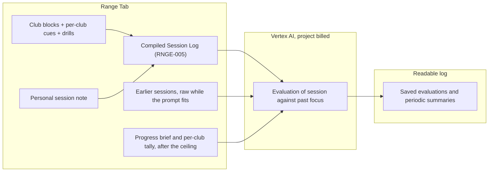

# Product Requirements Document — My Golf Diary

## Document Header

| Version | Status | Date | Owner |
| :--- | :--- | :--- | :--- |
| 1.8 | Approved (On Course dual-mode) | 2026-11-19 | Jason (PM cohort) |
| 1.7 | Approved | 2026-11-15 | Jason (PM cohort) |
| 1.6 | Approved (V2 epics additive) | 2026-11-15 | Jason (PM cohort) |

**Stories:** Embedded in §3 (34 total across v1 and planned roadmap). Optional `docs/stories/[PREFIX]/` files can mirror these IDs later. No file-per-story set for this version.

**Inputs:** [`ProjectBrief.md`](./ProjectBrief.md) v1.0 · [`PH_Golf_Venues.md`](./PH_Golf_Venues.md) · [`PH_Golf_Course_Hole_Coordinates.md`](./PH_Golf_Course_Hole_Coordinates.md) · [`Range_Drills.md`](./Range_Drills.md) · Code: `golf_diary_app/lib/` (Flutter).

---

## 1. Executive Summary

My Golf Diary is a **local-first** Flutter companion: **My Bag** (club stats + swing notes), **Range** (structured practice drills selector, multi-club block drill min/max/avg, per-club cues, an overall session note, a compiled session log, and a future Vertex AI Golf Swing Diary), **On Course** (**Course** vs **Simulator** dual-mode fairway HUD—catalog hole/par, GPS or typed carry, optional map/satellite HUD on mapped holes, penalties, mulligans, concede, optional upload), and **Scorecard** (18 holes + editor). The product goal is **one trusted bag** and **traceable rounds** with **mode-based tabs** (bottom nav), not deep menus. Cloud backup today is anonymous and per install. A future account menu in the sync slot (`SYNC-005`–`SYNC-010`) adds Google and email/password sign-in so the same diary, including compiled range session logs, can be saved to Firestore and opened on another phone or the PWA. V2 epics **MGDV-2…7** are additive planning on that same local-first core. Prefixes **BAG**, **CRSE**, **SCOR**, **RNGE**, **SYNC**, **MGDV** bind requirements to [`Architecture.md`](./Architecture.md) code map.

---

## 2. Target Users & Personas

| Persona | Job | Design implication |
| :--- | :--- | :--- |
| **Rounds-first Rory** | Log shots + honest score between swings, with live distance to the pin and visual stroke tracking when course coordinates exist | CRSE + SCOR consistency; zero clutter on unmapped courses |
| **Range-first Riley** | Pick structured practice drills, log block aggregates across several clubs, jot a session review, compile a session log, and review Vertex AI swing diary takeaways | RNGE drill catalog + RNGE → BAG path + compiled session log (`RNGE-005`) + future AI Swing Diary (`RNGE-004`) |
| **Bag-first Blake** | Pre-round yardages + cues | BAG clarity + persistence |

Rory, Riley, and Blake all keep one diary if they switch phones or open the PWA. That multi-device account is future `SYNC-005`–`SYNC-010`. It does not add a fourth persona, and it does not require an account before local play.

---

## 3. Feature Modules

| Prefix | Module | Code / Reference Docs |
| :--- | :--- | :--- |
| `BAG` | My Bag | `clubs_screen.dart`, `Club` |
| `CRSE` | On Course | `fairway_tracker_screen.dart`, `ShotRecord`, [`PH_Golf_Venues.md`](./PH_Golf_Venues.md), [`PH_Golf_Course_Hole_Coordinates.md`](./PH_Golf_Course_Hole_Coordinates.md) |
| `SCOR` | Scorecard | `scorecard_screen.dart`, `scorecard_hole_editor.dart`, [`PH_Golf_Venues.md`](./PH_Golf_Venues.md) |
| `RNGE` | Range | `range_drill_screen.dart`, `RangeDrillLog`, [`Range_Drills.md`](./Range_Drills.md) |
| `SYNC` | Cloud (optional) | `cloud_sync_service.dart`, `sync_cloud_button.dart` (future account avatar), `initializeFirebase` in `main.dart`, Firebase Storage (future map cache) |
| `MGDV` | V2 program (planning) | Epics **MGDV-2…7**; shards under `docs/shards/MGDV/`; full requirements land per epic |

### V2 pilot & epics (additive; v1 scope unchanged)

**Pilot club:** **Club Intramuros Golf Course** (`ph-crse-club-intramuros` in [`PH_Golf_Venues.md`](./PH_Golf_Venues.md)) — first validation for Scorecard cart view (MGDV-4), caddy pairing (MGDV-5), and club/tournament flows (MGDV-6). Mapped hole coordinates exist in [`PH_Golf_Course_Hole_Coordinates.md`](./PH_Golf_Course_Hole_Coordinates.md).

| Epic | Summary | PRD touch |
| :--- | :--- | :--- |
| **MGDV-2** | Starter wizard (age, years playing, gender); **skill tier** (beginner / amateur / seasoned pro) for UI density; Bag/Range progressive disclosure; optional cross-tab swing diary chat | New stories below; shards MGDV-201–203, MGDV-205 |
| **MGDV-3** | Putting & approach drills; putter on Range when drill category requires it; distances in **yards** | Extends RNGE-003 seed |
| **MGDV-4–7** | Scorecard cart view, caddy QR PWA pairing, tournament/attestation, barefoot tab | See Project store V2 roadmap; shards when epic opens |

**MGDV-2-001 — Onboarding & skill tier**  
As **any new golfer**, I want a **short wizard** that records my experience and **skill tier** so the app shows **simpler yardages and friendlier copy** by default.  
**AC:** (1) Wizard collects age, years playing, gender (for AI baseline only). (2) Skill tier ∈ {beginner, amateur, seasoned pro} drives UI density; gender does **not** change UI strings. (3) Profile editable in settings; local SQLite only. (4) Wizard skippable with **Finish later** until completed.

**MGDV-2-002 — Progressive disclosure (Bag & Range)**  
As a **beginner-tier** player, I want **one trusted carry number** and **Balls hit** language so Range and Bag feel coached, not like telemetry.  
**AC:** (1) Simple vs full yardage follows skill tier unless overridden in settings. (2) AppBar titles match design guide (**Range**, **On Course**). (3) SQLite column semantics unchanged. (4) Keys documented for new toggles.

**MGDV-2-003 — Swing diary as chat area (not a tab)**  
As **Riley/Rory**, I want **one diary thread** reachable from Range, On Course, and Scorecard so notes and AI evaluation stay continuous.  
**AC:** (1) No fifth bottom tab. (2) Extends RNGE-004 opt-in and offline rules. (3) Thread persists in existing diary tables. (4) Placeholder copy per UX audit.

### BAG — My Bag

**Overview:** Category chips, per-club **min/max/avg**, **swing notes** (SQLite).

**BAG-001 — Filter by category**  
As **Blake**, I want **category chips** so I see **only relevant clubs**.  
**AC:** (1) Chip selection filters list. (2) Switching categories updates without restart. (3) Empty category shows safe empty state. (4) Post-resume behavior documented if not persisted.

**BAG-002 — Distance stats**  
As **Blake**, I want **min/max/avg visible** so I know **carry and spread**.  
**AC:** (1) Row shows three stats from DB. (2) Values survive app restart. (3) All-zero still renders safely. (4) RNGE updates propagate per Architecture (refresh/save rule).

**BAG-003 — Swing notes**  
As **Riley**, I want **per-club notes** so **cues travel to the round**.  
**AC:** (1) Edit + explicit save. (2) Success feedback. (3) Notes reload on return. (4) No controller leaks on navigate away.

### CRSE — On Course

**Overview:** One **On Course** screen with **Course** vs **Simulator** mode chips (`ValueKey('oncourse-mode-course')`, `ValueKey('oncourse-mode-simulator')` per [`designs/Wireframe_OnCourse.md`](./designs/Wireframe_OnCourse.md)). Shared: active round, venue autocomplete, hole picker (`on-course-hole-previous` / `on-course-hole-label` / `on-course-hole-next`), par chips, club/lie, penalties, mulligans, concede, finish hole/round, sync. **Course mode:** catalog course → auto hole count and per-hole par; live yards-to-pin on mapped holes (`CRSE-005`); optional map/satellite HUD with tee/green/stroke markers (`CRSE-006`/`CRSE-009`); plan club/lie/aim bearing then **Record shot at ball** with sparse GPS and stroke-to-stroke yardage; unmapped courses stay on the **tabular HUD** (`CRSE-011`). **Simulator mode:** indoor bay or table play—post-shot logging after the ball lands; manual hole+par when no course card; club/lie; optional simulator **carry** and **distance-to-hole** fields; optional per-stroke notes; hole advance without GPS (`CRSE-007`).

| Concern | Course mode | Simulator mode |
| :--- | :--- | :--- |
| Venue | Catalog or custom name; par from card when known | Any label (sim shop, home bay); par chips always editable |
| Hole navigation | Picker + Finish Hole advances; catalog par on next hole | Same picker; par from card when venue matches catalog |
| Primary capture | GPS at ball when permission granted (`oncourse-record-shot-btn` label **Record shot at ball**) | Typed yards after the shot (`oncourse-sim-yards-field`) + **Record shot** |
| Distance readouts | Live yards to pin when mapped (`on-course-distance-to-hole`); segment yards between GPS fixes or stored coords | Optional carry + distance-to-hole fields (`CRSE-007`); no pin stream |
| Visual HUD | Map/satellite when hole has tee+green coords; else tabular HUD only | Tabular HUD only (map toggle hidden, same gating as `CRSE-005`) |

**CRSE-001 — Active round, course lookup & hole context**  
As **Rory**, I want **an active round, course autocomplete, and a hole picker** so **pars and hole count match where I play in either mode**.  
**AC:** (1) Bootstrap ensures/creates active round; errors are non-crashing. (2) `VenueNameField` (`oncourse-course-name-field`) suggests recent courses and catalog entries from [`PH_Golf_Venues.md`](./PH_Golf_Venues.md) while allowing custom names. (3) Selecting a catalog course with a published card applies hole par to unplayed holes and sets hole count (9 or 18); **Course** mode uses catalog par on hole change; **Simulator** mode keeps par chips editable when the venue is custom or a sim bay. (4) Hole stepper shows current hole, respects course hole count, and updates round total; switching holes loads that hole’s saved par/strokes when a row exists.

**CRSE-002 — Shot capture & pre-shot context (dual-mode)**  
As **Rory**, I want **club and lie locked before each stroke**, with **GPS on the course** and **typed distance in the simulator**, so **each shot row matches how I played it**.  
**AC:** (1) Par and lie ∈ {tee, fairway, rough, bunker, green, penalty}; par chips persist to the hole row when applicable. (2) Club chip (`oncourse-club-chip-{clubId}`) selects the club id saved on the shot. (3) **Course mode:** primary action **Record shot at ball** (`oncourse-record-shot-btn`); on permission grant, creates `ShotRecord` with hole, stroke, club, lie, lat/lon, timestamp; denied → snackbar + optional location banner (`oncourse-location-banner`); `_busy` blocks double-tap; shot list shows club name and yards or **Distance pending**. (4) **Simulator mode:** GPS is not required; player enters distance travelled in yards (`oncourse-sim-yards-field`, blank/0 blocks save with validation copy per wireframe); recorded shots use typed yards (no fabricated coordinates).

**CRSE-003 — Penalties, mulligans, concede**  
As **Rory**, I want **these on the HUD** so **I don’t switch screens mid-round**.  
**AC:** (1) +1/+2 penalties update totals. (2) Mulligan control increments + shows count. (3) Concede applies DB rule + refreshes. (4) Summary matches `RoundScore` after each action.

**CRSE-004 — Finish hole, holed end & round completion**  
As **Rory**, I want **Finish Hole / Finish Round** and **clear hole-out rules** so **I progress without leaving the HUD**.  
**AC:** (1) **Finish hole** (`oncourse-finish-hole-btn`) advances hole index, loads the next hole’s catalog par when the venue has a card (else default 4), and resets lie to **tee** when below course hole count. (2) On the final hole (9 or 18), control copy reads **Finish round** and persists the round without opening a new route. (3) **Holed out:** when strokes on the hole reach **par** or the player marks the ball **holed** (future explicit control or concede-on-green flow), the HUD may offer immediate hole advance; **double par** (strokes ≥ 2× par) still allows Finish Hole so the player can pick up pace of play. (4) Invalid or missing round id fails safe; totals stay consistent with `RoundScore` after each advance.

**CRSE-005 — Live GPS distance to hole**  
As **Rory**, I want **a live distance-from-hole yardage readout on the On Course HUD in Course mode** so **I can pick the right club for my approach**.  
**AC:** (1) Active **only** when On Course is in `Course` mode (off in `Simulator` mode) **and** the selected course + current hole have verified Tee and Green/Pin coordinates in [`PH_Golf_Course_Hole_Coordinates.md`](./PH_Golf_Course_Hole_Coordinates.md). (2) When coordinates are absent (unmapped course, unmapped hole on a partial course, or custom course), the distance-to-hole UI is completely hidden/turned off with no error state. (3) Computes Haversine distance (`Geolocator.distanceBetween` in meters × `1.09361`) from the player's live GPS position to the current hole's Green/Pin coordinate, displayed in whole yards (`ValueKey('on-course-distance-to-hole')`). (4) Updates as the player moves on the active hole and automatically pauses/stops location streaming when leaving the On Course tab, switching to Simulator mode, or selecting an unmapped hole/course to preserve battery.

**CRSE-006 — On-Course hole map view & cached course maps (Future Feature)**  
As **Rory**, I want **to switch between the HUD and a hole map view that plots tee-to-green geometry and my recorded strokes** so **I can visualize hole layout and shot dispersion offline**.  
**AC:** (1) Map toggle (`ValueKey('on-course-map-toggle')`) is enabled only in **Course** mode when the active course and hole have tee and green coordinates in [`PH_Golf_Course_Hole_Coordinates.md`](./PH_Golf_Course_Hole_Coordinates.md) (hidden in **Simulator** mode, same gating as `CRSE-005`). (2) Map view frames the vector line between the hole's Tee coordinate and Green/Pin coordinate and plots markers/polylines for each recorded `ShotRecord` (`start_lat/lon` → `end_lat/lon`) on the current hole. (3) **Map caching & sync architecture:** Course map imagery/tiles are fetched via the approved map provider (see **MGDV-18** / Watson), cached per course in **Firebase Storage**, and synced down to local device storage so once a course map is downloaded, the map view renders offline on the fairway without repeated live API calls. (4) If offline and the course map cache is not yet downloaded locally, gracefully falls back to the standard tabular HUD (`CRSE-011`) or a simplified coordinate vector canvas.

**CRSE-007 — Simulator post-shot logging (enhancement)**  
As **Riley**, I want **to log simulator or indoor-table holes stroke-by-stroke after each shot** with **optional carry, distance-to-hole, and stroke notes** so **practice rounds trace like on-course data without GPS**.  
**AC:** (1) With **Simulator** selected, the HUD emphasizes **post-shot** entry: club/lie before save, then optional **simulator carry (yds)** (`ValueKey('oncourse-sim-carry-field')`) and **distance-to-hole (yds)** (`ValueKey('oncourse-sim-distance-to-hole-field')`) in addition to the required **distance travelled** field (`oncourse-sim-yards-field`); all optional fields may be left blank without blocking save when travelled yards are valid. (2) Optional **stroke note** (`ValueKey('oncourse-stroke-note-field')`) attaches to the shot row (SQLite text column or note table per Architecture); survives hole navigation within the round. (3) Hole+par setup uses the same par chips and hole stepper as **Course** mode; **Finish hole** advances the virtual hole list for 9- or 18-hole sim rounds. (4) No GPS permission prompt in Simulator mode; switching to **Course** restores GPS capture rules from `CRSE-002` and hides simulator-only fields.

**CRSE-008 — Course plan, record at ball & stroke distances**  
As **Rory**, I want **to plan club, lie, and aim bearing on mapped holes**, then **record at the ball** with **stroke-to-stroke yardage** so **each segment reflects how I played the hole**.  
**AC:** (1) In **Course** mode, club and lie chips represent the **plan** for the next stroke; optional **aim bearing** control (`ValueKey('oncourse-aim-bearing')`, compass or degree chip row per Eunice) is shown on mapped holes and stored on the shot when set. (2) **Record shot at ball** captures sparse GPS (single read by default per Architecture § battery); when a prior stroke on the hole has coordinates, the shot list shows **segment yards** between successive ball positions (Haversine → yards, same helper as live pin distance). (3) Strokes increment from shot count; penalties/mulligans/concede from `CRSE-003` compose hole gross without double-counting manual stroke entry. (4) On unmapped holes within **Course** mode, plan fields remain; GPS save still applies when permission granted, but segment yards may show pending until coordinates exist.

**CRSE-009 — Map / satellite HUD & live markers (Course mode)**  
As **Rory**, I want **a map or satellite hole view with tee, green, and my ball markers** layered on **live or sparse GPS** so **I orient between swings without a separate app**.  
**AC:** (1) When `on-course-map-toggle` is available (`CRSE-006`), the map pane shows satellite or roadmap tiles per **MGDV-18** provider choice, frames current hole bounds, and plots tee pin, green/pin, and one marker per recorded stroke on the active hole. (2) Live GPS updates the **current ball** or **player** marker when a fix exists during **Course** mode on a mapped hole; throttling matches `CRSE-005` battery rules. (3) Switching to tabular HUD preserves the same hole, club/lie plan, and shot list. (4) **Simulator** mode never mounts the map pane (distance line and toggle absent).

**CRSE-011 — Unmapped course tabular HUD fallback**  
As **Rory**, I want **the full scoring HUD when my course has no surveyed coordinates** so **I never lose penalties, club/lie, or shot history waiting for maps**.  
**AC:** (1) When the venue is custom or `hasHoleCoordinates` is false for the active hole, **Course** mode shows only the tabular HUD card (`CRSE-001` layout per wireframe): no `on-course-distance-to-hole`, no `on-course-map-toggle`, no error placeholder. (2) **Record shot at ball** and simulator-style typed yards (if user switches to Simulator) remain available per mode rules. (3) Partial catalog courses hide pin distance and map only on unmapped holes; mapped holes on the same round still get `CRSE-005`/`CRSE-009` when selected. (4) UI uses `ValueKey('oncourse-hud-tabular')` on the primary HUD card for tests.

### SCOR — Scorecard

**Overview:** Round picker, **18-hole (or 9-hole) grid**, totals vs par, **hole editor**, **new round**, conceded markers.

**SCOR-001 — View rounds + grid**  
As **Rory**, I want **recent rounds + hole grid + totals** so **I verify the card**.  
**AC:** (1) Round selection loads holes (1–9 or 1–18 based on course card) and displays catalog par on unplayed tiles. (2) Out/in/total vs par + penalty/mulligan rollups. (3) Loading doesn’t hang forever. (4) Tab focus can refresh (`loadScorecard`). (5) **New round** action offers course autocomplete and creates a round with hole 1's catalog par without corrupting prior data.

**SCOR-002 — Hole editor**  
As **Rory**, I want **tap-to-edit** strokes/par/penalties/mulligans/concede/**complete**.  
**AC:** (1) Editor shows existing row par, or catalog par for that hole, or default 4. (2) Saves to SQLite + updates aggregates. (3) Validation/clamps per code. (4) Concede marker in grid stays consistent with CRSE rules.

**SCOR-003 — Concede visibility**  
As **Rory**, I want **gimmes visible** on the grid.  
**AC:** (1) Conceded holes distinguished (e.g. `Gimme`). (2) Updates if editor clears concede. (3) Totals match concede logic. (4) Not color-only if contrast fails.

### RNGE — Range

**Overview:** Header left-side drill selector drawer/sheet, non-putter club, **shot count**, min/max/avg fields, per-club notes, **save** `RangeDrillLog`, an overall **session note**, and a **Save and evaluate session** action that compiles the visit’s clubs, yardages, drills, per-club notes, and session note into a persisted **session log** that feeds the future Vertex AI Golf Swing Diary (`RNGE-004`).

**RNGE-001 — Club + shot block**  
As **Riley**, I want **club + shot counter** so **the drill matches my ball count**.  
**AC:** (1) Putter excluded from horizontal chips. (2) Counter increments and displays. (3) Empty club list → empty state. (4) Selected club visually obvious.

**RNGE-002 — Enter aggregates + save**  
As **Riley**, I want **min/max/avg + notes + save** so **each club block is recorded**.  
**AC:** (1) Fields parse to `RangeDrillLog` with club, counts, venue name, timestamp. (2) Default shot count 10 if counter zero per code. (3) Success snackbar. (4) Bad/non-numeric input fails safely (no crash). (5) After save, counter clears / reload per implemented UX so the player can switch clubs and record additional blocks during the same range visit.

**RNGE-003 — Structured practice drill catalog & custom drill manager**  
As **Riley**, I want **a list of practice drills accessible from a small icon on the left side of the Range header—with a short description, step-by-step instructions, and the ability to add my own drills or delete ones I don't like** so **my range sessions have clear structure**.  
**AC:** (1) A compact icon button on the left side of the Range AppBar (`ValueKey('range-header-drills-btn')`) opens the Practice Drills sheet/drawer. (2) The list is pre-populated from [`Range_Drills.md`](./Range_Drills.md), displaying each drill's title, category, and short description, and expanding on tap to show the numbered step-by-step instructions. (3) Selecting a drill links or copies the drill title/cue into the active Range session so the user can follow the steps and log their block. (4) Users can **add a custom drill** (title, category, short description, step-by-step instructions) and **delete any drill** (custom or seeded) they do not like, with changes persisted locally in SQLite (and sync-ready via tombstones/flags).

**RNGE-005 — Session note & compiled range session log (Save and evaluate)**  
As **Riley**, I want **to jot down a personal session note and compile all the clubs, yardages, drills, and per-club cues from my range visit into one session log when I tap Save and evaluate** so **I have a complete record of how the session went and a structured input ready for Vertex AI evaluation**.  
**AC:** (1) **Session note field:** Range provides a dedicated session-level note input (`ValueKey('range-session-note-field')`) distinct from the per-club Swing Cue & Mechanics Note, allowing the golfer to write overall thoughts and a personal review of the range visit; draft text survives switching between club chips during the active visit. (2) **Multi-club & drill compilation:** Tapping **Save and evaluate session** (`ValueKey('range-save-evaluate-session-btn')`) compiles the active range visit into a persisted **Range Session Log** entry containing: timestamp/date, venue name, the session note, and the list of recorded `RangeDrillLog` blocks from that visit (each with club name/id, shot count, min/max/avg yards, per-club tempo/mechanics note, and linked practice drill title/steps when used). If the user has unsaved block inputs or only a session note, the action either flushes the pending block first or saves a note-only session log safely without losing data. (3) **Session log view:** Compiled session logs are persisted locally in SQLite (and sync-ready) and displayed in the Range session log (`ValueKey('range-session-log-list')`) so the golfer can review the session note alongside the clubs and drills hit in that session. (4) **Vertex AI evaluation handoff:** The compiled session log serves as the primary "today's session" payload for `RNGE-004`; when Vertex AI evaluation is wired and online, **Save and evaluate session** passes the compiled session log directly into the evaluation flow, and when offline or before `RNGE-004` is enabled, it saves the compiled session log locally and confirms that the session is stored for later evaluation.

**RNGE-004 — Vertex AI range evaluation and Golf Swing Diary (Future Feature)**  
As **Riley**, I want **my compiled range session log—including my session note, clubs hit, yardages, per-club cues, and drills—assessed against what I have been practicing, in a continuous diary I can keep reading**, so **I can see whether a cue or a yardage is actually moving**.  
**AC (Future Scope):** (1) **Today in context:** Triggered from **Save and evaluate session** (`RNGE-005`) or on-demand from the diary, an evaluation covers the compiled session log (session note, each club block’s min / avg / max, per-club tempo notes, and linked drill steps) and says what the player has been focusing on and how those numbers compare with earlier sessions. (2) **Continuous diary:** Follow-up questions stay in one thread. A question about a specific older day uses that day’s saved session logs and club blocks. (3) **History that stays affordable:** While the prompt is under about 250,000 tokens, the model sees the real session and drill history. Past that ceiling, older history is replaced by a stored progress brief plus a per-club tally, a recent raw window remains, and today’s compiled session log stays in full. The project owner pays Vertex AI while this stays under about 1,000 people. The player does not enter an API key. (4) **A log the player can read:** Every evaluation and every periodic summary is saved locally (linked to the compiled session log where applicable) and can be reread without another model call. Range logging and session compilation still work offline when Vertex is unreachable. Where the log appears in navigation is decided later.

### SYNC — Cloud sync (optional)

**Overview:** Bidirectional sync of `clubs`, `shots`, `round_scores`, `golf_rounds`, and `range_drills` with Firestore database `my-golf-diary` under `users/{uid}/...`, plus Firebase Storage for shared course map caches. The same path serves the phone and the web PWA (IndexedDB). **Today** Anonymous Auth supplies `uid`, and the AppBar action on every tab is `SyncCloudButton` (`Key('sync-cloud-button')`, cloud icon) which runs `syncFull` immediately. `practice_drills`, `range_sessions`, swing-diary tables, and the local `golfer_profile` stay out of that sync. **Future** `SYNC-005`–`SYNC-010` replace that slot with an avatar menu so a Google or email/password account can own the diary across devices, including compiled range session logs. The MGDV-2 skill profile stays on the device. Local SQLite remains the source while offline.

**SYNC-001 — Firebase optional at launch**  
As **any user**, I want **app to run without Firebase** so **local always works**.  
**AC:** (1) Init failure doesn’t crash app. (2) `CloudSyncService.isAvailable` reflects Firebase or an injected remote. (3) README configure path stays valid. (4) No server secrets in repo. Public client config may live in `firebase_options.dart`.

**SYNC-002 — Manual sync**  
As **Rory**, I want **sync from any tab** when online.  
**AC:** (1) If unavailable → snackbar “local only”. (2) If available → `syncFull` reports pulled and pushed counts. (3) Successful pushes are marked synced. A failed write stays dirty. (4) No infinite dup push in the normal path.

**SYNC-003 — Anonymous identity**  
As **product**, each install syncs as its Firebase anonymous user.  
**AC:** (1) `SyncIdentity.ensureSignedIn()` is the user id. (2) Path stays `users/{uid}/...` on database `my-golf-diary`. (3) Durable Google and email/password accounts are future `SYNC-006` and `SYNC-008`; until they ship, each install keeps its own anonymous uid. (4) Old `users/local_user` data is not migrated automatically.

**SYNC-004 — Pull and last-write-wins**  
As **Rory**, I want **another browser or phone to pick up my diary**.  
**AC:** (1) Pull applies a remote row only when its `updatedAtMs` is newer. (2) A remote tombstone removes the local row. (3) Deleting a club uploads a tombstone before the local row disappears. (4) PWA and mobile share this behavior.

**SYNC-005 — Account avatar menu (Future Feature)**  
As **Rory**, I want **one avatar where the sync icon sits** so I can **sign in, sync, open my profile, or open settings** without a fifth tab.  
**Placement:** The control replaces `SyncCloudButton` in the `AppBar.actions` slot already used on My Bag, On Course, Scorecard, and Range. One icon only. The cloud icon does not remain beside it.  
**AC:** (1) Signed out, the control is `Key('account-avatar-button')` with a generic account icon and tooltip “Account”. Signed in, the same key shows the Google photo or initials from display name, then email. (2) Tap opens a menu with exactly four entries: Login `Key('account-menu-login')`, Sync `Key('account-menu-sync')`, Profile `Key('account-menu-profile')`, Settings `Key('account-menu-settings')`. (3) Signed out, Login opens the sign-in sheet (`SYNC-006`); Sync does not call `syncFull` and explains that sign-in is required to save to Firestore; Profile and Settings still open, and Profile offers sign-in rather than account details. Signed in, Login reads “Sign out” and signs out without deleting SQLite; Sync runs the same manual sync as `SYNC-002`. (4) Opening the menu never starts GPS, never blocks shot capture, and dismisses on outside tap. Sync result stays the existing snackbar (`pulled` / `pushed` / `failed`).

**SYNC-006 — Google and email/password sign-in (Future Feature)**  
As **Riley**, I want **to sign in with Google or email and password** so **my diary has an account I can open again**.  
**AC:** (1) The Login sheet offers Google (`Key('account-login-google')`) and email/password (`Key('account-login-email')`, `Key('account-login-password')`, `Key('account-login-submit')`) with a create-account / sign-in toggle and “Forgot password” for email. (2) Google uses Firebase Auth on Android, iOS, and the web PWA and lands on the same `users/{uid}` for that Google account. Email/password create and sign-in use Firebase Auth; wrong password, weak password, invalid email, and email-already-in-use show an inline error and leave local data unchanged. (3) An email/password account must verify email before the first cloud push. Until verified, play stays local and Sync explains why. Google accounts are treated as verified. (4) The app still launches and records bag, course, scorecard, and range with no account and when Firebase init fails (`SYNC-001`). Passwords are never written to SQLite, logs, or the repo. (5) A successful sign-in persists across relaunch until Sign out.

**SYNC-007 — Retrieve the diary on another device (Future Feature)**  
As **Blake**, I want **a second phone or the PWA signed into the same account** to **download and upload my diary**.  
**AC:** (1) After sign-in, Sync pulls then pushes `clubs`, `shots`, `round_scores`, `golf_rounds`, `range_drills`, `practice_drills`, and `range_sessions` (plus swing-diary rows) under `users/{uid}/...` on database `my-golf-diary`, using `SYNC-004` last-write-wins. Those extra tables stay out of today’s anonymous `syncFull`. The local `golfer_profile` from `MGDV-2` is not part of this cloud copy. (2) Device B, signed into the same Google or email account, shows rows Device A successfully pushed, including tombstones. (3) The snackbar includes how many local rows were replaced because the remote `updatedAtMs` was newer. There is no per-row merge screen. (4) Sign-out keeps the on-device SQLite copy and stops further cloud reads and writes for that account. The next sync requires sign-in. A reinstall plus the same account recovers the cloud copy only.

**SYNC-008 — Keep this device’s diary when the account changes (Future Feature)**  
As **Rory**, I want **the rounds already on this phone to follow me** when I **create a durable account**.  
**AC:** (1) If this install is anonymous and has local diary rows, Google or email sign-in links that anonymous user (`linkWithCredential` / equivalent) so existing `users/{uid}` docs stay put. (2) If link fails because that Google or email account already exists, the sheet offers two explicit actions. “Upload this device, then download the account” pushes local rows into the signed-in uid, then pulls with last-write-wins. “Replace this device with the account” pulls that account and does not push this device’s rows; on-device-only rows are removed only after that second confirm. Neither copy is discarded silently. (3) Legacy `users/local_user` cloud docs are still not migrated. Local rows that never synced follow the same choice. (4) Cancel returns to the anonymous or signed-out state the device had before the attempt.

**SYNC-009 — Profile (Future Feature)**  
As **Riley**, I want **a profile** so I can **see who is signed in and leave the account**.  
**AC:** (1) Profile, opened from the avatar menu, shows display name, email, Google photo or initials, and provider (Google or email). It does not edit clubs, rounds, or drills. (2) Signed out, the same screen explains that the diary is on this device only and offers the sign-in sheet. (3) Sign out (`Key('account-profile-sign-out')`) confirms, clears the Firebase session, returns the avatar to the generic icon, and leaves SQLite in place. (4) Delete account is a second, separate confirm. It deletes the Firebase Auth user and cloud docs under that `users/{uid}` only. Local SQLite remains unless the player also confirms “Erase diary on this device”.

**SYNC-010 — Settings (Future Feature)**  
As **Blake**, I want **settings beside sync** so I can **see whether the cloud has my latest diary**.  
**AC:** (1) Settings, opened from the avatar menu, shows Firebase availability, signed-in email or “Not signed in”, last successful sync time, and the count of local rows with `is_synced = 0`. (2) “Sync now” is the same action as the menu’s Sync item, including the signed-out explanation. (3) Email accounts get “Change password” and “Send verification email” here; Google accounts do not show password fields. (4) The MGDV-2 skill-tier profile stays editable here as local SQLite only and is separate from the Firebase account on Profile. This screen does not add a units toggle, handicap, or social controls. Yards stay the stored unit until a separate decision changes that.

---

## 4. User Journey Map

1. Open app → sees **bottom tabs** (My Bag / Range / On Course / Scorecard).  
2. **Pre-round** → My Bag: category + yardages + notes.  
3. **Tee or sim** → On Course: choose **Course** or **Simulator**; pick course (autocomplete sets hole pars) or sim venue; use hole picker; in **Course** mode view live **yards to pin** and optional **map/satellite HUD** when coordinates exist, **plan** club/lie/bearing, **record at ball**; in **Simulator** mode **log post-shot** with typed yards, optional carry/distance-to-hole and stroke notes.  
4. **Adjust** → penalties / mulligans / concede on HUD; **Finish Hole** advances with the course card's next par.  
5. **Verify** → Scorecard: totals; tap hole to fix strokes or par.  
6. **Range — Select Drill** → tap the left header icon on Range to open the **Practice Drills** list ([`Range_Drills.md`](./Range_Drills.md)), read the step-by-step explainer (or add/delete custom drills), and apply a drill to the session.  
7. **Range — Log Club Blocks** → pick a club, count swings, enter min/max/avg and per-club cue notes, and save the block; repeat across several clubs and drills during the range visit.  
8. **Range — Session Note & Save and Evaluate** → jot down an overall **session note** (personal review of how the session went) and tap **Save and evaluate session** to compile all club blocks, drill info, per-club notes, and the session note into a single **session log** (`RNGE-005`).  
9. **Range — Swing Diary (Future)** → feed the compiled session log into Vertex AI (`RNGE-004`) to evaluate the session against earlier practice, continue the thread, and later reread saved evaluations and periodic summaries.  
10. **Account & backup** → today, the cloud icon on any tab runs anonymous sync when Firebase is configured. Future: that same slot is an avatar (`SYNC-005`) with Login, Sync, Profile, and Settings. After Google or email sign-in, Sync writes the diary, including compiled range session logs, to that account and another device on the same account retrieves it (`SYNC-006`, `SYNC-007`).  
11. **Next round** → new round from scorecard or implied active round behavior.

---

## 5. Non-Functional Requirements

| Area | Requirement |
| :--- | :--- |
| **Performance** | Tabs and shot save feel responsive; GPS read shows busy state (target: feedback ≤ ~2s typical). Cached course maps load from local disk without blocking shot capture. |
| **Security / privacy** | No keys in source; on-device SQLite; Firestore and Firebase Storage rules before production sync. Swing-diary calls use Vertex AI billed to the project. Players do not supply a Gemini key. Future accounts (`SYNC-006`) use Firebase Auth only: passwords never sit in SQLite or logs, email/password accounts verify before the first cloud push, and rules stay `request.auth.uid == userId`. |
| **Accessibility** | Primary taps ≥48dp where feasible; theme contrast; respect OS font scale on core screens. |
| **Offline** | Bag, fairway, scorecard, range, and seeded/custom drill catalog fully usable offline; distance-to-hole works offline via device GPS + bundled coordinates; cached course maps render offline once synced from Firebase Storage; AI assessment requires connectivity. Sign-in and sync need a network. A persisted session still records offline and syncs on the next successful Sync. |
| **Location** | Request when recording or showing live hole distance; handle denied/deniedForever; automatically hide distance-to-hole on unmapped courses or Simulator mode. |
| **Battery** | Single position read per shot by default; live distance-to-hole uses a throttled/distance-filtered location stream (`distanceFilter` ≥ 2–5m) active only while On Course is visible on a mapped hole in Course mode. |

---

## 6. Out of Scope (Current v1 Baseline)

1. Official **handicap** / GHIN / competition compliance mode.  
2. **3D flyover animations** or full commercial CAD course modeling (hole map view is scoped to cached 2D Google Maps / satellite imagery + tee-to-pin and stroke coordinate overlays).  
3. **Social** / live leaderboards / multiplayer real-time sync.  
4. **Auto** launch-monitor **Bluetooth** hardware ingest (manual/sim entry v1).  
5. **Watch-first** capture.  
6. A separate non-Flutter web client. The Flutter PWA is in scope for sync.  
7. A **login wall**. Local play works with no account.  
8. **Social** profiles, public diaries, friend graphs, or more than one signed-in account at a time.  
9. **Sign in with Apple**, phone OTP, or providers other than Google and email/password, unless App Store review requires Apple (see §7).  
10. A **manual row-by-row merge** UI. Multi-device conflicts stay last-write-wins.

*(Note: **CRSE-006**/**CRSE-009** cached hole map / satellite HUD, **CRSE-007** simulator carry+note fields (schema touch), **RNGE-004** Vertex AI swing diary, and **SYNC-005–SYNC-010** account avatar, Google and email/password sign-in, and multi-device retrieve are future or enhancement tracks. Core tabular HUD, dual-mode chips, GPS shot capture, and simulator typed yards do not depend on map cache or accounts.)*

---

## 7. Open Questions & Dependencies

| Question | Owner |
| :--- | :--- |
| Yards vs meters (global preference)? | Watson + Product |
| RNGE aggregates: overwrite vs blend vs history-only? | Watson |
| Source of truth if shot count ≠ scorecard strokes? | Watson (document in Architecture) |
| Map provider, tile licensing, offline pack format, and Firebase Storage layout for per-course map caching (`CRSE-006`, **MGDV-18**) | Watson |
| Simulator shot optional columns (carry, distance-to-hole, stroke note) vs JSON payload on `ShotRecord` (`CRSE-007`) | Watson |
| Aim-bearing UX and persistence on `ShotRecord` (`CRSE-008`) | Eunice + Watson |
| Where the saved evaluation and periodic-summary log appears in navigation (`RNGE-004`) | Jason + Eunice |
| What replaces project-billed Vertex AI if the diary reaches about 1,000 people | Jason + Watson |
| iOS **Info.plist** location strings | Watson |
| If iOS App Store review requires Sign in with Apple whenever Google sign-in is offered, add it before the iOS ship of `SYNC-006`. Product decision until then: Google and email/password only | Jason + Watson |
| Email-verification copy and how long an unverified account may keep playing local-only (`SYNC-006`) | Jason |
| Analytics for Brief KPIs | Jason + Watson |

**Dependencies:**
- Firebase project `novusinc-8df79`, Firestore database `my-golf-diary`, Anonymous Auth enabled, and `firestore.rules` deployed to that database. `initializeFirebase` in `main.dart`.
- Future `SYNC-006`: enable Google and Email/Password on that same project (no new Firebase project). Android needs the app’s SHA fingerprints; the PWA domain must be an authorized domain. Anonymous linking behavior is specified in `SYNC-008`.
- [`PH_Golf_Course_Hole_Coordinates.md`](./PH_Golf_Course_Hole_Coordinates.md) for `CRSE-005` live distance-to-hole and `CRSE-006` hole map bounds.
- [`Range_Drills.md`](./Range_Drills.md) for `RNGE-003` seeded practice drills.
- **MGDV-18** (Watson): selected map provider and keys for `CRSE-006`/`CRSE-009` satellite or roadmap tiles; must align with Architecture § Constraints (no secrets in repo, offline cache via Firebase Storage).
- Future: a Firebase Storage bucket and provider map credentials (`CRSE-006`). Vertex AI on `novusinc-8df79` for `RNGE-004`, with App Check. No separate Gemini API product and no player API key.
- [`designs/Wireframe_OnCourse.md`](./designs/Wireframe_OnCourse.md) for mode chips, hole stepper, record button, and simulator yards field keys; map layout in [`designs/Wireframe_HoleMap.md`](./designs/Wireframe_HoleMap.md).

---

## 8. Success Metrics

| KPI (from Brief) | v1 / Roadmap measurement |
| :--- | :--- |
| Clubs with non-zero avg @ 30d | Future SQL/analytics or manual |
| Shots per 18-equivalent | Local query / research |
| Complete 18-hole rounds | `round_scores` completion stats |
| RNGE saves / user / month | `range_drills` club blocks + compiled range session logs (`RNGE-005`) + % of sessions using a structured drill (`RNGE-003`) |
| Swing diary use (future) | Share of compiled range session logs (`RNGE-005`) that produce a saved evaluation, and whether players reopen the evaluation log (`RNGE-004`) |
| Diary recovered on a second device (future) | Among players who create a Google or email account, share who complete a successful Sync on a second install within 30 days. Count Firebase Auth users against distinct installs; no new analytics SDK in this story (`SYNC-007`) |

Interim: **5+ interviews** on “log at cart/bag” and “card matches round.”

---

## Document history

| Ver | Date | Summary |
| :--- | :--- | :--- |
| 1.0 | 2026-11-06 | From ProjectBrief v1.0 + code surfaces |
| 1.1 | 2026-11-07 | SYNC-004 pull/merge, anonymous uid, PWA in scope for sync |
| 1.2 | 2026-11-08 | Reference [`PH_Golf_Venues.md`](./PH_Golf_Venues.md) lookup table for CRSE, SCOR, and RNGE |
| 1.3 | 2026-11-09 | Add `CRSE-005` (live GPS distance to hole on mapped courses), `CRSE-006` (future On-Course hole map view with Google Maps + Firebase Storage cache), `RNGE-003` (Range header drill picker + custom add/delete + [`Range_Drills.md`](./Range_Drills.md)), and `RNGE-004` (future Google AI daily range assessment & RAG Golf Swing Diary chat) |
| 1.4 | 2026-11-09 | Align `RNGE-004` with Architecture 1.3: Vertex AI billed to the project under about 1,000 people, raw history until about 250,000 tokens, then a stored progress brief, and a readable log of evaluations and periodic summaries. No embeddings and no player API key in this phase |
| 1.5 | 2026-11-11 | Add `RNGE-005` (Range session note + **Save and evaluate session** compiled session log bundling multi-club blocks, per-club notes, drill info, and the overall session review) and connect it as the primary input to `RNGE-004` Vertex AI evaluation |
| 1.6 | 2026-11-15 | Add V2 **MGDV** epic table, **Intramuros Club** pilot note, and MGDV-2-001…003 stories (wizard, progressive disclosure, cross-tab diary); v1 module stories unchanged |
| 1.7 | 2026-11-15 | Future account menu in the sync slot, rebased onto v1.6: `SYNC-005` avatar with Login, Sync, Profile, and Settings; `SYNC-006` Google and email/password; `SYNC-007` same diary on another device, including compiled `range_sessions`; `SYNC-008` link or explicit upload when leaving anonymous auth; `SYNC-009` Firebase profile, separate from the local MGDV-2 skill profile; `SYNC-010` sync settings. Local play stays signed-out. Not in the current build |
| 1.8 | 2026-11-19 | **On Course dual-mode enhancement (Reuben):** refine `CRSE-001`/`CRSE-002`/`CRSE-004` for Course vs Simulator chips; add `CRSE-007` simulator post-shot logging (optional carry, distance-to-hole, stroke notes), `CRSE-008` plan + record-at-ball + stroke segments, `CRSE-009` map/satellite HUD markers, `CRSE-011` unmapped tabular fallback; tie map stack to **MGDV-18**; wireframe `ValueKey`s from `Wireframe_OnCourse.md` |
