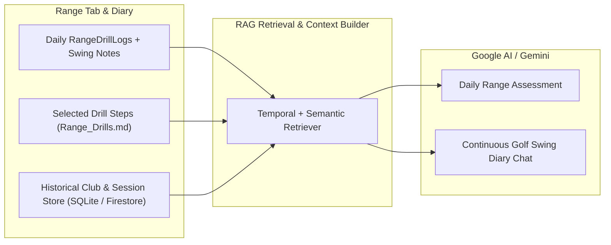

# Product Requirements Document — My Golf Diary

## Document Header

| Version | Status | Date | Owner |
| :--- | :--- | :--- | :--- |
| 1.3 | Approved | 2026-11-09 | Jason (PM cohort) |

**Stories:** Embedded in §3 (20 total across v1 and planned roadmap). Optional `docs/stories/[PREFIX]/` files can mirror these IDs later.

**Inputs:** [`ProjectBrief.md`](./ProjectBrief.md) v1.0 · [`PH_Golf_Venues.md`](./PH_Golf_Venues.md) · [`PH_Golf_Course_Hole_Coordinates.md`](./PH_Golf_Course_Hole_Coordinates.md) · [`Range_Drills.md`](./Range_Drills.md) · Code: `golf_diary_app/lib/` (Flutter).

---

## 1. Executive Summary

My Golf Diary is a **local-first** Flutter companion: **My Bag** (club stats + swing notes), **On Course** (GPS fairway HUD, live distance-to-hole metric on mapped courses, future cached course map view, penalties, mulligans, concede, optional upload), **Scorecard** (18 holes + editor), and **Range** (structured practice drills selector, block drill min/max/avg, notes, and a future Google AI / RAG continuous Golf Swing Diary chat). The product goal is **one trusted bag** and **traceable rounds** with **mode-based tabs** (bottom nav), not deep menus. Prefixes **BAG**, **CRSE**, **SCOR**, **RNGE**, **SYNC** bind requirements to [`Architecture.md`](./Architecture.md) code map.

---

## 2. Target Users & Personas

| Persona | Job | Design implication |
| :--- | :--- | :--- |
| **Rounds-first Rory** | Log shots + honest score between swings, with live distance to the pin and visual stroke tracking when course coordinates exist | CRSE + SCOR consistency; zero clutter on unmapped courses |
| **Range-first Riley** | Pick structured practice drills, log block aggregates on the right club, and review daily AI swing diary takeaways | RNGE drill catalog + RNGE → BAG path + future AI Swing Diary |
| **Bag-first Blake** | Pre-round yardages + cues | BAG clarity + persistence |

---

## 3. Feature Modules

| Prefix | Module | Code / Reference Docs |
| :--- | :--- | :--- |
| `BAG` | My Bag | `clubs_screen.dart`, `Club` |
| `CRSE` | On Course | `fairway_tracker_screen.dart`, `ShotRecord`, [`PH_Golf_Venues.md`](./PH_Golf_Venues.md), [`PH_Golf_Course_Hole_Coordinates.md`](./PH_Golf_Course_Hole_Coordinates.md) |
| `SCOR` | Scorecard | `scorecard_screen.dart`, `scorecard_hole_editor.dart`, [`PH_Golf_Venues.md`](./PH_Golf_Venues.md) |
| `RNGE` | Range | `range_drill_screen.dart`, `RangeDrillLog`, [`Range_Drills.md`](./Range_Drills.md) |
| `SYNC` | Cloud (optional) | `cloud_sync_service.dart`, `initializeFirebase` in `main.dart`, Firebase Storage (future map cache) |

### BAG — My Bag

**Overview:** Category chips, per-club **min/max/avg**, **swing notes** (SQLite).

**BAG-001 — Filter by category**  
As **Blake**, I want **category chips** so I see **only relevant clubs**.  
**AC:** (1) Chip selection filters list. (2) Switching categories updates without restart. (3) Empty category shows safe empty state. (4) Post-resume behavior documented if not persisted.

**BAG-002 — Distance stats**  
As **Blake**, I want **min/max/avg visible** so I know **carry and spread**.  
**AC:** (1) Row shows three stats from DB. (2) Values survive app restart. (3) All-zero still renders safely. (4) RNGE updates propagate per Architecture (refresh/save rule).

**BAG-003 — Swing notes**  
As **Riley**, I want **per-club notes** so **cues travel to the round**.  
**AC:** (1) Edit + explicit save. (2) Success feedback. (3) Notes reload on return. (4) No controller leaks on navigate away.

### CRSE — On Course

**Overview:** Fairway HUD: course lookup & hole par, live distance-to-hole GPS metric (when hole coordinates exist), future cached hole map view with stroke plotting, lie, club, **GPS shot**, penalties, mulligans, concede, finish hole/round, **sync** action.

**CRSE-001 — Active round & course lookup**  
As **Rory**, I want **an active round + course name autocomplete** so **data is grouped and hole pars match my course**.  
**AC:** (1) Bootstrap ensures/creates active round. (2) Course field suggests recent courses and catalog entries from [`PH_Golf_Venues.md`](./PH_Golf_Venues.md) while allowing custom names. (3) Selecting a course with a published card applies hole par to unplayed holes and sets hole count (9 or 18). (4) HUD shows **round total** updates and bootstrap errors are non-crashing.

**CRSE-002 — GPS shot + pre-shot context**  
As **Rory**, I want **par, lie, club, then GPS capture** so **metadata matches each stroke**.  
**AC:** (1) Par chips persist to hole row when applicable. (2) Lie ∈ {tee, fairway, rough, bunker, green, penalty}. (3) Club chip selects id used on save. (4) On permission grant, record creates shot with hole, stroke, club, lie, lat/lon, time; denied → snackbar; busy blocks double-tap; list refreshes with distance or pending.

**CRSE-003 — Penalties, mulligans, concede**  
As **Rory**, I want **these on the HUD** so **I don’t switch screens mid-round**.  
**AC:** (1) +1/+2 penalties update totals. (2) Mulligan control increments + shows count. (3) Concede applies DB rule + refreshes. (4) Summary matches `RoundScore` after each action.

**CRSE-004 — Finish hole/round**  
As **Rory**, I want **Finish Hole / Finish Round** so **I progress through the course card**.  
**AC:** (1) Advances hole, loads next hole's catalog par (or 4), & resets lie when below course hole count. (2) Final hole (9 or 18) action completes the round. (3) Persists + updates totals. (4) Invalid round id is safe.

**CRSE-005 — Live GPS distance to hole**  
As **Rory**, I want **a live distance-from-hole yardage readout on the On Course HUD in Course mode** so **I can pick the right club for my approach**.  
**AC:** (1) Active **only** when On Course is in `Course` mode (off in `Simulator` mode) **and** the selected course + current hole have verified Tee and Green/Pin coordinates in [`PH_Golf_Course_Hole_Coordinates.md`](./PH_Golf_Course_Hole_Coordinates.md). (2) When coordinates are absent (unmapped course, unmapped hole on a partial course, or custom course), the distance-to-hole UI is completely hidden/turned off with no error state. (3) Computes Haversine distance (`Geolocator.distanceBetween` in meters × `1.09361`) from the player's live GPS position to the current hole's Green/Pin coordinate, displayed in whole yards (`ValueKey('on-course-distance-to-hole')`). (4) Updates as the player moves on the active hole and automatically pauses/stops location streaming when leaving the On Course tab, switching to Simulator mode, or selecting an unmapped hole/course to preserve battery.

**CRSE-006 — On-Course hole map view & cached course maps (Future Feature)**  
As **Rory**, I want **to switch between the HUD and a hole map view that plots tee-to-green geometry and my recorded strokes** so **I can visualize hole layout and shot dispersion offline**.  
**AC:** (1) Map toggle (`ValueKey('on-course-map-toggle')`) is enabled only when the active course and hole have tee and green coordinates in [`PH_Golf_Course_Hole_Coordinates.md`](./PH_Golf_Course_Hole_Coordinates.md). (2) Map view frames the vector line between the hole's Tee coordinate and Green/Pin coordinate and plots markers/polylines for each recorded `ShotRecord` (`start_lat/lon` → `end_lat/lon`) on the current hole. (3) **Map caching & sync architecture:** Course map imagery/tiles are fetched via Google Maps API, cached per course in **Firebase Storage**, and synced down to local device storage so once a course map is downloaded, the map view renders offline on the fairway without repeated live Google Maps API calls. (4) If offline and the course map cache is not yet downloaded locally, gracefully falls back to the standard HUD or a simplified coordinate vector canvas.

### SCOR — Scorecard

**Overview:** Round picker, **18-hole (or 9-hole) grid**, totals vs par, **hole editor**, **new round**, conceded markers.

**SCOR-001 — View rounds + grid**  
As **Rory**, I want **recent rounds + hole grid + totals** so **I verify the card**.  
**AC:** (1) Round selection loads holes (1–9 or 1–18 based on course card) and displays catalog par on unplayed tiles. (2) Out/in/total vs par + penalty/mulligan rollups. (3) Loading doesn’t hang forever. (4) Tab focus can refresh (`loadScorecard`). (5) **New round** action offers course autocomplete and creates a round with hole 1's catalog par without corrupting prior data.

**SCOR-002 — Hole editor**  
As **Rory**, I want **tap-to-edit** strokes/par/penalties/mulligans/concede/**complete**.  
**AC:** (1) Editor shows existing row par, or catalog par for that hole, or default 4. (2) Saves to SQLite + updates aggregates. (3) Validation/clamps per code. (4) Concede marker in grid stays consistent with CRSE rules.

**SCOR-003 — Concede visibility**  
As **Rory**, I want **gimmes visible** on the grid.  
**AC:** (1) Conceded holes distinguished (e.g. `Gimme`). (2) Updates if editor clears concede. (3) Totals match concede logic. (4) Not color-only if contrast fails.

### RNGE — Range

**Overview:** Header left-side drill selector drawer/sheet, non-putter club, **shot count**, min/max/avg fields, notes, **save** `RangeDrillLog`, plus future Google AI / RAG continuous Golf Swing Diary assessment.

**RNGE-001 — Club + shot block**  
As **Riley**, I want **club + shot counter** so **the drill matches my ball count**.  
**AC:** (1) Putter excluded from horizontal chips. (2) Counter increments and displays. (3) Empty club list → empty state. (4) Selected club visually obvious.

**RNGE-002 — Enter aggregates + save**  
As **Riley**, I want **min/max/avg + notes + save** so **the session is recorded**.  
**AC:** (1) Fields parse to `RangeDrillLog` with club, counts, venue name, timestamp. (2) Default shot count 10 if counter zero per code. (3) Success snackbar. (4) Bad/non-numeric input fails safely (no crash). (5) After save, counter clears / reload per implemented UX.

**RNGE-003 — Structured practice drill catalog & custom drill manager**  
As **Riley**, I want **a list of practice drills accessible from a small icon on the left side of the Range header—with a short description, step-by-step instructions, and the ability to add my own drills or delete ones I don't like** so **my range sessions have clear structure**.  
**AC:** (1) A compact icon button on the left side of the Range AppBar (`ValueKey('range-header-drills-btn')`) opens the Practice Drills sheet/drawer. (2) The list is pre-populated from [`Range_Drills.md`](./Range_Drills.md), displaying each drill's title, category, and short description, and expanding on tap to show the numbered step-by-step instructions. (3) Selecting a drill links or copies the drill title/cue into the active Range session so the user can follow the steps and log their block. (4) Users can **add a custom drill** (title, category, short description, step-by-step instructions) and **delete any drill** (custom or seeded) they do not like, with changes persisted locally in SQLite (and sync-ready via tombstones/flags).

**RNGE-004 — Google AI Range Assessment & Continuous RAG Golf Swing Diary Chat (Future Feature)**  
As **Riley**, I want **a Google AI assessment of my drills and swing notes—capable of summarizing all range notes taken in a day and maintaining a continuous Gemini-style Golf Swing Diary chat grounded in my historical practice data (RAG)** so **I can track swing evolution and get personalized coaching insights over time**.  
**AC (Conceptual / Future Scope):** (1) **Daily Range Summary:** On-demand or end-of-day action synthesizes all `RangeDrillLog` entries, selected drills, yardage spreads (`min`/`max`/`avg`), and `tempo_notes` recorded on that date into a concise AI coaching assessment. (2) **Continuous Golf Swing Diary Chat:** Provides a persistent, multi-turn conversational thread (like Gemini chat) where the golfer asks questions ("Why did my 7-iron dispersion tighten last week?", "What cue worked when my driver started slicing in October?") and logs free-form feel thoughts. (3) **RAG Grounding Architecture:** Retrieves relevant historical context from the user's local/synced `range_drills`, `clubs.swing_notes`, and prior diary summaries (via embeddings / semantic retrieval or structured temporal context windows) before calling the Google AI (Gemini) API, ensuring responses cite the golfer's own logged sessions rather than generic tips. (4) **Offline & Privacy Guardrails:** Requires explicit user opt-in and network connectivity; raw local SQLite logs remain usable offline when AI services are unreachable.

### SYNC — Cloud sync (optional)

**Overview:** Bidirectional sync of `clubs`, `shots`, `round_scores`, `range_drills` (and future custom drills / map cache metadata) with Firestore database `my-golf-diary` under `users/{uid}/...` and Firebase Storage for shared course map caches. The same path serves the phone and the web PWA (IndexedDB). Anonymous Auth supplies `uid`.

**SYNC-001 — Firebase optional at launch**  
As **any user**, I want **app to run without Firebase** so **local always works**.  
**AC:** (1) Init failure doesn’t crash app. (2) `CloudSyncService.isAvailable` reflects Firebase or an injected remote. (3) README configure path stays valid. (4) No server secrets in repo. Public client config may live in `firebase_options.dart`.

**SYNC-002 — Manual sync**  
As **Rory**, I want **sync from any tab** when online.  
**AC:** (1) If unavailable → snackbar “local only”. (2) If available → `syncFull` reports pulled and pushed counts. (3) Successful pushes are marked synced. A failed write stays dirty. (4) No infinite dup push in the normal path.

**SYNC-003 — Anonymous identity**  
As **product**, each install syncs as its Firebase anonymous user.  
**AC:** (1) `SyncIdentity.ensureSignedIn()` is the user id. (2) Path stays `users/{uid}/...` on database `my-golf-diary`. (3) Linking Google or email is a later epic. (4) Old `users/local_user` data is not migrated automatically.

**SYNC-004 — Pull and last-write-wins**  
As **Rory**, I want **another browser or phone to pick up my diary**.  
**AC:** (1) Pull applies a remote row only when its `updatedAtMs` is newer. (2) A remote tombstone removes the local row. (3) Deleting a club uploads a tombstone before the local row disappears. (4) PWA and mobile share this behavior.

---

## 4. User Journey Map

1. Open app → sees **bottom tabs** (Bag / On Course / Scorecard / Range).  
2. **Pre-round** → My Bag: category + yardages + notes.  
3. **Tee** → On Course: pick course (autocomplete sets hole pars), view live GPS **distance to hole** (when course coordinates exist), record shots with GPS at natural breaks, or toggle to the cached **hole map view** (future) to inspect stroke coordinates.  
4. **Adjust** → penalties / mulligans / concede on HUD; **Finish Hole** advances with the course card's next par.  
5. **Verify** → Scorecard: totals; tap hole to fix strokes or par.  
6. **Range — Select Drill** → tap the left header icon on Range to open the **Practice Drills** list ([`Range_Drills.md`](./Range_Drills.md)), read the step-by-step explainer (or add/delete custom drills), and apply a drill to the session.  
7. **Range — Log Block** → pick club, count swings, enter min/max/avg and tempo notes, save.  
8. **Range — AI Swing Diary (Future)** → request a **Google AI daily assessment** of today's drills and notes, and continue the conversation in the RAG-backed **Golf Swing Diary chat**.  
9. **Backup** → **cloud sync** if Firebase is configured.  
10. **Next round** → new round from scorecard or implied active round behavior.

---

## 5. Non-Functional Requirements

| Area | Requirement |
| :--- | :--- |
| **Performance** | Tabs and shot save feel responsive; GPS read shows busy state (target: feedback ≤ ~2s typical). Cached course maps load from local disk without blocking shot capture. |
| **Security / privacy** | No keys in source; on-device SQLite; Firestore & Firebase Storage rules before prod sync; Google AI API keys proxied or secured per Watson's architecture. |
| **Accessibility** | Primary taps ≥48dp where feasible; theme contrast; respect OS font scale on core screens. |
| **Offline** | Bag, fairway, scorecard, range, and seeded/custom drill catalog fully usable offline; distance-to-hole works offline via device GPS + bundled coordinates; cached course maps render offline once synced from Firebase Storage; AI assessment requires connectivity. |
| **Location** | Request when recording or showing live hole distance; handle denied/deniedForever; automatically hide distance-to-hole on unmapped courses or Simulator mode. |
| **Battery** | Single position read per shot by default; live distance-to-hole uses a throttled/distance-filtered location stream (`distanceFilter` ≥ 2–5m) active only while On Course is visible on a mapped hole in Course mode. |

---

## 6. Out of Scope (Current v1 Baseline)

1. Official **handicap** / GHIN / competition compliance mode.  
2. **3D flyover animations** or full commercial CAD course modeling (hole map view is scoped to cached 2D Google Maps / satellite imagery + tee-to-pin and stroke coordinate overlays).  
3. **Social** / live leaderboards / multiplayer real-time sync.  
4. **Auto** launch-monitor **Bluetooth** hardware ingest (manual/sim entry v1).  
5. **Watch-first** capture.  
6. A separate non-Flutter web client. The Flutter PWA is in scope for sync.

*(Note: **CRSE-006** Cached Course Map View and **RNGE-004** Google AI / RAG Golf Swing Diary Chat are documented in §3 as **Future Features** for architectural planning and phased delivery.)*

---

## 7. Open Questions & Dependencies

| Question | Owner |
| :--- | :--- |
| Yards vs meters (global preference)? | Watson + Product |
| RNGE aggregates: overwrite vs blend vs history-only? | Watson |
| Source of truth if shot count ≠ scorecard strokes? | Watson (document in Architecture) |
| Google Maps Static/Tile API licensing & Firebase Storage bucket structure for per-course map caching (`CRSE-006`) | Watson |
| RAG storage & embedding strategy for Google AI Swing Diary (`RNGE-004`): client-side SQLite vector search vs Firestore Vector Search / Vertex AI / Gemini long-context window | Watson + Jason |
| iOS **Info.plist** location strings | Watson |
| Linking anonymous uid to Google or email, and migrating `local_user` | Product + Watson |
| Analytics for Brief KPIs | Jason + Watson |

**Dependencies:**
- Firebase project `novusinc-8df79`, Firestore database `my-golf-diary`, Anonymous Auth enabled, and `firestore.rules` deployed to that database. `initializeFirebase` in `main.dart`.
- [`PH_Golf_Course_Hole_Coordinates.md`](./PH_Golf_Course_Hole_Coordinates.md) for `CRSE-005` live distance-to-hole and `CRSE-006` hole map bounds.
- [`Range_Drills.md`](./Range_Drills.md) for `RNGE-003` seeded practice drills.
- Future: Firebase Storage bucket + Google Maps API key (`CRSE-006`), and Google AI (Gemini) API / Firebase Vertex AI integration (`RNGE-004`).

---

## 8. Success Metrics

| KPI (from Brief) | v1 / Roadmap measurement |
| :--- | :--- |
| Clubs with non-zero avg @ 30d | Future SQL/analytics or manual |
| Shots per 18-equivalent | Local query / research |
| Complete 18-hole rounds | `round_scores` completion stats |
| RNGE saves / user / month | `range_drills` counts + % of sessions using a structured drill (`RNGE-003`) |
| AI Diary engagement (future) | % of range days followed by a daily AI assessment or Swing Diary chat turn (`RNGE-004`) |

Interim: **5+ interviews** on “log at cart/bag” and “card matches round.”

---

## Document history

| Ver | Date | Summary |
| :--- | :--- | :--- |
| 1.0 | 2026-11-06 | From ProjectBrief v1.0 + code surfaces |
| 1.1 | 2026-11-07 | SYNC-004 pull/merge, anonymous uid, PWA in scope for sync |
| 1.2 | 2026-11-08 | Reference [`PH_Golf_Venues.md`](./PH_Golf_Venues.md) lookup table for CRSE, SCOR, and RNGE |
| 1.3 | 2026-11-09 | Add `CRSE-005` (live GPS distance to hole on mapped courses), `CRSE-006` (future On-Course hole map view with Google Maps + Firebase Storage cache), `RNGE-003` (Range header drill picker + custom add/delete + [`Range_Drills.md`](./Range_Drills.md)), and `RNGE-004` (future Google AI daily range assessment & RAG Golf Swing Diary chat) |
