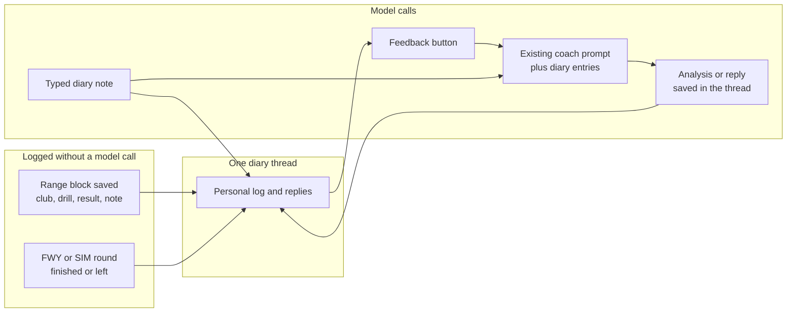

# Product Requirements Document — My Golf Diary

## Document Header

| Version | Status | Date | Owner |
| :--- | :--- | :--- | :--- |
| 1.12 | Approved (MGDV-6 epic) | 2026-11-23 | Jason (PM cohort) |
| 1.11 | Approved (diary thread) | 2026-11-20 | Jason (PM cohort) |
| 1.9 | Approved (shipped-features audit) | 2026-11-20 | Jason (PM cohort) |
| 1.8 | Approved (On Course dual-mode) | 2026-11-19 | Jason (PM cohort) |
| 1.7 | Approved | 2026-11-15 | Jason (PM cohort) |
| 1.6 | Approved (V2 epics additive) | 2026-11-15 | Jason (PM cohort) |

**PRD revision note (1.12):** **MGDV-6** is defined in §3: **shipped** individual/group scoring (`MGDV-601` — Gross, Molave, System 36, paid mulligans, unofficial handicap estimate, local attestation, flight QR, caddy hole scores); **planned** club tournament pilot at Intramuros (enrollment, event-scoped leaderboard, committee attestation, post-tournament diary). Philippine format rules are normative in this PRD; full scoring engine behavior is in shard [`MGDV-601`](../shards/MGDV/MGDV-601-scoring-formats.md). Club back-office scoring (Gscore-class) stays out of scope per [`Roadmap-V3.md`](./Roadmap-V3.md) §5.3.

**PRD revision note (1.11):** `RNGE-004` is one ongoing diary thread: a personal log and an AI sounding board. The existing coach prompt stays and reads diary entries as context. A saved range club block, and a **FWY** or **SIM** round that is finished or left, each write an entry and do not call the model. **Feedback** in the diary submits recent entries and saves the analysis in the thread. A note typed in the diary is saved, then the model replies in that same thread. `RNGE-005` still compiles the range session log and does not start a model call. Architecture §5.7 still describes the previous auto-evaluate path; Watson owns that alignment (§7).

**PRD revision note (1.9):** Aligned with `golf_diary_app/` and `docs/shards/` as of 2026-11-20. Documents shipped **CRSE-035/036** On Course layouts (SIM compact stack; **FWY** full-bleed map shell), **CRSE-041** OSM stylized hole **map packs** via Firebase Storage, **Finish Hole holing stroke**, header **account avatar** (**SYNC-005**, partial **SYNC-006** sign-in), **MGDV-201/202/203** onboarding + skill-tier Bag stat-tile cards and Range yardage disclosure, **MGDV-401** scorecard cart view, partial **RNGE-004** Vertex swing diary, tier-aware **diary** entry + On Course edge swipe, **PWA** GitHub Pages deploy (`.github/workflows/publish-pwa.yml`). Map imagery matches **Architecture v1.16** (OSM-produced packs via `tools/map_pack/`).

**Stories:** Canonical narratives in [`docs/stories/`](../stories/README.md) (file-per-story); §3 below remains the requirement source with full AC text.

**Inputs:** [`ProjectBrief.md`](./ProjectBrief.md) v1.0 · [`PH_Golf_Venues.md`](./PH_Golf_Venues.md) · [`PH_Golf_Course_Hole_Coordinates.md`](./PH_Golf_Course_Hole_Coordinates.md) · [`Range_Drills.md`](./Range_Drills.md) · Code: `golf_diary_app/lib/` (Flutter).

---

## 1. Executive Summary

My Golf Diary is a **local-first** Flutter companion (mobile + **PWA** on GitHub Pages): **My Bag** (skill-tier **stat-tile** club cards—shortest / usual / best / trend, swing notes, range session history—no Details sheet), **Range** (drill catalog, tier-aware yardage entry, block saves, session note, **Save and evaluate session** → compiled session log), **On Course** (**FWY** vs **SIM** dual mode—SIM uses a compact scroll + bottom sheets [`CRSE-035`]; **FWY** uses a full-bleed stylized hole map with side rail, Live/Manual GPS, aim ring, and stand-in holes when unsurveyed [`CRSE-036`]), and **Scorecard** (classic grid or **cart** scoring for sun-friendly use). **Diary** (`RNGE-004`) is one ongoing thread: a personal log and an AI sounding board. Range blocks and finished or left **FWY**/**SIM** rounds write entries without a model call. **Feedback** and notes typed in the diary use the existing coach prompt, with those entries as context, and save the reply in the same thread. **Account avatar** in every tab AppBar (`SYNC-005`) replaces the legacy cloud icon; Google and email/password sign-in (`SYNC-006`) ship for durable accounts, with linking behavior per `SYNC-008`. Anonymous Firestore sync remains the default until the player signs in. V2 epics **MGDV-2…7** extend the same core (onboarding wizard, caddy PWA pairing, **Philippine tournament and flight scoring** via **MGDV-6**). Prefixes **BAG**, **CRSE**, **SCOR**, **RNGE**, **SYNC**, **MGDV** bind requirements to [`Architecture.md`](./Architecture.md) code map.

---

## 2. Target Users & Personas

| Persona | Job | Design implication |
| :--- | :--- | :--- |
| **Rounds-first Rory** | Log shots + honest score between swings, with live distance to the pin and visual stroke tracking when course coordinates exist | CRSE + SCOR consistency; zero clutter on unmapped courses |
| **Range-first Riley** | Pick structured practice drills, log block aggregates across several clubs, jot a session review, compile a session log, and keep one diary that records those blocks and answers when asked | RNGE drill catalog + RNGE → BAG path + compiled session log (`RNGE-005`) + diary thread (`RNGE-004`) |
| **Bag-first Blake** | Pre-round yardages + cues | BAG clarity + persistence |

Rory, Riley, and Blake all keep one diary if they switch phones or open the PWA. **Account avatar and sign-in** (`SYNC-005`/`SYNC-006`) ship today; **full multi-device diary parity** (compiled sessions, drills, diary rows) tracks `SYNC-007`–`SYNC-010`. It does not add a fourth persona, and it does not require an account before local play.

---

## 3. Feature Modules

| Prefix | Module | Code / Reference Docs |
| :--- | :--- | :--- |
| `BAG` | My Bag | `clubs_screen.dart`, `Club` |
| `CRSE` | On Course | `fairway_tracker_screen.dart`, `fwy_hole_map.dart`, `course_map_cache_service.dart`, `ShotRecord`, [`PH_Golf_Venues.md`](./PH_Golf_Venues.md), [`PH_Golf_Course_Hole_Coordinates.md`](./PH_Golf_Course_Hole_Coordinates.md) |
| `SCOR` | Scorecard | `scorecard_screen.dart`, `scorecard_hole_editor.dart`, [`PH_Golf_Venues.md`](./PH_Golf_Venues.md) |
| `RNGE` | Range | `range_drill_screen.dart`, `RangeDrillLog`, [`Range_Drills.md`](./Range_Drills.md) |
| `SYNC` | Cloud (optional) | `cloud_sync_service.dart`, `account_avatar_app_bar_menu.dart`, `account_auth_controller.dart`, `initializeFirebase` in `main.dart`, Firebase Storage (`course_maps/` packs) |
| `MGDV` | V2 program (planning) | Epics **MGDV-2…7**; shards under `docs/shards/MGDV/`; full requirements land per epic |

### V2 pilot & epics (additive; v1 scope unchanged)

**Pilot club:** **Club Intramuros Golf Course** (`ph-crse-club-intramuros` in [`PH_Golf_Venues.md`](./PH_Golf_Venues.md)) — first validation for Scorecard cart view (MGDV-4), caddy pairing (MGDV-5), and club/tournament flows (MGDV-6). Mapped hole coordinates exist in [`PH_Golf_Course_Hole_Coordinates.md`](./PH_Golf_Course_Hole_Coordinates.md).

| Epic | Summary | PRD touch |
| :--- | :--- | :--- |
| **MGDV-2** | Starter wizard (age, years playing, gender); **skill tier** (beginner / amateur / seasoned pro) for UI density; Bag/Range progressive disclosure; optional cross-tab swing diary chat | New stories below; shards MGDV-201–203, MGDV-205 |
| **MGDV-3** | Putting & approach drills; putter on Range when drill category requires it; distances in **yards** | Extends RNGE-003 seed |
| **MGDV-4** | Scorecard **cart** scoring view | SCOR-004 / MGDV-401 *(shipped)* |
| **MGDV-5** | Caddy **QR** PWA pairing; per-stroke sync to golfer diary | [`MGDV-501`](../stories/MGDV/MGDV-501-caddy-pairing.md) *(v1 shipped; flight hole-score extensions in MGDV-6)* |
| **MGDV-6** | **Philippine formats**, attestation, **flight** sync, **pilot club tournament** | §3 **MGDV-6** stories; [`MGDV-601`](../shards/MGDV/MGDV-601-scoring-formats.md) *(shipped)*; MGDV-602+ planned |
| **MGDV-7** | Barefoot / no-glove practice tab | Roadmap only until storage architecture; no PRD stories yet |

**MGDV-2-001 — Onboarding & skill tier** *(shipped)*  
As **any new golfer**, I want a **short wizard** that records my experience and **skill tier** so the app shows **simpler yardages and friendlier copy** by default.  
**AC:** (1) `OnboardingGate` → `onboarding_starter_wizard.dart` collects age, years playing, gender (for AI baseline only). (2) Skill tier ∈ {beginner, amateur, seasoned pro} drives UI density; gender does **not** change UI strings. (3) Profile editable in `GolferProfileSettingsScreen`; local SQLite `golfer_profile` only. (4) Wizard skippable with **Finish later** (`onboarding-finish-later-btn`); **Complete** sets `onboarding_completed`. (5) Settings may reset onboarding.

**MGDV-2-002 — Progressive disclosure (Bag & Range)** *(shipped — see BAG-010 / MGDV-203)*  
As a **beginner-tier** player, I want **one trusted carry number** and **Balls hit** language so Range and Bag feel coached, not like telemetry.  
**AC:** (1) Simple vs full yardage follows skill tier and `yardage_display_mode` unless overridden in settings. (2) AppBar titles: **Range**, **On Course**, **My Bag**, **Scorecard**. (3) SQLite column semantics unchanged. (4) Range **More numbers** (`range-yardage-mode-expand`) in simple mode. (5) Bag stat-tile labels: **Shortest · Usual · Best** vs **Min · Avg · Max** in full mode.

**MGDV-2-003 — Swing diary as chat area (not a tab)** *(partial — RNGE-004)*  
As **Riley/Rory**, I want **one diary thread** reachable from Range, On Course, and Scorecard so notes and AI evaluation stay continuous.  
**AC:** (1) No fifth bottom tab. (2) `SharedHeaderActions` + `PlayHeaderOverflowButton` open `SwingDiarySheet`; On Course adds right-edge swipe (`oncourse-diary-edge-swipe`). (3) One thread holds golfer notes, triggered range and round entries, and model replies. (4) Tier-aware policy hides or overflows diary/caddy affordances (`HeaderActionPolicy`). (5) Triggered entries do not call the model. **Feedback** and typed notes do, under the RNGE-004 token ceiling below.

### BAG — My Bag

**Overview:** Category chips, per-club **stat-tile cards** (shortest / usual / best / trend sparkline), **session count** chip → range logs sheet, **swing notes** on-card (SQLite). No **Details** button or sheet (`MGDV-203`).

**BAG-010 — Stat-tile club cards (progressive disclosure)** *(shipped)*  
As **Blake**, I want **yardages and trend on one compact card** so I trust my bag without opening a second screen.  
**AC:** (1) One card per club (`bag-club-card-{clubId}`) ≤ ~140dp at 360dp width. (2) Row 1: name + brand · model (tap `bag-club-edit-{clubId}` → edit dialog) + sessions chip (`bag-range-logs-{clubId}`). (3) Row 2: four tiles `bag-min-yards-{clubId}`, `bag-hero-yards-{clubId}`, `bag-max-yards-{clubId}`, `bag-trend-{clubId}`; hero tile highlights **usual** carry. (4) Row 3: swing note line (`bag-notes-text-{clubId}` / `bag-notes-add-{clubId}`). (5) Labels follow skill tier / yardage display mode (**Shortest · Usual · Best** vs **Min · Avg · Max**). (6) No `bag-details-btn-{clubId}`.

**BAG-001 — Filter by category**  
As **Blake**, I want **category chips** so I see **only relevant clubs**.  
**AC:** (1) Chip selection filters list. (2) Switching categories updates without restart. (3) Empty category shows safe empty state. (4) Post-resume behavior documented if not persisted.

**BAG-002 — Distance stats**  
As **Blake**, I want **min/max/avg visible** so I know **carry and spread**.  
**AC:** (1) Row shows three stats from DB. (2) Values survive app restart. (3) All-zero still renders safely. (4) RNGE updates propagate per Architecture (refresh/save rule).

**BAG-003 — Swing notes**  
As **Riley**, I want **per-club notes** so **cues travel to the round**.  
**AC:** (1) Edit + explicit save. (2) Success feedback. (3) Notes reload on return. (4) No controller leaks on navigate away.

### CRSE — On Course

**Overview:** One **On Course** screen (`fairway_tracker_screen.dart`) with **FWY** (fairway / outdoor) vs **SIM** (simulator) toggle (`oncourse-mode-toggle`; segment keys `oncourse-mode-course` / `oncourse-mode-simulator`, labels **FWY** / **SIM**). Shared: active round, course summary sheets, hole picker, par chips, penalties, mulligans, concede, **Finish hole** with **holing stroke** (see `CRSE-004`), tier-aware header (**diary**, **caddy QR**, **account avatar**). **SIM** [`CRSE-035` shipped]: single-scroll compact stack + modal bottom sheets for club/lie/course/hole/par; Record / Concede / Finish dock on first viewport; optional carry / to-hole / notes via chips. **FWY** [`CRSE-036` shipped]: full-bleed `FwyHoleMap` background (OSM stylized pack from Firebase Storage when available, else vector line or **stand-in** hole); top overlay scrim; side **rail** (club / lie / aim / pen / mul); **Record shot at ball** only in dock; shots sheet; Live vs **Manual GPS**; aim ring; double-par prompt; Concede/Finish in overflow + hole sheet — **no** legacy `on-course-map-toggle` or embedded tabular HUD card on FWY. Finishing the round, or leaving it, in **FWY** or **SIM** writes one diary entry (course, mode, score, short shot summary) and does not call the model (`RNGE-004`).

| Concern | FWY (fairway) mode | SIM (simulator) mode |
| :--- | :--- | :--- |
| Venue | Course summary sheet + catalog autocomplete | Same; par always editable when custom |
| Hole navigation | Overlay stepper + hole sheet; Finish advances with catalog par | Same compact rows (`CRSE-035`) |
| Primary capture | **Record shot at ball** — Live GPS or Manual pin on map (`CRSE-036`) | Typed **distance travelled** (`oncourse-sim-yards-field`); no GPS prompt |
| Distance readouts | Live or manual yards to pin / stand-in (`on-course-distance-to-hole`, `oncourse-standin-yards`) | Optional carry + distance-to-hole fields (`CRSE-007`) |
| Visual | Full-screen stylized hole map + OSM attribution (`CRSE-041` packs) | No map pane — scroll form only |

**CRSE-001 — Active round, course lookup & hole context**  
As **Rory**, I want **an active round, course autocomplete, and a hole picker** so **pars and hole count match where I play in either mode**.  
**AC:** (1) Bootstrap ensures/creates active round; errors are non-crashing. (2) `VenueNameField` (`oncourse-course-name-field`) suggests recent courses and catalog entries from [`PH_Golf_Venues.md`](./PH_Golf_Venues.md) while allowing custom names. (3) Selecting a catalog course with a published card applies hole par to unplayed holes and sets hole count (9 or 18); **Course** mode uses catalog par on hole change; **Simulator** mode keeps par chips editable when the venue is custom or a sim bay. (4) Hole stepper shows current hole, respects course hole count, and updates round total; switching holes loads that hole’s saved par/strokes when a row exists.

**CRSE-002 — Shot capture & pre-shot context (dual-mode)**  
As **Rory**, I want **club and lie locked before each stroke**, with **GPS on the course** and **typed distance in the simulator**, so **each shot row matches how I played it**.  
**AC:** (1) Par and lie ∈ {tee, fairway, rough, bunker, green, penalty}; par chips persist to the hole row when applicable. (2) Club chip (`oncourse-club-chip-{clubId}`) selects the club id saved on the shot. (3) **Course mode:** primary action **Record shot at ball** (`oncourse-record-shot-btn`); on permission grant, creates `ShotRecord` with hole, stroke, club, lie, lat/lon, timestamp; denied → snackbar + optional location banner (`oncourse-location-banner`); `_busy` blocks double-tap; shot list shows club name and yards or **Distance pending**. (4) **Simulator mode:** GPS is not required; player enters distance travelled in yards (`oncourse-sim-yards-field`, blank/0 blocks save with validation copy per wireframe); recorded shots use typed yards (no fabricated coordinates).

**CRSE-003 — Penalties, mulligans, concede**  
As **Rory**, I want **these on the HUD** so **I don’t switch screens mid-round**.  
**AC:** (1) +1/+2 penalties update totals. (2) Mulligan control increments + shows count. (3) Concede applies DB rule + refreshes. (4) Summary matches `RoundScore` after each action.

**CRSE-004 — Finish hole, holing stroke & round completion** *(shipped)*  
As **Rory**, I want **Finish Hole / Finish Round** to **count the holing putt** and **clear pickup rules** so **my score matches how I played**.  
**AC:** (1) **Finish hole** (`oncourse-finish-hole-btn` in SIM dock; `oncourse-overflow-finish` / hole-sheet finish in FWY) calls `finishHole`, then advances hole index and loads catalog par (else default 4). (2) Final hole (9 or 18) completes the round (`completeRound`). (3) **Holing stroke:** unless the player **picked up at double par** (strokes + penalties ≥ 2× par), hole was **conceded**, or the last shot is already marked **Holed** (`ShotRecord.notes == 'Holed'`, `isHoled`), `finishHole` appends one **green putt** shot (putter club, note **Holed**) and syncs stroke count. (4) Double-par pickup skips the holing stroke; `oncourse-double-par-banner` offers Finish without auto-advancing (FWY). (5) Totals stay consistent with `RoundScore` after each advance.

**CRSE-005 — Live GPS distance to hole**  
As **Rory**, I want **a live distance-from-hole yardage readout on the On Course HUD in Course mode** so **I can pick the right club for my approach**.  
**AC:** (1) Active **only** when On Course is in `Course` mode (off in `Simulator` mode) **and** the selected course + current hole have verified Tee and Green/Pin coordinates in [`PH_Golf_Course_Hole_Coordinates.md`](./PH_Golf_Course_Hole_Coordinates.md). (2) When coordinates are absent (unmapped course, unmapped hole on a partial course, or custom course), the distance-to-hole UI is completely hidden/turned off with no error state. (3) Computes Haversine distance (`Geolocator.distanceBetween` in meters × `1.09361`) from the player's live GPS position to the current hole's Green/Pin coordinate, displayed in whole yards (`ValueKey('on-course-distance-to-hole')`). (4) Updates as the player moves on the active hole and automatically pauses/stops location streaming when leaving the On Course tab, switching to Simulator mode, or selecting an unmapped hole/course to preserve battery.

**CRSE-006 — Stylized hole map packs & offline fairway map** *(shipped FWY shell; pack pipeline in progress)*  
As **Rory**, I want **a fairway map that works offline** showing **hole shape and my shots** without leaving the app.  
**AC (shipped):** (1) **FWY only** — full-bleed `oncourse-map-background` via `FwyHoleMap`; **SIM** never mounts the map pane (`CRSE-035`). (2) When a **CRSE-041** pack exists locally or in Firebase Storage, show stylized PNG per manifest `frame` + `oncourse-map-attribution` (default **© OpenStreetMap contributors (ODbL)**). (3) `CourseMapCacheService` / `HoleMapPackSource` download per-course packs; loading shows `oncourse-map-download`. (4) Without a pack but with surveyed tee/green: vector line badge `oncourse-map-line-only-badge`. (5) Without coordinates: **stand-in** hole from par (`oncourse-standin-badge`). (6) Legacy `on-course-map-toggle` and tabular HUD card are **removed from FWY** (superseded by `CRSE-036`). **Pipeline:** `tools/map_pack/` builds packs; owner uploads to Storage — not all catalog courses have packs yet.

**CRSE-007 — Simulator post-shot logging (enhancement)**  
As **Riley**, I want **to log simulator or indoor-table holes stroke-by-stroke after each shot** with **optional carry, distance-to-hole, and stroke notes** so **practice rounds trace like on-course data without GPS**.  
**AC:** (1) With **Simulator** selected, the HUD emphasizes **post-shot** entry: club/lie before save, then optional **simulator carry (yds)** (`ValueKey('oncourse-sim-carry-field')`) and **distance-to-hole (yds)** (`ValueKey('oncourse-sim-distance-to-hole-field')`) in addition to the required **distance travelled** field (`oncourse-sim-yards-field`); all optional fields may be left blank without blocking save when travelled yards are valid. (2) Optional **stroke note** (`ValueKey('oncourse-stroke-note-field')`) attaches to the shot row (SQLite text column or note table per Architecture); survives hole navigation within the round. (3) Hole+par setup uses the same par chips and hole stepper as **Course** mode; **Finish hole** advances the virtual hole list for 9- or 18-hole sim rounds. (4) No GPS permission prompt in Simulator mode; switching to **Course** restores GPS capture rules from `CRSE-002` and hides simulator-only fields.

**CRSE-008 — Course plan, record at ball & stroke distances**  
As **Rory**, I want **to plan club, lie, and aim bearing on mapped holes**, then **record at the ball** with **stroke-to-stroke yardage** so **each segment reflects how I played the hole**.  
**AC:** (1) In **Course** mode, club and lie chips represent the **plan** for the next stroke; optional **aim bearing** control (`ValueKey('oncourse-aim-bearing')`, compass or degree chip row per Eunice) is shown on mapped holes and stored on the shot when set. (2) **Record shot at ball** captures sparse GPS (single read by default per Architecture § battery); when a prior stroke on the hole has coordinates, the shot list shows **segment yards** between successive ball positions (Haversine → yards, same helper as live pin distance). (3) Strokes increment from shot count; penalties/mulligans/concede from `CRSE-003` compose hole gross without double-counting manual stroke entry. (4) On unmapped holes within **Course** mode, plan fields remain; GPS save still applies when permission granted, but segment yards may show pending until coordinates exist.

**CRSE-009 — FWY map overlays, aim ring & markers** *(shipped in CRSE-036)*  
As **Rory**, I want **tee-at-bottom map orientation**, **live or manual ball position**, and **aim targets** on the fairway map.  
**AC:** (1) Map uses manifest framing (tee bottom); tee/green markers and stroke rows on the active hole. (2) **Live GPS** stream (`CRSE-005`) or **Manual** pin placement (`oncourse-manual-pin`, stale-pin gate) drives yards-to-target. (3) **Aim mode** (`oncourse-aim-summary`): ring at typical club yards; snap to ring or manifest markers; save derived L/C/R in `aim_direction` (full lat/lon columns deferred per shard). (4) Side **rail** for club/lie/aim/pen/mul; `oncourse-record-shot-btn` sole dock CTA. (5) Right-edge **diary swipe** (`oncourse-diary-edge-swipe`) does not overlap rail gutters.

**CRSE-035 — Compact Simulator layout** *(shipped)*  
As **Riley**, I want **the sim stroke loop on one viewport** with **sheets for club and lie** so **I log quickly at the bay**.  
**AC:** Per shard [`CRSE-035`](../shards/CRSE/CRSE-035-compact-on-course-layout.md): FWY/SIM toggle on course row; hole stats row; Club+Lie selectors; sim yards + optional chip fields; penalty/mulligan steppers; Record/Concede/Finish dock; stroke list below fold.

**CRSE-036 — FWY map-background shell** *(shipped)*  
As **Rory**, I want **the hole map as the screen** with a **rail and overlays** so **I play without a separate GPS app**.  
**AC:** Per shard [`CRSE-036`](../shards/CRSE/CRSE-036-fwy-map-background-shell.md): full-bleed map, top overlay, side rail, shots peek sheet, Live/Manual GPS, aim ring, stand-in holes, double-par banner, overflow Concede/Finish.

**CRSE-011 — Unmapped / partial course behavior** *(updated)*  
As **Rory**, I want **full scoring when coordinates or packs are missing** so **I never wait on maps**.  
**AC:** (1) **FWY:** stand-in hole drawing + GPS record still works; no error state. (2) **SIM:** unchanged tabular stack (`CRSE-035`). (3) Partial catalog courses: mapped holes use coords/packs; unmapped holes use stand-in for that hole only. (4) `hasHoleCoordinates` still gates live pin distance (`CRSE-005`).

### SCOR — Scorecard

**Overview:** Round picker, **18-hole (or 9-hole) grid** or **cart scoring** mode (`MGDV-401`), **format totals** (Gross, Molave, System 36 — `MGDV-6`), optional **unofficial handicap** line, **local attestation**, **flight** sheet, totals vs par, **hole editor** (paid tournament mulligan), **new round**, conceded markers. View mode stored on `golfer_profile.scorecard_view_mode`; cart mode may use wakelock during an active round.

**SCOR-001 — View rounds + grid**  
As **Rory**, I want **recent rounds + hole grid + totals** so **I verify the card**.  
**AC:** (1) Round selection loads holes (1–9 or 1–18 based on course card) and displays catalog par on unplayed tiles. (2) Out/in/total vs par + penalty/mulligan rollups. (3) Loading doesn’t hang forever. (4) Tab focus can refresh (`loadScorecard`). (5) **New round** action offers course autocomplete and creates a round with hole 1's catalog par without corrupting prior data.

**SCOR-002 — Hole editor**  
As **Rory**, I want **tap-to-edit** strokes/par/penalties/mulligans/concede/**complete**.  
**AC:** (1) Editor shows existing row par, or catalog par for that hole, or default 4. (2) Saves to SQLite + updates aggregates. (3) Validation/clamps per code. (4) Concede marker in grid stays consistent with CRSE rules.

**SCOR-003 — Concede visibility**  
As **Rory**, I want **gimmes visible** on the grid.  
**AC:** (1) Conceded holes distinguished (e.g. `Gimme`). (2) Updates if editor clears concede. (3) Totals match concede logic. (4) Not color-only if contrast fails.

**SCOR-004 — Cart scoring view** *(shipped — MGDV-401)*  
As **Rory**, I want **large tap targets for riding in a cart** so **I can update the card without reading a tiny grid**.  
**AC:** (1) Segmented **Classic** / **Cart** toggle on Scorecard when a round is active or in progress. (2) Cart panel (`scorecard_cart_panel.dart`) shows hole strip, stroke count, +1 stroke, penalty, mulligan, gimme, totals banner (`scorecard-cart-*` keys). (3) Optional **high contrast** switch (`scorecard-cart-high-contrast-switch`) persists on profile. (4) Classic grid + hole editor unchanged.

### MGDV-6 — Tournament & group scoring (Philippines)

**Overview:** **MGDV-6** lets a golfer **practise and play** the formats common in PH club, corporate, and charity tournaments **on their own diary first**, then **sync a flight** without merging private shots or diary threads, and **later** join a **pilot club event** at **Club Intramuros** with an **event-scoped leaderboard** and **committee/marker attestation**. Scoring is **derived from stored strokes** (Gross, Molave, System 36); changing format does not rewrite stroke counts. **NGAP** remains the official handicap body; any in-app index is labeled **unofficial estimate**. **B2B club tournament operations** (registration desks, Gscore-class back office) stay **out of scope** — we are the golfer’s diary that feeds the game.

**Philippine format reference** (normative for product; engine in `scoring_format.dart`):

| Format | Hole points / net rule | Product notes |
| :--- | :--- | :--- |
| **Gross** | Strokes + penalties vs par | Default; net may use unofficial index when 18 holes played |
| **Molave** (modified Stableford) | HIO 6; double eagle 7 (club option 6); eagle 5; birdie 4; par 3; bogey 2; double 1; triple+ 0 (even par → 54 on any 18-hole card) | Configurable double-eagle points; confirm pick-up at triple in Molave |
| **System 36** | Par+ 2, bogey 1, double+ 0; after 18 holes daily handicap = 36 − points; net = gross − daily handicap | Running points during round; net hidden until 18 played holes |
| **Paid tournament mulligan** | Excluded from gross and HIO eligibility; max **one per nine** | Separate from practice mulligans; optional fee field (PHP) for diary/settlement copy |

**Epic boundaries**

| In MGDV-6 | Not MGDV-6 (deferred / other) |
| :--- | :--- |
| Individual + flight scoring, attestation, unofficial handicap from **entered** rating/slope | Official NGAP posting, stroke index allocation, GHIN |
| Flight QR: **hole gross summaries** for up to 4 players | Full shot-level multiplayer sync, public social feed |
| Caddy **hole-score** mode for additional flight players | Production caddy token hardening (`MGDV-501` deferrals) |
| Pilot **club tournament**: enroll, locked format, standings for enrollees | Club POS, tee-sheet ERP, Gscore replacement |

**MGDV-601 — Individual & flight scoring foundation** *(shipped)*  
As **Rory**, I want **Molave, System 36, and gross on one card**, **attest my card**, **share a flight by QR**, and let my **caddy score others by hole** so **I can practise tournament math and audit a group round without a second app**.  
**AC:** (1) **Format selector** on Scorecard (`scorecard-format-toggle`) switches Gross / Molave / System 36; totals recalculate live from par, strokes, penalties, concede, and paid mulligans without altering stored strokes. (2) **Molave:** double-eagle points 7 or 6 per round setting (`scorecard-double-eagle-7` / `scorecard-double-eagle-6`); HIO 6 when gross is 1 and no paid mulligan and not conceded; triple-bogey pick-up prompts in Molave (`scorecard-molave-pickup`). (3) **System 36:** running format points in UI; **net** and daily handicap only after 18 **played** holes. (4) **Paid mulligan** toggle in hole editor (`hole-editor-paid-mulligan`); clamp one per nine; excluded from HIO points. (5) Optional **course rating** and **slope** (`scorecard-course-rating`, `scorecard-slope`); after **three** completed rated 18-hole rounds show **Unofficial estimate** handicap (`scorecard-handicap-estimate`). (6) **Attest card** (`scorecard-attest-btn`) with name and role (self, marker, caddy, committee); edits after attest require confirm and clear attest (`scorecard-attest-edit-confirm`); badge shows edited-after-attest. (7) **Flight** sheet (`scorecard-flight-btn`): mint/join QR (`flight-qr`, `flight-code`); publish **hole grosses only**; partner **attest** flags mismatches on later publish. (8) **Caddy** scorecard: player strip (`caddy-player-strip`); `setHoleScore` for non-primary players stays off golfer `round_scores`; caddy may **attest** primary card (`caddy-attest-card`). (9) Finish-round **diary** note includes format summary and attestation label (no model call). **Shard:** [`MGDV-601`](../shards/MGDV/MGDV-601-scoring-formats.md).

**MGDV-6-010 — Club tournament enrollment (pilot)** *(planned)*  
As **Rory** at **Club Intramuros**, I want **to enroll in a posted club tournament** from the app so **my diary round is tied to that event** without giving up local-first play.  
**AC:** (1) Tournament list shows **pilot** events only (seed or Firestore doc per Architecture); each event shows name, date, course, **locked scoring format**, and fee copy when configured. (2) **Enroll** requires a **durable account** (Google or email per `SYNC-006`) — aligns with ProjectBrief “anonymous until tournament enrollment.” (3) Enrolling creates a local `tournament_enrollment` row linking `userId`, `eventId`, and optional flight assignment; play remains offline until publish/sync. (4) Golfer can **withdraw** before committee lock with confirm; withdrawn rounds stay personal-only.

**MGDV-6-011 — Tournament round under event rules** *(planned)*  
As **Rory**, I want **my scorecard to follow the event’s format and lock window** so **committee rules match what I see**.  
**AC:** (1) Starting a round **from an enrolled event** pre-selects format, double-eagle policy, and paid-mulligan policy from the event; golfer cannot switch to a conflicting format mid-round without leaving the event round. (2) **Diary silence** optional flag per event (no model calls during competition window) — implementation pairs with `MGDV-205` follow-on when event demands it. (3) **Attestation** on completion follows event policy: self-only vs marker-required before submit. (4) Unenrolled personal rounds behave exactly as `MGDV-601`.

**MGDV-6-012 — Event-scoped leaderboard** *(planned)*  
As **a flight member**, I want **standings in my tournament** in the event’s format so **we see order of play without a public social network**.  
**AC:** (1) Leaderboard shows **only players enrolled in the same event**; sort by active format total (Molave points, System 36 net, or gross). (2) Updates when a player **publishes** from flight channel or committee **imports** attested card — no live shot stream. (3) Mismatch / edited-after-attest surfaced as audit state, not silent overwrite. (4) Not a global or friend-graph leaderboard (see §6). (5) Readable offline from last sync snapshot with stale banner.

**MGDV-6-013 — Marker and committee attestation** *(planned)*  
As **a marker or committee volunteer**, I want **to attest a player’s card for the event** so **disputes have a named record**.  
**AC:** (1) Marker role can attest another golfer’s **published** hole summary or full card per event rules; stores `attested_by_name`, role, and timestamp. (2) **Committee lock** freezes standings for the event after published close time; further golfer edits flag **late correction** workflow (notify only — no auto prize logic in app). (3) Caddy attest from `MGDV-601` remains valid for non-event rounds; event may require marker in addition. (4) No payment settlement or GCash integration in v1 pilot — copy-only fee reminders allowed.

**MGDV-6-014 — Post-tournament handoff to practice** *(planned)*  
As **Riley**, I want **a short tournament wrap in the diary** so **I know what to work on at the range**.  
**AC:** (1) When committee **closes** an event, enrolled golfers receive a **diary context note** (format total, vs field median if available, biggest leak holes) — **no automatic Vertex call** unless player taps **Feedback**. (2) Note links to **Range** drill suggestions by tag (putting, approach) per Roadmap A2 — prescription detail in shard when built. (3) Personal rounds unaffected.

**MGDV-6-015 — Extend caddy flight hardening** *(planned — bridges MGDV-5 deferrals)*  
As **operations**, I want **production-safe caddy redeem and accept/dispute** when tournaments rely on caddy entry so **flight audit is trustworthy**.  
**AC:** (1) Document overlap with [`MGDV-501`](../shards/MGDV/MGDV-501-caddy-pairing-v1.md) deferrals: player picker for one device scoring full flight, accept/dispute golfer vs caddy hole, hardened token redeem. (2) Tournament events may **require** caddy-attested submit before leaderboard publish. (3) Architecture defines Firestore rules upgrade path (pilot uses same loose auth as caddy v1 until hardened).

### RNGE — Range

**Overview:** Header left-side drill selector drawer/sheet, non-putter club, **shot count**, min/max/avg fields, per-club notes, **save** `RangeDrillLog`, an overall **session note**, and a **Save and evaluate session** action that compiles the visit’s clubs, yardages, drills, per-club notes, and session note into a persisted **session log** (`RNGE-005`). Each saved club block also writes a diary entry without calling the model (`RNGE-004`).

**RNGE-001 — Club + shot block**  
As **Riley**, I want **club + shot counter** so **the drill matches my ball count**.  
**AC:** (1) Putter excluded from horizontal chips. (2) Counter increments and displays. (3) Empty club list → empty state. (4) Selected club visually obvious.

**RNGE-002 — Enter aggregates + save**  
As **Riley**, I want **min/max/avg + notes + save** so **each club block is recorded**.  
**AC:** (1) Fields parse to `RangeDrillLog` with club, counts, venue name, timestamp. (2) Default shot count 10 if counter zero per code. (3) Success snackbar. (4) Bad/non-numeric input fails safely (no crash). (5) After save, counter clears / reload per implemented UX so the player can switch clubs and record additional blocks during the same range visit. (6) Saving the block writes one diary entry for that club (`RNGE-004`) and does not call the model.

**RNGE-003 — Structured practice drill catalog & custom drill manager**  
As **Riley**, I want **a list of practice drills accessible from a small icon on the left side of the Range header—with a short description, step-by-step instructions, and the ability to add my own drills or delete ones I don't like** so **my range sessions have clear structure**.  
**AC:** (1) A compact icon button on the left side of the Range AppBar (`ValueKey('range-header-drills-btn')`) opens the Practice Drills sheet/drawer. (2) The list is pre-populated from [`Range_Drills.md`](./Range_Drills.md), displaying each drill's title, category, and short description, and expanding on tap to show the numbered step-by-step instructions. (3) Selecting a drill links or copies the drill title/cue into the active Range session so the user can follow the steps and log their block. (4) Users can **add a custom drill** (title, category, short description, step-by-step instructions) and **delete any drill** (custom or seeded) they do not like, with changes persisted locally in SQLite (and sync-ready via tombstones/flags).

**RNGE-005 — Session note & compiled range session log (Save and evaluate)**  
As **Riley**, I want **to jot down a personal session note and compile all the clubs, yardages, drills, and per-club cues from my range visit into one session log when I tap Save and evaluate** so **I have a complete record of how the session went**.  
**AC:** (1) **Session note field:** Range provides a dedicated session-level note input (`ValueKey('range-session-note-field')`) distinct from the per-club Swing Cue & Mechanics Note, allowing the golfer to write overall thoughts and a personal review of the range visit; draft text survives switching between club chips during the active visit. (2) **Multi-club & drill compilation:** Tapping **Save and evaluate session** (`ValueKey('range-save-evaluate-session-btn')`) compiles the active range visit into a persisted **Range Session Log** entry containing: timestamp/date, venue name, the session note, and the list of recorded `RangeDrillLog` blocks from that visit (each with club name/id, shot count, min/max/avg yards, per-club tempo/mechanics note, and linked practice drill title/steps when used). If the user has unsaved block inputs or only a session note, the action either flushes the pending block first or saves a note-only session log safely without losing data. (3) **Session log view:** Compiled session logs are persisted locally in SQLite (and sync-ready) and displayed in the Range session log (`ValueKey('range-session-log-list')`) so the golfer can review the session note alongside the clubs and drills hit in that session. (4) **Diary handoff:** Compiling the session log does not call the model. Per-club diary entries are already written when each block is saved (`RNGE-004`). Online and offline, the action confirms the session log is stored on this device.

**RNGE-004 — One diary thread (personal log and AI sounding board)** *(partial — thread model agreed; coach prompt already shipped)*  
As **Riley** (and **Rory** on the course), I want **one ongoing diary** that keeps **my notes and an AI sounding board in the same thread** so **practice and rounds are logged as I go, and coaching shows up when I ask**.  
**AC:** (1) **One thread.** Personal notes, triggered entries, and model replies are entries in a single diary. The thread opens from Range, On Course (overflow and edge swipe), and Scorecard. It is not a fifth tab. Entries stay on device and can be re-read offline. (2) **Existing prompt, plus diary context.** Model calls keep the current coach system instruction (biomechanics / physio / caddie method, golfer profile pillars, bag, venues) via `VertexDiaryModel` (`FirebaseAI.agentPlatform()`) when Firebase and App Check are available. They do not add a second persona or a player API key. Each call includes diary entries as context, inside the existing ~250,000-token ceiling and periodic-summary rule. Opt-in stays a local `diary_settings` choice. Vertex stays project-billed. (3) **Triggered entries do not call the model.** Saving a range drill block for one club writes one entry whether or not the golfer wrote a note. The entry holds club, drill, result (shot count and yardages), and the note when one was written. Finishing a **FWY** or **SIM** round, or leaving that round, writes one entry with course, mode, score, and a short shot summary. Neither write calls Vertex. **Save and evaluate session** (`RNGE-005`) still only compiles the range session log. (4) **Feedback.** A **Feedback** button in the diary (`diary-feedback-btn`) submits recent entries, within the token ceiling. The model returns an analysis. That analysis is saved as an entry in the same thread. Feedback is how a run of triggered entries is sent for coaching. (5) **Direct entries.** Text the golfer types in the diary (`diary-composer-field`, `diary-send-btn`) is saved as an entry first. The model then reads the thread, including that entry, and the reply is saved in the same thread on that turn. Offline, or before opt-in, the typed entry remains and no model call is made until Vertex can run. **Still with Watson (§7):** Architecture §5.7 still starts a model call from **Save and evaluate session**. Live-prompt compaction and the ~1,000-user cost gate are unchanged.

### SYNC — Cloud sync (optional)

**Overview:** Bidirectional sync of `clubs`, `shots`, `round_scores`, `golf_rounds`, and `range_drills` with Firestore database `my-golf-diary` under `users/{uid}/...`, plus Firebase Storage for **OSM hole map packs** (`course_maps/`). Phone and **PWA** share IndexedDB SQLite. **Today:** `AccountAvatarAppBarMenu` (`account-avatar-button`) on every tab via `SharedHeaderActions` — menu **Login / Sync / Profile / Settings** (`SYNC-005` shipped). Anonymous Auth is default; **Google and email/password** sign-in ship (`SYNC-006` partial — see gaps in §7). `syncFull` still omits `practice_drills`, `range_sessions`, swing-diary tables, and `golfer_profile`. Durable sign-in enables broader table sync per `SYNC-007` (not fully expanded in `syncFull` yet). Local SQLite remains source while offline.

**SYNC-001 — Firebase optional at launch**  
As **any user**, I want **app to run without Firebase** so **local always works**.  
**AC:** (1) Init failure doesn’t crash app. (2) `CloudSyncService.isAvailable` reflects Firebase or an injected remote. (3) README configure path stays valid. (4) No server secrets in repo. Public client config may live in `firebase_options.dart`.

**SYNC-002 — Manual sync**  
As **Rory**, I want **sync from any tab** when online.  
**AC:** (1) If unavailable → snackbar “local only”. (2) Avatar menu **Sync** (`account-menu-sync`) or Settings **Sync now** runs `syncFull` / `runDiarySync` with pulled/pushed counts. (3) Signed-out Sync explains sign-in required (no silent `syncFull`). (4) Successful pushes mark synced; failed writes stay dirty.

**SYNC-003 — Anonymous identity**  
As **product**, each install syncs as its Firebase anonymous user.  
**AC:** (1) `SyncIdentity.ensureSignedIn()` is the user id. (2) Path stays `users/{uid}/...` on database `my-golf-diary`. (3) Durable Google and email/password accounts ship via `SYNC-006` (with linking per `SYNC-008`); anonymous uid remains the default until the player signs in. (4) Old `users/local_user` data is not migrated automatically.

**SYNC-004 — Pull and last-write-wins**  
As **Rory**, I want **another browser or phone to pick up my diary**.  
**AC:** (1) Pull applies a remote row only when its `updatedAtMs` is newer. (2) A remote tombstone removes the local row. (3) Deleting a club uploads a tombstone before the local row disappears. (4) PWA and mobile share this behavior.

**SYNC-005 — Account avatar menu** *(shipped)*  
As **Rory**, I want **one avatar where the sync icon sat** so I can **sign in, sync, open profile, or open settings** without a fifth tab.  
**Placement:** `AccountAvatarAppBarMenu` in `SharedHeaderActions` on My Bag, On Course, Scorecard, and Range; legacy `SyncCloudButton` is unused.  
**AC:** (1) `Key('account-avatar-button')` shows the signed-in Google photo first. Otherwise it shows the illustrated golfer avatar: the Settings choice, else gender × skill tier (beginner / amateur / seasoned; `seasoned_pro` → seasoned). With no avatar it falls back to initials when signed in or the generic icon when signed out. Golfer profile settings offers **Auto** plus all eight portraits; the second female and male amateur art are alternates. The choice is local SQLite (`avatar_choice`) and is not synced. (2) Menu: Login, Sync, Profile, Settings (`account-menu-*` keys). (3) Signed out: Login → `account_login_sheet.dart`; Sync explains sign-in; Profile/Settings still open. Signed in: Login → Sign out; Sync → `runDiarySync`. (4) Menu does not start GPS or block capture.

**SYNC-006 — Google and email/password sign-in** *(shipped core; enforcement gaps)*  
As **Riley**, I want **to sign in with Google or email and password** so **my diary has an account I can open again**.  
**AC (shipped):** (1) Login sheet: Google (`account-login-google`) and email/password fields with create/sign-in toggle. (2) `AccountAuthController` — Firebase Auth on mobile + PWA; anonymous **link** on first durable sign-in when possible (`linkWithCredential`). (3) Inline errors for auth failures; local SQLite unchanged on failure. (4) App works with no account (`SYNC-001`). **Gaps vs original spec:** email verification gate before first push and full “Forgot password” UX — treat as open polish (§7).

**SYNC-007 — Retrieve the diary on another device (Future Feature)**  
As **Blake**, I want **a second phone or the PWA signed into the same account** to **download and upload my diary**.  
**AC:** (1) After sign-in, Sync pulls then pushes `clubs`, `shots`, `round_scores`, `golf_rounds`, `range_drills`, `practice_drills`, and `range_sessions` (plus swing-diary rows) under `users/{uid}/...` on database `my-golf-diary`, using `SYNC-004` last-write-wins. Those extra tables stay out of today’s anonymous `syncFull`. The local `golfer_profile` from `MGDV-2` is not part of this cloud copy. (2) Device B, signed into the same Google or email account, shows rows Device A successfully pushed, including tombstones. (3) The snackbar includes how many local rows were replaced because the remote `updatedAtMs` was newer. There is no per-row merge screen. (4) Sign-out keeps the on-device SQLite copy and stops further cloud reads and writes for that account. The next sync requires sign-in. A reinstall plus the same account recovers the cloud copy only.

**SYNC-008 — Keep this device’s diary when the account changes (Future Feature)**  
As **Rory**, I want **the rounds already on this phone to follow me** when I **create a durable account**.  
**AC:** (1) If this install is anonymous and has local diary rows, Google or email sign-in links that anonymous user (`linkWithCredential` / equivalent) so existing `users/{uid}` docs stay put. (2) If link fails because that Google or email account already exists, the sheet offers two explicit actions. “Upload this device, then download the account” pushes local rows into the signed-in uid, then pulls with last-write-wins. “Replace this device with the account” pulls that account and does not push this device’s rows; on-device-only rows are removed only after that second confirm. Neither copy is discarded silently. (3) Legacy `users/local_user` cloud docs are still not migrated. Local rows that never synced follow the same choice. (4) Cancel returns to the anonymous or signed-out state the device had before the attempt.

**SYNC-009 — Profile (Future Feature)**  
As **Riley**, I want **a profile** so I can **see who is signed in and leave the account**.  
**AC:** (1) Profile, opened from the avatar menu, shows display name, email, Google photo or initials, and provider (Google or email). It does not edit clubs, rounds, or drills. (2) Signed out, the same screen explains that the diary is on this device only and offers the sign-in sheet. (3) Sign out (`Key('account-profile-sign-out')`) confirms, clears the Firebase session, returns the avatar to the generic icon, and leaves SQLite in place. (4) Delete account is a second, separate confirm. It deletes the Firebase Auth user and cloud docs under that `users/{uid}` only. Local SQLite remains unless the player also confirms “Erase diary on this device”.

**SYNC-010 — Settings (Future Feature)**  
As **Blake**, I want **settings beside sync** so I can **see whether the cloud has my latest diary**.  
**AC:** (1) Settings, opened from the avatar menu, shows Firebase availability, signed-in email or “Not signed in”, last successful sync time, and the count of local rows with `is_synced = 0`. (2) “Sync now” is the same action as the menu’s Sync item, including the signed-out explanation. (3) Email accounts get “Change password” and “Send verification email” here; Google accounts do not show password fields. (4) The MGDV-2 skill-tier profile stays editable here as local SQLite only and is separate from the Firebase account on Profile. This screen does not add a units toggle, handicap, or social controls. Yards stay the stored unit until a separate decision changes that.

---

## 4. User Journey Map

1. Open app → **onboarding wizard** on first launch (or **Finish later**) → **bottom tabs** (My Bag / Range / On Course / Scorecard).  
2. **Pre-round** → My Bag: category chips + **stat-tile** cards (usual carry, trend, notes).  
3. **Tee or sim** → On Course: **FWY** or **SIM** toggle; course/hole sheets; **FWY** — full-screen hole map, rail, Live/Manual GPS, aim ring, **Record shot at ball**; **SIM** — compact stack, typed yards, optional carry/notes chips.  
4. **Adjust** → penalties / mulligans / concede (SIM dock or FWY rail/overflow); **Finish Hole** adds holing stroke when appropriate and advances par.  
5. **Verify** → Scorecard: **Classic** grid or **Cart** scoring; tap hole to edit.  
6. **Range — Select Drill** → tap the left header icon on Range to open the **Practice Drills** list ([`Range_Drills.md`](./Range_Drills.md)), read the step-by-step explainer (or add/delete custom drills), and apply a drill to the session.  
7. **Range — Log Club Blocks** → pick a club, count swings, enter min/max/avg and per-club cue notes, and save the block. Each save writes a diary entry (club, drill, result, and the note when present) and does not call the AI. Repeat across clubs and drills during the visit.  
8. **Range — Session note and compile** → jot an overall **session note** and tap **Save and evaluate session** to compile the visit into one **session log** (`RNGE-005`). The compile stores the log and does not call the model.  
9. **Diary** → open the one thread from the header or, on On Course, the edge swipe. Read triggered entries offline. Tap **Feedback** to send recent entries and keep the analysis in the thread. Type a note to save it and receive a reply in the same thread.  
10. **Account & backup** → **Account avatar** on any tab: sign in (Google/email), Sync, Profile, Settings; anonymous play still works. Map packs download from Firebase Storage when online. **PWA** at `https://<owner>.github.io/My-Golf-Diary/` via CI publish.  
11. **Caddy (pilot)** → golfer invites caddy QR; caddy opens PWA `?mode=caddy` (On Course + Scorecard tabs); caddy may pick a flight player and enter **hole scores** on Scorecard tab.  
12. **Flight (shipped)** → from Scorecard, open **Flight**; mint or join code/QR; publish hole gross summaries; partner may attest; audit highlights edits after attest.  
13. **Formats & attest (shipped)** → choose Gross / Molave / System 36; optional rating/slope; attest card; finish writes diary summary.  
14. **Tournament (planned — MGDV-6-010+)** → enroll in pilot club event (signed-in); play under event-locked format; submit attested card; view **event-only** leaderboard; post-event diary note.  
15. **Next round** → new round from scorecard or active round on On Course.

---

## 5. Non-Functional Requirements

| Area | Requirement |
| :--- | :--- |
| **Performance** | Tabs and shot save feel responsive; GPS read shows busy state (target: feedback ≤ ~2s typical). OSM hole map packs load from local disk without blocking shot capture; pack download may show `oncourse-map-download`. |
| **Web / PWA** | Flutter web build publishes to **gh-pages** (workflow `publish-pwa.yml` on `golf_diary_app/**` changes); base href `/My-Golf-Diary/`; sqflite FFI web assets required. Service worker prompts on update (`pwa/`). |
| **Security / privacy** | No keys in source; on-device SQLite; Firestore and Firebase Storage rules before production sync. Swing-diary calls use Vertex AI billed to the project. Players do not supply a Gemini key. Future accounts (`SYNC-006`) use Firebase Auth only: passwords never sit in SQLite or logs, email/password accounts verify before the first cloud push, and rules stay `request.auth.uid == userId`. |
| **Accessibility** | Primary taps ≥48dp where feasible; theme contrast; respect OS font scale on core screens. |
| **Offline** | Bag, fairway, scorecard, range, and seeded/custom drill catalog fully usable offline; distance-to-hole works offline via device GPS + bundled coordinates; **downloaded** OSM map packs render offline on FWY; vector/stand-in fallback without packs; triggered diary entries (range block, finished or left round) save with no network. **Feedback** and typed-note replies need Vertex connectivity; the entries themselves stay on device. Sign-in, sync, and map pack **first download** need a network. |
| **Location** | Request when recording or showing live hole distance; handle denied/deniedForever; automatically hide distance-to-hole on unmapped courses or Simulator mode. |
| **Battery** | Single position read per shot by default; live distance-to-hole uses a throttled/distance-filtered location stream (`distanceFilter` ≥ 2–5m) active only while On Course is visible on a mapped hole in Course mode. |

---

## 6. Out of Scope (Current v1 Baseline)

1. Official **handicap posting** / GHIN / NGAP substitution. *(Unofficial estimate from self-entered rating/slope is in scope — MGDV-601.)*  
2. **3D flyover animations** or full commercial CAD course modeling (FWY map is **2D stylized OSM-derived art** + GPS overlay, not live satellite tiles).  
3. **Public social** feeds, friend graphs, live broadcast, and **global** leaderboards. *(**In scope:** up to four diaries on a **flight** QR sharing **hole totals**; **event-scoped** standings for enrolled pilot tournaments — MGDV-6.)*  
4. **Auto** launch-monitor **Bluetooth** hardware ingest (manual/sim entry v1).  
5. **Watch-first** capture.  
6. A separate non-Flutter web client. The Flutter PWA is in scope for sync.  
7. A **login wall**. Local play works with no account.  
8. **Social** profiles, public diaries, friend graphs, or more than one signed-in account at a time.  
9. **Sign in with Apple**, phone OTP, or providers other than Google and email/password, unless App Store review requires Apple (see §7).  
10. A **manual row-by-row merge** UI. Multi-device conflicts stay last-write-wins.

*(Note: **CRSE-041** pack coverage for all PH courses, **CRSE-038/039** extra shot/aim columns, **SYNC-007–SYNC-010** full multi-device table sync, merge UX, and account-delete flows remain enhancement tracks. **CRSE-035/036**, holing stroke, OSM packs, avatar menu, partial **RNGE-004**, onboarding, and Bag stat tiles are **in the current build**.)*

---

## 7. Open Questions & Dependencies

| Question | Owner |
| :--- | :--- |
| Yards vs meters (global preference)? | Watson + Product |
| RNGE aggregates: overwrite vs blend vs history-only? | Watson |
| Source of truth if shot count ≠ scorecard strokes? | Watson (document in Architecture) |
| Map pack coverage (% courses with OSM packs), manifest versioning, and Storage layout (`CRSE-041`); reconcile PRD OSM packs vs Architecture §5.5 Google Static | Watson |
| Simulator shot optional columns (carry, distance-to-hole, stroke note) vs JSON payload on `ShotRecord` (`CRSE-007`) | Watson |
| Aim-bearing UX and persistence on `ShotRecord` (`CRSE-008`) | Eunice + Watson |
| Align Architecture §5.7 with PRD 1.11: diary writes on a range block and on a finished or left FWY/SIM round do not call the model; the existing coach prompt takes diary-thread entries as context; **Feedback** and typed notes are the model calls, and each reply is an entry in that thread (`RNGE-004`) | Watson |
| What replaces project-billed Vertex AI if the diary reaches about 1,000 people | Jason + Watson |
| iOS **Info.plist** location strings | Watson |
| If iOS App Store review requires Sign in with Apple whenever Google sign-in is offered, add it before the iOS ship of `SYNC-006`. Product decision until then: Google and email/password only | Jason + Watson |
| Email-verification copy and how long an unverified account may keep playing local-only (`SYNC-006`) | Jason |
| Analytics for Brief KPIs | Jason + Watson |
| MGDV-6 tournament enrollment: minimum auth (Google/email only vs club guest code) | Jason + Watson |
| Event and leaderboard Firestore schema vs stay SQLite-first with optional publish | Watson |
| Marker/committee roles: in-app only vs import from club spreadsheet at pilot | Jason + pilot club |
| Wording guardrails so unofficial handicap and event standings are never confused with NGAP | Jason |
| Whether `golf_rounds` format/attestation columns join `syncFull` at enrollment (`SYNC-007`) | Watson |
| Gscore / club POS boundary for Intramuros pilot — manual committee workflow vs API | Mary + Jason |

**Dependencies:**
- Firebase project `novusinc-8df79`, Firestore database `my-golf-diary`, Anonymous Auth enabled, and `firestore.rules` deployed to that database. `initializeFirebase` in `main.dart`.
- Future `SYNC-006`: enable Google and Email/Password on that same project (no new Firebase project). Android needs the app’s SHA fingerprints; the PWA domain must be an authorized domain. Anonymous linking behavior is specified in `SYNC-008`.
- [`PH_Golf_Course_Hole_Coordinates.md`](./PH_Golf_Course_Hole_Coordinates.md) for `CRSE-005` live distance-to-hole and `CRSE-006` hole map bounds.
- [`Range_Drills.md`](./Range_Drills.md) for `RNGE-003` seeded practice drills.
- **CRSE-041** / `tools/map_pack/`: OSM Overpass → stylized PNG + `manifest.json` uploaded to Firebase Storage `course_maps/{courseId}/`.
- Vertex AI on `novusinc-8df79` for `RNGE-004`, with App Check. No player API key.
- Design: [`designs/Wireframe_OnCourse.md`](./designs/Wireframe_OnCourse.md) (SIM stack); FWY shell in shard CRSE-036 / Agent Store `docs/fwy-map-layout-plan.md`; [`designs/Wireframe_HoleMap.md`](./designs/Wireframe_HoleMap.md) partially superseded by CRSE-036.
- PWA: `.github/workflows/publish-pwa.yml`, skill `publish-pwa-github-pages`.

---

## 8. Success Metrics

| KPI (from Brief) | v1 / Roadmap measurement |
| :--- | :--- |
| Clubs with non-zero avg @ 30d | Future SQL/analytics or manual |
| Shots per 18-equivalent | Local query / research |
| Complete 18-hole rounds | `round_scores` completion stats |
| RNGE saves / user / month | `range_drills` club blocks + compiled range session logs (`RNGE-005`) + % of sessions using a structured drill (`RNGE-003`) |
| Diary thread use | Local count of thread entries by kind (range block, FWY/SIM round, golfer note, model reply) and the share of days with a **Feedback** analysis (`RNGE-004`) |
| Diary recovered on a second device (future) | Among players who create a Google or email account, share who complete a successful Sync on a second install within 30 days. Count Firebase Auth users against distinct installs; no new analytics SDK in this story (`SYNC-007`) |

Interim: **5+ interviews** on “log at cart/bag” and “card matches round.”

---

## Document history

| Ver | Date | Summary |
| :--- | :--- | :--- |
| 1.0 | 2026-11-06 | From ProjectBrief v1.0 + code surfaces |
| 1.1 | 2026-11-07 | SYNC-004 pull/merge, anonymous uid, PWA in scope for sync |
| 1.2 | 2026-11-08 | Reference [`PH_Golf_Venues.md`](./PH_Golf_Venues.md) lookup table for CRSE, SCOR, and RNGE |
| 1.3 | 2026-11-09 | Add `CRSE-005` (live GPS distance to hole on mapped courses), `CRSE-006` (future On-Course hole map view with Google Maps + Firebase Storage cache), `RNGE-003` (Range header drill picker + custom add/delete + [`Range_Drills.md`](./Range_Drills.md)), and `RNGE-004` (future Google AI daily range assessment & RAG Golf Swing Diary chat) |
| 1.4 | 2026-11-09 | Align `RNGE-004` with Architecture 1.3: Vertex AI billed to the project under about 1,000 people, raw history until about 250,000 tokens, then a stored progress brief, and a readable log of evaluations and periodic summaries. No embeddings and no player API key in this phase |
| 1.5 | 2026-11-11 | Add `RNGE-005` (Range session note + **Save and evaluate session** compiled session log bundling multi-club blocks, per-club notes, drill info, and the overall session review) and connect it as the primary input to `RNGE-004` Vertex AI evaluation |
| 1.6 | 2026-11-15 | Add V2 **MGDV** epic table, **Intramuros Club** pilot note, and MGDV-2-001…003 stories (wizard, progressive disclosure, cross-tab diary); v1 module stories unchanged |
| 1.7 | 2026-11-15 | Future account menu in the sync slot, rebased onto v1.6: `SYNC-005` avatar with Login, Sync, Profile, and Settings; `SYNC-006` Google and email/password; `SYNC-007` same diary on another device, including compiled `range_sessions`; `SYNC-008` link or explicit upload when leaving anonymous auth; `SYNC-009` Firebase profile, separate from the local MGDV-2 skill profile; `SYNC-010` sync settings. Local play stays signed-out. Not in the current build |
| 1.8 | 2026-11-19 | **On Course dual-mode enhancement (Reuben):** refine `CRSE-001`/`CRSE-002`/`CRSE-004` for Course vs Simulator chips; add `CRSE-007` simulator post-shot logging (optional carry, distance-to-hole, stroke notes), `CRSE-008` plan + record-at-ball + stroke segments, `CRSE-009` map/satellite HUD markers, `CRSE-011` unmapped tabular fallback; tie map stack to **MGDV-18**; wireframe `ValueKey`s from `Wireframe_OnCourse.md` |
| 1.9 | 2026-11-20 | **Shipped-features audit (Jason):** document **CRSE-035/036** layouts, **CRSE-041** OSM map packs, holing stroke, **BAG-010** stat tiles, **SCOR-004** cart, **SYNC-005/006** avatar + sign-in, partial **RNGE-004**, **MGDV-201/203**, PWA publish; FWY/SIM naming; flag Architecture map-provider drift |
| 1.10 | 2026-11-20 | `SYNC-005` AC(1): illustrated golfer avatars (gender × tier, amateur alternates, Settings picker); Google photo keeps precedence |
| 1.11 | 2026-11-20 | **Diary thread (`RNGE-004`):** one ongoing personal log and AI sounding board. Triggered entries on each range club block and when a FWY or SIM round is finished or left, with no model call. **Feedback** and typed notes use the existing coach prompt with diary entries as context, and the reply is saved in the same thread. `RNGE-005` compile does not start evaluation |
| 1.12 | 2026-11-23 | **MGDV-6 epic:** Philippine format table; shipped **MGDV-601** story; planned **MGDV-6-010…015** (Intramuros pilot enrollment, event rules, event leaderboard, committee attestation, post-tournament diary, caddy hardening); SCOR overview and journey updated; §6 carve-outs for flight sync and unofficial handicap |
