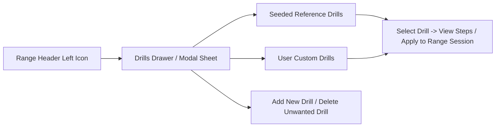

# Reference / Lookup Table — Golf Range Practice Drills

| Field | Value |
| :--- | :--- |
| **Product** | My Golf Diary |
| **Document** | Reference / Lookup Table — Golf Range Practice Drills |
| **Owner** | Jason (PM cohort) |
| **Purpose** | Seed catalog for the Range Drill selector drawer/sheet (`RNGE-003`), providing structured practice drills with short descriptions and step-by-step execution instructions |
| **Status** | Active |

---

## 1. Overview & Product Integration

In the **Range** tab (`range_drill_screen.dart`), players can browse and select structured practice drills via an icon action on the **left side of the AppBar header** (`ValueKey('range-header-drills-btn')`).

### Core User Capabilities (`RNGE-003`)
1. **Browse Seeded Drills**: View the curated drills below grouped by skill category, with a concise summary and step-by-step instructions.
2. **Apply to Session**: Selecting a drill populates the active drill context (or appends the drill title/cue into the session's swing notes) so the player can log their 10-ball block against a specific objective.
3. **Create Custom Drills**: Users can add their own drills (`title`, `category`, `shortDescription`, and ordered `steps`) stored locally in SQLite (and eligible for Firestore sync).
4. **Delete Drills**: Users can remove any drill—custom or seeded—that they do not want in their active list (using soft-delete / hide flags so deletions persist across app restarts and sync).

---

## 2. Master Range Drills Catalog

### 2.1 Full Swing & Tempo

#### `rng-drl-tempo-3to1` — 3:1 Tour Tempo Rhythm
- **Category:** Full Swing & Tempo
- **Recommended Clubs:** 7-Iron, Driver
- **Recommended Balls:** 10 balls
- **Short Description:** Build a smooth, repeatable transition by matching a 3-count backswing to a 1-count downswing through impact.
- **Step-by-Step Instructions:**
  1. Select a mid-iron (7-iron) and tee the ball slightly or place it on a clean turf mat lie.
  2. Take two rehearsal swings while counting "One-Two-Three" from takeaway to the top of the backswing, and "Four" at impact.
  3. Address the ball, release tension in your grip (aim for 4 out of 10 pressure), and execute the swing counting "1-2-3" back and "4" through.
  4. Hold a balanced finish for 3 full seconds with your belt buckle facing the target and 90% of your weight on your lead foot.
  5. Log the 10-ball block carry distances and note whether your rhythm felt rushed at the transition.

#### `rng-drl-feet-together` — Feet-Together Balance & Center Contact
- **Category:** Full Swing & Tempo
- **Recommended Clubs:** 8-Iron, 7-Iron
- **Recommended Balls:** 10 balls
- **Short Description:** Eliminate lateral swaying and improve centered clubface contact by swinging with your feet touching.
- **Step-by-Step Instructions:**
  1. Set up to the ball with a 7-iron or 8-iron, then bring your trail foot in until your shoes are touching side by side.
  2. Grip downhalf an inch on the handle to account for standing slightly taller.
  3. Make a controlled three-quarter backswing focusing on rotating your shoulders around your spine without losing balance.
  4. Swing through the ball at 75% speed and hold your finish without stepping out of position.
  5. After 5 consecutive solid strikes with feet together, widen to your normal stance for the remaining 5 balls while keeping the same centered rotation feel.

#### `rng-drl-pause-at-top` — Pause-at-the-Top Transition
- **Category:** Full Swing & Tempo
- **Recommended Clubs:** 6-Iron, 7-Iron, Hybrid
- **Recommended Balls:** 10 balls
- **Short Description:** Cure an over-the-top rush from the top by pausing for a full one-second count before starting the downswing.
- **Step-by-Step Instructions:**
  1. Address the ball with a mid-iron and pick a specific downrange target.
  2. Turn to the top of your backswing and come to a complete, deliberate stop for a "One-one-thousand" count.
  3. Initiate the downswing from the ground up by shifting pressure into your lead heel while your back stays momentarily turned to the target.
  4. Brush the turf just after the ball and finish in full balance.
  5. Repeat for 10 balls, recording min/max/avg carry to see how clean sequencing preserves distance even with a pause.

---

### 2.2 Ball Striking & Low Point Control

#### `rng-drl-towel-behind` — Towel Behind the Ball (Chunk Eradicator)
- **Category:** Ball Striking & Low Point
- **Recommended Clubs:** 9-Iron, 8-Iron, 7-Iron
- **Recommended Balls:** 10 balls
- **Short Description:** Train ball-first, turf-second iron compression by placing a folded towel behind the ball to penalize early ground contact.
- **Step-by-Step Instructions:**
  1. Lay a flat folded golf towel on the mat or grass approximately 4 to 5 inches (one clubhead width) directly behind the golf ball.
  2. Set your sternum and weight slightly favoring your lead side at address (55% lead / 45% trail).
  3. Make your normal iron swing with the goal of striking the ball cleanly without clipping or moving the towel.
  4. As contact improves, slide the towel closer (2 to 3 inches behind the ball) for the second half of your 10-ball block.
  5. Record your carry dispersion and note your low-point cue in Swing Notes.

#### `rng-drl-gate-strike` — Two-Tee Clubface Gate (Sweet-Spot Strike)
- **Category:** Ball Striking & Low Point
- **Recommended Clubs:** 7-Iron, 5-Iron, Driver
- **Recommended Balls:** 10 balls
- **Short Description:** Center your strike location on the clubface by swinging through a narrow gate of two tees or foam objects just outside the toe and heel.
- **Step-by-Step Instructions:**
  1. Place a ball down and position two rubber tees (or headcovers/range balls) outside the toe and heel of your clubhead, leaving about half an inch of clearance on each side.
  2. Take a half-speed practice rehearsal ensuring the clubhead passes cleanly through the gate without touching either marker.
  3. Hit 10 balls at 85% cruise speed, focusing on maintaining posture and wrist angles through impact.
  4. After each shot, check where the ball contacted the face (heel, center, or toe) and reset the gate if clipped.
  5. Save your 10-ball carry numbers to establish a true centered-strike yardage baseline.

#### `rng-drl-split-hand` — Split-Hand Release & Shaft Lean
- **Category:** Ball Striking & Low Point
- **Recommended Clubs:** 8-Iron, 7-Iron
- **Recommended Balls:** 10 balls
- **Short Description:** Feel proper forearm rotation and forward shaft lean through impact by separating your hands on the grip during rehearsals.
- **Step-by-Step Instructions:**
  1. Grip an 8-iron with your lead hand in its normal position and slide your trail hand down the shaft 3 to 4 inches (near the bottom of the grip).
  2. Make two slow waist-high to waist-high rehearsal swings, feeling the clubhead stay outside your hands on the takeaway and the handle lead the clubhead at impact.
  3. Return your hands together into your normal grip and immediately hit a golf ball while replicating that forward-handle sensation.
  4. Alternate 1 split-hand rehearsal with 1 live shot for a 10-ball block.
  5. Note whether ball flight launched lower and more penetrating than usual.

---

### 2.3 Distance Wedges & Scoring Matrix

#### `rng-drl-wedge-clock` — Clock-System Distance Wedge Matrix (9:00 / 10:30)
- **Category:** Distance Wedges
- **Recommended Clubs:** Pitching Wedge, Gap Wedge, Sand Wedge, Lob Wedge
- **Recommended Balls:** 10 balls per position
- **Short Description:** Dial in exact carry yardages for partial wedge swings using lead-arm clock positions (9:00 and 10:30) at a consistent tempo.
- **Step-by-Step Instructions:**
  1. Narrow your stance slightly, set 60% of your weight on your lead foot, and grip down to a consistent marker on your wedge handle.
  2. Hit 5 balls swinging your lead arm back to 9:00 (parallel to the ground) and accelerating smoothly through to a matching chest-high finish.
  3. Hit 5 balls swinging your lead arm back to 10:30 (three-quarter shoulder turn) with the same rhythm.
  4. Watch where each ball lands (carry, not total roll) or read the launch monitor carry number.
  5. Save the drill session and record your 9:00 and 10:30 carry yardages in the club's Swing Notes for on-course reference.

#### `rng-drl-random-target-ladder` — 10-Yard Distance Ladder
- **Category:** Distance Wedges
- **Recommended Clubs:** Sand Wedge, Gap Wedge, Pitching Wedge
- **Recommended Balls:** 10 balls
- **Short Description:** Train feel and distance control by hitting consecutive shots that must each carry 10 yards farther than the previous ball.
- **Step-by-Step Instructions:**
  1. Pick a starting carry distance (for example, 50 yards) with your wedge.
  2. Hit Ball 1 to carry 50 yards, Ball 2 to 60 yards, Ball 3 to 70 yards, Ball 4 to 80 yards, and Ball 5 to 90 yards.
  3. For Balls 6 through 10, work back down the ladder from 90 yards to 50 yards in 10-yard increments.
  4. Control the distance by adjusting backswing length and grip position while keeping acceleration constant.
  5. Log the session min/max/avg and note which yardage rung was hardest to hit on the number.

---

### 2.4 Shot Shaping & Start-Line Control

#### `rng-drl-alignment-stick-startline` — Start-Line Window Drill
- **Category:** Shot Shaping & Start Line
- **Recommended Clubs:** 7-Iron, 6-Iron, Hybrid, Driver
- **Recommended Balls:** 10 balls
- **Short Description:** Train clubface control at impact by starting the ball consistently through a narrow visual window downrange.
- **Step-by-Step Instructions:**
  1. Place an alignment stick on the ground pointing at your target line, or pick two tight intermediate markers 10 feet in front of your tee/mat creating a narrow window.
  2. Aim your clubface squarely through the center of the window before setting your feet parallel to the target line.
  3. Hit 10 balls with one primary focus: the ball must launch inside the start-line window during the first 30 yards of flight.
  4. Count how many out of 10 balls started on your intended line (aim for at least 7/10).
  5. Record the count in your session notes alongside your distance numbers.

#### `rng-drl-nine-flight-windows` — Draw / Straight / Fade Trajectory Control
- **Category:** Shot Shaping & Start Line
- **Recommended Clubs:** 7-Iron, 6-Iron
- **Recommended Balls:** 9 or 10 balls
- **Short Description:** Develop face-to-path awareness and wind control by intentionally shaping draws, straight shots, and fades.
- **Step-by-Step Instructions:**
  1. Pick a clear flag or target downrange as your center line.
  2. Balls 1–3 (Draw): Aim your clubface slightly right of the target (for a right-handed golfer), align your stance slightly right of the face, and swing along your foot line so the ball curves back to the flag.
  3. Balls 4–6 (Straight): Square both your clubface and stance to the target and hit three neutral, stock shots.
  4. Balls 7–9 (Fade): Aim your clubface slightly left of the target, align your stance open (left of the face), and hold the face stable through impact so the ball fades gently to the flag.
  5. Ball 10 (Pressure Stock Shot): Pick your go-to on-course shape and execute one committed swing with full pre-shot routine.

---

### 2.5 Driver & Tee Box Confidence

#### `rng-drl-driver-fairway-corridor` — Simulated Fairway Corridor (10-Ball Challenge)
- **Category:** Driver & Tee Box
- **Recommended Clubs:** Driver, 3-Wood
- **Recommended Balls:** 10 balls
- **Short Description:** Simulate real on-course tee pressure by stepping back behind the ball before every drive and aiming into a defined 30-yard fairway corridor.
- **Step-by-Step Instructions:**
  1. Define a left boundary and a right boundary on the range (two flags, trees, or simulator fairway edges) representing a 30-yard-wide fairway.
  2. Before every single ball, step completely behind the tee, visualize your shot shape, and pick a specific intermediate spot 3 feet in front of the ball.
  3. Step in, set the ball opposite your lead heel, tilt your spine slightly away from the target, and make a committed, balanced swing.
  4. Score yourself out of 10 fairways hit in regulation.
  5. Log the 10-ball min/max/avg driver distance and record your fairways-hit score (e.g., "8/10 fairways") in Swing Notes.

---

### 2.6 Pre-Round Warmup & Pressure Simulation

#### `rng-drl-simulated-3hole-loop` — Simulated 3-Hole Range Loop (Club-Switch Routine)
- **Category:** Pressure & Course Simulation
- **Recommended Clubs:** Driver, Fairway Wood/Hybrid, Mid-Iron, Wedge
- **Recommended Balls:** 10 balls
- **Short Description:** Break out of block-practice comfort by switching clubs on every swing to play three imaginary holes (Par 4, Par 3, Par 5).
- **Step-by-Step Instructions:**
  1. Lay out a Driver, a Hybrid or 5-Wood, a 7-Iron, and a Pitching or Sand Wedge next to your bay.
  2. **Hole 1 (Par 4):** Hit 1 Driver tee shot, then switch immediately to 7-Iron for your approach shot (Balls 1–2).
  3. **Hole 2 (Par 3):** Switch to your mid-iron or hybrid and hit 1 tee shot to a specific flag; follow with a partial wedge pitch as if scrambling (Balls 3–4).
  4. **Hole 3 (Par 5):** Hit 1 Driver, 1 Fairway Wood/Hybrid layup, and 1 Scoring Wedge approach (Balls 5–7).
  5. Finish the block with 3 stock swings using the primary club you are logging for the session (Balls 8–10) and save its distance aggregates.
