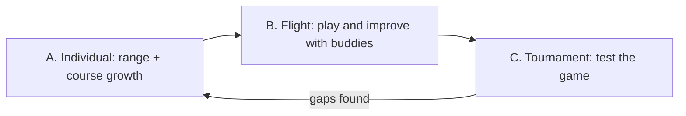

# My Golf Diary — V3 Roadmap

**Status:** Draft for review · **Date:** 2026-11-20 · **Type:** Planning only (no code)
**Benchmark:** The Grint (reference "complete roadmap") · **Market:** Philippines first

---

## 1. Purpose

V2 made the individual golfer *aware* of where they are (bag, range, course, card). V3 turns that awareness into *measured growth*, then opens the loop to a flight of buddies and finally tournaments, so each tournament sends the golfer back to the range with a clear list of what to fix.

---

## 2. The Grint — benchmark summary

### 2.1 Feature set

| Area | What The Grint offers |
| :--- | :--- |
| Handicap | USGA/WHS-style handicap index from posted rounds; official GHIN handicap in the US (paid tier); course handicap per tee |
| Scoring | Hole-by-hole scorecard, multiple players per card, scan a paper card |
| Stats | Fairways hit, greens in regulation (GIR), putts, scrambling, sand saves, penalties, scoring by par type, trends over time |
| GPS | Front/middle/back distances, hazards, layups, shot tracking with club per shot, club average distances |
| Courses | Large global course database with tees, ratings, slopes |
| Social | Friends feed, comments, sharing rounds, buddy handicaps |
| Competition | Live leaderboards, leagues, tournaments, side games (skins, Nassau, match play) |
| Devices | Apple Watch / Wear OS |
| Model | Free core; paid tiers for advanced stats, GPS extras, official handicap |

### 2.2 Golfer mindset The Grint is built for

The **everyday amateur who wants a number**: they play regularly with the same group, care about their handicap and bragging rights, and improve by seeing stats and competing with friends. It is *score-first and social-first*; practice is largely outside the app.

### 2.3 Match against V2's mindset

| Dimension | The Grint | My Golf Diary V2 |
| :--- | :--- | :--- |
| Entry point | Post a score, get a handicap | Know your bag, practise, log honestly |
| Growth driver | Stats + competition | Self-awareness + structured practice + diary |
| Practice | Minimal | Core (drills, club blocks, session log, AI diary) |
| Simulator | Minimal | First-class (SIM mode) |
| Social | Core, from day one | Deferred by design |
| Locale | US-centric (GHIN) | Philippine courses, venues, sim shops |

**Conclusion:** V2 covers the stage *before* The Grint's user: the beginner-to-amateur who needs to learn their game. V3 adopts The Grint's measurement layer (stats, handicap, course management) for the individual first, and only later its social and competition layer, reframed around the PH flight and tournament culture.

---

## 3. What V2 accomplished

| Module | Delivered | Golfer value |
| :--- | :--- | :--- |
| **Onboarding (MGDV-2)** | Starter wizard, skill tier (beginner / amateur / seasoned pro), progressive disclosure | App speaks at the golfer's level |
| **My Bag (BAG)** | Category chips, per-club min/max/avg, swing notes | "What I carry and what each club does" |
| **Range (RNGE, MGDV-3)** | Drill catalog + custom drills, putting/approach drills, multi-club blocks, session note, compiled session log, Vertex AI swing diary (planned) | Form improves, and club ranges in My Bag update from real practice |
| **On Course (CRSE)** | Course (GPS) and Simulator modes, PH catalog pars, live yards to pin, map/satellite HUD on mapped holes, plan → record at ball, penalties, mulligans, concede | Every stroke traced on fairway or in a sim bay; gross score progress |
| **Scorecard (SCOR)** | 9/18-hole grid, editor, concede visibility, totals vs par | Personal per-course record |
| **Sync (SYNC)** | Local-first, anonymous Firebase sync; accounts planned (SYNC-005–010) | Diary is safe and portable |
| **V2 close-out (MGDV-4–7)** | Scorecard cart view, caddy QR pairing, club/tournament attestation pilot at Club Intramuros | Foundation for flight and tournament stages |

**Gap V2 leaves open:** On Course records *what happened* but does not yet teach *why* or *what to do next*. Scorecard is gross-only and personal. There is no handicap, no stat trends, and no link from course weaknesses back to Range drills.

---

## 4. V3 guiding principles

1. **Individual first.** Phases 1–2 serve one golfer; social waits until the solo loop is strong.
2. **Every number points to an action.** A stat is only shown with the drill or course decision it suggests.
3. **Local-first stays.** No login wall; offline on the fairway.
4. **Philippines-native.** PH courses, caddy culture, sim shops, flights, club tournaments, pesos for side games.
5. **Borrow The Grint's measurement, not its noise.** Adopt stats/handicap; skip feature sprawl.

---

## 5. Roadmap phases

### Phase 1 — Know your game (Individual: measurement)
*Grint parity on personal stats, built on V2 data.*

| ID (proposed) | Feature | Builds on |
| :--- | :--- | :--- |
| V3-STAT-01 | Per-hole stat capture: fairway hit/miss (L/R), GIR, putts, up-and-down, sand save | CRSE shots + lie; SCOR editor |
| V3-STAT-02 | Stats dashboard: trends by round, par 3/4/5 scoring, penalties per round | SCOR history |
| V3-STAT-03 | Club performance from the course: real on-course carry vs range carry per club | CRSE segment yards + BAG |
| V3-HCP-01 | Unofficial handicap index (WHS-style) using course rating/slope from PH catalog | SCOR + PH_Golf_Venues |
| V3-HCP-02 | Net score and course handicap per round | V3-HCP-01 |
| V3-SIM-01 | Separate SIM vs FWY stat views (sim rounds excluded from handicap) | CRSE modes |

**Exit:** a golfer can answer "what's my handicap, and where do I lose strokes?"

### Phase 2 — Fix your game (Individual: coaching and course management)
*Where My Golf Diary goes beyond The Grint.*

| ID (proposed) | Feature | Builds on |
| :--- | :--- | :--- |
| V3-CM-01 | Strokes-lost breakdown: off the tee, approach, short game, putting | Phase 1 stats |
| V3-CM-02 | Hole strategy card: suggested club off the tee and target based on *your* bag dispersion and hole geometry | BAG min/max + hole coordinates |
| V3-CM-03 | Pre-round game plan and post-round review ("you went driver on 4 tight holes; 3 penalties") | CRSE plan/aim bearing |
| V3-CM-04 | Miss pattern map: dispersion per club on mapped holes | CRSE-009 map |
| V3-LOOP-01 | **Course → Range prescription**: weakest area auto-suggests drills and a practice plan | RNGE drill catalog |
| V3-LOOP-02 | AI diary spans Range + On Course + Scorecard: one thread on progress | RNGE-004, MGDV-2-003 |
| V3-GOAL-01 | Goals and milestones (break 100/90/80, handicap target, GIR %) with tier promotion | MGDV-2 skill tier |

**Exit:** after every round, the golfer gets 1–3 concrete things to practise, and can see whether they improved next round.

### Phase 3 — Play together (Flight)
*The Grint's social layer, scoped to a PH flight of buddies.*

| ID (proposed) | Feature | Builds on |
| :--- | :--- | :--- |
| V3-ACC-01 | Accounts required for flight features only (SYNC-005–010) | SYNC |
| V3-FLT-01 | Flight scorecard: up to 4 players, one scorer or each self-scores, merged card | SCOR cart view (MGDV-4) |
| V3-FLT-02 | Caddy as scorer/attester via QR PWA | MGDV-5 |
| V3-FLT-03 | Side games: skins, Nassau, match play, with net strokes from handicaps | V3-HCP-02 |
| V3-FLT-04 | Buddy list and private flight history (no public feed) | Accounts |
| V3-FLT-05 | Shared flight review: who gained where, group goals | Phase 2 stats |

**Exit:** a regular Saturday flight runs its card and games in the app and sees each other's progress.

### Phase 4 — Test your game (Tournament) → back to Range
*Grint leagues/tournaments, built from the V2 Club Intramuros pilot.*

| ID (proposed) | Feature | Builds on |
| :--- | :--- | :--- |
| V3-TRN-01 | Club tournament setup: format (stroke, Stableford, scramble), flights by handicap, tee times | MGDV-6 |
| V3-TRN-02 | Live leaderboard (gross and net) | Flight scorecards |
| V3-TRN-03 | Attested scores (marker/caddy) feeding handicap | MGDV-5/6 |
| V3-TRN-04 | Post-tournament report: stats under pressure vs casual rounds | Phase 1–2 |
| V3-TRN-05 | **Tournament → Range plan**: gaps exposed in competition become the next practice block | V3-LOOP-01 |
| V3-ORG-01 | Club / organiser view for PH clubs and corporate outings | Pilot clubs |

**Exit:** the full A → B → C loop closes in-app.

### Later / optional
Watch capture, paper-card scan, launch-monitor/sim-shop data import, official handicap partnership (NGAP or club-level), public community feed, premium tier.

---

## 6. Philippines opportunity

- **Flights and caddies are standard**: caddy-attested scoring is a natural differentiator over The Grint.
- **Sim shops are growing** in Metro Manila: SIM mode lets beginners progress before green fees.
- **Club and corporate tournaments** are frequent; organisers often still use paper and spreadsheets.
- **No dominant local app** with PH course data, ratings, and par cards; `PH_Golf_Venues.md` and hole coordinates are an asset to keep expanding.
- **Handicap access** is club-driven; an unofficial, transparent index fills the gap until a partnership exists.

---

## 7. Dependencies and open questions

| Question | Owner |
| :--- | :--- |
| Course rating/slope data for PH courses (needed for handicap) | Watson + data |
| Handicap formula: WHS clone vs simplified, and naming to avoid "official" claims | Jason |
| Strokes-gained baseline for amateurs without PGA-level data | Watson |
| Account requirement boundary (solo stays account-free) | Jason + Watson |
| Monetisation: free solo, paid flight/tournament or organiser plan? | Mary |
| Privacy for shared flight data | Watson |

---

## 8. Success metrics

| Phase | Metric |
| :--- | :--- |
| 1 | % of rounds with stats captured; handicap computed for active users |
| 2 | % of rounds followed by a prescribed range session; average gross trend over 10 rounds |
| 3 | Flights with ≥3 rounds together; side games per round |
| 4 | Tournaments run in-app; % of players starting a range plan within 7 days after a tournament |

---

## 9. Next steps

1. Mary validates scope and PH opportunity in `ProjectBrief.md`.
2. Jason converts Phase 1–2 into PRD stories (`STAT`, `HCP`, `CM`, `LOOP`, `GOAL` prefixes).
3. Watson adds data model for stats, handicap, and course ratings to `Architecture.md`.
4. Poe shards Phase 1 once V2 close-out (MGDV-4–7) ships.
