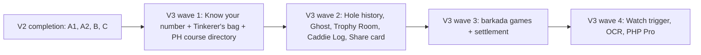

# My Golf Diary — V3 Roadmap

**Status:** Draft for review · **Date:** 2026-11-20 · **Type:** Planning only (no code)
**Benchmark:** TheGrint (Play / Improve / Compete) · **Market:** Philippines
**Source:** *TheGrint Product Teardown, Philippine Golf Market Cross-Correlation, and Roadmap Reference for My-Golf-Diary* (user research, Nov 2026)

---

## 1. How to read this document

| Track | Meaning |
| :--- | :--- |
| **V2 completion** | Gaps that finish V2's promise: the individual golfer's growth loop (Range → Course → Scorecard → back to Range), then flight and tournament. Section 3. |
| **V3 expansion** | Things TheGrint does *for the golfer* that V2 does not, cherry-picked and localized for Philippine golfers. Section 5. |

The golfer cycle stays the same for both tracks:

---

## 2. What V2 accomplished

| Module | Delivered | Golfer value |
| :--- | :--- | :--- |
| Onboarding (MGDV-2) | Starter wizard, skill tier, progressive disclosure | App speaks at the golfer's level |
| My Bag (BAG) | Category chips, per-club min/max/avg, swing notes | What I carry and what each club does |
| Range (RNGE, MGDV-3) | Drill catalog + custom drills, putting/approach drills, multi-club blocks, session note, compiled session log, Vertex AI swing diary (planned) | Form improves; club ranges update from real practice |
| On Course (CRSE) | Course (GPS) and Simulator modes, PH catalog pars, live yards to pin, map HUD on mapped holes, plan → record at ball, penalties, mulligans, concede | Every stroke traced, on the fairway or in a sim bay |
| Scorecard (SCOR) | 9/18 grid, editor, concede visibility, totals vs par | Personal per-course record |
| Sync (SYNC) | Local-first, anonymous Firebase sync; accounts planned | Diary is safe and portable |
| V2 close-out (MGDV-4–7) | Cart view, caddy QR pairing, club/tournament pilot at Club Intramuros | Foundation for flight and tournament |

---

## 3. V2 completion (gaps to close before V3)

These were drafted earlier as "V3 phases." They complete V2.

| Stage | Gap to close | Examples |
| :--- | :--- | :--- |
| **A1 — Know your game** | On Course records strokes but not stats | Fairway hit/miss, GIR, putts, up-and-down, penalties per round; on-course vs range carry per club; SIM vs FWY separation |
| **A2 — Fix your game** | No course management or link back to Range | Where strokes are lost, hole strategy from own bag dispersion, pre-round plan / post-round review, **course → range drill prescription**, goals (break 100/90/80), AI diary across tabs |
| **B — Flight** | Scorecard is single-player | Up to 4 players per card, caddy attestation (MGDV-5), private buddy history |
| **C — Tournament** | Pilot only; gross-only scoring | Club tournament flow (MGDV-6), attested scores, **Philippine scoring formats** (below), post-tournament report → range plan |

### V2 completion C — Philippine tournament scoring (moved from V3)

Club, corporate, and charity tournaments in the Philippines score with these formats more often than pure stroke play, so they complete V2's tournament stage.

| Feature | Rules | Notes |
| :--- | :--- | :--- |
| **Molave Points** | Modified Stableford: double eagle 7 (6 in some clubs), hole-in-one 6, eagle 5, birdie 4, par 3, bogey 2, double bogey 1, triple or worse 0 (even par = 54) | Club setting for 6- or 7-point double eagle; pick-up prompt once the player is on triple bogey |
| **System 36** | Par or better 2, bogey 1, double or worse 0; after 18 holes, daily handicap = 36 − points, net = gross − daily handicap | For players without an official index; computed offline after hole 18 |
| **Gross / net stroke play** | Standard | Net uses the System 36 daily handicap or the golfer's index |
| **Paid tournament mulligans** | e.g. one per nine, ₱200 | Tracked separately from gross; not eligible for hole-in-one prizes |

Scoring works offline from the same scorecard and is available in personal rounds too, so a golfer can practise a format before the tournament.

---

## 4. Overlap: TheGrint vs V2

TheGrint is built around three pillars: **Play** (GPS + scoring), **Improve** (handicap + stats), **Compete** (games, leaderboards, social).

| TheGrint capability | V2 status | Notes |
| :--- | :--- | :--- |
| GPS yardage to green | **Overlap** | V2 has live yards to pin on surveyed PH holes; TheGrint covers 40,000+ courses with front/center/back |
| Aerial hole map | **Overlap (partial)** | V2 map/satellite HUD on mapped holes only |
| Manual shot tracking with club | **Overlap** | Both are manual; V2 adds plan (club/lie/aim) and simulator typed yards |
| Basic hole-by-hole scoring | **Overlap** | V2 Scorecard + On Course |
| Penalties, mulligans, concede | **Overlap (V2 stronger)** | V2 tracks mulligans separately, which fits PH practice |
| Club average distances | **Overlap (V2 stronger)** | V2 feeds from range blocks; TheGrint from on-course shots only |
| Advanced scoring (FIR, GIR, putts) | **V2 gap** | Covered by V2 completion A1 |
| Multi-player card, attestation | **V2 gap** | Covered by V2 completion B/C |
| Range drills, swing cues, sim logging, AI diary | **V2 only** | TheGrint has none; this is our differentiator |
| Handicap Index, Anti-Handicap, What-if Score, Insights & Targets, Match Play Index | **TheGrint only** | V3 candidates |
| Hole History, Ghost Mode, Trophy Room, Highlights, Yaps | **TheGrint only** | V3 candidates |
| Side games (11 formats), Teams Cup, King of the Course, live broadcast | **TheGrint only** | V3 candidates (localized) |
| Scorecard Picture Service, Hole Notes | **TheGrint only** | V3 candidates (lightweight) |
| Watch app, Swingman rangefinder, Green Maps | **TheGrint only** | Watch later; rest skipped |

**Mindset match.** Both apps serve the amateur who wants to get better without sensor hardware. TheGrint gets them there through *the number and the group* (handicap, games, leaderboards). V2 gets them there through *the diary and the range*. V3 adds TheGrint's number and group mechanics on top of V2's practice loop.

---

## 5. V3 expansion: cherry-picked from TheGrint for the Philippine golfer

### 5.1 The Philippine golf psyche (from the research)

- **Caddie does the work.** Caddies carry, spot, call yardage, read greens, and keep the paper card. The phone is a *second opinion*, used between caddie handoffs.
- **Practice is where weekly golf happens.** Green fees and private club costs push play to driving ranges and CBD simulators (GolfX, Friends Screen, Citygolf, Villamor range).
- **Club tinkerers.** Japan trips, Japan surplus shops, and Viber trading groups (Tower Golf, ~10k members) mean mixed "franken-bags" that constantly need re-gapping.
- **Barkada play and local formats.** Molave Points, System 36, 40 Points with Escalera, Snake 3-Putt, paid mulligans; settlement over GCash / Maya; banter on Viber.
- **NGAP owns the official handicap** (₱500/year WHS). Golfers want a companion, not a rival.
- **Subscription-averse**, prefer one-time purchases; battery matters on 4.5–5 hour tropical rounds.
- **Growing young and female segment** (Gen Z, millennials, +18% female participation) that shares on IG / TikTok.

### 5.2 Picks

Each pick names the TheGrint feature it comes from, why it fits, and how it is localized.

#### Theme 1 — Know your number (Improve)

| V3 feature | From TheGrint | PH localization |
| :--- | :--- | :--- |
| **V3-HCP-01 NGAP Companion Card** | Handicap Index | Store NGAP member ID; unofficial WHS estimate after 3+ rounds; high-contrast "Clubhouse Posting Card" to hand the caddie or post on ngapwhs.com. Never claims to be official. |
| **V3-HCP-02 Anti-Handicap & Consistency Gap** | Anti-Handicap | Worst 8 of last 20 differentials vs index; shows how wide the golfer's swings in form are |
| **V3-HCP-03 What-if Score** | What-if Score | Average score minus penalties **and mulligans**, since mulligans are a local norm |
| **V3-INS-01 Peer benchmarks** | Insights & Targets | Compare driving, approach, GIR, scrambling, putting to golfers of similar index; each gap links to a Range drill (V2 loop) |

#### Theme 2 — Your history on every hole (retention)

| V3 feature | From TheGrint | PH localization |
| :--- | :--- | :--- |
| **V3-HIST-01 Hole History on the tee** | Hole History | Personal average/best/worst per hole at repeat public courses (Villamor, Veterans, Intramuros, Navy) |
| **V3-HIST-02 Ghost Diary** | Ghost Mode | Play hole-by-hole against your own best or average round at that course; offline in SQLite |
| **V3-HIST-03 Trophy Room & milestones** | Trophy Room, Collectibles | Break 100/90/80, first birdie, 3-putt-free streak, first Molave 36+; each linked to the round |
| **V3-HIST-04 Private Hole & Green Notes** | Hole Notes | Personal notes (grain, downhill speed, where to miss) in place of paid green maps |
| **V3-HIST-05 Caddie Log** | (new; replaces Green Maps value) | Caddie name, vest number, course, green-reading rating, last tip; helps the golfer request a good caddie again |

#### Theme 3 — Tinkerer's bag (extends My Bag, inspired by TheGrint club stats)

| V3 feature | From TheGrint | PH localization |
| :--- | :--- | :--- |
| **V3-BAG-01 Club specs & status** | Club model filters in Approach stats | Brand/model, shaft flex/weight, status (in bag / testing / retired), source (Japan, surplus, Viber trade) |
| **V3-BAG-02 Club A/B test log** | Shot Distance by club | Compare incumbent vs test club across range and sim blocks |
| **V3-BAG-03 Gapping chart** | Shot Distance quartiles | Shows overlaps and dead zones in a mixed bag |
| **V3-BAG-04 Range vs fairway reality gap** | Club distances from shot tracking | Sim/range averages vs on-course GPS segments |
| **V3-SIM-01 Simulator block capture** | (none in TheGrint) | Carry vs total and shot shape (pull/straight/push/slice/hook) for GolfX, Friends Screen, Metro Golf Zone |

#### Theme 4 — Barkada games (Compete, localized)

| V3 feature | From TheGrint | PH localization |
| :--- | :--- | :--- |
| **V3-GAME-01 Side-game suite** | 11 game formats, multi-game | 40 Points (holes, corners, nines, total, putt points, chip-ins, Escalera), Skins, BOB, High-Low, Snake 3-Putt, Nassau with presses; several games from one card |
| **V3-GAME-02 Settlement summary** | (TheGrint tallies only) | Tally only, no money handled in-app; share to Viber with optional GCash / Maya QR |
| **V3-GAME-03 Score integrity** | EDITED/DELETED stamps, attestation | Visible edit stamps in flight rounds; caddie or partner attest (extends MGDV-5) |

#### Theme 5 — Share the round (social, light)

| V3 feature | From TheGrint | PH localization |
| :--- | :--- | :--- |
| **V3-SHR-01 19th-hole share card** | Highlights, Yaps | Vertical card for Viber / IG / TikTok: gross, Molave or System 36 total, longest drive, club highlight, flight or caddie card photo |
| **V3-SHR-02 Caddie card photo** | Scorecard Picture Service | Free photo attachment on each round; OCR to fill the scorecard later (no human transcription) |

#### Theme 6 — Course directory (Play, localized)

| V3 feature | From TheGrint | PH localization |
| :--- | :--- | :--- |
| **V3-CRS-01 PH course directory** | 40,000-course database | ~124 PH courses with pars, stroke index, rating/slope (needed for handicap), clean 27-hole nine pickers, local tags (night golf, Intramuros closed Sundays, caddie fee guide) |
| **V3-CRS-02 Course leaderboard (personal first)** | King of the Course | Start with personal records per course; opt-in weekly course leaderboard later |

#### Theme 7 — Convenience (later)

| V3 feature | From TheGrint | PH localization |
| :--- | :--- | :--- |
| **V3-WCH-01 Minimal watch trigger** | Watch scoring / shot tracking | Wear OS / Apple Watch: select club → mark ball only; no wrist maps, to last a 5-hour round |
| **V3-PRO-01 PHP-priced Pro** | Free core / paid analytics | Free capture forever; Pro unlocks analytics on all past rounds; priced near NGAP's ₱500/year, paid via GCash / Maya / app stores |

### 5.3 Deliberately not picked

| TheGrint feature | Why not |
| :--- | :--- |
| Green Maps | Caddies read greens; PH contour data is sparse |
| GHAP / selling a handicap | NGAP is the official ₱500 WHS body; we complement it |
| Swingman rangefinder, wind/elevation "plays-like" | Golfers buy cheap lasers and Garmin/Huawei watches |
| Social feed, live broadcast, Teams Cup | Viber, Telegram, and KaGolf already own group chat; revisit after flight features |
| Club tournament operations | Gscore owns B2B club scoring; we stay the golfer's own diary that goes into tournaments |
| Continuous GPS tracking | Battery; keep GPS on tap |

---

## 6. Suggested sequencing

**Why this order:** wave 1 strengthens the individual (your priority) and needs course ratings, which also unlock handicap. Wave 2 adds retention without needing friends. Wave 3 is the barkada layer, building on the V2 flight scorecard and Molave / System 36 scoring. Wave 4 is convenience and monetization once there is enough history to make Pro worthwhile.

---

## 7. Open questions

| Question | Owner |
| :--- | :--- |
| Source of PH course rating, slope, stroke index | Watson + data |
| Wording so the handicap estimate is never mistaken for an official NGAP index | Jason |
| Pro pricing and what stays free | Mary |
| Privacy of Caddie Log and shared flight data | Watson |

---

## 8. Next steps

1. Confirm V2 completion scope (section 3) and V3 picks (section 5).
2. Mary updates `ProjectBrief.md` with the PH psyche and non-goals.
3. Jason adds Molave / System 36 stories to the V2 PRD (SCOR / MGDV-6).
4. Jason drafts PRD prefixes for V3 waves (`HCP`, `HIST`, `BAG`, `GAME`, `SHR`, `CRS`).
5. Watson adds schema notes (club specs, course ratings, game ledgers) to `Architecture.md`.
