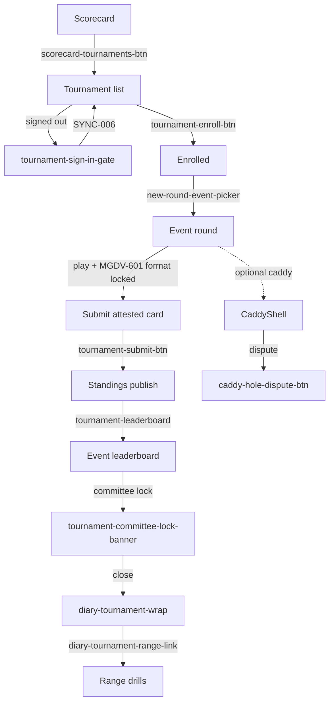

# Flow — Club tournament pilot (MGDV-6)

| Field | Value |
| :--- | :--- |
| **Stories** | MGDV-6-010 … MGDV-6-015 |
| **Wireframe** | [Wireframe_Tournament.md](./Wireframe_Tournament.md) |
| **Architecture** | [Architecture.md](../Architecture.md) §5.0.2 |

**Offline loops:** enroll and play stay on SQLite; leaderboard reads `tournament_standing_cache` with stale banner until sync.