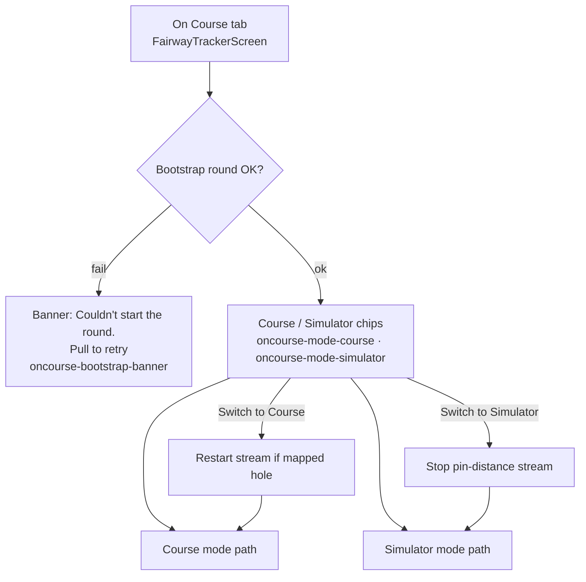
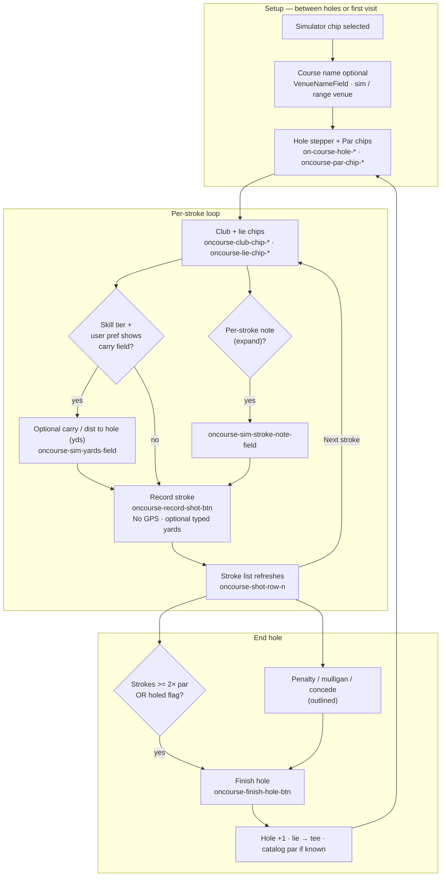
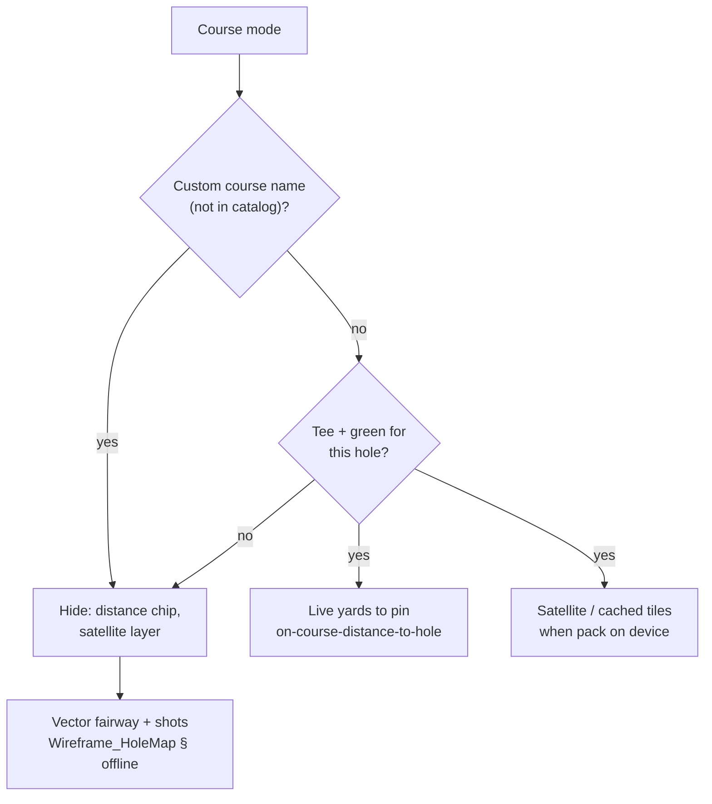
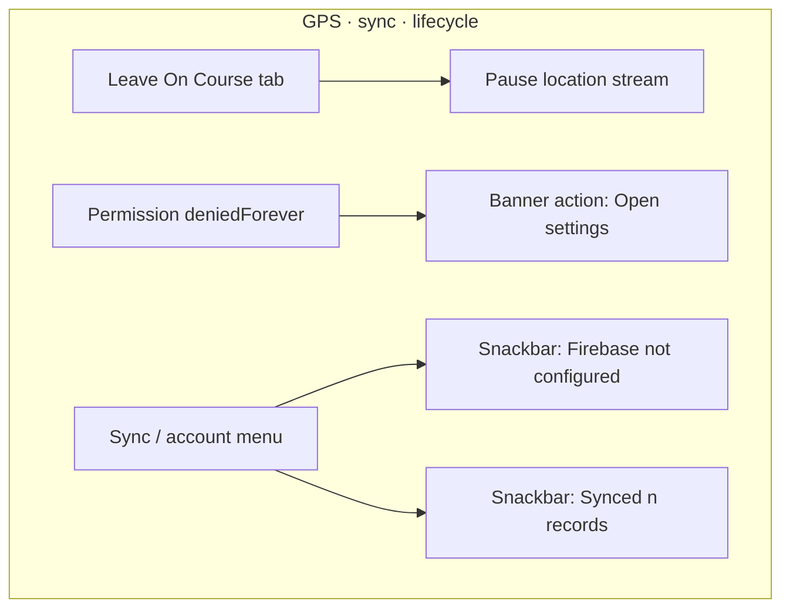

# UX Flow — On Course dual modes (Simulator · Course map HUD)

| Field | Value |
| :--- | :--- |
| **Command** | `/flow OnCourse-Modes` |
| **Owner** | Eunice (UI/UX Designer cohort) |
| **PRD & Architecture** | `CRSE-001`–`CRSE-006`, `MGDV-2-002` (`PRD.md` v1.7 · `Architecture.md` §5 GPS / map) |
| **Screens / Widgets** | `FairwayTrackerScreen` (single widget; mode fork inside) |
| **Wireframes** | [Wireframe_OnCourse.md](./Wireframe_OnCourse.md) (Course · map-first), [Wireframe_OnCourse-Simulator.md](./Wireframe_OnCourse-Simulator.md), [Wireframe_HoleMap.md](./Wireframe_HoleMap.md) |

## 1. Golfer mental model

**On Course** is one tab with **two rhythms**, not two routes:

| Mode | Where the phone lives | When to use | Primary readout |
| :--- | :--- | :--- | :--- |
| **Simulator** | Face-up on a table beside the bay | Indoor sim round or practice loop | Hole · par · stroke count; optional typed carry |
| **Course** | In hand or cart mount on the fairway | Outdoor round on a catalog (or custom) course | **Map HUD** with yards to **next marker / green**; GPS segment yards on each recorded stroke |

Mode choice persists for the active round until the golfer switches chips. Leaving the tab pauses GPS streams (`CRSE-005`). Sync never blocks recording (`SYNC-002`).

**Skill tier** ([MGDV-202](../shards/MGDV/MGDV-202-golfer-profile-skill-tier.md), [MGDV-203](../shards/MGDV/MGDV-203-range-bag-progressive-disclosure.md)) thins or enriches **field density** on both modes — not separate flows. See wireframes § Skill tier density.

---

## 2. Mode pick & shell



---

## 3. Simulator loop

Phone stays on the table. The golfer sets **hole** and **par**, picks **club** and **lie**, reads the sim screen, then taps **Record stroke** — no GPS read.



**Simulator edge errors**

| Edge | UI |
| :--- | :--- |
| Record with yards required but blank / 0 | Inline error on yards field: "Enter a distance greater than 0" |
| Double-tap record | Button shows spinner; `onPressed: null` (`_busy`) |
| No clubs in bag | Snackbar "Add a club in My Bag first" |
| Finish hole 18 / max hole | Snackbar "Round saved on this device" |

Full layout: [Wireframe_OnCourse-Simulator.md](./Wireframe_OnCourse-Simulator.md).

---

## 4. Course loop (map-first HUD)

Catalog course sets **hole count and par** from [`PH_Golf_Venues.md`](../PH_Golf_Venues.md). Map is the **body**; chrome sits in **header** and **footer rail**.

```mermaid
flowchart TD
  subgraph CourseSetup [Course & hole]
    PickCourse["VenueNameField\ncatalog → pars + 9/18"]
    Mapped{hasHoleCoordinates\n(course, hole)?}
    PickHole["Hole stepper"]
    PickCourse --> PickHole --> Mapped
  end

  subgraph MapHud [Map HUD body]
    MapPane["Satellite / cached map +\npath markers + shot polyline\noncourse-hole-map"]
    HudChip["HUD chip: yards to next marker\nor green · on-course-distance-to-hole\noncourse-yards-to-marker"]
    UnmappedFallback["Vector tee→green +\nshots only\noncourse-map-vector\nNo error banner"]
    Mapped -->|yes| MapPane
    Mapped -->|yes| HudChip
    Mapped -->|no| UnmappedFallback
  end

  subgraph PlanShot [Plan shot strip — footer above Record]
    ClubLie["Club + lie chips"]
    Aim["Aim wedge L · center · R\noncourse-aim-left · oncourse-aim-center · oncourse-aim-right"]
    ClubLie --> Aim
  end

  subgraph RecordGps [Record at ball]
    Rec["Record shot at ball\noncourse-record-shot-btn"]
    Perm{Location permission?}
    Banner["oncourse-location-banner"]
    GpsRead["Single position read"]
    Save["ShotRecord + segment yds\nfrom prior GPS"]
    Rec --> Perm
    Perm -->|denied| Banner
    Perm -->|granted| GpsRead
    GpsRead -->|null| SnackGps["Snackbar: Couldn't read location"]
    GpsRead -->|ok| Save
    Save --> MapPane
  end

  PickHole --> MapPane
  MapPane --> PlanShot
  Aim --> Rec
```

**Live distance (`CRSE-005`)** — stream updates **yards to pin / green** while map is visible on a **mapped** hole. **Yards to next marker** is a separate chip when Architecture provides fairway waypoint markers for that hole; if only tee+green exist, the HUD chip reads **to pin** (same key as PRD).

**Hole end** — same as Simulator: penalties, mulligan, concede (`2× par`), **Finish hole**. Auto-prompt when strokes reach **double par** or golfer marks **Holed** (`oncourse-holed-btn`, seasoned tier default visible).

Full layout: [Wireframe_OnCourse.md](./Wireframe_OnCourse.md).

---

## 5. Unmapped & partial course fallback

No error UI for missing coordinates — controls simply **omit** live distance and satellite toggle.



---

## 6. Shared edge errors & tab lifecycle



| Edge | Course mode | Simulator mode |
| :--- | :--- | :--- |
| Permission denied | Banner + record may fail; distance hidden | N/A (no GPS) |
| Offline + no map pack | Vector fallback + record still works | Unaffected |
| Map download in progress | Progress on map only (`oncourse-map-download`) | Map area N/A |
| Bootstrap fail | `oncourse-bootstrap-banner` | Same |

---

## 7. Route / tab mapping

| Step | Widget | Navigation |
| :--- | :--- | :--- |
| Enter | `HomeShell` → On Course tab | Bottom `NavigationBar` |
| Shot edit | `ShotEditDialog` | Modal on row tap |
| Settings / skill tier | `GolferProfileAppBarMenu` | AppBar menu (not a new tab) |
| Scorecard override | `ScorecardScreen` + hole editor | Other tab; CRSE does not block |

---

## 8. Sharding hints (Poe)

| Shard theme | Flow nodes |
| :--- | :--- |
| Mode fork + persist | §2 `ModeChips`, stop/start GPS |
| Simulator stroke | §3 `Record` without GPS, optional yards/note |
| Map HUD + markers | §4 `MapPane`, `HudChip`, `PlanShot` |
| CRSE-005 | §4 live distance; §5 unmapped hide |
| CRSE-006 | §4 satellite/cache; §5 vector fallback |
| MGDV-2 density | Wireframes § Skill tier density |