# UX Flow — Post-Range Sit-Down: Session Note, Summary & Vertex AI Evaluation

| Field | Value |
| :--- | :--- |
| **Command** | `/flow RangeSessionAndEvaluation` |
| **Owner** | Eunice (UI/UX Designer cohort) |
| **PRD & Architecture** | `RNGE-001`..`005` (`PRD.md` v1.5, `Architecture.md` v1.6 §5.3.1 & §5.6) |
| **Screens / Widgets** | `RangeDrillScreen`, `PracticeDrillSheet`, `RangeSessionLog`, `SwingDiarySheet` |

## 1. Golfer Mental Model (The Two Phases of a Range Visit)

A range session has two natural rhythms:

1. **On the mat (Active Hitting Loop):** Riley is holding a club, picking a structured drill (`PracticeDrillSheet`), hitting a 10-ball block, and logging `Min / Avg / Max` yards plus a quick per-club mechanic cue (**Save Drill Session**). Riley repeats this across 2–4 clubs.
2. **Sitting down on the bench (Reflect, Compile, & Evaluate):** After finishing the bucket, Riley sits down, wipes the clubs, and wants to:
   - **Jot down an overall Session Note** (`range-session-note-field`) reflecting on how the day went, without losing that note if they tap a club chip to check a number.
   - **Review the Visit Summary** (`range-visit-summary-preview`) showing all the clubs, yardages, cues, and drills recorded during the visit.
   - **Tap `Save and Evaluate Session`** (`range-save-evaluate-session-btn`) to lock those blocks and the session note into one compiled **Range Session Log** (`range_sessions`) and immediately read what **Vertex AI** (`SwingDiarySheet`) has to say about today's session compared against past practice.

---

## 2. End-to-End UX Flowchart

```mermaid
flowchart TD
  subgraph Phase1 [1. Standing at the Bay — Club & Drill Blocks]
    OpenRange["Open Range tab (RangeDrillScreen)"]
    PickVenue["Select or type venue (VenueNameField)"]
    OpenDrills["Optional: Taprange-header-drills-btn → PracticeDrillSheet"]
    ApplyDrill["Tap drill title (copies to club cue) or 'Use this drill'"]
    PickClub["Select non-putter club ChoiceChip"]
    HitBlock["Tap 'Hit Shot' (up to 10) + enter Min / Avg / Max + per-club cue"]
    SaveBlock["Tap 'Save Drill Session'\n• Writes RangeDrillLog (session_id = NULL)\n• Updates club min/avg/max in My Bag\n• Appends block to 'This visit so far' preview"]

    OpenRange --> PickVenue --> OpenDrills --> ApplyDrill --> PickClub
    PickVenue --> PickClub
    PickClub --> HitBlock --> SaveBlock
    SaveBlock -->|"Switch club / drill for next block"| PickClub
  end

  subgraph Phase2 [2. Sitting Down After the Bucket — Session Note & Summary]
    SitDown["Scroll to 'Wrap Up & Session Review' card\n(range-visit-wrapup-card)"]
    ReviewPreview["Inspect 'This visit so far'\n(range-visit-summary-preview)\nShows each club block, yards, cue, & drill"]
    WriteSessionNote["Type overall reflection in Session Note\n(range-session-note-field)\nPersists across club switches & tab switches"]
    TapSaveEval["Tap 'Save and Evaluate Session'\n(range-save-evaluate-session-btn)"]

    SaveBlock -->|"Bucket finished"| SitDown
    SitDown --> ReviewPreview --> WriteSessionNote --> TapSaveEval
  end

  subgraph Phase3 [3. Local Compilation & Edge Safeguards]
    CheckPending{"Unsaved club block inputs\nin Min/Avg/Max or Shots > 0?"}
    FlushBlock["Auto-save pending club block via saveRangeDrill()"]
    CheckEmpty{"Any visit blocks OR\nnon-empty Session Note?"}
    EmptyWarn["Snackbar: 'Log a club block or write a session note first'"]
    CompileTx["LocalDatabaseService.compileAndSaveRangeSession()\n• Snapshot club blocks + drill steps into compiled_summary_json\n• Insert range_sessions row\n• Link range_drills.session_id\n• Render card in range-session-log-list"]

    TapSaveEval --> CheckPending
    CheckPending -->|Yes| FlushBlock --> CheckEmpty
    CheckPending -->|No| CheckEmpty
    CheckEmpty -->|No| EmptyWarn
    CheckEmpty -->|Yes| CompileTx
  end

  subgraph Phase4 [4. Review Summary & Vertex AI Evaluation]
    DiaryReady{"SwingDiarySheet (RNGE-004)\nimplemented?"}
    PreRNGE004["Snackbar: 'Session log saved for evaluation'\nHighlight compiled card in range-session-log-list"]
    OpenDiary["Open SwingDiarySheet with\ndiary-session-summary-card at top"]
    OptInGate{"AI Opt-In granted?"}
    AskOptIn["Show privacy notice (no API key)\nContinue / Not now"]
    NetGate{"Online & Vertex reachable?"}
    OfflineDiary["Show compiled Session Summary card\nDisable composer with offline message"]
    VertexCall["Send compiled session + raw history/progress brief\nto FirebaseAI.vertexAI()"]
    ShowEval["Render Vertex AI evaluation card below Session Summary\nSave to range_evaluations(session_id)"]
    FollowUp["Ask follow-up question in thread OR\nopen Past Evaluations Log (diary-evaluation-log-btn)"]

    CompileTx --> DiaryReady
    DiaryReady -->|"Before RNGE-022 lands"| PreRNGE004
    DiaryReady -->|"With RNGE-022"| OpenDiary
    OpenDiary --> OptInGate
    OptInGate -->|No| AskOptIn
    AskOptIn -->|"Not now"| PreRNGE004
    AskOptIn -->|"Continue"| NetGate
    OptInGate -->|Yes| NetGate
    NetGate -->|No| OfflineDiary
    NetGate -->|Yes| VertexCall --> ShowEval --> FollowUp
  end
```

---

## 3. Screen-by-Screen UX Integration Details

### A. Keeping Per-Club Cues and the Visit Session Note Distinct
- **Problem avoided:** Previously, `RangeDrillScreen` only had `_notesController` (Swing Cue & Mechanics Note), which reloads `club.swingNotes` every time the golfer taps a different club chip. If a golfer wrote their end-of-session thoughts there and then tapped `Driver` to check their driver block, their session review would be wiped out.
- **UX solution:**
  - **Swing Cue & Mechanics Note** stays inside the top club-block section (amber-tinted card) and is explicitly scoped to the currently selected club/drill block.
  - **Session Note (`range-session-note-field`)** lives inside the **Wrap Up & Session Review** card (`range-visit-wrapup-card`) below **Save Drill Session**. It uses its own `_sessionNoteController` and is never touched by club chip selection or `Save Drill Session`.

### B. Reviewing the Summary Before & After Tapping "Save and Evaluate Session"
- **Before compiling (`range-visit-summary-preview`):** As each club block is saved during the visit, a compact summary row appears inside the **Wrap Up & Session Review** card (e.g., `7 Iron · 10 shots · 148 / 155 / 162 yds · 3:1 Tour Tempo Rhythm`). When the golfer sits down, they can see at a glance every club they hit before writing their session note.
- **After compiling (`range-compiled-session-{sessionId}` & `diary-session-summary-card`):**
  - In the Range screen's **Session log** (`range-session-log-list`), the compiled session renders as a cohesive session card displaying the date/time, venue, the quoted **Session Note**, and the breakdown of clubs and drills hit in that session.
  - When `SwingDiarySheet` opens (`RNGE-022`), the same compiled summary sits at the top of the sheet (`diary-session-summary-card`) right above the Vertex AI evaluation card so the golfer can read their numbers, their own note, and the AI's feedback on a single screen.
