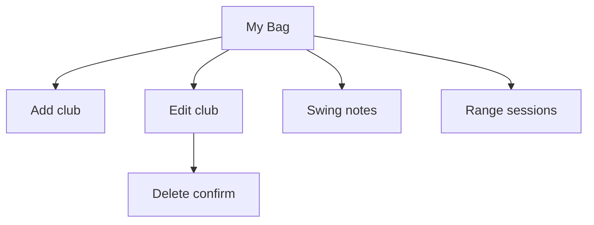

# Wireframe — Club Editor

| Field | Value |
| :--- | :--- |
| **Widgets** | `EditClubDialog`, `_AddClubDialog`, `SwingNotesDialog`, `ClubRangeLogSheet` |
| **PRD** | BAG-001 … BAG-003 |
| **Status** | As built — these dialogs had no wireframe |

## 1. Screen purpose

Add a club, edit its name, brand, model, and category, write swing notes, or read the range sessions that updated it. The glance-card target in [Wireframe_MyBag.md](./Wireframe_MyBag.md) still applies to the list; this file covers the dialogs the list opens today.

## 2. Mobile layout

Add / edit:

```
┌─────────────────────────────┐
│ Edit club                   │
│ Name                        │
│ Brand                       │
│ Model                       │
│ Category  [ Iron ]          │
│        Delete        Save   │
└─────────────────────────────┘
```

Empty name does not close the dialog. Delete asks "Remove this club?" before the tombstone. Add Club uses the same fields without Delete. Category is a dropdown of wood, hybrid, iron, wedge, putter.

Notes:

```
┌─────────────────────────────┐
│ Swing notes                 │
│ ┌─────────────────────────┐ │
│ │                         │ │
│ └─────────────────────────┘ │
│              [ Save notes ] │
└─────────────────────────────┘
```

Range log sheet: club name, then sessions newest first (min / avg / max, venue, time). Empty: "No range sessions for {club} yet." Sparkline on the card stays a non-interactive trend of those averages.

## 3. Larger screens

Dialogs max width 400. The range sheet max width 560.

## 4. Widget inventory

`AlertDialog`, `TextField`, `DropdownButtonFormField`, `FilledButton`, `TextButton`, `ModalBottomSheet`, `ListTile`.

## 5. Interaction & state map

| Action | Result |
| :--- | :--- |
| Save edit | Name, brand, model, category persist |
| Delete confirmed | Club leaves the bag |
| Save notes | Note reloads on the card |
| Open range log | Read-only list, key `bag-range-logs-{clubId}` |

## 6. UX flow



## 7. Key map

| Element | ValueKey | Widget |
| :--- | :--- | :--- |
| Add | `add-club-button` | `IconButton` |
| Name | `bag-club-name-field` | `TextField` |
| Brand | `bag-club-brand-field` | `TextField` |
| Model | `bag-club-model-field` | `TextField` |
| Save club | `bag-club-save-btn` | `FilledButton` |
| Delete | `bag-club-delete-btn` | `TextButton` |
| Confirm delete | `bag-club-delete-confirm` | `FilledButton` |
| Notes | `bag-notes-field` | `TextField` |
| Save notes | `bag-save-notes-btn` | `FilledButton` |
| Range log | `bag-range-logs-{clubId}` | `IconButton` |
