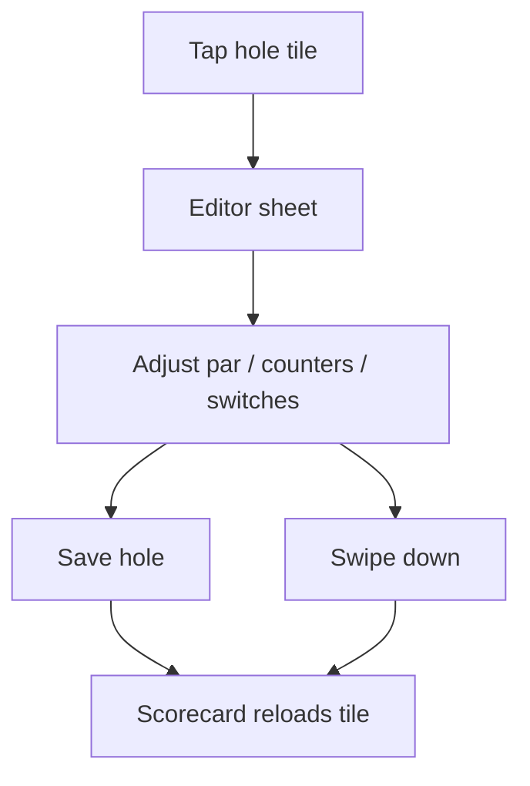

# Wireframe — Hole editor

| Field | Value |
| :--- | :--- |
| **Widget** | `showScorecardHoleEditor` / `_HoleEditorSheet` |
| **PRD** | SCOR-002, SCOR-003 |
| **Persona** | Rory correcting a hole without GPS |
| **Status** | Target v1.1 — sheet already exists; this tightens hierarchy and keys |

## 1. Screen purpose

Manual override for one hole: par, strokes, penalties, practice mulligans, concede, and hole-complete. Gross preview is `strokes + penalties`. Concede sets strokes to `par * 2` and marks the hole complete.

This sheet is how a player records a score **without** a GPS shot. Saving here can later be overwritten if On Course records a new shot (`syncStrokeCountFromShots`). No extra warning in v1; copy under the title states it.

## 2. Mobile layout

```
┌─────────────────────────────┐
│            ━━━              │  drag handle
│ Hole 7                      │  headlineSmall, center
│ Manual score · GPS shots    │
│ on this hole replace strokes│
│                             │
│        GROSS  6             │  displaySmall tabular
│        +2 vs par            │  scoreNegative or scorePositive
│                             │
│ PAR                         │
│ [ 3 ] [ 4 ] [ 5 ]           │  equal width, ≥48dp
│                             │
│ Strokes          −  4  +   │  56dp IconButtons
│ Penalties        −  2  +   │
│ Mulligans        −  0  +   │  subtitle: practice, not in gross
│                             │
│ Concede / gimme      [ ]    │  SwitchListTile
│ Mark hole complete   [ ]    │  locked on when conceded
│                             │
│ [ Save hole 7             ] │  filled 56dp
└─────────────────────────────┘
```

Sheet uses `BottomSheetTheme` (20dp top radius, cream elevated / forest elevated). `isScrollControlled: true`. Padding includes `viewInsets.bottom`.

### What changes vs current code

- Live **gross** and **vs par** above the steppers, not only in the complete-switch subtitle.
- Steppers use `GolfTextStyles.tabularNum` for the value.
- Mulligan row subtitle: "Practice only — not in gross".
- Clamps stay: strokes 0–20, penalties 0–10, mulligans 0–20.
- Decrement disabled at 0 (`onPressed: null`), same as today.

## 3. Larger screens

Sheet max width 480, centered. Same vertical stack. Do not become a full-screen route.

## 4. Widget inventory

| Widget | Role |
| :--- | :--- |
| `ModalBottomSheet` | Host |
| `ChoiceChip` | Par |
| `IconButton.filled` | Minus / plus |
| `SwitchListTile` | Concede, complete |
| `FilledButton` | Save |
| `GolfTextStyles` | Gross and vs par |

## 5. Interaction & state map

| Control | Behavior |
| :--- | :--- |
| Par | Sets `_par`. If concede is on, strokes become `par * 2` immediately |
| Strokes ± | Clears concede (manual count wins) |
| Penalties ± | Gross updates; concede unchanged |
| Mulligans ± | Stored only |
| Concede on | Strokes = `par * 2`, complete forced on, complete switch disabled |
| Concede off | Leaves strokes at 2× par until the user changes them; complete switch re-enables |
| Complete | Sets `holeComplete`. Unplayed holes can be saved as a draft if complete is off — match `saveManualHoleScore` |
| Save | Writes SQLite, pops sheet, scorecard reloads |

Preview total uses `computeFinalScore`. Vs par = preview − par. Zero delta shows `E`. If strokes are 0 and not conceded, show gross `0` and vs par as `—` until complete or strokes &gt; 0, so an untouched hole does not look like an eagle.

## 6. UX flow



Dismiss without save discards edits.

## 7. Key map

| Element | ValueKey | Widget |
| :--- | :--- | :--- |
| Par 3 / 4 / 5 | `hole-editor-par-chip-3` `hole-editor-par-chip-4` `hole-editor-par-chip-5` | `ChoiceChip` |
| Strokes minus / plus | `hole-editor-strokes-dec` `hole-editor-strokes-inc` | `IconButton` |
| Penalties minus / plus | `hole-editor-penalties-dec` `hole-editor-penalties-inc` | `IconButton` |
| Mulligans minus / plus | `hole-editor-mulligans-dec` `hole-editor-mulligans-inc` | `IconButton` |
| Concede | `hole-editor-concede-switch` | `SwitchListTile` |
| Complete | `hole-editor-complete-switch` | `SwitchListTile` |
| Save | `hole-editor-save-btn` | `FilledButton` |
| Gross readout | `hole-editor-gross` | `Text` |
