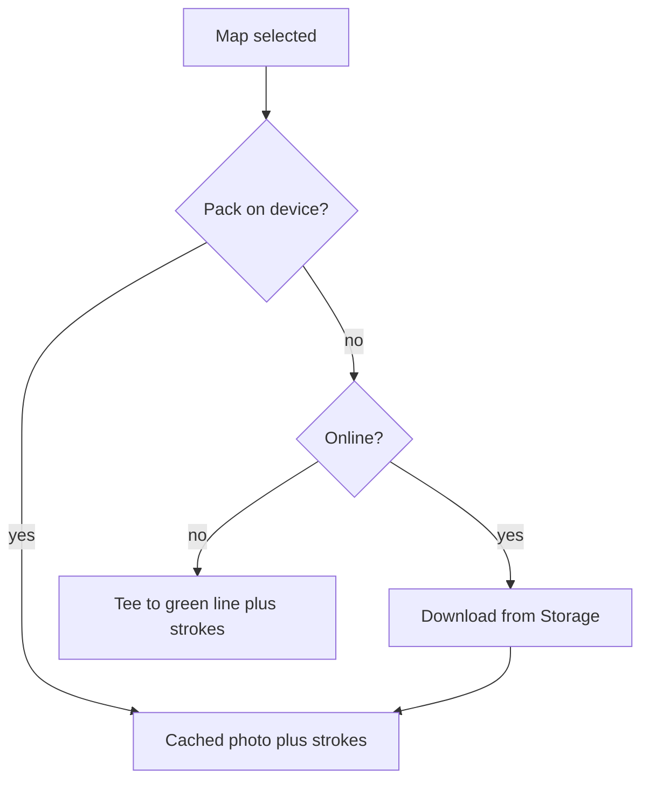

# Wireframe — Hole Map

| Field | Value |
| :--- | :--- |
| **Widget** | Map pane inside `FairwayTrackerScreen` |
| **PRD** | CRSE-006 (future) |
| **Persona** | Rory |
| **Status** | Future — toggle hidden until this hole has a tee and a green |

## 1. Screen purpose

Show the hole from tee to green and the strokes already logged, using a map pack stored on the phone. Shot capture stays available; the map does not replace Record.

## 2. Mobile layout

```
┌─────────────────────────────┐
│ On Course            [sync] │
│ Wack Wack — East            │
│ [ Course ] [ Simulator ]    │
│ 168 yds to pin              │
│ [ HUD | Map ]               │  Map selected
│ ┌─────────────────────────┐ │
│ │        (tee)            │ │
│ │          │              │ │  cached image
│ │     •———•———• flag      │ │  strokes
│ │                         │ │
│ └─────────────────────────┘ │
│ Hole 16 · Par 3             │
│ [  Record shot at ball   ]  │  same primary as HUD
└─────────────────────────────┘
```

Markers: tee (small circle), green (flag), each shot start (filled dot) joined in stroke order. Club name sits on the segment in Inter 11, yardage in Roboto Mono. Colors: path uses `onSurface`, current ball uses `primary`. Do not use red/green alone to encode club.

## 3. Larger screens

≥600dp: map fills the right column; HUD summary and Record stay in the left column (max 480).

## 4. Widget inventory

`SegmentedButton`, map image or `CustomPaint` vector fallback, marker overlay, `FilledButton` (shared with HUD).

## 5. Interaction & state map

| State | UI |
| :--- | :--- |
| No coordinates | Segmented control not built |
| Pack on device | Image + overlay |
| Pack in Firebase, online | Progress on the map area only: "Downloading this course" |
| Offline, no pack | Vector tee-to-green line and shot dots on `surfaceContainer`. Snackbar once: "Showing the hole line without the course photo." |
| Simulator | Map control hidden with the distance line |
| New shot saved | Overlay adds the point without leaving Map |

## 6. UX flow



## 7. Key map

| Element | ValueKey | Widget |
| :--- | :--- | :--- |
| Toggle | `on-course-map-toggle` | `SegmentedButton` |
| Map surface | `oncourse-hole-map` | `CustomPaint` or image |
| Download | `oncourse-map-download` | `LinearProgressIndicator` |
| Vector fallback | `oncourse-map-vector` | `CustomPaint` |
