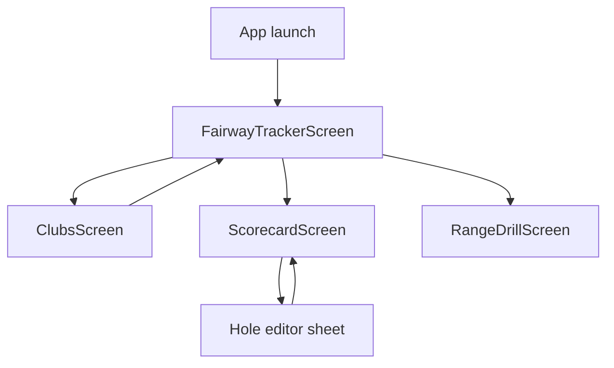

# Wireframe — HomeShell

| Field | Value |
| :--- | :--- |
| **Widget** | `HomeShell` in `golf_diary_app/lib/main.dart` |
| **Status** | Target v1.1 (theme already applied; icon pairs already in code) |
| **Personas** | Rory (default tab On Course), Riley (Range), Blake (My Bag) |

## 1. Screen purpose

Keep the golfer in one activity. Four destinations, no drawer, no extra routes. Selecting **Scorecard** calls `ScorecardScreenState.loadScorecard()`.

Default selected index stays **1 (On Course)** so a round starts on the capture screen.

## 2. Mobile layout

```
┌─────────────────────────────┐
│  [active screen scaffold]   │
│                             │
│                             │
├─────────────────────────────┤
│ My Bag │ On Course │ Card │ Range │
│  (o)   │   (●)     │ (o)  │  (o)  │
└─────────────────────────────┘
```

- Bar background: `surfaceContainer` (cream elevated / forest elevated). No shadow.
- Selected: filled icon + Inter 12 w700, indicator `primaryContainer`.
- Unselected: outlined icon + `onSurfaceVariant`.
- Labels stay short: **My Bag**, **On Course**, **Scorecard**, **Range**.
- Safe area below the bar is the system inset. Do not add a second bottom padding inside tab bodies that already sit above this bar. On Course’s sticky record dock sits **above** this bar.

## 3. Larger screens

Phone-first. On width ≥600dp, keep the same `NavigationBar` (do not switch to `NavigationRail` in v1). Content max width 560dp, centered, so cards do not stretch across a tablet.

## 4. Widget inventory

| Widget | Role |
| :--- | :--- |
| `Scaffold` | Hosts `IndexedStack` or current page list |
| `NavigationBar` | Four `NavigationDestination`s |
| `Icon` outlined / filled | Idle vs selected |

Indexed stack is preferred over rebuilding pages so On Course GPS state and Range draft fields survive tab switches. Today `_pages` is a list shown by index inside one body — keep state alive the same way (do not dispose the inactive route).

## 5. Interaction & state map

| State | Behavior |
| :--- | :--- |
| Launch | Index 1, On Course bootstraps round |
| Tap My Bag | Index 0, bag reloads clubs for selected category |
| Tap On Course | Index 1, hole state unchanged |
| Tap Scorecard | Index 2, `loadScorecard()` |
| Tap Range | Index 3, draft fields kept |
| System dark | `ThemeMode.system` already set |

## 6. UX flow



## 7. Key map

| Element | ValueKey | Widget |
| :--- | :--- | :--- |
| My Bag destination | `shell-tab-bag` | `NavigationDestination` |
| On Course destination | `shell-tab-oncourse` | `NavigationDestination` |
| Scorecard destination | `shell-tab-scorecard` | `NavigationDestination` |
| Range destination | `shell-tab-range` | `NavigationDestination` |
| Navigation bar | `shell-nav-bar` | `NavigationBar` |
| Sync | `sync-cloud-button` | `IconButton` (as built, each tab AppBar) |
| PWA update | `pwa-update-dialog` | `AlertDialog` |

## 8. As built overlays

Sync is an AppBar action on My Bag, On Course, Scorecard, and Range, not a fifth tab. Unavailable Firebase uses a snackbar and does not block the tab.

On the web PWA, a newer published build opens [Wireframe_PwaUpdate.md](./Wireframe_PwaUpdate.md). It is not shown on Android.
