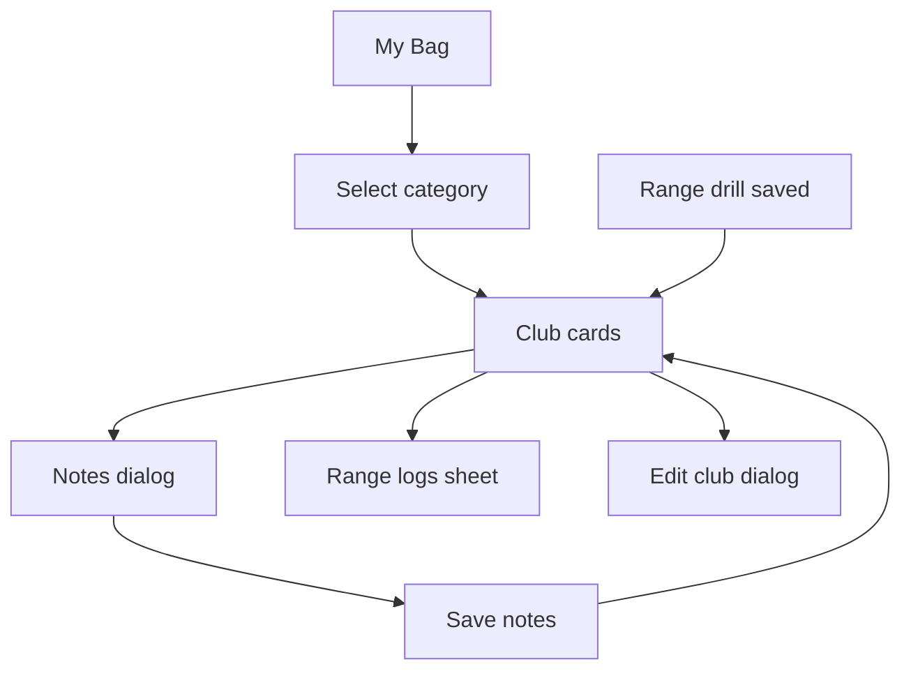

# Wireframe — My Bag

| Field | Value |
| :--- | :--- |
| **Widget** | `ClubsScreen` |
| **Stories** | [BAG-001](../../stories/BAG/BAG-001-filter-by-category.md), [BAG-002](../../stories/BAG/BAG-002-distance-stats.md), [BAG-003](../../stories/BAG/BAG-003-swing-notes.md), [BAG-010](../../stories/BAG/BAG-010-stat-tile-cards.md) |
| **Persona** | Blake (glance), Riley (notes) |
| **Status** | **Shipped** — stat-tile cards (BAG-010) |

## 1. Screen purpose

Show the bag by category with **min / avg / max in yards** and swing notes that survive restart. Notes are edited on purpose, not typed into every visible card.

## 2. Mobile layout

Amended 2026-11-20: **Option B, stat tiles** (Project store `docs/bag-card-compact-design.md` §4). One card layout for every skill tier, ≈136dp tall at 360dp, everything visible at once. There is **no Details button and no details sheet**.

```
┌─────────────────────────────┐
│ [+] My Bag      [book][acct]│  + add-club-button · book diary-entry-bag
├─────────────────────────────┤
│ [Wood] Hybrid Iron Wedge …  │  horizontal chips, height 48
├─────────────────────────────┤
│ ┌───────────────────────────────────────┐ │
│ │ Driver ✎ TaylorMade Stealth 2  (🕘 5 ›)│ │  row 1: name 16/600 + brand 12 inline; sessions chip
│ │ [MIN 210][AVG 230][MAX 255][TREND +6 ╱╲]│ │  row 2: four 44dp tiles, AVG tile primaryContainer
│ │ ✎ "Smooth tempo, finish high — tee…"  │ │  row 3: one-line note, full width
│ └───────────────────────────────────────┘ │  ≈136dp, 8dp gap
│ ┌───────────────────────────────────────┐ │
│ │ 3 Wood                         (🕘 0 ›)│ │
│ │ [MIN —][AVG —][MAX —][TREND —]        │ │  all-zero → em dash, still a card
│ │ ＋ Add swing note                      │ │
│ └───────────────────────────────────────┘ │
└─────────────────────────────┘
```

| Zone | Content | Behavior |
| :--- | :--- | :--- |
| Identity | `club.name` + ✎ glyph, `brand · model` inline (ellipsis) | Tap → `EditClubDialog` |
| Sessions chip | 🕘 `N` › | Tap → `ClubRangeLogSheet` (empty state at 0). Semantics “Range logs (N)” |
| Stat tiles | Shortest/Min · Usual/Avg · Best/Max, numbers in tabular mono, no `yds` unit | Not interactive. `—` when 0 |
| Trend tile | sparkline + `+N` / `−N` delta (`positive` / `negative`) | `first → last yds` in tooltip and semantics. <2 sessions → `—` |
| Notes row | ✎ + italic note, 1 line, ellipsis; empty → ＋ “Add swing note” in `primary` | Tap → `SwingNotesDialog` |

**Skill tier changes labels only:** beginner and amateur read **Shortest · Usual · Best**, full display reads **Min · Avg · Max**. Layout is identical.

**Notes dialog** (tap note row): `SwingNotesDialog`, 3–6 line `TextField`, **Save notes**. Save is explicit (BAG-003).

### As-built implementation (`clubs_screen.dart`)

- `_ClubBagCard`: 12dp horizontal padding, 8dp bottom margin, 44dp stat tiles, `ActionChip` sessions row.
- Category chips: **no `ValueKey` yet** — see [Design_Audit.md](./Design_Audit.md) optional P1.
- `add-club-button`: `Key('add-club-button')` on AppBar icon.
- Category selection is session-only (not persisted).

## 3. Larger screens

≥600dp: two-column card grid, same chip filter full width. Card height unchanged.

## 4. Widget inventory

| Widget | Role |
| :--- | :--- |
| `AppBar` | Title "My Bag" |
| `ChoiceChip` in horizontal `ListView` | Category filter |
| `Card` + `InkWell` | Club glance row |
| Stat tiles (`Container`, `primaryContainer` for usual) | Min, avg, max, trend |
| `ActionChip` | Sessions count → range logs sheet |
| `AlertDialog` (`SwingNotesDialog`) | Notes editor |
| `TextField` | Notes, only inside the dialog |
| `ElevatedButton` | Save notes |
| `CircularProgressIndicator` | First load |
| `SnackBar` floating | "Saved swing notes for {name}" |

## 5. Interaction & state map

| State | UI |
| :--- | :--- |
| Loading | Spinner, chips visible but disabled |
| Loaded | Cards for category |
| Empty category | Message, no cards |
| All-zero distances | Em dashes in every tile, same card height |
| <2 range sessions | Trend tile shows `—` |
| Note present | Single truncated line (`maxLines: 1`) |
| Note empty | "＋ Add swing note" in `primary` |
| Dialog open | Save enabled always (empty note is a valid clear) |
| Save success | Pop dialog, snackbar, note row updates |

Switching chips calls `getClubsByCategory` and does not restart the app. Dispose note controllers when the sheet closes.

## 6. UX flow



Range saves update club min/avg/max in SQLite. My Bag must reload when the tab is selected again (same idea as scorecard refresh on tab focus).

## 7. Key map

| Element | ValueKey | Widget |
| :--- | :--- | :--- |
| Wood chip | `bag-category-chip-wood` | `ChoiceChip` |
| Hybrid chip | `bag-category-chip-hybrid` | `ChoiceChip` |
| Iron chip | `bag-category-chip-iron` | `ChoiceChip` |
| Wedge chip | `bag-category-chip-wedge` | `ChoiceChip` |
| Putter chip | `bag-category-chip-putter` | `ChoiceChip` |
| Club card | `bag-club-card-{clubId}` | `Card` |
| Identity / edit club | `bag-club-edit-{clubId}` | `InkWell` |
| Usual / Avg tile value | `bag-hero-yards-{clubId}` | `Text` |
| Shortest / Min value | `bag-min-yards-{clubId}` | `Text` |
| Best / Max value | `bag-max-yards-{clubId}` | `Text` |
| Trend tile | `bag-trend-{clubId}` | `Tooltip` |
| Note row | `bag-notes-text-{clubId}` | `InkWell` |
| Add swing note (empty) | `bag-notes-add-{clubId}` | `InkWell` |
| Range logs / sessions chip | `bag-range-logs-{clubId}` | `ActionChip` |
| Empty state | `bag-empty-category` | `Text` |
| Add club | `add-club-button` | `IconButton` (leading) |
| Swing diary | `diary-entry-bag` | `IconButton` (`Icons.auto_stories_outlined`, left of the avatar) |
| ~~Details~~ | ~~`bag-details-btn-{clubId}`~~ | Retired 2026-11-20 |

## 8. As built dialogs

The stat-tile card in §2 is the shipped layout. Edit club (brand, model, category, delete with confirm), the swing-notes dialog and the range-log sheet are specified in [Wireframe_ClubEditor.md](./Wireframe_ClubEditor.md). Add Club stays in the AppBar, not at the bottom of the list.
