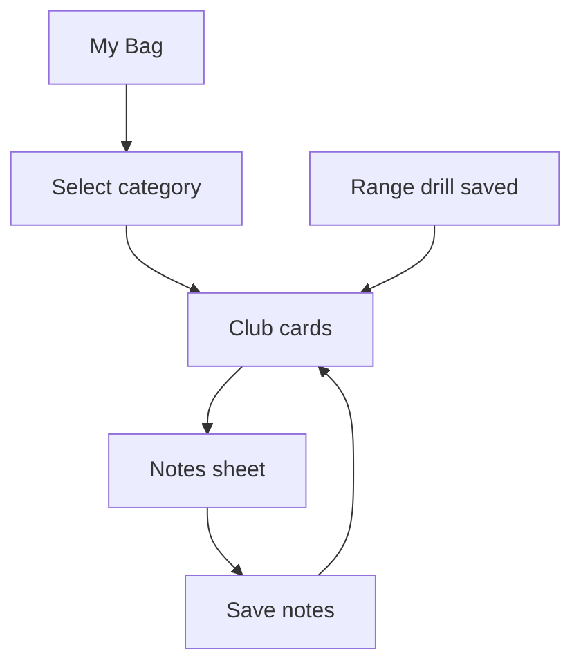

# Wireframe — My Bag

| Field | Value |
| :--- | :--- |
| **Widget** | `ClubsScreen` |
| **PRD** | BAG-001, BAG-002, BAG-003 |
| **Persona** | Blake (glance), Riley (notes) |
| **Status** | Target v1.1 |

## 1. Screen purpose

Show the bag by category with **min / avg / max in yards** and swing notes that survive restart. Notes are edited on purpose, not typed into every visible card.

## 2. Mobile layout

```
┌─────────────────────────────┐
│ AppBar: My Bag              │
├─────────────────────────────┤
│ [Wood] Hybrid Iron Wedge …  │  horizontal chips, height 48
├─────────────────────────────┤
│ ┌ Driver ───────────────┐   │
│ │ MIN    AVG     MAX    │   │
│ │ 210    230     255    │   │  tabular yds
│ │ yds    yds     yds    │   │
│ │ Smooth tempo      ›   │   │  one-line note or "Add swing note"
│ └───────────────────────┘   │
│ ┌ 3 Wood ───────────────┐   │
│ │  —      —      —      │   │  all-zero → em dash, still a card
│ │ No swing note     ›   │   │
│ └───────────────────────┘   │
└─────────────────────────────┘
```

**Notes sheet** (tap card):

```
┌─────────────────────────────┐
│ Driver                      │
│ Swing notes                 │
│ ┌─────────────────────────┐ │
│ │                         │ │  3–6 lines
│ └─────────────────────────┘ │
│              [ Save notes ] │  filled, one primary
└─────────────────────────────┘
```

### What changes vs current code

- Remove the always-open `TextField` and per-card **Save notes**. That made the list a form.
- Card tap opens `showModalBottomSheet` (same pattern as the hole editor). Save is explicit (BAG-003).
- Category chip row height **48**, not 48 including vertical padding that clips the chip.
- All-zero stats render `—`, not `0 yds`, so a starter bag does not look measured. Subtitle can say "No distances yet".
- Empty category: centered text "No clubs in this category" — no crash (BAG-001).
- Loading: `CircularProgressIndicator` centered until the first query returns. Do not flash an empty list.
- Category selection is session-only (not persisted). Documented here so resume returns to **Wood**.

## 3. Larger screens

≥600dp: two-column card grid, same chip filter full width. Sheet stays a bottom sheet (max width 560, centered) rather than a new route.

## 4. Widget inventory

| Widget | Role |
| :--- | :--- |
| `AppBar` | Title "My Bag" |
| `ChoiceChip` in horizontal `ListView` | Category filter |
| `Card` + `InkWell` | Club glance row |
| `GolfTextStyles.yardage` | Min, avg, max |
| `ModalBottomSheet` | Notes editor |
| `TextField` | Notes, only inside the sheet |
| `FilledButton` | Save notes |
| `CircularProgressIndicator` | First load |
| `SnackBar` floating | "Saved swing notes for {name}" |

## 5. Interaction & state map

| State | UI |
| :--- | :--- |
| Loading | Spinner, chips visible but disabled |
| Loaded | Cards for category |
| Empty category | Message, no cards |
| All-zero distances | Em dashes + "No distances yet" |
| Note present | Single truncated line (`maxLines: 1`) |
| Note empty | "Add swing note" in `onSurfaceVariant` |
| Sheet open | Keyboard inset padding; Save enabled always (empty note is a valid clear) |
| Save success | Pop sheet, snackbar, card subtitle updates |
| Save failure | Snackbar with `error` color, sheet stays open |

Switching chips calls `getClubsByCategory` and does not restart the app. Dispose note controllers when the sheet closes.

## 6. UX flow



Range saves update club min/avg/max in SQLite. My Bag must reload when the tab is selected again (same idea as scorecard refresh on tab focus).

## 7. Key map

| Element | ValueKey | Widget |
| :--- | :--- | :--- |
| Wood chip | `bag-category-chip-wood` | `ChoiceChip` |
| Hybrid chip | `bag-category-chip-hybrid` | `ChoiceChip` |
| Iron chip | `bag-category-chip-iron` | `ChoiceChip` |
| Wedge chip | `bag-category-chip-wedge` | `ChoiceChip` |
| Putter chip | `bag-category-chip-putter` | `ChoiceChip` |
| Club card | `bag-club-card-{clubId}` | `Card` |
| Notes field | `bag-notes-field-{clubId}` | `TextField` |
| Save notes | `bag-save-notes-btn-{clubId}` | `FilledButton` |
| Empty state | `bag-empty-category` | `Text` |
