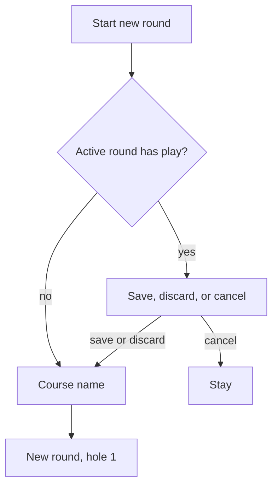

# Wireframe — New Round

| Field | Value |
| :--- | :--- |
| **Widgets** | `showCourseRoundDialog`, `showSaveRoundBeforeNewDialog` |
| **Stories** | [SCOR-001](../../stories/SCOR/SCOR-001-view-rounds-grid.md), [CRSE-001](../../stories/CRSE/CRSE-001-active-round-context.md) |
| **Status** | One dialog for Scorecard and On Course |

## 1. Screen purpose

Name the course and choose the scoring format for a round. Scorecard and On Course open the same dialog. If another round already has shots or a saved hole, Scorecard asks whether to keep it before starting a new one.

## 2. Mobile layout

Save first, only when the active round has meaningful play:

```
┌─────────────────────────────┐
│ Save this round?            │
│ Local Course is still open. │
│ [ Cancel ]                  │
│ [ Discard ]  [ Save ]       │
└─────────────────────────────┘
```

Then the shared dialog. Tapping the course name on Scorecard or On Course opens this same dialog with the current values filled in. There is no separate On Course sheet.

```
┌─────────────────────────────┐
│ Course                      │
│ Course name                 │
│ [ Wack Wack — East        ] │  autocomplete
│ 18 holes · par 72           │  only when the name matches a card
│ [ Gross | Molave | System 36 ]
│ Double eagle [7] [6]        │  only when Molave is selected
│ Course rating    Slope      │  optional
│        Cancel         Save  │
└─────────────────────────────┘
```

Save is filled. Cancel writes nothing. Empty name becomes **Local Course**. Suggestions: recent rounds, then the catalog. A typed name that is not in the list is accepted.

Confirm returns the course name, format, double-eagle points, rating, and slope.

- **Scorecard, course name.** Save writes those values onto the selected round. It does not start another round.
- **On Course, course name.** Save writes those values onto the active round the same way.
- **Scorecard, Start new round.** After save / discard / cancel, Save creates the round with those values.

If the round is already attested, either screen shows **Edit attested card?** before the write. Confirming that clears the attestation.

## 3. Larger screens

Dialog max width 400. The suggestion list scrolls inside the dialog, max height 240.

## 4. Widget inventory

`AlertDialog`, `VenueNameField` (`Autocomplete` + `TextField`), `TextButton`, `FilledButton`.

## 5. Interaction & state map

| Choice | Result |
| :--- | :--- |
| Cancel (either dialog) | No new round |
| Save | `completeRound`, then the name dialog |
| Discard | `discardRound`, then the name dialog |
| Save on an existing round | Writes name, format, double eagle, rating, and slope. Scorecard uses the selected round. On Course uses the active round |
| Save on Start new round | `startNewRound` with hole-1 par from the card, or 4, then the format values |

## 6. UX flow



## 7. Key map

| Element | ValueKey | Widget |
| :--- | :--- | :--- |
| Course | `scorecard-new-round-course` | `TextField` |
| On Course name field | `oncourse-course-name-field` | `VenueNameField` (same dialog) |
| Save course | `scorecard-new-round-start` | `FilledButton` |
| Cancel name | `scorecard-new-round-cancel` | `TextButton` |
| Format | `scorecard-format-toggle` | `SegmentedButton` |
| Double eagle | `scorecard-double-eagle-7`, `scorecard-double-eagle-6` | `ChoiceChip` |
| Rating / slope | `scorecard-course-rating`, `scorecard-slope` | `TextField` |
| Save | `scorecard-save-before-new` | `FilledButton` |
| Discard | `scorecard-discard-before-new` | `TextButton` |
| Cancel save | `scorecard-save-before-cancel` | `TextButton` |
