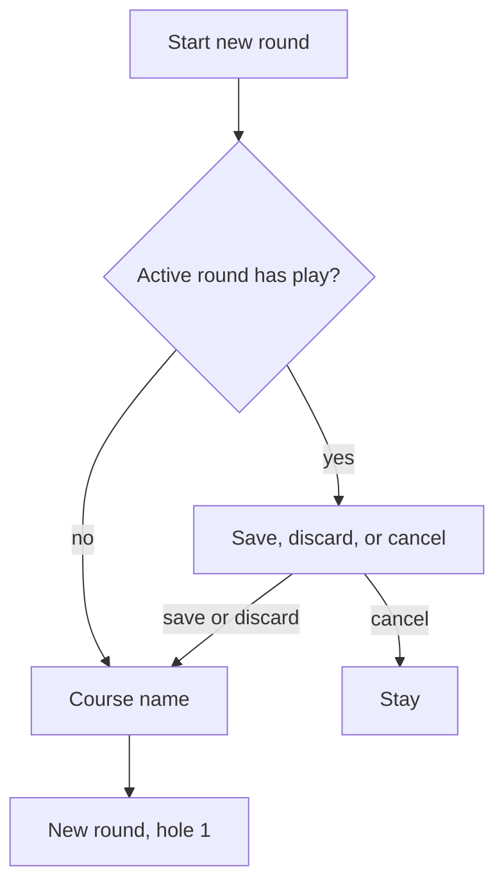

# Wireframe — New Round

| Field | Value |
| :--- | :--- |
| **Widgets** | `_NewRoundDialog`, `showSaveRoundBeforeNewDialog` |
| **PRD** | SCOR-001, CRSE-001 |
| **Status** | As built — dialogs had no wireframe |

## 1. Screen purpose

Name the course for a new round. If another round already has shots or a saved hole, ask whether to keep it before starting.

## 2. Mobile layout

Save first, only when the active round has meaningful play:

```
┌─────────────────────────────┐
│ Save this round?            │
│ Local Course is still open. │
│ [ Cancel ]                  │
│ [ Discard ]  [ Save ]       │
└─────────────────────────────┘
```

Then:

```
┌─────────────────────────────┐
│ Start new round             │
│ Course name                 │
│ [ Wack Wack — East        ] │  autocomplete
│ 18 holes · par 72           │  only when the name matches a card
│        Cancel        Start  │
└─────────────────────────────┘
```

Start is filled. Empty name becomes **Local Course**, matching the code. Suggestions: recent rounds, then the catalog. A typed name that is not in the list is accepted.

## 3. Larger screens

Dialog max width 400. The suggestion list scrolls inside the dialog, max height 240.

## 4. Widget inventory

`AlertDialog`, `VenueNameField` (`Autocomplete` + `TextField`), `TextButton`, `FilledButton`.

## 5. Interaction & state map

| Choice | Result |
| :--- | :--- |
| Cancel (either dialog) | No new round |
| Save | `completeRound`, then the name dialog |
| Discard | `discardRound`, then the name dialog |
| Start | `startNewRound` with hole-1 par from the card, or 4 |

## 6. UX flow



## 7. Key map

| Element | ValueKey | Widget |
| :--- | :--- | :--- |
| Course | `scorecard-new-round-course` | `TextField` |
| Start | `scorecard-new-round-start` | `FilledButton` |
| Cancel name | `scorecard-new-round-cancel` | `TextButton` |
| Save | `scorecard-save-before-new` | `FilledButton` |
| Discard | `scorecard-discard-before-new` | `TextButton` |
| Cancel save | `scorecard-save-before-cancel` | `TextButton` |
