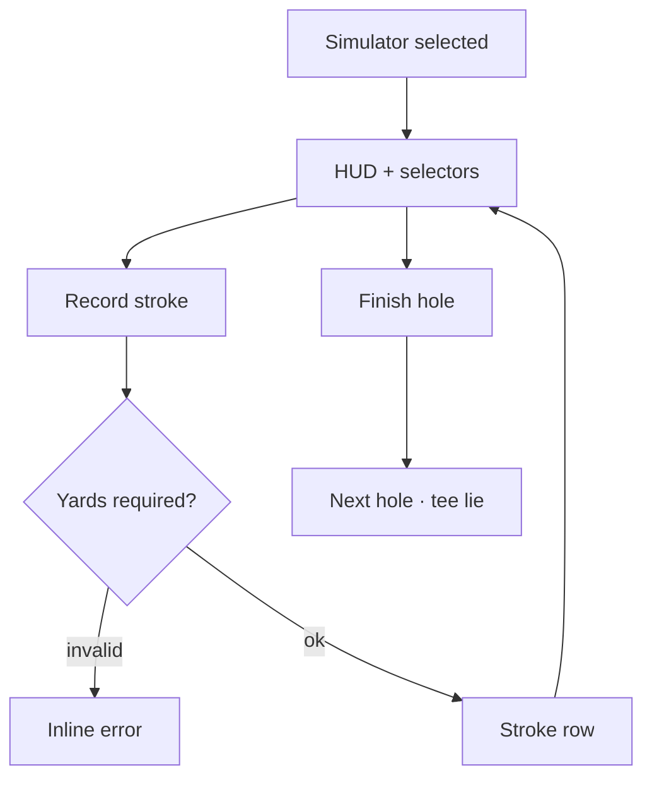

# Wireframe — On Course · Simulator mode

| Field | Value |
| :--- | :--- |
| **Widget** | `FairwayTrackerScreen` (`_simulator == true`) |
| **PRD** | CRSE-001 … CRSE-004 (GPS off for capture), MGDV-2-002 |
| **Persona** | Riley — sim bay, phone on table, eyes on the screen |
| **Status** | Target v1.3 — shard-ready with Course map mode |
| **Parent wireframe** | [Wireframe_OnCourse.md](./Wireframe_OnCourse.md) (Course / map-first) |
| **Flow** | [Flow_OnCourse-Modes.md](./Flow_OnCourse-Modes.md) §3 |

## 1. Screen purpose

Log a **simulator round** stroke-by-stroke with the phone **face-up on the table**. The golfer sets **hole and par**, chooses **club and lie**, optionally types **carry / distance to hole** and a **short stroke note**, then records — **after** the simulator shows the result. No GPS. Finish hole advances the card; **double par** or **concede** ends the hole without leaving the tab.

## 2. Mobile layout

Header holds **identity and mode**; the **HUD card** is the hero (not a map). Record stays **sticky** above the tab bar.

```
┌─────────────────────────────┐
│ On Course      [diary][acct]│  AppBar: no map chrome
├─────────────────────────────┤
│ Range Sim · Bay 3        ✎ │  VenueNameField (optional venue)
│ [ Course ] [●Simulator ]   │  oncourse-mode-*
├─────────────────────────────┤
│ ┌─────────────────────────┐ │
│ │  HOLE 12        PAR 4   │ │  HUD card (tabular)
│ │  Strokes 3   Pen 0      │ │
│ │  Hole 5    Round 43     │ │
│ └─────────────────────────┘ │
│  ‹  Hole 12  ›              │  stepper
│  Par  [3] [4] [5]           │  manual override (catalog default when known)
│─────────────────────────────│
│ CLUB                        │
│ [Dr] 7i 9i … P         ›    │  ≥48dp chips; avg subtitle on selected (pro tier)
│ LIE                         │
│ [Tee] Fairway Rough …       │
│ Carry (optional)            │  collapsed for beginner unless expanded
│ [ 156                    ]  │  oncourse-sim-yards-field
│ Stroke note (optional)      │  amateur+ or “Add note” link for beginner
│ [ Chunked it right…      ]  │  oncourse-sim-stroke-note-field · 2 lines max
│ ┌ Stroke 2 · 7i · Fairway ┐ │
│ │ 142 yds · note icon     │ │  list · tap → ShotEditDialog
│ └─────────────────────────┘ │
│ Penalty +1   Penalty +2     │  outlined 48dp
│ Mulligan 0   Concede        │
│ Finish hole                 │  outlined; hole 18 → **Finish round**
├─────────────────────────────┤
│ [      Record stroke      ] │  STICKY filled 64dp · oncourse-record-shot-btn
└─────────────────────────────┘
│ ○ Bag  ○ Range  ● Course  ○ │  shell NavigationBar (unchanged)
└─────────────────────────────┘
```

**Not shown in Simulator:** `on-course-distance-to-hole`, map surface, aim wedge, satellite layer (`Flow_OnCourse-Modes.md` §2).

Body scrolls inside the header/footer sandwich. Record is **outside** the scroll view (same dock pattern as Course mode).

### Skill tier density

Cross-ref [MGDV-202](../shards/MGDV/MGDV-202-golfer-profile-skill-tier.md) · [MGDV-203](../shards/MGDV/MGDV-203-range-bag-progressive-disclosure.md).

| Element | Beginner | Amateur | Seasoned pro |
| :--- | :--- | :--- | :--- |
| Carry field | Hidden; **Add distance** text link reveals field | Shown; optional blank allowed if settings = simple | Always shown; validates &gt; 0 when filled |
| Stroke note | Hidden behind **Add note** per stroke | One-line field visible | Always visible; note icon on list rows |
| Club chip subtitle | Club name only | `{name} · usual {avg} yds` when avg &gt; 0 | `{name} · {min}–{max} yds` on selected chip |
| HUD extras | Strokes + hole gross only | + penalties, round total | + mulligan count, vs-par chip |
| Copy on record CTA | **Record stroke** | Same | Same (not “at ball”) |

Settings override **Match skill tier** per MGDV-202.

## 3. Larger screens

≥600dp: HUD + selectors left (max 480); stroke list right. Sticky record spans the left column width. No map column in Simulator.

## 4. Widget inventory

| Widget | Role |
| :--- | :--- |
| `AppBar` + profile / diary / account | Title **On Course**; sync via account menu when `SYNC-005` lands |
| `VenueNameField` | Optional venue / sim lab name |
| `ChoiceChip` | Course / Simulator, par, club, lie |
| HUD `Card` | Hole, par, strokes, penalties, totals |
| `TextField` | Optional carry yds, optional stroke note |
| `FilledButton` | Record stroke (primary) |
| `OutlinedButton` | Penalties, mulligan, concede, finish hole |
| `ListTile` | Strokes this hole |
| `CircularProgressIndicator` | On record button only while saving |
| `SnackBar` | Validation, round saved |

## 5. Interaction & state map

| Action | Result |
| :--- | :--- |
| Simulator chip | `_simulator = true`; pin stream off; distance line removed |
| Par chip | Updates hole row when score row exists |
| Record | Inserts shot with typed yards when field shown/filled; **no** lat/lon. Strokes = shot count (Architecture §5.2). Optional note stored on shot metadata when schema supports; else diary cross-link future |
| Yards empty | If tier requires yards, block record + inline error |
| Penalty / mulligan / concede | Same as [Wireframe_OnCourse.md](./Wireframe_OnCourse.md) §5 |
| Finish hole | Next hole, lie **tee**, catalog par; hole 18 → round complete snackbar |
| Strokes ≥ 2× par | Non-blocking banner: "Max score — finish hole?" with **Finish hole** action |
| Holed (pro / optional) | Sets strokes to hole-out count; prompts finish |

| State | UI |
| :--- | :--- |
| Idle | Record enabled when club + round exist |
| Saving | Spinner on record; second tap ignored |
| No clubs | Empty club lane + snackbar |
| Bootstrap fail | `oncourse-bootstrap-banner` |

## 6. UX flow



## 7. Key map

| Element | ValueKey | Widget |
| :--- | :--- | :--- |
| Mode Course / Simulator | `oncourse-mode-course` `oncourse-mode-simulator` | `ChoiceChip` |
| Course / venue field | `oncourse-course-name-field` | `VenueNameField` |
| Hole previous / label / next | `on-course-hole-previous` `on-course-hole-label` `on-course-hole-next` | `IconButton` / `Text` |
| Par 3 / 4 / 5 | `oncourse-par-chip-3` `oncourse-par-chip-4` `oncourse-par-chip-5` | `ChoiceChip` |
| Club chip | `oncourse-club-chip-{clubId}` | `ChoiceChip` |
| Lie chip | `oncourse-lie-chip-{lie}` | `ChoiceChip` |
| Carry / distance (optional) | `oncourse-sim-yards-field` | `TextField` |
| Stroke note (optional) | `oncourse-sim-stroke-note-field` | `TextField` |
| Add distance link (beginner) | `oncourse-sim-add-distance-link` | `TextButton` |
| Add note link (beginner) | `oncourse-sim-add-note-link` | `TextButton` |
| Record | `oncourse-record-shot-btn` | `FilledButton` |
| Penalty +1 / +2 | `oncourse-penalty-1-btn` `oncourse-penalty-2-btn` | `OutlinedButton` |
| Mulligan | `oncourse-mulligan-btn` | `OutlinedButton` |
| Concede | `oncourse-concede-btn` | `OutlinedButton` |
| Finish hole | `oncourse-finish-hole-btn` | `OutlinedButton` |
| Holed | `oncourse-holed-btn` | `TextButton` |
| Stroke row | `oncourse-shot-row-{strokeNumber}` | `ListTile` |
| Bootstrap banner | `oncourse-bootstrap-banner` | `MaterialBanner` |
| Max-score banner | `oncourse-max-score-banner` | `MaterialBanner` |

**Explicitly omitted in Simulator:** `on-course-distance-to-hole`, `on-course-map-toggle`, `oncourse-hole-map`, `oncourse-aim-*`.

## 8. vs as-built `fairway_tracker_screen.dart`

| As built | Target Simulator wireframe |
| :--- | :--- |
| Simulator yards field always visible under mode chips | Tier-gated; beginner uses expand link |
| Same 80dp green `ElevatedButton` as Course | 64dp sticky **Record stroke**; outlined secondaries |
| No per-stroke note | Optional `oncourse-sim-stroke-note-field` |
| Full scroll includes record button | Record docked above tab bar |
| Keys on mode chips incomplete vs design | Full key map above |

Course-mode deltas live in [Wireframe_OnCourse.md](./Wireframe_OnCourse.md) §2.