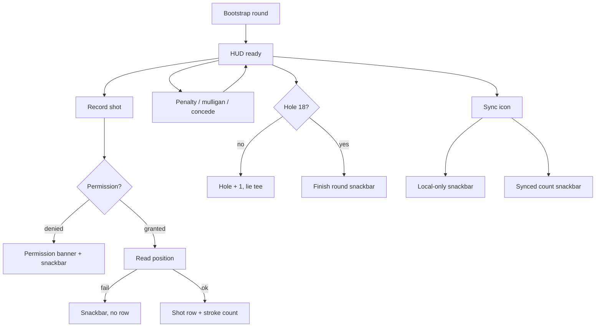
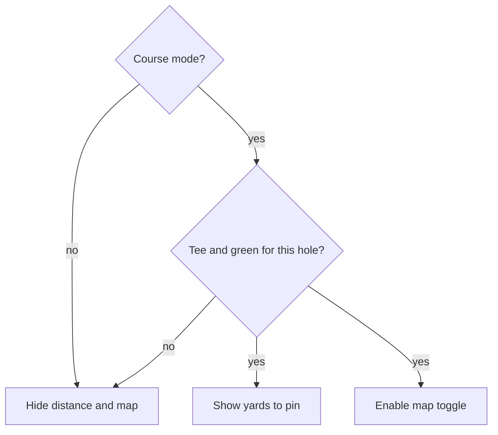

# Wireframe — On Course

| Field | Value |
| :--- | :--- |
| **Widget** | `FairwayTrackerScreen` |
| **PRD** | CRSE-001 … CRSE-006, SYNC-002 |
| **Persona** | Rory — log between swings, phone out for a few seconds |
| **Status** | Target v1.2 — includes as-built venue lookup and new distance / map |
| **AppBar title** | **On Course** (replace "Fairway HUD") |

## 1. Screen purpose

Capture one GPS shot with club, lie, and hole context without scrolling to find the button. Penalties, mulligans, and concede stay on this screen. Sync stays optional and never blocks local save.

## 2. Mobile layout

```
┌─────────────────────────────┐
│ On Course            [sync] │
├─────────────────────────────┤
│ Local Course            ✎   │  VenueNameField; caption "18 holes · par 72" when known
│ [ Course ] [ Simulator ]  │  as built
│ 142 yds to pin            │  CRSE-005, tabular, only when mapped + Course mode
│ [ HUD | Map ]             │  CRSE-006, only when this hole has tee and green
│ ┌─────────────────────────┐ │
│ │ HOLE 7          PAR 4   │ │  HUD card
│ │ Strokes 2  Pen 0        │ │
│ │ Hole 2    Round 28      │ │  tabular
│ └─────────────────────────┘ │
│ Par   [3] [4] [5]           │
│ CLUB                        │
│ [Dr] 3W 5W … 7i …     ›     │  selected chip shows avg, e.g. "7i · 155"
│ LIE                         │
│ [Tee] Fairway Rough …       │
│ ┌ Shot 1 · Tee · Dr       ┐ │
│ │ 248 yds                 │ │  list, or "Distance pending"
│ └─────────────────────────┘ │
│ Penalty +1   Penalty +2     │  outlined, 48dp
│ Mulligan 0   Concede        │
│ Finish hole                 │  text / outlined, not filled gold
├─────────────────────────────┤
│ [  Record shot at ball   ]  │  STICKY filled, 64dp, above nav bar
└─────────────────────────────┘
```

Body scrolls. The record button is a `bottomNavigationBar` **of this scaffold** stacked above the shell’s `NavigationBar` — implement as a `Column` footer inside the shell body, or `Scaffold.bottomNavigationBar` only if it does not replace the app’s tab bar. Preferred: persistent footer `Padding` + `FilledButton` as the last sliver’s sibling, **outside** the scroll view, with 16dp horizontal inset and 8dp gap above the tab bar.

### What changes vs current code

- **One primary:** Record Shot. Finish Hole is outlined. Today both are 72–80dp filled buttons (green and amber) and compete.
- Course name is one tappable row. Tap expands the existing `TextEditingController` field. Default text stays `Local Course`. Editing updates the active round name (CRSE-001).
- Club chips stay the full non-empty bag (putter included — a putter stroke is valid). Chip label is club name. Selected chip subtitle in the section header: `{name} · {avg} yds` when avg &gt; 0.
- Chip lanes are **48dp** tall (current lanes are 44).
- Shot rows show **club name**, not `clubId`.
- Mulligans show the count on the button. They do not change gross.
- Concede still sets strokes to `par * 2` via `concedeHole`. Button label: **Concede**. After concede, HUD shows a `Gimme` chip so it is not color-only.
- Hole 18 button copy: **Finish round**. It does not open a new route.
- Do not block the UI thread on GPS. Only the record button shows a 24dp `CircularProgressIndicator` and ignores a second tap (`_busy`).

### GPS and sync states (required)

| State | UI |
| :--- | :--- |
| Idle | Record enabled if round and club exist |
| Locating | Button spinner, label hidden, `onPressed: null` |
| Permission denied / deniedForever | Banner under the HUD: "Location is off for shot tracking." Action **Open settings** (`Geolocator.openAppSettings` when deniedForever, else request again). Snackbar still fires (CRSE-002). |
| Position null after grant | Snackbar "Couldn’t read location. Shot not saved." |
| Sync, Firebase absent | Snackbar "Firebase not configured — local data is saved on device" |
| Sync success | Snackbar "Synced {n} records to cloud" |
| Bootstrap failure | Non-crashing banner "Couldn’t start the round. Pull to retry." |

## 3. Larger screens

≥600dp: HUD and selectors in a left column (max 480); shot list in a right column. Record button remains full width of the left column, pinned to the bottom of that column. Phone layout is unchanged.

## 4. Widget inventory

| Widget | Role |
| :--- | :--- |
| `AppBar` + `IconButton` | Title, sync |
| HUD `Card` | Hole, par, strokes, penalties, hole gross, round total |
| `ChoiceChip` | Par 3/4/5, club, lie |
| `FilledButton` | Record shot |
| `OutlinedButton` | Penalty +1, +2, mulligan, concede, finish hole |
| `ListTile` | Shots this hole |
| `MaterialBanner` or inline `Card` | Permission / bootstrap error |
| `SnackBar` | Sync and GPS failure |
| `CircularProgressIndicator` | On the record button only |

Lie set (fixed): `tee`, `fairway`, `rough`, `bunker`, `green`, `penalty`.

## 5. Interaction & state map

| Action | Result |
| :--- | :--- |
| Par chip | Updates hole row when a score row exists |
| Record | Inserts shot; `strokes` become `shots.length` (Architecture §5.2). List refreshes. Lie stays as selected. |
| Penalty +1 / +2 | `incrementPenalties`, HUD penalties and hole gross update (`strokes + penalties`) |
| Mulligan | Count increments; gross unchanged |
| Concede | Strokes become `par * 2`; HUD shows Gimme |
| Finish hole (&lt;18) | Next hole, lie resets to **tee**, par defaults to 4 |
| Finish round (18) | Persists hole; stay on screen; snackbar "Round saved on this device" |
| Pull to refresh | Optional; `_refreshHoleState` |

Recording a shot **replaces** a manual stroke count for that hole. The HUD does not need a warning dialog in v1; the scorecard editor remains the override path.

## 6. UX flow



## 7. Key map

| Element | ValueKey | Widget |
| :--- | :--- | :--- |
| Sync | `oncourse-sync-btn` | `IconButton` |
| Course row | `oncourse-course-name-field` | `TextField` when expanded, else tappable row with same key |
| Par 3 / 4 / 5 | `oncourse-par-chip-3` `oncourse-par-chip-4` `oncourse-par-chip-5` | `ChoiceChip` |
| Club chip | `oncourse-club-chip-{clubId}` | `ChoiceChip` |
| Lie chip | `oncourse-lie-chip-{lie}` | `ChoiceChip` |
| Record | `oncourse-record-shot-btn` | `FilledButton` |
| Penalty +1 | `oncourse-penalty-1-btn` | `OutlinedButton` |
| Penalty +2 | `oncourse-penalty-2-btn` | `OutlinedButton` |
| Mulligan | `oncourse-mulligan-btn` | `OutlinedButton` |
| Concede | `oncourse-concede-btn` | `OutlinedButton` |
| Finish hole | `oncourse-finish-hole-btn` | `OutlinedButton` |
| Shot row | `oncourse-shot-row-{strokeNumber}` | `ListTile` |
| Permission banner | `oncourse-location-banner` | `MaterialBanner` |
| Course / Simulator | `oncourse-mode-course` `oncourse-mode-simulator` | `ChoiceChip` |
| Distance to pin | `on-course-distance-to-hole` | `Text` (Roboto Mono) |
| Map toggle | `on-course-map-toggle` | `SegmentedButton` |
| Simulator yards | `oncourse-sim-yards-field` | `TextField` |

## 8. As built (keep these states in the layout)

The shipping screen still uses the AppBar title **Fairway HUD**, two large filled actions (Record and Finish), and a full course `TextField`. Those stay documented as the current code until the target dock in §2 is built. Behaviors that **are** in code and must appear on this wireframe:

- **Course autocomplete** (`VenueNameField`): recent names, then the Philippines catalog. Custom text stays valid. Recognized course shows `18 holes · par 72` in `bodySmall`.
- **Course / Simulator chips.** Simulator replaces GPS with a yards field. Blank or 0 shows "Enter a distance greater than 0".
- **Hole stepper** keys already in code: `on-course-hole-previous`, `on-course-hole-label`, `on-course-hole-next`. Next is disabled until Finish Hole creates the next row. A 9-hole card ends at hole 9.
- **Shot edit** opens `ShotEditDialog` (see [Wireframe_ShotEdit.md](./Wireframe_ShotEdit.md)). Row key in code: `on-course-shot-{id}`.

## 9. Distance to the hole (CRSE-005)

Shown only in **Course** mode when `hasHoleCoordinates(course, hole)` is true. Hidden with no error on Simulator, a custom course, or an unmapped hole (including a missing hole on a partial layout).

| State | UI |
| :--- | :--- |
| Eligible, locating | Caption "Reading location…" under the mode chips. No fake yardage. |
| Fix received | `142 yds to pin` in Roboto Mono, `titleLarge`. Updates when the player moves about 3 m. |
| Permission denied | Same location banner as shot capture. Distance line stays hidden. |
| Leave tab, Simulator, or unmapped hole | Stream stops. The line is not in the tree. |

The number is remaining yards to the **green**, not the last shot’s carry. Label it **to pin** so it is not confused with shot distance on the stroke list.

## 10. Map toggle (CRSE-006, future)

The HUD / Map control is omitted unless this hole has a tee and a green. Map layout is [Wireframe_HoleMap.md](./Wireframe_HoleMap.md). If the pack is not on the device and the phone is offline, stay on the HUD and snackbar "Map for this course isn’t on the phone yet."


