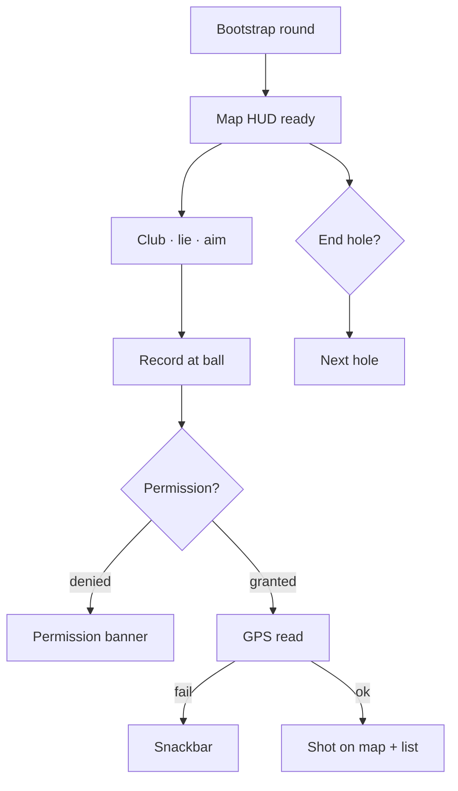

# Wireframe — On Course · Course mode (map-first HUD)

| Field | Value |
| :--- | :--- |
| **Widget** | `FairwayTrackerScreen` (`_simulator == false`) |
| **Stories** | [CRSE-001](../../stories/CRSE/CRSE-001-active-round-context.md)–[006](../../stories/CRSE/CRSE-006-stylized-hole-map.md), [CRSE-009](../../stories/CRSE/CRSE-009-fwy-map-overlays.md), [CRSE-036](../../stories/CRSE/CRSE-036-fwy-map-shell.md), [CRSE-005](../../stories/CRSE/CRSE-005-live-pin-distance.md), [MGDV-202](../../stories/MGDV/MGDV-202-skill-tier-settings.md) |
| **Persona** | Rory — log between swings, phone out for a few seconds |
| **Status** | **Shipped** — FWY map-background shell (CRSE-036) |
| **AppBar title** | **On Course** |
| **Companion** | [Wireframe_OnCourse-Simulator.md](./Wireframe_OnCourse-Simulator.md) · [Flow_OnCourse-Modes.md](./Flow_OnCourse-Modes.md) |

## 1. Screen purpose

Capture each **fairway stroke** with **club, lie, aim**, and **GPS at the ball** while a **satellite / cached map HUD** shows the hole line, **path markers**, and stroke polyline. **Yards to the next marker** (or **to pin** when only tee+green exist) stays readable in the header chip. Penalties, mulligans, concede, and finish-hole stay on this screen. **Simulator** logging is a separate layout — [Wireframe_OnCourse-Simulator.md](./Wireframe_OnCourse-Simulator.md).

## 2. Mobile layout (FWY map shell — as built)

Full-bleed `FwyHoleMap` under scrim overlays. **Top gradient band** (`oncourse-top-overlay`) holds course, mode toggle, hole stepper, distance / GPS badges. **Side rail** (`oncourse-side-rail`) is vertical `FwyRailTile`s for Club, Lie, Aim (mapped holes), Penalty, Mulligan. **Bottom dock** (safe area): shots **peek** row + single **Record shot at ball** filled button.

```
┌─────────────────────────────┐
│ [⋮] On Course  [book][acct] │  book = diary-entry-on-course
│▓▓▓▓▓▓▓▓▓▓▓▓▓▓▓▓▓▓▓▓▓▓▓▓▓▓▓▓▓│  top overlay (map scrim)
│ Course · H7 · Par 4 · 168y  │  oncourse-top-overlay
│ [Live][Manual]  badges…     │  oncourse-gps-live / manual
│                    ┌─Club─┐ │
│     MAP (full)     │ Lie  │ │  oncourse-side-rail
│     FwyHoleMap     │ Aim  │ │
│                    │ Pen++│ │
│▓▓▓▓▓▓▓▓▓▓▓▓▓▓▓▓▓▓▓▓▓▓▓▓▓▓▓▓▓│  bottom scrim gradient
│ Shots this hole (3) ⌃       │  oncourse-shots-peek → sheet
│ [ Record shot at ball    ]  │  oncourse-record-shot-btn
├─────────────────────────────┤
│ Bag │ Range │ ● On Course │… │
└─────────────────────────────┘
```

- **Write in the diary** with the header book icon only (`diary-entry-on-course`, `Icons.auto_stories_outlined`, 48dp, immediately left of the account avatar). The leading ⋮ is round tools (invite caddy, concede, finish, GPS, rail side). It does not list Diary. There is no right-edge swipe.
- **Course name** (`oncourse-course-summary`) opens the shared **Course** dialog, the same control as Scorecard ([Wireframe_NewRound.md](./Wireframe_NewRound.md)). Save writes the name, format, double eagle, rating, and slope onto the active round. Cancel writes nothing.
- **Map** is always the body in FWY mode (`oncourse-map-background`). Overlays use `fwyOverlayText` / `fwySurface` ([`fwy_overlays.dart`](../../../golf_diary_app/lib/widgets/fwy_overlays.dart)).
- Manual GPS with no confirmed pin shows `oncourse-manual-hint` (“Tap the map where your ball is”) about three rows above the tee marker (`oncourse-tee-marker`), clear of the triangle.
- **Carry mark** (Aim mode): a 30° arc at the selected club's carry distance, centred on the golfer's aim. With no aim set, the arc faces the hole, or the nearest marker toward the hole when the pin is not the target.
- **Plan shot** via rail tiles → bottom sheets for club/lie/aim; GPS on Record only.
- **Shots sheet** (`oncourse-shots-sheet`) lists `oncourse-shot-row-{n}`; overflow menu holds Concede / Finish ([CRSE-003](../../stories/CRSE/CRSE-003-penalties-mulligans-concede.md)).
- Badges: stand-in yards, line-only, map download (`oncourse-map-download`).

### Skill tier density

[MGDV-202](../shards/MGDV/MGDV-202-golfer-profile-skill-tier.md) · [MGDV-203](../shards/MGDV/MGDV-203-range-bag-progressive-disclosure.md).

| Element | Beginner | Amateur | Seasoned pro |
| :--- | :--- | :--- | :--- |
| Map markers | Tee, flag, your ball only | + fairway markers | + aim cone on last shot |
| Distance chip | **to green** one number | **to marker** with chevron when waypoints exist | Both marker + pin line |
| Aim wedge | Hidden (defaults center) | L / R icons | Full L · center · R + compass hint |
| Shot list rows | Club + stroke # | + lie + yards | + lat quality / edit affordance |
| Footer penalties | Concede + Finish only | + Mulligan | Full penalty row |
| Copy | "Yards left" | "Yds to marker" | "168 yds · M2" |

Simulator tier table: [Wireframe_OnCourse-Simulator.md](./Wireframe_OnCourse-Simulator.md) § Skill tier density.

### Implementation notes (`fairway_tracker_screen.dart`)

| Area | Shipped behavior |
| :--- | :--- |
| Layout | `Stack`: map → scrims → overlay → rail → dock |
| SIM branch | Separate scroll HUD — [Wireframe_OnCourse-Simulator.md](./Wireframe_OnCourse-Simulator.md) |
| Record CTA | Single filled green button; spinner when `_busy` |
| Finish / concede | Overflow actions + double-par chip; not second filled primary |

### GPS and sync states (required)

| State | UI |
| :--- | :--- |
| Idle | Record enabled if round and club exist |
| Locating | Spinner **on record button** only; distance chip may show "Reading location…" |
| Permission denied / deniedForever | Banner in footer rail: "Location is off for shot tracking." Action **Open settings** |
| Position null after grant | Snackbar "Couldn't read location. Shot not saved." |
| Unmapped course or hole | No distance chip; vector map only — **no error** |
| Sync, Firebase absent | Snackbar "Firebase not configured — local data is saved on device" |
| Sync success | Snackbar "Synced {n} records to cloud" |
| Bootstrap failure | `oncourse-bootstrap-banner` |

## 3. Larger screens

≥600dp: map in the **right** column (flex 3); header stats + footer rail (plan shot, record, penalties) in **left** column max 420dp. Phone layout unchanged.

## 4. Widget inventory

| Widget | Role |
| :--- | :--- |
| `AppBar` + actions | Leading ⋮ for round tools; trailing book icon (`diary-entry-on-course`) then account avatar |
| Header band | Venue, mode chips, hole stepper, distance chip |
| Map surface | Satellite/cache/vector + markers (`oncourse-hole-map`) |
| `ChoiceChip` | Mode, par, club, lie |
| Aim wedge | `SegmentedButton` or icon toggle group |
| `FilledButton` | Record shot at ball |
| `OutlinedButton` | Penalties, mulligan, concede, finish |
| `ListTile` | Shots this hole |
| `MaterialBanner` | Permission / bootstrap |
| `SnackBar` | Sync, GPS, map pack |
| `CircularProgressIndicator` | Record button busy |
| `LinearProgressIndicator` | Map pack download |

## 5. Interaction & state map

| Action | Result |
| :--- | :--- |
| Catalog course pick | Hole pars, 9/18 count, marker layout when coords exist |
| Par chip | Updates hole row when score row exists |
| Aim wedge | Stores aim on next `ShotRecord` (L/center/R) |
| Record | GPS read → shot row + polyline; strokes = shot count |
| Penalty / mulligan / concede | Same as PRD CRSE-003 |
| Finish hole (&lt; max) | Next hole, lie **tee**, catalog par |
| Finish round (final hole) | Snackbar "Round saved on this device" |
| Vector chip | Swap satellite off; keep markers + shots |
| New shot saved | Map overlay updates without navigation |
| Diary book icon | Opens `SwingDiarySheet`. Only write entry on this screen |

## 6. UX flow

High-level loop: [Flow_OnCourse-Modes.md](./Flow_OnCourse-Modes.md) §4.



## 7. Key map

| Element | ValueKey | Widget |
| :--- | :--- | :--- |
| Sync (legacy) / account | `oncourse-sync-btn` / account menu keys | `IconButton` |
| Swing diary | `diary-entry-on-course` | `IconButton` (`Icons.auto_stories_outlined`) |
| Course row | `oncourse-course-summary` | `InkWell` opens the shared course dialog |
| Course name field | `oncourse-course-name-field` | `VenueNameField` inside that dialog |
| Mode | `oncourse-mode-course` `oncourse-mode-simulator` | `ChoiceChip` |
| Hole stepper | `on-course-hole-previous` `on-course-hole-label` `on-course-hole-next` | `IconButton` / `Text` |
| Yards to pin | `on-course-distance-to-hole` | `Text` (Roboto Mono) |
| Yards to marker | `oncourse-yards-to-marker` | `Text` |
| Map surface | `oncourse-map-background` | `FwyHoleMap` |
| Tee marker | `oncourse-tee-marker` | Tee point on the map |
| Manual pin hint | `oncourse-manual-hint` | Banner about three rows above the tee |
| Top overlay | `oncourse-top-overlay` | `DecoratedBox` + gradient |
| Side rail | `oncourse-side-rail` | Column of `FwyRailTile` |
| Club / lie / aim on rail | `oncourse-club-summary` … `oncourse-aim-summary` | `FwyRailTile` |
| Shots peek | `oncourse-shots-peek` | `InkWell` |
| Shots sheet | `oncourse-shots-sheet` | Modal sheet |
| Map download | `oncourse-map-download` | `LinearProgressIndicator` |
| Aim left / center / right | `oncourse-aim-left` `oncourse-aim-center` `oncourse-aim-right` | `SegmentedButton` slots |
| Par chips | `oncourse-par-chip-3` … `5` | `ChoiceChip` |
| Club / lie | `oncourse-club-chip-{id}` `oncourse-lie-chip-{lie}` | `ChoiceChip` |
| Record | `oncourse-record-shot-btn` | `FilledButton` |
| Penalty / mulligan / concede / finish | `oncourse-penalty-1-btn` … `oncourse-finish-hole-btn` | `OutlinedButton` |
| Holed | `oncourse-holed-btn` | `TextButton` |
| Shot row | `oncourse-shot-row-{strokeNumber}` | `ListTile` |
| Permission banner | `oncourse-location-banner` | `MaterialBanner` |
| Bootstrap banner | `oncourse-bootstrap-banner` | `MaterialBanner` |

Simulator-only keys: [Wireframe_OnCourse-Simulator.md](./Wireframe_OnCourse-Simulator.md) §7.

## 8. Distance & unmapped rules (CRSE-005)

- Live stream **only** in Course mode on mapped holes (`hasHoleCoordinates`).
- Label **to pin** when no waypoint markers; **to marker** when Architecture exposes fairway marker coords.
- Simulator or unmapped: chip **not in tree** (no placeholder).

## 9. Map imagery (CRSE-006)

Default **satellite/cache** per [Wireframe_HoleMap.md](./Wireframe_HoleMap.md). Offline without pack: vector tee→green + shot dots; snackbar once per session. **Record** remains available on all states.

## 10. Legacy target notes (superseded layout)

Earlier v1.2 wireframe showed HUD card **above** selectors and an optional HUD/Map segmented control. v1.3 **Course** mode inverts that: **map-first**, footer rail for planning. Simulator keeps HUD-card layout in the companion wireframe.