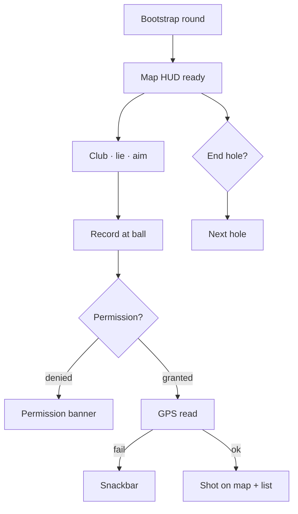

# Wireframe — On Course · Course mode (map-first HUD)

| Field | Value |
| :--- | :--- |
| **Widget** | `FairwayTrackerScreen` (`_simulator == false`) |
| **PRD** | CRSE-001 … CRSE-006, SYNC-002, MGDV-2-002 |
| **Persona** | Rory — log between swings, phone out for a few seconds |
| **Status** | Target v1.3 — map-first Course HUD; Simulator split out |
| **AppBar title** | **On Course** |
| **Companion** | [Wireframe_OnCourse-Simulator.md](./Wireframe_OnCourse-Simulator.md) · [Flow_OnCourse-Modes.md](./Flow_OnCourse-Modes.md) |

## 1. Screen purpose

Capture each **fairway stroke** with **club, lie, aim**, and **GPS at the ball** while a **satellite / cached map HUD** shows the hole line, **path markers**, and stroke polyline. **Yards to the next marker** (or **to pin** when only tee+green exist) stays readable in the header chip. Penalties, mulligans, concede, and finish-hole stay on this screen. **Simulator** logging is a separate layout — [Wireframe_OnCourse-Simulator.md](./Wireframe_OnCourse-Simulator.md).

## 2. Mobile layout (map-first)

Chrome wraps the map: **header** = course + mode + hole + distance; **body** = map; **footer rail** = plan shot + secondary actions + sticky record.

```
┌─────────────────────────────┐
│ On Course    [caddy][diary] │  AppBar — compact actions
├─────────────────────────────┤  HEADER (fixed)
│ Wack Wack East           ✎ │  VenueNameField · catalog pars
│ [●Course ] [ Simulator ]  │
│ ‹ H7 ›  Par 4  ·  Strokes 2│  tabular row
│ ┌──────────┬──────────────┐ │
│ │ 168 yds  │ to marker ▸  │ │  on-course-distance-to-hole /
│ └──────────┴──────────────┘   oncourse-yards-to-marker
├─────────────────────────────┤  MAP BODY (flex, ≥40vh)
│ ┌─────────────────────────┐ │
│ │    ○ tee                │ │
│ │      ╲                  │ │  satellite or cached tile
│ │   ○───•───○ flag       │ │  fairway markers + shot dots
│ │         ▲ you           │ │  path to next marker (dashed)
│ └─────────────────────────┘ │  oncourse-hole-map
│ [Vector]  offline · no pack │  chip when tiles absent
├─────────────────────────────┤  FOOTER RAIL (scroll if needed)
│ CLUB  [7i·155] [9i] …  ›   │  chip lanes 48dp
│ LIE   [Fairway] [Rough] …   │
│ Aim   [ ◀ L ] [ ● ] [ R ▶ ] │  aim wedge · oncourse-aim-*
│ ┌ Shot 2 · 7i · 156 yds  ┐ │  segment GPS yds · tap edit
│ └─────────────────────────┘ │
│ Pen +1  Pen +2  Mulligan    │  outlined · single row scroll
│ Concede    Finish hole      │
├─────────────────────────────┤
│ [  Record shot at ball   ]  │  STICKY 64dp filled · above tab bar
└─────────────────────────────┘
│ ○ Bag  ○ Range  ● Course  ○ │
└─────────────────────────────┘
```

- Map is **not** behind a HUD/Map segmented toggle for the default outdoor experience — the **map is the screen**. A **Vector** chip collapses satellite to the offline schematic ([Wireframe_HoleMap.md](./Wireframe_HoleMap.md)).
- **Plan shot** = club + lie + **aim wedge** (left / center / right) stored with the stroke; GPS fires on **Record shot at ball** only (Architecture battery rule).
- **Stroke list** shows **segment yards** from prior ball position to new fix (or "Distance pending").
- Hole ends at **Finish hole**, **concede** (`2× par`), or **Holed** / **double par** prompt (tier-gated visibility).

### Skill tier density

[MGDV-202](../shards/MGDV/MGDV-202-golfer-profile-skill-tier.md) · [MGDV-203](../shards/MGDV/MGDV-203-range-bag-progressive-disclosure.md).

| Element | Beginner | Amateur | Seasoned pro |
| :--- | :--- | :--- | :--- |
| Map markers | Tee, flag, your ball only | + fairway markers | + aim cone on last shot |
| Distance chip | **to green** one number | **to marker** with chevron when waypoints exist | Both marker + pin line |
| Aim wedge | Hidden (defaults center) | L / R icons | Full L · center · R + compass hint |
| Shot list rows | Club + stroke # | + lie + yards | + lat quality / edit affordance |
| Footer penalties | Concede + Finish only | + Mulligan | Full penalty row |
| Copy | "Yards left" | "Yds to marker" | "168 yds · M2" |

Simulator tier table: [Wireframe_OnCourse-Simulator.md](./Wireframe_OnCourse-Simulator.md) § Skill tier density.

### What changes vs current `fairway_tracker_screen.dart`

| As built (`lib/screens/fairway_tracker_screen.dart`) | Target Course wireframe |
| :--- | :--- |
| `SingleChildScrollView` form; map not primary | Map **`Expanded`** body between header and footer rail |
| Course `TextField` dominates first viewport | One-line venue row; tap expands `VenueNameField` |
| Mode chips then optional distance text inline | Header **distance chip** + hole stepper on one band |
| No aim direction | **Aim wedge** before record |
| No marker / next-yard concept | **Yards to marker** when coords include waypoints; else CRSE-005 pin only |
| Record + Finish both ~80dp filled `ElevatedButton` | Single filled **Record**; Finish **outlined** |
| Club/lie lanes 44dp | **48dp** chips |
| Simulator yards field in same column | Simulator UI only in [Wireframe_OnCourse-Simulator.md](./Wireframe_OnCourse-Simulator.md) |
| `CRSE-006` toggle not implemented | Map default; vector fallback chip instead of HUD/Map fork |
| Keys: partial par/club/lie keys | Full Key map §7 + aim/marker keys |

Behaviors **keep from code** until refactored: bootstrap round, `syncStrokeCountFromShots`, concede rule, pin watch gating when `!_simulator`, `ShotEditDialog`, hole stepper keys, invite caddy + diary buttons in AppBar.

### GPS and sync states (required)

| State | UI |
| :--- | :--- |
| Idle | Record enabled if round and club exist |
| Locating | Spinner **on record button** only; distance chip may show "Reading location…" |
| Permission denied / deniedForever | Banner in footer rail: "Location is off for shot tracking." Action **Open settings** |
| Position null after grant | Snackbar "Couldn't read location. Shot not saved." |
| Unmapped course or hole | No distance chip; vector map only — **no error** |
| Sync, Firebase absent | Snackbar "Firebase not configured — local data is saved on device" |
| Sync success | Snackbar "Synced {n} records to cloud" |
| Bootstrap failure | `oncourse-bootstrap-banner` |

## 3. Larger screens

≥600dp: map in the **right** column (flex 3); header stats + footer rail (plan shot, record, penalties) in **left** column max 420dp. Phone layout unchanged.

## 4. Widget inventory

| Widget | Role |
| :--- | :--- |
| `AppBar` + actions | Title, caddy QR, diary, account |
| Header band | Venue, mode chips, hole stepper, distance chip |
| Map surface | Satellite/cache/vector + markers (`oncourse-hole-map`) |
| `ChoiceChip` | Mode, par, club, lie |
| Aim wedge | `SegmentedButton` or icon toggle group |
| `FilledButton` | Record shot at ball |
| `OutlinedButton` | Penalties, mulligan, concede, finish |
| `ListTile` | Shots this hole |
| `MaterialBanner` | Permission / bootstrap |
| `SnackBar` | Sync, GPS, map pack |
| `CircularProgressIndicator` | Record button busy |
| `LinearProgressIndicator` | Map pack download |

## 5. Interaction & state map

| Action | Result |
| :--- | :--- |
| Catalog course pick | Hole pars, 9/18 count, marker layout when coords exist |
| Par chip | Updates hole row when score row exists |
| Aim wedge | Stores aim on next `ShotRecord` (L/center/R) |
| Record | GPS read → shot row + polyline; strokes = shot count |
| Penalty / mulligan / concede | Same as PRD CRSE-003 |
| Finish hole (&lt; max) | Next hole, lie **tee**, catalog par |
| Finish round (final hole) | Snackbar "Round saved on this device" |
| Vector chip | Swap satellite off; keep markers + shots |
| New shot saved | Map overlay updates without navigation |

## 6. UX flow

High-level loop: [Flow_OnCourse-Modes.md](./Flow_OnCourse-Modes.md) §4.



## 7. Key map

| Element | ValueKey | Widget |
| :--- | :--- | :--- |
| Sync (legacy) / account | `oncourse-sync-btn` / account menu keys | `IconButton` |
| Course row | `oncourse-course-name-field` | `VenueNameField` |
| Mode | `oncourse-mode-course` `oncourse-mode-simulator` | `ChoiceChip` |
| Hole stepper | `on-course-hole-previous` `on-course-hole-label` `on-course-hole-next` | `IconButton` / `Text` |
| Yards to pin | `on-course-distance-to-hole` | `Text` (Roboto Mono) |
| Yards to marker | `oncourse-yards-to-marker` | `Text` |
| Map surface | `oncourse-hole-map` | Map / `CustomPaint` |
| Vector fallback | `oncourse-map-vector` | `ChoiceChip` or toggle |
| Map download | `oncourse-map-download` | `LinearProgressIndicator` |
| Aim left / center / right | `oncourse-aim-left` `oncourse-aim-center` `oncourse-aim-right` | `SegmentedButton` slots |
| Par chips | `oncourse-par-chip-3` … `5` | `ChoiceChip` |
| Club / lie | `oncourse-club-chip-{id}` `oncourse-lie-chip-{lie}` | `ChoiceChip` |
| Record | `oncourse-record-shot-btn` | `FilledButton` |
| Penalty / mulligan / concede / finish | `oncourse-penalty-1-btn` … `oncourse-finish-hole-btn` | `OutlinedButton` |
| Holed | `oncourse-holed-btn` | `TextButton` |
| Shot row | `oncourse-shot-row-{strokeNumber}` | `ListTile` |
| Permission banner | `oncourse-location-banner` | `MaterialBanner` |
| Bootstrap banner | `oncourse-bootstrap-banner` | `MaterialBanner` |

Simulator-only keys: [Wireframe_OnCourse-Simulator.md](./Wireframe_OnCourse-Simulator.md) §7.

## 8. Distance & unmapped rules (CRSE-005)

- Live stream **only** in Course mode on mapped holes (`hasHoleCoordinates`).
- Label **to pin** when no waypoint markers; **to marker** when Architecture exposes fairway marker coords.
- Simulator or unmapped: chip **not in tree** (no placeholder).

## 9. Map imagery (CRSE-006)

Default **satellite/cache** per [Wireframe_HoleMap.md](./Wireframe_HoleMap.md). Offline without pack: vector tee→green + shot dots; snackbar once per session. **Record** remains available on all states.

## 10. Legacy target notes (superseded layout)

Earlier v1.2 wireframe showed HUD card **above** selectors and an optional HUD/Map segmented control. v1.3 **Course** mode inverts that: **map-first**, footer rail for planning. Simulator keeps HUD-card layout in the companion wireframe.