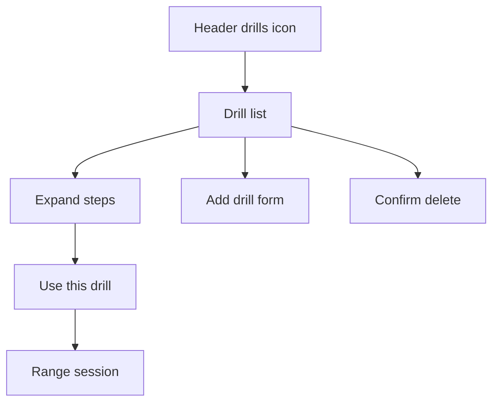

# Wireframe — Practice Drills

| Field | Value |
| :--- | :--- |
| **Widget** | Modal sheet from `RangeDrillScreen` |
| **PRD** | RNGE-003 |
| **Reference** | [`Range_Drills.md`](../Range_Drills.md) |
| **Persona** | Riley |
| **Status** | New — not in code yet |

## 1. Screen purpose

Pick a drill, read the steps, add one, or remove one, without leaving Range. The sheet is opened from the **leading** AppBar icon.

## 2. Mobile layout

```
┌─────────────────────────────┐
│ Practice drills        [+]  │  drag handle
│ [All] Tempo  Strike  Wedge  │  category chips, 48dp
│ ┌ 3:1 Tour Tempo Rhythm   ┐ │
│ │ Full swing · 10 balls   │ │
│ │ Build a 3-count back… › │ │
│ └─────────────────────────┘ │
│ ┌ Feet-Together Balance   ┐ │
│ └─────────────────────────┘ │
└─────────────────────────────┘
```

Expanded card (tap the row, not a second screen):

```
┌─────────────────────────────┐
│ 3:1 Tour Tempo Rhythm       │
│ 1  Tee a mid-iron…          │
│ 2  Rehearse One-Two-Three…  │
│ 3  Address and count…       │
│ 4  Hold the finish…         │
│ 5  Log the block…           │
│ [ Use this drill ]  [Delete]│
└─────────────────────────────┘
```

**Use this drill** is the one filled button. Delete is a text button. Add (`+`) opens a form sheet: title, category, short description, steps (one field per step, **Add step**). Save is filled. Empty title keeps the form open.

## 3. Larger screens

≥600dp: sheet max width 560, centered. Category chips stay one row.

## 4. Widget inventory

`DraggableScrollableSheet`, `FilterChip`, `ExpansionTile` or card, `FilledButton`, `TextButton`, `TextField`, `IconButton`.

## 5. Interaction & state map

| State | UI |
| :--- | :--- |
| Seeded list | 11 drills, `deleted = 0` |
| Category filter | Subset; All restores the full list |
| Custom drill | Same row; no badge that implies seeded drills cannot be deleted |
| Delete | Confirm "Remove this drill?" then tombstone. Row leaves the list. |
| Use | Pop sheet. Range shows the title under the venue field. |
| Empty after deletes | "No drills in this list. Add one." |

## 6. UX flow



## 7. Key map

| Element | ValueKey | Widget |
| :--- | :--- | :--- |
| Open | `range-header-drills-btn` | `IconButton` |
| Sheet | `range-drills-sheet` | `BottomSheet` |
| Category | `range-drills-chip-{category}` | `FilterChip` |
| Row | `range-drill-row-{id}` | `ExpansionTile` |
| Use | `range-drill-use-btn` | `FilledButton` |
| Delete | `range-drill-delete-btn` | `TextButton` |
| Add | `range-drill-add-btn` | `IconButton` |
| Save custom | `range-drill-save-btn` | `FilledButton` |
