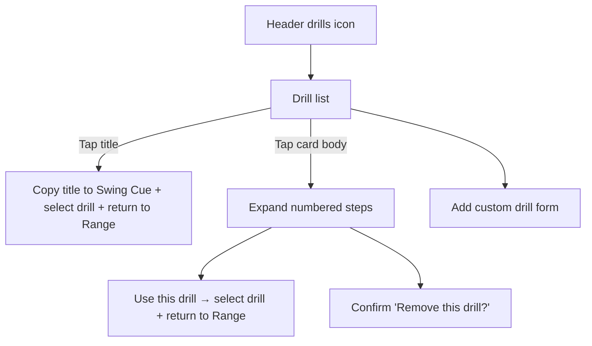

# Wireframe — Practice Drills

| Field | Value |
| :--- | :--- |
| **Widget** | `PracticeDrillSheet` (modal bottom sheet from `RangeDrillScreen`) |
| **PRD** | RNGE-003 |
| **Reference** | [`Range_Drills.md`](../Range_Drills.md) |
| **Persona** | Riley |
| **Status** | Implemented (`practice_drill_sheet.dart`) |

## 1. Screen purpose

Pick a structured practice drill, read its numbered steps, copy its title directly into the per-club Swing Cue & Mechanics Note, or add/delete drills without leaving Range. Opened from the leading AppBar icon (`range-header-drills-btn`).

## 2. Mobile layout

```
┌─────────────────────────────────┐
│ Practice drills            [+]  │  drag handle + add custom drill
│ [All] [Ball Striking…] [Tempo…] │  horizontal FilterChips, 48dp
│ ┌ 3:1 Tour Tempo Rhythm       ┐ │  tap title → copy to cue & close
│ │ Full Swing & Tempo          │ │  tap card body → expand steps
│ │ Build a repeatable 3-count… │ │
│ └─────────────────────────────┘ │
│ ┌ Feet-Together Balance Drill ┐ │
│ └─────────────────────────────┘ │
└─────────────────────────────────┘
```

Expanded card (tap the row body):

```
┌─────────────────────────────────┐
│ 3:1 Tour Tempo Rhythm           │
│ Full Swing & Tempo              │
│ Build a repeatable 3-count…     │
│ 1. Select a mid-iron…           │
│ 2. Make three practice swings…  │
│ 3. Step in and hit 10 balls…    │
│ 4. Hold your balanced finish…   │
│ 5. Log the 10-ball block…       │
│ [     Use this drill     ]      │  FilledButton
│          [ Delete ]             │  TextButton
└─────────────────────────────────┘
```

### Two ways to apply a drill

1. **Tap the drill title (`range-drill-title-{id}`):** Immediately selects the drill, copies its title into the Range screen's **Swing Cue & Mechanics Note** field, and closes the sheet (`PracticeDrillPick(drill, copyTitleToNote: true)`).
2. **Expand the row and tap `Use this drill` (`range-drill-use-btn`):** Selects the drill and shows it under the venue field on Range without overwriting a custom note already typed in **Swing Cue & Mechanics Note** (`PracticeDrillPick(drill, copyTitleToNote: false)`).

Both paths attach `drill.id` (and its title/steps at session compile time) to the next saved club block so the compiled **Range Session Log** (`RNGE-005`) and **Vertex AI evaluation** (`RNGE-004`) know exactly which drill was performed.

## 3. Larger screens

≥600dp: sheet max width 560, centered. Category chips scroll horizontally in a single row.

## 4. Widget inventory

`SafeArea`, `FilterChip`, `Card`, `InkWell`, `FilledButton`, `TextButton`, `TextField`, `IconButton`, `AlertDialog` (delete confirmation).

## 5. Interaction & state map

| State | UI |
| :--- | :--- |
| Seeded list | 12 reference drills from `Range_Drills.md`, `deleted = 0` |
| Category filter | Filters list; `All` restores full list |
| Tap title | Copies title to Swing Cue & Mechanics Note, sets active drill, pops sheet |
| Tap row body | Expands / collapses numbered steps (`1..N`), **Use this drill**, and **Delete** |
| Tap **Use this drill** | Sets active drill without overwriting Swing Cue & Mechanics Note, pops sheet |
| Tap `+` (`range-drill-add-btn`) | Opens `PracticeDrillForm` sheet (title, category, short description, steps). Empty title or no step shows inline error `"Add a title and at least one step."` |
| Tap **Delete** | Confirms `"Remove this drill?"` → tombstones (`deleted = 1`) and reloads list |
| Empty list | `"No drills in this list. Add one."` |

## 6. UX flow



## 7. Key map

| Element | ValueKey | Widget |
| :--- | :--- | :--- |
| Open sheet | `range-header-drills-btn` | `IconButton` |
| Sheet root | `range-drills-sheet` | `SizedBox` inside BottomSheet |
| Category chip | `range-drills-chip-{slug}` | `FilterChip` |
| Drill row | `range-drill-row-{id}` | `InkWell` |
| Drill title | `range-drill-title-{id}` | `InkWell` |
| Use button | `range-drill-use-btn` | `FilledButton` |
| Delete button | `range-drill-delete-btn` | `TextButton` |
| Add button | `range-drill-add-btn` | `IconButton` |
| Save custom drill | `range-drill-save-btn` | `FilledButton` |
