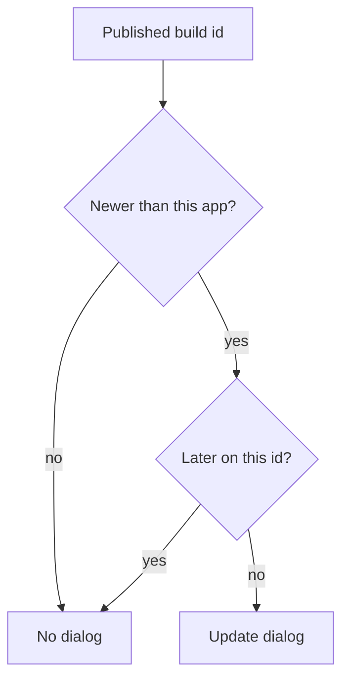

# Wireframe — PWA Update

| Field | Value |
| :--- | :--- |
| **Widget** | `PwaUpdateDialog` |
| **PRD** | Web publish / installed PWA |
| **Status** | As built — web only |

## 1. Screen purpose

Tell someone using the installed site that a newer build is published, and let them reload or stay.

## 2. Mobile layout

```
┌─────────────────────────────┐
│ Update available            │
│ A newer Golf Diary is       │
│ published. Reload to use it.│
│ Your rounds stay on this    │
│ phone.                      │
│      Later          Update  │
└─────────────────────────────┘
```

Update is filled (`primary`). Later is text. Later remembers this build id so the same publish does not ask again. Diary data is IndexedDB and is not cleared by the reload.

## 3. Larger screens

Same dialog, max width 400.

## 4. Widget inventory

`AlertDialog`, `TextButton`, `FilledButton`.

## 5. Interaction & state map

| Action | Result |
| :--- | :--- |
| Update | Reload onto the published build |
| Later | Dismiss; do not ask again for this build id |
| Android / iOS | Dialog is not shown |

## 6. UX flow



## 7. Key map

| Element | ValueKey | Widget |
| :--- | :--- | :--- |
| Dialog | `pwa-update-dialog` | `AlertDialog` |
| Update | `pwa-update-confirm` | `FilledButton` |
| Later | `pwa-update-later` | `TextButton` |
