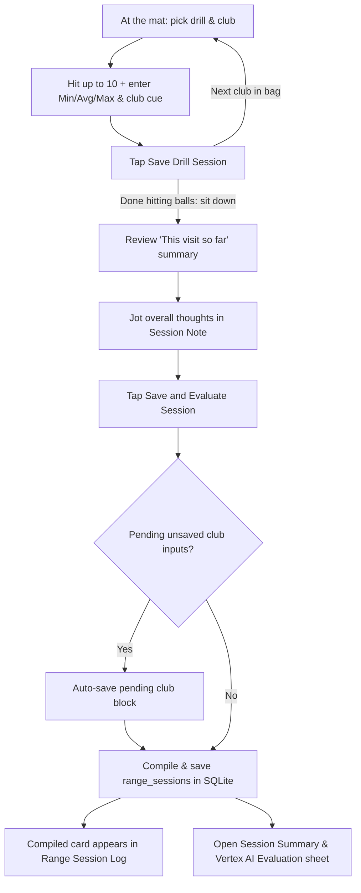

# Wireframe — Range

| Field | Value |
| :--- | :--- |
| **Widget** | `RangeDrillScreen` |
| **PRD** | RNGE-001 … RNGE-005 |
| **Persona** | Riley — hits several clubs & drills on the mat, then sits down to jot a session note, review the compiled summary, and read Vertex AI's evaluation |
| **Status** | Target v1.3 (aligned with as-built Range Drill Instructor + `RNGE-005` / `RNGE-004`) |
| **AppBar title** | **Range Drill Instructor** (as built) |

## 1. Screen purpose

Support the two distinct moments of a real range visit:

1. **Standing at the bay (Per-Club Block Capture — `RNGE-001`..`003`):** Pick a drill from the top-left header icon (`range-header-drills-btn`), select a club chip, tap **Hit Shot** up to 10 balls, enter `Min / Avg / Max` yards and a per-club **Swing Cue & Mechanics Note**, and tap **Save Drill Session**. Repeat across several clubs and drills. Each saved block updates that club's distance in My Bag and joins the **Active Visit Summary**.
2. **Sitting down after the bucket (Session Note, Summary Review & Evaluation — `RNGE-005` → `RNGE-004`):** When done hitting balls, the golfer sits down, sees the **Wrap Up Range Visit** card showing a live summary of the clubs and drills recorded in this visit, jots down an overall **Session Note** (`range-session-note-field` — never erased when switching club chips), and taps **Save and Evaluate Session** (`range-save-evaluate-session-btn`). This compiles the visit into a single `RangeSessionLogEntry` in SQLite and opens the **Session Summary & Vertex AI Evaluation** sheet ([`Wireframe_SwingDiary.md`](./Wireframe_SwingDiary.md)).

## 2. Mobile layout

```
┌─────────────────────────────────────────┐
│ [≡] Range Drill Instructor   [✦] [sync] │  [≡] drills · [✦] diary · [sync]
├─────────────────────────────────────────┤
│ Driving range or simulator              │  VenueNameField
│ 3:1 Tour Tempo Rhythm           [Clear] │  active drill banner (when chosen)
│                                         │
│ Select club                             │
│ [Driver] [3 Wood] [7 Iron] [PW] …       │  48dp ChoiceChips (putter excluded)
│                                         │
│ ┌ 💡 Swing Cue & Mechanics Note ──────┐ │  amber-tinted card (per-club cue)
│ │ 3:1 Tour Tempo Rhythm               │ │  reloads on club switch or drill tap
│ └─────────────────────────────────────┘ │
│                                         │
│ Shots: 0 / 10          [ ⛳ Hit Shot ]   │  56dp button, caps at 10
│ [ Min (Yds) ] [ Avg (Yds) ] [ Max (Yds)]│  tabular numeric inputs
│                                         │
│ [       Save Drill Session            ] │  saves 1 club block → joins visit
│                                         │
│ ── WRAP UP RANGE VISIT (RNGE-005) ───── │
│ ┌ 📝 Wrap Up & Session Review ────────┐ │  creamElevated / surfaceContainer
│ │ This visit so far (2 club blocks)   │ │  live preview before compiling
│ │ • 7 Iron · 10 shots · avg 155 yds   │ │    Cue: "3:1 Tour Tempo Rhythm"
│ │ • Driver · 10 shots · avg 242 yds   │ │    Drill: Simulated Fairway Corridor
│ │ ─────────────────────────────────── │ │
│ │ Session Note (overall thoughts)     │ │
│ │ ┌─────────────────────────────────┐ │ │  ValueKey('range-session-note-field')
│ │ │ Tempo felt much smoother with   │ │ │  3–4 lines, persists across club
│ │ │ mid-irons; driver still pushy…  │ │ │  chip switches & tab switches
│ │ └─────────────────────────────────┘ │ │
│ │                                     │ │
│ │ [ ✦ Save and Evaluate Session     ] │ │  ValueKey('range-save-evaluate-session-btn')
│ └─────────────────────────────────────┘ │
│                                         │
│ Session log                             │  ValueKey('range-session-log-title')
│ [This club]  [All clubs]                │
│ ┌ Compiled Session · Topgolf BGC ─────┐ │  ValueKey('range-session-log-list')
│ │ 11/11/2026 7:45 PM · 2 club blocks  │ │  ValueKey('range-compiled-session-{id}')
│ │ "Tempo felt much smoother…"         │ │
│ │ • 7 Iron: 10 shots · 148/155/162 yds│ │
│ │ • Driver: 10 shots · 225/242/255 yds│ │
│ │ [ View AI Evaluation › ]            │ │  reopens saved evaluation (no AI call)
│ └─────────────────────────────────────┘ │
└─────────────────────────────────────────┘
```

### Visual hierarchy: Per-Club Block vs. Post-Visit Sit-Down

- **Save Drill Session** (existing top section) logs a *single club block* while standing at the mat.
- **Wrap Up & Session Review** (`Card` in `surfaceContainer` with `hairline` border) sits directly below **Save Drill Session** and above the historical **Session log**. It gives the golfer a calm "sit down after the bucket" workspace:
  1. **This visit so far (`range-visit-summary-preview`):** Shows the uncompiled club blocks recorded during the current visit (club name, shots, min/avg/max in `GolfTextStyles.tabularNum`, per-club cue, and drill badge). If no blocks have been saved yet, shows subtle helper copy: *"Save one or more club blocks above, or jot a quick session note below."*
  2. **Session Note (`range-session-note-field`):** Multi-line `TextField` (`minLines: 2, maxLines: 4`) labeled **Session Note** with hint *"How did the session feel overall? Ball flight, fatigue, takeaways…"*. Owned by `RangeDrillScreenState._sessionNoteController` so switching club chips **never** overwrites or clears it.
  3. **Save and Evaluate Session (`range-save-evaluate-session-btn`):** 56dp action button with `Icons.auto_awesome` (`✦`). If the golfer typed numbers into `Min / Avg / Max` (or tapped `Hit Shot`) for the current club and forgot to tap **Save Drill Session** first, tapping **Save and Evaluate Session** automatically flushes that pending club block first, compiles the visit into `range_sessions`, and opens the **Session Summary & Vertex AI Evaluation** sheet.

## 3. Larger screens

≥600dp: Club block capture on the left column; **Wrap Up & Session Review** card and **Session log** on the right column.

## 4. Widget inventory

| Widget | Role |
| :--- | :--- |
| `IconButton` leading (`range-header-drills-btn`) | Opens `PracticeDrillSheet` (`RNGE-003`) |
| `IconButton` trailing (`range-swing-diary-btn`) | Opens `SwingDiarySheet` (`RNGE-004`) |
| `VenueNameField` | Driving range or simulator autocomplete |
| Horizontal `ChoiceChip` | Non-putter clubs |
| `Card` (amber tint) + `TextField` | Per-club **Swing Cue & Mechanics Note** (`_notesController`) |
| `ElevatedButton.icon` | **Hit Shot** (`0 / 10` counter) |
| `TextField` × 3 | `Min (Yds)`, `Avg (Yds)`, `Max (Yds)` |
| `ElevatedButton` | **Save Drill Session** (records single club block) |
| `Card` (`range-visit-wrapup-card`) | Post-drill sit-down card containing active visit preview, session note, and compile CTA |
| `TextField` (`range-session-note-field`) | Visit-level personal review note (`_sessionNoteController`) |
| `FilledButton.icon` (`range-save-evaluate-session-btn`) | **Save and Evaluate Session** — compiles `range_sessions` and opens evaluation |
| `FilterChip` × 2 | `This club` (`range-log-this-club`) / `All clubs` (`range-log-all`) |
| `RangeSessionLog` (`range-session-log-list`) | Displays compiled `RangeSessionLogEntry` cards and standalone `RangeDrillLog` tiles |

## 5. Interaction & state map

| State | UI behavior |
| :--- | :--- |
| Switch club chip | Updates selected club and reloads `_notesController` from `club.swingNotes`. **`_sessionNoteController` (`range-session-note-field`) is untouched.** |
| Tap drill title in `PracticeDrillSheet` | Sets `_selectedDrill`, copies drill title into `_notesController` (per-club cue), and closes sheet. |
| Tap **Use this drill** in `PracticeDrillSheet` | Sets `_selectedDrill` without overwriting `_notesController`, and closes sheet. |
| Tap **Save Drill Session** | Saves `RangeDrillLog` (`session_id = NULL`), updates club stats in My Bag, appends the block to **This visit so far**, resets counter and min/avg/max fields. |
| Tap **Save and Evaluate Session** with blocks or session note | Flushes any unsaved club block input first → writes compiled `range_sessions` row + links `range_drills.session_id` → clears `_sessionNoteController` and active visit preview → opens the **Session Summary & Vertex AI Evaluation** sheet (or, if offline / before `RNGE-004` is active, shows snackbar *"Session log saved. Connect to evaluate with Vertex AI."* and scrolls/highlights the new compiled card in `range-session-log-list`). |
| Tap **Save and Evaluate Session** when completely empty | No uncompiled blocks, no pending block numbers, and blank session note → snackbar *"Log a club block or write a session note before saving the session."* |
| Filter `This club` vs `All clubs` | `All clubs` shows all compiled session cards and standalone blocks. `This club` filters compiled session cards to those containing the selected club ( plus standalone blocks for that club). |

## 6. UX flow

See [`Flow_RangeSessionAndEvaluation.md`](./Flow_RangeSessionAndEvaluation.md) for the complete end-to-end Mermaid diagram from hitting balls to reviewing the compiled summary and reading Vertex AI's evaluation.



## 7. Key map

| Element | ValueKey / Key | Widget |
| :--- | :--- | :--- |
| Drills button | `range-header-drills-btn` | `IconButton` leading |
| Swing diary button | `range-swing-diary-btn` | `IconButton` trailing |
| Active drill clear | `range-active-drill-clear` | `TextButton` |
| Wrap-up card | `range-visit-wrapup-card` | `Card` |
| Visit summary preview | `range-visit-summary-preview` | `Column` / `Widget` |
| Session note field | `range-session-note-field` | `TextField` |
| Save & evaluate button | `range-save-evaluate-session-btn` | `FilledButton` / `ElevatedButton` |
| Session log title | `range-session-log-title` | `Text` |
| This club filter | `range-log-this-club` | `FilterChip` |
| All clubs filter | `range-log-all` | `FilterChip` |
| Session log list | `range-session-log-list` | `RangeSessionLog` |
| Compiled session card | `range-compiled-session-{sessionId}` | `Card` |
| Standalone block tile | `range-session-{drillId}` | `Card` |
| Empty session log | `range-session-empty` | `Text` |
