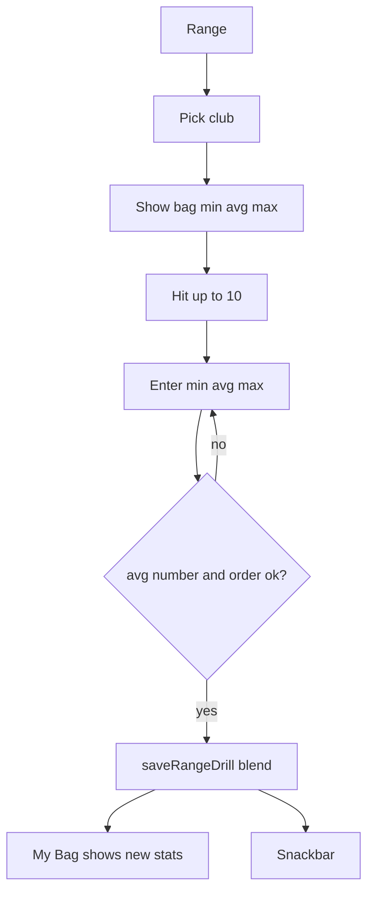

# Wireframe — Range

| Field | Value |
| :--- | :--- |
| **Widget** | `RangeDrillScreen` |
| **PRD** | RNGE-001 … RNGE-004 |
| **Persona** | Riley — ten balls, then write min / avg / max once |
| **Status** | Target v1.1 |
| **AppBar title** | **Range** (replace "Range Drill Instructor") |

## 1. Screen purpose

Log one drill block for a non-putter club. Save writes `RangeDrillLog` and blends into the club’s min / avg / max (`saveRangeDrill`: new min = min of both, new max = max of both, new avg = mean of the two avgs). The screen shows the **current bag numbers** so Riley sees what will change.

## 2. Mobile layout

```
┌─────────────────────────────┐
│ [≡] Range            [sync] │  left icon opens drills (RNGE-003)
├─────────────────────────────┤
│ Driving range or simulator  │  VenueNameField, as built
│ 3:1 Tour Tempo          ›   │  selected drill, or hidden
│ CLUB                        │
│ [7 Iron] 8i 9i PW …         │  48dp chips, putters hidden
│ ┌ 7 Iron ───────────────┐   │
│ │ Bag now               │   │
│ │ MIN 140  AVG 155  MAX 168│ │  tabular, or — if zero
│ └───────────────────────┘   │
│ TEMPO                       │
│ ┌ 3:1, pause at the top ┐   │  optional notes
│ └───────────────────────┘   │
│                             │
│        4 / 10               │  tabular displaySmall
│   balls in this block       │
│        [  +  Hit  ]         │  filled, 64dp, disabled at 10
│                             │
│ This block (yds)            │
│ Min        [ 148    ]       │  hint = current bag min
│ Avg        [ 156    ]       │  required
│ Max        [ 170    ]       │
│                             │
│ [ Save drill              ] │  filled, disabled until avg parses
└─────────────────────────────┘
```

Counter and **Hit** sit in the thumb zone, above the number fields. **Save drill** is the single filled primary. **Hit** is a tonal button (`FilledButton.tonal`) at 64dp so it stays easy to tap without becoming a second primary.

### What changes vs current code

- Title shortens to **Range**.
- Selected club gets a baseline card (BAG numbers) so the drill is not a blind form.
- Min / avg / max stack full width. Three columns on a phone are too narrow for gloves and for `yds` labels.
- Hints show the current bag value, not the word "Min (Yds)" alone. Suffix text `yds` on each field.
- Save stays disabled until **avg** parses as a number ≥ 0. Min and max may be empty; on save, empty min/max become `0.0` as today **only if** we also show a helper: "Empty min or max is stored as 0 and can shrink the bag minimum." Preferred target: if min or max is empty, copy avg into the empty side before save so a single-number block does not write 0. Document this as the UX rule for Athena — it is safer than the current `?? 0.0` and still produces a numeric `RangeDrillLog`.
- If the user enters all three and min &gt; avg or avg &gt; max, inline error on the field and Save disabled.
- Shot count 0 on save still stores **10** (RNGE-002 AC). Helper under the counter: "Leaving this at 0 saves the block as 10 balls."
- After save: snackbar "Saved drill for {club}. Bag avg updated.", counter resets to 0, distance fields clear, notes stay (they are the club cue), baseline card reloads.
- Empty club list (no non-putters): "Add clubs to the bag before a drill." No save button.

## 3. Larger screens

≥600dp: baseline card and counter on the left; min/avg/max and save on the right. Club chips span both columns.

## 4. Widget inventory

| Widget | Role |
| :--- | :--- |
| Horizontal `ChoiceChip` | Non-putter clubs |
| `Card` | Bag baseline |
| `TextField` | Tempo notes, min, avg, max |
| `FilledButton.tonal` | Hit |
| `Text` tabular | `n / 10` |
| `FilledButton` | Save drill |
| `SnackBar` | Success |
| `GolfTextStyles.yardage` | Baseline stats |

Keyboard: `TextInputType.numberWithOptions(decimal: true)`.

## 5. Interaction & state map

| State | UI |
| :--- | :--- |
| Loading clubs | Spinner |
| No clubs | Empty message |
| Club selected | Chip selected, baseline + notes loaded from `swingNotes` |
| Counter 0–9 | Hit enabled |
| Counter 10 | Hit disabled |
| Avg empty or not a number | Save disabled |
| min &gt; avg or avg &gt; max | Field error, Save disabled |
| Saving | Button shows progress, ignores double tap |
| Saved | Snackbar, fields cleared, baseline refreshed |

Notes edited here are the club’s swing notes passed through `tempoNotes` on the log. Do not imply a second notes store. If save also writes `updateClubSwingNotes`, say so in the snackbar ("Tempo note saved on this club"). Match current `saveRangeDrill` only — today notes live on the drill log, and the notes field is prefilled from `club.swingNotes` but save does not write them back. **Target:** keep that behavior. Label the field **Tempo for this drill** so it is not confused with bag swing notes.

## 6. UX flow



## 7. Key map

| Element | ValueKey | Widget |
| :--- | :--- | :--- |
| Club chip | `range-club-chip-{clubId}` | `ChoiceChip` |
| Baseline card | `range-bag-baseline` | `Card` |
| Tempo field | `range-tempo-field` | `TextField` |
| Hit | `range-shot-counter-increment` | `FilledButton` |
| Counter readout | `range-shot-counter` | `Text` |
| Min | `range-min-field` | `TextField` |
| Avg | `range-avg-field` | `TextField` |
| Max | `range-max-field` | `TextField` |
| Save | `range-save-drill-btn` | `FilledButton` |
| Empty clubs | `range-empty-clubs` | `Text` |
| Drills | `range-header-drills-btn` | `IconButton` leading |
| Venue | `range-venue-field` | `TextField` inside autocomplete |
| This club log | `range-log-this-club` | `FilterChip` (as built) |
| All clubs log | `range-log-all` | `FilterChip` (as built) |
| Session title | `range-session-log-title` | `Text` |
| Diary | `range-swing-diary-btn` | `IconButton`, future RNGE-004 |

## 8. As built

The screen title is still **Range Drill Instructor**. The venue field, club chips, shot counter, min/avg/max, tempo notes, Save, and the session log (this club / all clubs) are in code. The left-header drill button and the diary button are not. Session log empty key: `range-session-empty`. Row key: `range-session-{drillId}`.

## 9. Practice drills and diary

The leading icon opens [Wireframe_PracticeDrills.md](./Wireframe_PracticeDrills.md). A chosen drill shows one line under the venue field: title plus a chevron to reopen the steps. It does not replace the 10-ball form.

The diary icon (trailing, beside sync) is future and stays disabled with tooltip "Swing diary is not on yet" until RNGE-004. Layout: [Wireframe_SwingDiary.md](./Wireframe_SwingDiary.md).
