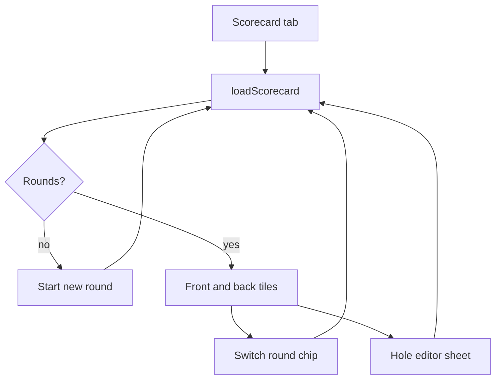

# Wireframe — Scorecard

| Field | Value |
| :--- | :--- |
| **Widget** | `ScorecardScreen` / `ScorecardScreenState` |
| **PRD** | SCOR-001, SCOR-003 |
| **Persona** | Rory verifying the card after the hole |
| **Status** | Target v1.1 |

## 1. Screen purpose

Show the selected round’s 18 holes, front/back/total versus par, penalties, and mulligans. Tap a hole to open the editor. Pull-to-refresh and tab focus both call `loadScorecard()`.

## 2. Mobile layout

```
┌─────────────────────────────┐
│ Scorecard                   │  no refresh icon; pull to refresh
├─────────────────────────────┤
│ Local Course                │  headlineSmall
│ [Today · Local] [Yesterday] │  only if more than one round
│ ┌─────┬─────┬─────┐         │
│ │ OUT │ IN  │ TOT │         │  tabular
│ │ 38  │ 40  │ 78  │         │
│ │ +2  │ +4  │ +6  │         │  positive / negative / E
│ └─────┴─────┴─────┘         │
│ Penalties 2 · Mulligans 1   │  mulligans labeled "practice"
│ FRONT 9                     │
│ ┌───┬───┬───┐               │
│ │ 1 │ 2 │ 3 │               │  tile ≥ 72×64, tap target ≥48
│ │ 4 │ 5 │ 4*│  * = Gimme    │
│ │ E │+1 │ — │               │
│ └───┴───┴───┘               │
│ BACK 9                      │  same 3×3
│ [ Start new round ]         │  outlined
└─────────────────────────────┘
```

Each tile:

- Top: hole number (Inter w700).
- Middle: gross in `GolfTextStyles.tabularNum` 20, or `—` if unplayed.
- Bottom: vs par (`E`, `+1`, `-1`) or `Gimme` when conceded.

Tile fill (not the only signal):

- Under par: `primaryContainer` at low emphasis, vs-par text `positive`.
- Over par: `errorContainer`, text `negative`.
- Even: default `surfaceContainer`.
- Conceded: `surfaceContainerHigh` plus the word **Gimme** (SCOR-003). Do not rely on grey alone.
- Unplayed: em dash, no fill.

### What changes vs current code

- Retire the 6-column table. Rows are too short to tap outdoors and "Str / Pen / Tot" needs a legend. Gross and vs par are what Rory checks; strokes vs penalties stay in the editor.
- Remove the AppBar refresh icon. `RefreshIndicator` + tab focus cover SCOR-001.
- Summary cells use tabular numbers. To-par uses `scorePositive` / `scoreNegative`, not a single green for every delta.
- Empty: card copy "No rounds yet. Track shots on On Course or start a round here." plus filled **Start new round** (this empty state is allowed the one primary).
- Loading: centered progress, not a blank scaffold. Timeout is not required; the query is local SQLite.

`Start new round` calls `ensureActiveRound(courseName: 'Local Course')` and reloads. It must not delete the previous round.

## 3. Larger screens

≥600dp: Front 9 and Back 9 side by side (two 3×3 grids). Summary banner stays full width above them.

## 4. Widget inventory

| Widget | Role |
| :--- | :--- |
| `RefreshIndicator` + `ListView` | Pull to refresh |
| `ChoiceChip` | Recent rounds (max 12, existing query) |
| Summary `Card` | Out, In, Total |
| Custom hole `InkWell` tile | Opens editor |
| `OutlinedButton` | Start new round when a round exists |
| `FilledButton` | Start new round on empty state only |
| `CircularProgressIndicator` | `_loading` |

## 5. Interaction & state map

| State | UI |
| :--- | :--- |
| Loading | Spinner |
| No rounds | Empty card + primary start |
| One round | No chip row |
| Many rounds | Horizontal chips; selected loads holes |
| Unplayed hole | `—` / `—` |
| Played | Gross + vs par |
| Conceded | Gross (2× par) + label Gimme |
| Penalties or mulligans &gt; 0 | Summary footnote |
| Tab selected | `loadScorecard()` from `HomeShell` |

Vs par is `effectiveHoleScore - par` for played holes. Even par displays `E`.

## 6. UX flow



## 7. Key map

| Element | ValueKey | Widget |
| :--- | :--- | :--- |
| Round chip | `scorecard-round-chip-{roundId}` | `ChoiceChip` |
| Summary banner | `scorecard-summary-banner` | `Card` |
| Hole tile | `scorecard-hole-tile-{n}` | `InkWell` |
| New round | `scorecard-new-round-btn` | `OutlinedButton` or `FilledButton` |
| Empty state | `scorecard-empty-state` | `Card` |
| Loading | `scorecard-loading` | `CircularProgressIndicator` |
| Course field | `scorecard-new-round-course` | `TextField` in the dialog |
| Save round | `scorecard-save-before-new` | `FilledButton` |
| Discard round | `scorecard-discard-before-new` | `TextButton` |

## 8. As built and catalog par

- Unplayed tiles on a known course show **Par 3**, **Par 4**, or **Par 5** instead of an em dash. Played tiles still show the score and to-par. A 9-hole card hides **BACK 9**.
- Caption under the course name: `18 holes · par 72` when the round’s name matches a published card.
- **Start new round** opens [Wireframe_NewRound.md](./Wireframe_NewRound.md). If the active round already has play, that dialog is preceded by save / discard / cancel.
- Empty copy stays: "No rounds yet. Track shots on On Course or start a round here." The empty primary uses the same key as the outlined button on a populated card (`scorecard-new-round-btn`). One is on screen at a time.
