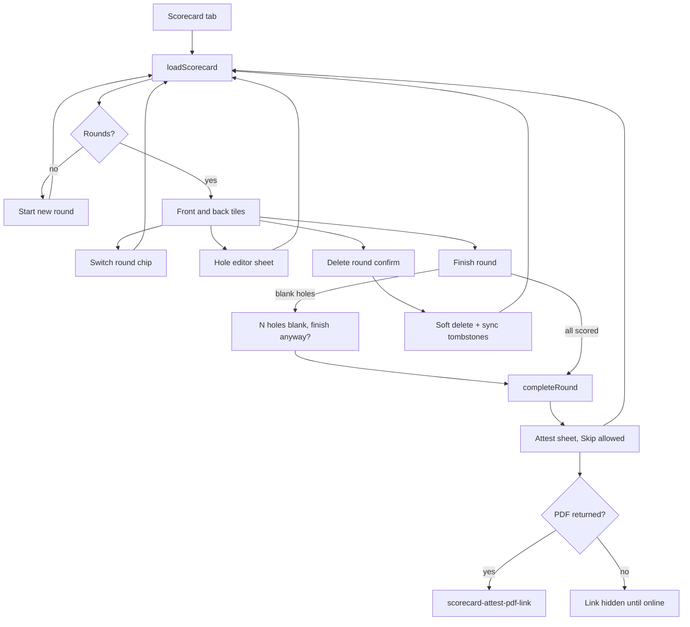

# Wireframe — Scorecard

| Field | Value |
| :--- | :--- |
| **Widget** | `ScorecardScreen` / `ScorecardScreenState` |
| **Stories** | [SCOR-001](../../stories/SCOR/SCOR-001-view-rounds-grid.md), [SCOR-003](../../stories/SCOR/SCOR-003-concede-visibility.md), [SCOR-004](../../stories/SCOR/SCOR-004-cart-scoring.md), [MGDV-601](../../stories/MGDV/MGDV-601-scoring-formats-epic.md) |
| **Persona** | Rory verifying the card after the hole |
| **Status** | Layout matches On Course. Format and course name share one dialog ([Wireframe_ScorecardFormats.md](./Wireframe_ScorecardFormats.md), [Wireframe_NewRound.md](./Wireframe_NewRound.md)) |

## 1. Screen purpose

Show the selected round’s 18 holes, front/back/total versus par, penalties, and mulligans. Tap a hole to open the editor. Pull-to-refresh and tab focus both call `loadScorecard()`.

## 2. Mobile layout

```
┌─────────────────────────────┐
│ [⋮] Scorecard   [book][acct]│  ⋮ = caddy, flight. book = diary
│ Wack Wack — East ✎ [Cl|Cart]│  scorecard-course-summary
│ 18 holes · par 72           │
│ Molave · double eagle 7     │  indicators, not controls
│ [Today · Local] [Yesterday] │  only if more than one round
│ ┌─────┬─────┬─────┐         │
│ │ OUT │ IN  │ TOT │         │  tabular
│ │ 38  │ 40  │ 78  │         │
│ │ +2  │ +4  │ +6  │         │  positive / negative / E
│ └─────┴─────┴─────┘         │
│ Penalties 2 · Mulligans 1   │  mulligans labeled "practice"
│ FRONT 9                     │
│ ┌───┬───┬───┐               │
│ │ 1 │ 2 │ 3 │               │  tile ≥ 72×64, tap target ≥48
│ │ 4 │ 5 │ 4*│  * = Gimme    │
│ │ E │+1 │ — │               │
│ └───┴───┴───┘               │
│ BACK 9                      │  same 3×3
│ Attested by Pat · marker    │  finished rounds only
│ Attested score PDF          │  scorecard-attest-pdf-link, only when the PDF is saved
│ [ ⚑ Finish round          ] │  scorecard-finish-round, full width
│ [+ Start new round][🗑 Delete]│  one row; Delete is red
└─────────────────────────────┘
```

The course name opens the shared **Course** dialog ([Wireframe_NewRound.md](./Wireframe_NewRound.md)). Classic | Cart sits on that row. Format, double eagle, rating, and slope are not controls on the card. Flight is in the leading ⋮ with Invite caddy. Diary and the account avatar stay pinned.

### Round controls (below the card or the cart panel)

- **Finish round** (`scorecard-finish-round`) is the full-width primary while the round is open. It replaces the standalone Attest button. If any hole on the card is blank (`isHolePlayed` false), a confirm asks first: “N holes blank, finish anyway?” (`scorecard-finish-confirm`). Finishing calls `completeRound`, writes the diary note, and opens the attest sheet right away. Its dismiss reads **Skip** (`scorecard-attest-skip`); the round stays finished.
- The sheet collects name, role, a required signature, and an optional front-camera selfie (`scorecard-attest-selfie`, retake `scorecard-attest-selfie-retake`, remove `scorecard-attest-selfie-remove`). **Sign** (`scorecard-attest-signature`) opens a full-screen pad (`scorecard-attest-signature-pad`) so there is room to scribble and the sheet behind does not scroll. **Clear** (`scorecard-attest-signature-clear`) sits on that pad. Preview is `scorecard-attest-preview`. On a selfie, the signature is scaled to the width of the portrait photo. **Attest** (`scorecard-attest-save`) stays disabled until there is a stroke.
- Once finished, the primary slot shows **Attest card** (`scorecard-attest-btn`) only while the card is not attested, including after an edit cleared it. Attested cards show the badge (`scorecard-attest-badge`). **Attested score PDF** (`scorecard-attest-pdf-link`) sits under that badge only when the Cloud Function has returned a PDF for this round. It is hidden while the round is unattested, while the device is offline, and while the function call is still in flight. Tap shares or opens the saved file. The link is not inside the sheet.
- **Start new round** (`scorecard-new-round-btn`) and **Delete round** (`scorecard-delete-round`, error color) share one row. Delete always confirms (`scorecard-delete-confirm`). An attested round, or one shared through a flight or caddy session, adds a red warning line (`scorecard-delete-warning`). Delete soft-deletes with sync tombstones, so the round leaves every synced device. Afterwards the next most recent round is selected, or the empty state shows.
- The status caption under the name (`scorecard-round-status`) reads **In progress**, **Finished · read-only**, or **Finished · editing**.

### Finished rounds are read-only

Hole taps, cart buttons, and the course dialog show a snackbar (`scorecard-read-only-snack`) instead of editing. The leading ⋮ adds **Edit finished round** (`scorecard-edit-finished-round`) to unlock the selected round until another round is selected. An unlocked attested card still uses the “Edit attested card?” confirm, and each edit after attesting increments `edited_after_attest_count`.

On Course has no new buttons and no PDF link. Its existing **Finish Round** on the last hole runs the same blank-hole confirm and then the same skippable attest sheet.

Each tile:

- Top: hole number (Inter w700).
- Middle: gross in `GolfTextStyles.tabularNum` 20, or `—` if unplayed.
- Bottom: vs par (`E`, `+1`, `-1`) or `Gimme` when conceded.

Tile fill (not the only signal):

- Under par: `primaryContainer` at low emphasis, vs-par text `positive`.
- Over par: `errorContainer`, text `negative`.
- Even: default `surfaceContainer`.
- Conceded: `surfaceContainerHigh` plus the word **Gimme** (SCOR-003). Do not rely on grey alone.
- Unplayed: em dash, no fill.

### What changes vs current code

- Retire the 6-column table. Rows are too short to tap outdoors and "Str / Pen / Tot" needs a legend. Gross and vs par are what Rory checks; strokes vs penalties stay in the editor.
- Remove the AppBar refresh icon. `RefreshIndicator` + tab focus cover SCOR-001.
- Summary cells use tabular numbers. To-par uses `scorePositive` / `scoreNegative`, not a single green for every delta.
- Empty: card copy "No rounds yet. Track shots on On Course or start a round here." plus filled **Start new round** (this empty state is allowed the one primary).
- Loading: centered progress, not a blank scaffold. Timeout is not required; the query is local SQLite.

`Start new round` calls `ensureActiveRound(courseName: 'Local Course')` and reloads. It must not delete the previous round.

## 3. Larger screens

≥600dp: Front 9 and Back 9 side by side (two 3×3 grids). Summary banner stays full width above them.

## 4. Widget inventory

| Widget | Role |
| :--- | :--- |
| `RefreshIndicator` + `ListView` | Pull to refresh |
| `ChoiceChip` | Recent rounds (max 12, existing query) |
| Summary `Card` | Out, In, Total |
| Custom hole `InkWell` tile | Opens editor |
| `FilledButton` | Finish round, or Attest card on a finished unattested round |
| `OutlinedButton` | Start new round and Delete round when a round exists |
| `FilledButton` | Start new round on empty state only |
| `CircularProgressIndicator` | `_loading` |

## 5. Interaction & state map

| State | UI |
| :--- | :--- |
| Loading | Spinner |
| No rounds | Empty card + primary start |
| One round | No chip row |
| Many rounds | Horizontal chips; selected loads holes |
| Unplayed hole | `—` / `—` |
| Played | Gross + vs par |
| Conceded | Gross (2× par) + label Gimme |
| Penalties or mulligans &gt; 0 | Summary footnote |
| Open round | Finish round primary |
| Finished, locked | Read-only; ⋮ offers Edit finished round |
| Finished, unlocked | Edits allowed; attested edits confirm first |
| Tab selected | `loadScorecard()` from `HomeShell` |

Vs par is `effectiveHoleScore - par` for played holes. Even par displays `E`.

## 6. UX flow



## 7. Key map

| Element | ValueKey | Widget |
| :--- | :--- | :--- |
| Course name | `scorecard-course-summary` | `InkWell` |
| Round chip | `scorecard-round-chip-{roundId}` | `ChoiceChip` |
| Summary banner | `scorecard-summary-banner` | `Card` |
| Hole tile | `scorecard-hole-tile-{n}` | `InkWell` |
| New round | `scorecard-new-round-btn` | `OutlinedButton` or `FilledButton` |
| Finish round | `scorecard-finish-round` | `FilledButton` |
| Finish anyway | `scorecard-finish-confirm` | `FilledButton` in the blank-holes confirm |
| Attest card | `scorecard-attest-btn` | `FilledButton`, finished and unattested only |
| Skip attest | `scorecard-attest-skip` | `TextButton` in the attest sheet |
| Signature | `scorecard-attest-signature` | `OutlinedButton` that opens the full-screen pad |
| Signature pad | `scorecard-attest-signature-pad` | Full-screen scribble surface |
| Clear signature | `scorecard-attest-signature-clear` | `TextButton` on the full-screen pad |
| Selfie | `scorecard-attest-selfie` | `OutlinedButton`, front camera |
| Retake selfie | `scorecard-attest-selfie-retake` | `OutlinedButton` |
| Remove selfie | `scorecard-attest-selfie-remove` | `OutlinedButton` |
| Attest preview | `scorecard-attest-preview` | Combined image, or the signature |
| Attested PDF | `scorecard-attest-pdf-link` | `TextButton` on the scorecard, only when a PDF is saved |
| Delete round | `scorecard-delete-round` | `OutlinedButton`, error color |
| Confirm delete | `scorecard-delete-confirm` | `FilledButton`, error color |
| Delete warning | `scorecard-delete-warning` | `Text`, attested or flight rounds |
| Edit finished round | `scorecard-edit-finished-round` | Leading ⋮ item |
| Round status | `scorecard-round-status` | `Text` |
| Read-only notice | `scorecard-read-only-snack` | `SnackBar` |
| Empty state | `scorecard-empty-state` | `Card` |
| Loading | `scorecard-loading` | `CircularProgressIndicator` |
| Course field | `scorecard-new-round-course` | `TextField` in the dialog |
| Save round | `scorecard-save-before-new` | `FilledButton` |
| Discard round | `scorecard-discard-before-new` | `TextButton` |

## 8. As built and catalog par

- Unplayed tiles on a known course show **Par 3**, **Par 4**, or **Par 5** instead of an em dash. Played tiles still show the score and to-par. A 9-hole card hides **BACK 9**.
- Caption under the course name: `18 holes · par 72` when the round’s name matches a published card.
- **Start new round** opens [Wireframe_NewRound.md](./Wireframe_NewRound.md). If the active round already has play, that dialog is preceded by save / discard / cancel.
- Empty copy stays: "No rounds yet. Track shots on On Course or start a round here." The empty primary uses the same key as the outlined button on a populated card (`scorecard-new-round-btn`). One is on screen at a time.
