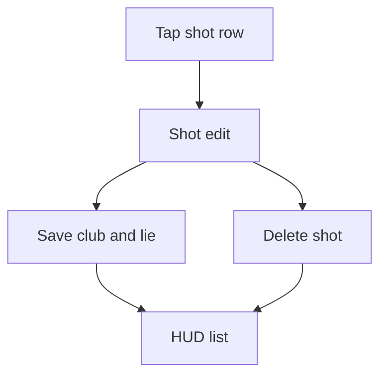

# Wireframe — Shot Edit

| Field | Value |
| :--- | :--- |
| **Widget** | `ShotEditDialog` in `fairway_tracker_screen.dart` |
| **PRD** | CRSE-002 |
| **Status** | As built — this dialog had no wireframe |

## 1. Screen purpose

Change the club or lie of a saved shot, or delete it. Distance and GPS are not edited here.

## 2. Mobile layout

```
┌─────────────────────────────┐
│ Stroke 2                    │
│ Club                        │
│ [Driver] 3 Wood  7 Iron …   │
│ Lie                         │
│ [Tee] Fairway Rough …       │
│        Delete        Save   │
└─────────────────────────────┘
```

Dialog, not a full route. Save is the filled button. Delete is text and uses `negative` for the label, with no second confirm in the current code — target adds one line: "Delete this shot?" before `deleteShot`, because a tap removes the stroke and renumbers the hole.

## 3. Larger screens

Same dialog, max width 400, centered.

## 4. Widget inventory

`AlertDialog`, `ChoiceChip`, `TextButton`, `FilledButton`.

## 5. Interaction & state map

| Action | Result |
| :--- | :--- |
| Save | Updates club and lie, closes, HUD refreshes |
| Delete | Removes the shot, renumbers strokes, syncs the hole stroke count |
| Cancel | System back / barrier dismiss, no write |

## 6. UX flow



## 7. Key map

| Element | ValueKey | Widget |
| :--- | :--- | :--- |
| Dialog | `oncourse-shot-edit-dialog` | `AlertDialog` |
| Save | `on-course-shot-save` | `FilledButton` (as built) |
| Delete | `on-course-shot-delete` | `TextButton` (as built) |
| Club | `oncourse-shot-edit-club-{clubId}` | `ChoiceChip` |
| Lie | `oncourse-shot-edit-lie-{lie}` | `ChoiceChip` |
