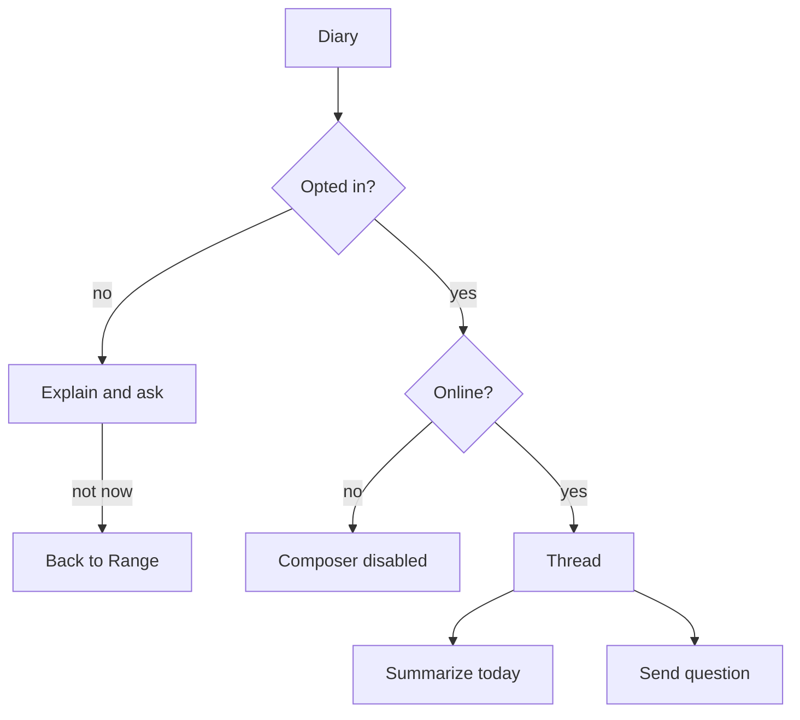

# Wireframe — Swing Diary

| Field | Value |
| :--- | :--- |
| **Widget** | Sheet or full-screen route from Range |
| **PRD** | RNGE-004 (future) |
| **Persona** | Riley |
| **Status** | Conceptual — do not build the chat until the architecture in Architecture §5.6 is chosen |

## 1. Screen purpose

A continuous coaching thread grounded in this golfer’s range logs and bag notes. It can also write one summary of today’s sessions. It is not a generic tips bot and it does not run offline.

## 2. Mobile layout

```
┌─────────────────────────────┐
│ Swing diary            [×]  │
│ ┌─────────────────────────┐ │
│ │ Today · 9 Nov           │ │  model card, creamElevated
│ │ 7-iron block was tighter│ │
│ │ than the 3:1 session.   │ │
│ └─────────────────────────┘ │
│ You                         │
│ What changed on the 7-iron? │
│ ┌─────────────────────────┐ │
│ │ Ask about your sessions │ │
│ └─────────────────────────┘ │
│ [ Summarize today ]         │  outlined, one per day
└─────────────────────────────┘
```

User bubbles: `primaryContainer`. Model bubbles: `surfaceContainer`. Numbers in the answer stay Roboto Mono. The composer is a single `TextField` plus a send `IconButton` at 48dp. **Summarize today** is outlined so send stays the filled action (send uses `Icons.send` inside a filled 48dp button).

## 3. Larger screens

≥600dp: thread max width 640, centered. Composer sticks to the bottom.

## 4. Widget inventory

`ListView`, `Card`, `TextField`, `IconButton`, `OutlinedButton`, `SnackBar`.

## 5. Interaction & state map

| State | UI |
| :--- | :--- |
| Opt-in not given | First open explains that notes are sent to Google AI. **Continue** / **Not now**. |
| Offline | Composer disabled. "Diary needs a connection. Your range log is still on this phone." |
| Waiting | Three-dot row in the model column. Send disabled. |
| Answer | Appended under today’s date. |
| No sessions today | Summarize disabled. Helper: "Log a drill before a daily summary." |

## 6. UX flow



## 7. Key map

| Element | ValueKey | Widget |
| :--- | :--- | :--- |
| Open | `range-swing-diary-btn` | `IconButton` |
| Opt-in continue | `diary-opt-in-continue` | `FilledButton` |
| Opt-in dismiss | `diary-opt-in-dismiss` | `TextButton` |
| Composer | `diary-composer-field` | `TextField` |
| Send | `diary-send-btn` | `IconButton` |
| Summarize | `diary-summarize-today-btn` | `OutlinedButton` |
| Message | `diary-message-{id}` | `Card` |
