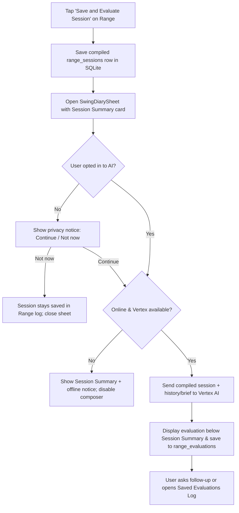

# Wireframe — Session Summary & Vertex AI Swing Diary

| Field | Value |
| :--- | :--- |
| **Widget** | `SwingDiarySheet` (modal bottom sheet or full-screen route opened from **Save and Evaluate Session** or the Range header icon) |
| **PRD** | RNGE-005 (Compiled Session Summary) & RNGE-004 (Vertex AI Swing Diary & Evaluation Log) |
| **Persona** | Riley — sits down after hitting balls, reviews the compiled session summary, and reads what Vertex AI says about recent sessions and progress |
| **Status** | Target v1.3 (aligned with `PRD.md` v1.5 and `Architecture.md` v1.6) |

## 1. Screen purpose

Give the golfer a single, calm post-session review surface right after tapping **Save and Evaluate Session** (or anytime via the Range header diary icon):

1. **Compiled Session Summary card (`RNGE-005`):** At the top of the sheet, the golfer immediately sees the compiled **Range Session Log** they just saved—venue, timestamp, their personal **Session Note**, and every club/drill block (`min / avg / max` in tabular digits, shot count, per-club cue). This card renders 100% from local SQLite (`range_sessions`), so even offline the golfer gets an immediate, structured summary of their session.
2. **Vertex AI Progress & Session Evaluation (`RNGE-004`):** Directly below the compiled session summary, Vertex AI (`FirebaseAI.vertexAI()`, project-billed, no player API key) evaluates today's compiled session against earlier practice—highlighting whether carry yardages, dispersion (`min..max`), and swing cues are progressing—and lets the golfer ask follow-up questions in the same thread or open the **Past Evaluations Log** (`RNGE-024`).

## 2. Mobile layout

### A. Post-Session Review & Evaluation View (opened from `Save and Evaluate Session`)

```
┌─────────────────────────────────────────┐
│ Swing Diary & Evaluation    [Log]  [×]  │  [Log] opens Past Evaluations (RNGE-024)
├─────────────────────────────────────────┤
│ ┌ 📋 Session Summary · Topgolf BGC ───┐ │  ValueKey('diary-session-summary-card')
│ │ 11 Nov 2026 · 7:45 PM · 2 blocks    │ │  creamElevated / surfaceContainer
│ │ "Tempo felt much smoother with      │ │  golfer's Session Note (RNGE-005)
│ │  mid-irons; driver still pushy."    │ │
│ │ ─────────────────────────────────── │ │
│ │ 7 Iron  10 shots  148 / 155 / 162yd │ │  tabular digits (GolfTextStyles)
│ │   Drill: 3:1 Tour Tempo Rhythm      │ │
│ │   Cue:   3:1 Tour Tempo Rhythm      │ │
│ │ Driver  10 shots  225 / 242 / 255yd │ │
│ │   Drill: Simulated Fairway Corridor │ │
│ │   Cue:   Tee high, commit to fade   │ │
│ └─────────────────────────────────────┘ │
│                                         │
│ ┌ ✦ Vertex AI Coach · 11 Nov ─────────┐ │  ValueKey('diary-message-{id}')
│ │ Your 7-iron avg moved from 151 yds  │ │  model card, surfaceContainerHigh
│ │ last week to 155 yds today, and     │ │
│ │ your 14-yd spread is your tightest  │ │
│ │ under the 3:1 Tour Tempo drill.     │ │
│ │ On Driver, the 30-yd spread matches │ │
│ │ your note about pushing late…       │ │
│ └─────────────────────────────────────┘ │
│                                         │
│                  ┌────────────────────┐ │
│                  │ What drill should  │ │  user bubble, primaryContainer
│                  │ I pair with Driver │ │
│                  │ next session?      │ │
│                  └────────────────────┘ │
├─────────────────────────────────────────┤
│ ┌ Ask about your sessions…      ┐ [➤]  │  diary-composer-field + diary-send-btn
│ └───────────────────────────────┘       │
│ [ Re-evaluate / Summarize today ]       │  diary-summarize-today-btn (outlined)
└─────────────────────────────────────────┘
```

### B. First-Open Privacy Notice (Opt-In Gate — `RNGE-022`)

Shown once before the first Vertex AI call. Never asks for an API key.

```
┌─────────────────────────────────────────┐
│ Evaluate your range sessions with AI?   │
│                                         │
│ When you evaluate a session, Golf Diary │
│ sends your compiled session summary,    │
│ club yardages, drill steps, and swing   │
│ notes to Google Vertex AI to compare    │
│ today's session against your history.   │
│                                         │
│ Your session log is already saved on    │
│ this device and works offline.          │
│                                         │
│            [ Not now ]   [ Continue ]   │
└─────────────────────────────────────────┘
```

### C. Past Evaluations & Progress Briefs Log (`RNGE-024`)

Opened via `[Log]` (`diary-evaluation-log-btn`) in the sheet header. Reads local `range_evaluations` only—zero network or model calls.

```
┌─────────────────────────────────────────┐
│ ‹ Back   Saved Evaluations              │  ValueKey('diary-evaluation-log')
├─────────────────────────────────────────┤
│ ┌ Session Evaluation · 2026-11-11 ────┐ │  ValueKey('diary-evaluation-row-{id}')
│ │ Your 7-iron avg moved from 151 yds… │ │  kind = 'evaluation'
│ └─────────────────────────────────────┘ │
│ ┌ Progress Brief · Through 2026-10-31 ┐ │  kind = 'periodic_summary' badge
│ │ Compacted 28 sessions: 7-iron +4yd… │ │  distinguishable from daily eval
│ └─────────────────────────────────────┘ │
└─────────────────────────────────────────┘
```

## 3. Larger screens

≥600dp: Sheet max width 640dp, centered. The **Session Summary** card stays pinned or collapsible at the top of the scroll view while the coaching thread scrolls underneath.

## 4. Widget inventory

| Widget | Role |
| :--- | :--- |
| `Card` (`diary-session-summary-card`) | Displays the compiled `RangeSessionLogEntry` (`session_note` + club/drill blocks) |
| `TextButton.icon` (`diary-evaluation-log-btn`) | Opens the local read-only `range_evaluations` reader (`RNGE-024`) |
| `ListView` | Coaching conversation messages (`diary-message-{id}`) |
| `TextField` (`diary-composer-field`) | Follow-up question input |
| `IconButton.filled` (`diary-send-btn`) | Send follow-up question (48 × 48dp) |
| `OutlinedButton` (`diary-summarize-today-btn`) | **Summarize today** / **Evaluate session** trigger |

## 5. Interaction & state map

| State | UI behavior |
| :--- | :--- |
| Opened from **Save and Evaluate Session** (`RNGE-005`) | Top of sheet renders `diary-session-summary-card` for the newly compiled `RangeSessionLogEntry`. If opted in and online, automatically triggers the Vertex AI evaluation for that session. |
| Opt-in not yet granted | Shows the opt-in card below the compiled session summary. **Not now** (`diary-opt-in-dismiss`) closes the prompt while keeping the compiled session saved locally. **Continue** (`diary-opt-in-continue`) remembers consent and starts the Vertex AI evaluation. |
| Offline or Vertex unavailable | `diary-session-summary-card` still renders in full. Composer and **Summarize today** are disabled with helper copy: *"Your range session log is saved on this device. Connect to the internet to run Vertex AI evaluation."* |
| Evaluating / waiting | Shows a calm 3-dot progress row in the model column; disables send/summarize to prevent duplicate calls. |
| Evaluation received | Renders model card (`diary-message-{id}`), stores turn in `swing_diary_messages`, and persists a durable copy in `range_evaluations(kind: 'evaluation', session_id: session.id)`. |
| Past Evaluations Log (`RNGE-024`) | Tapping `diary-evaluation-log-btn` switches to `diary-evaluation-log`. Shows `evaluation` and `periodic_summary` rows newest first, or `"No evaluations yet."` if empty. |

## 6. UX flow



## 7. Key map

| Element | ValueKey | Widget |
| :--- | :--- | :--- |
| Open diary (Range header) | `range-swing-diary-btn` | `IconButton` |
| Compiled session summary card | `diary-session-summary-card` | `Card` |
| Opt-in continue | `diary-opt-in-continue` | `FilledButton` |
| Opt-in dismiss | `diary-opt-in-dismiss` | `TextButton` |
| Composer input | `diary-composer-field` | `TextField` |
| Send button | `diary-send-btn` | `IconButton` |
| Summarize / evaluate button | `diary-summarize-today-btn` | `OutlinedButton` |
| Message card | `diary-message-{id}` | `Card` |
| Open evaluation log | `diary-evaluation-log-btn` | `TextButton` / `IconButton` |
| Evaluation log view | `diary-evaluation-log` | `Widget` |
| Evaluation log row | `diary-evaluation-row-{id}` | `Card` |
